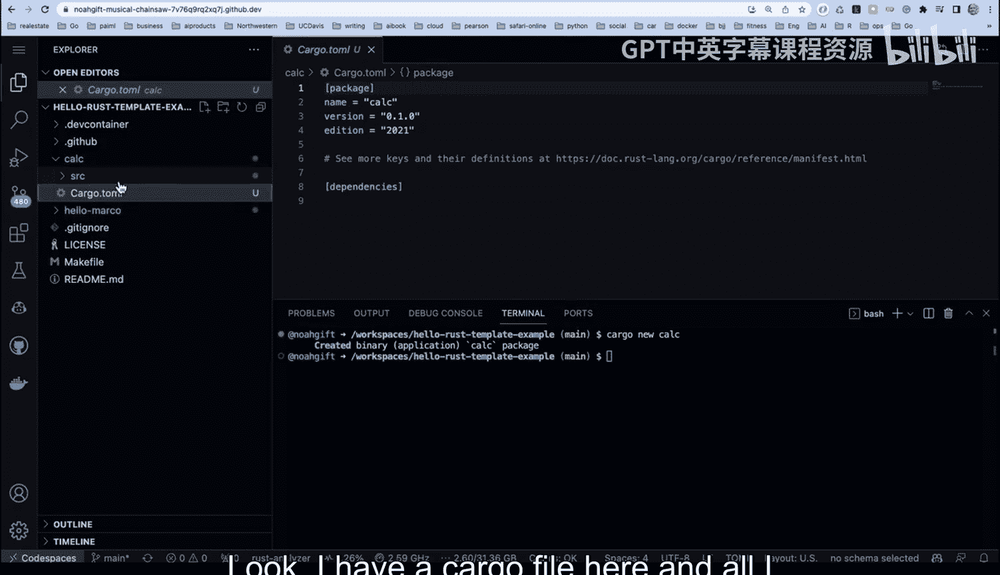
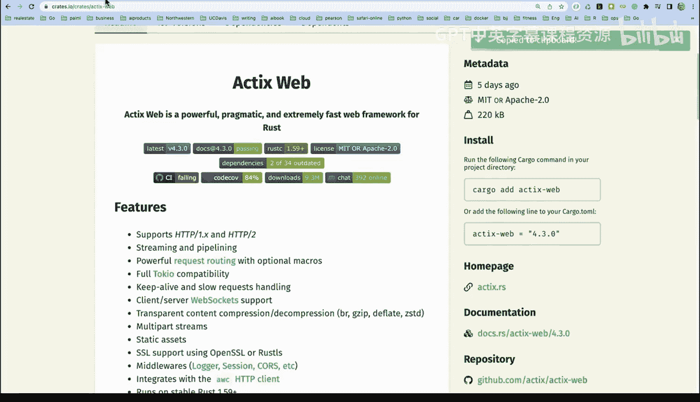
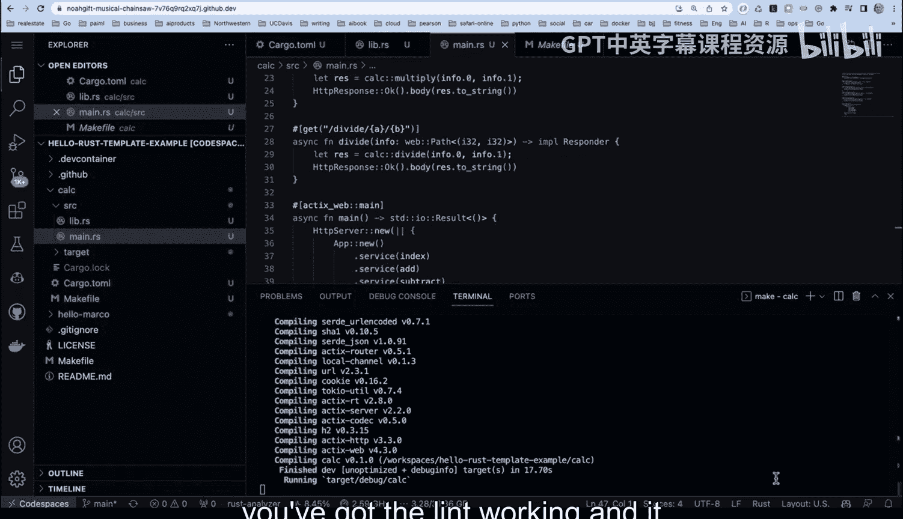
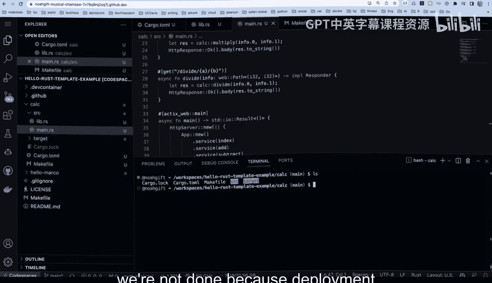
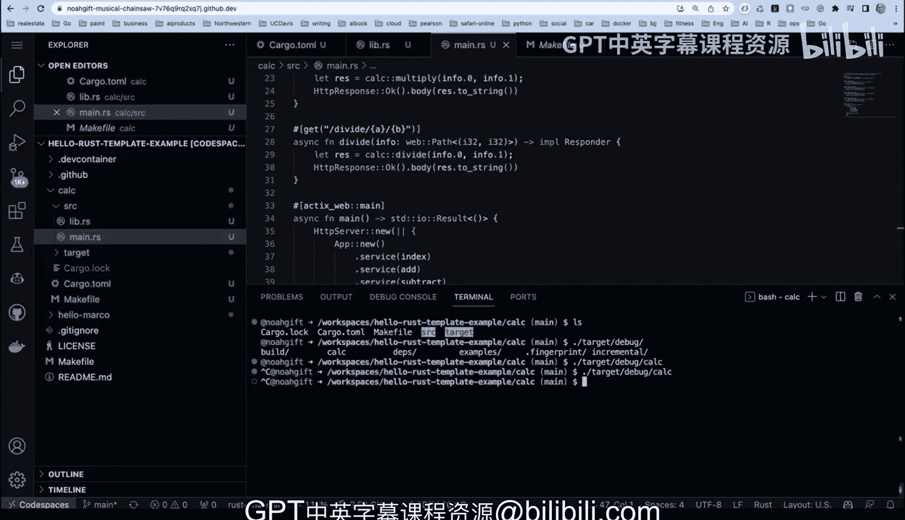

#  057：使用Rust包管理进行Web开发 🚀


在本节课中，我们将学习如何从Python包管理系统升级，转而使用Rust的Cargo包管理器和Crate生态系统来构建一个高性能的Web微服务。我们将创建一个简单的计算器服务，并体验Rust在开发效率和部署便捷性上的优势。

## 从Python包管理升级到Cargo

上一节我们介绍了Python的包管理系统。本节中，我们来看看Rust的Cargo系统。Python的打包方式有很多种，这继承了Perl的特点，但Rust的Cargo和Crate系统在许多方面更简单。使用Rust生态系统，你可以快速开始构建Web微服务、K均值工具、集成Hugging Face模型、使用PyTorch和GPU等。这些功能在Rust生态中都可实现，且方式通常比Python更简单。

我们将使用世界上速度最快的Web框架之一。具体哪个框架最快可能每周都在变化，但这并不重要。关键在于，我们将看到安装它、用Rust构建微服务、运行甚至部署都是非常简单的，因为二进制文件会为我们自动生成。

## 探索Crate生态系统

对于任何要使用的库，一个常见困扰是安装路径是否友好，或者安装过程是否会非常困难。幸运的是，借助Rust的Crate系统，你可以访问社区Crate注册中心。这里可以看到可用Crate（即包）数量的巨大增长，以及惊人的下载量。

以下是一些关于不同语言库增长趋势的研究发现：
*   Python显然经历了指数级增长。
*   Ruby的增长实际上是对数级的，可能即将进入稳定状态或衰退。
*   相比之下，Cargo可能正处于大规模指数增长曲线的早期阶段。可以说，Rust生态系统的指数增长甚至比Python的还要快。

## 选择Web框架

如果你想构建微服务，首先要做的是寻找一个Web框架。在Crate注册中心，你可以查看不同的Web框架。一个实用的方法是关注近期下载量。例如，`actix-web`框架拥有巨大的下载量。它的描述是“一个强大、实用、快速的Rust框架”。最棒的是，你只需复制配置，就可以将其轻松集成到你的项目中。

查看它的“Hello World”示例，会发现它非常简单，看起来就像Flask或FastAPI。现在，让我们回到GitHub Codespaces，快速启动一个微服务。

## 构建计算器微服务

我们将构建一个基于Web服务的计算器，这是一个很好的入门方式。


首先，使用以下命令创建一个新的Rust项目：
```bash
cargo new calc
```
这会生成一个`Cargo.toml`文件。接下来，我们需要将`actix-web`的依赖项添加到这个文件中。只需从Crate页面复制依赖信息并粘贴进去即可。这个生态系统会自动显示所有内容的版本信息。

现在，我们几乎准备好了。接下来，需要创建一个库文件。

### 创建库函数





我们将在`src/lib.rs`文件中构建计算器函数。目标是公开这些函数，以便后续的Web服务可以调用。

以下是核心的计算函数定义：
```rust
pub fn add(a: i32, b: i32) -> i32 {
    a + b
}

pub fn subtract(a: i32, b: i32) -> i32 {
    a - b
}

pub fn multiply(a: i32, b: i32) -> i32 {
    a * b
}

pub fn divide(a: i32, b: i32) -> i32 {
    a / b // 注意：实际应用中需处理除零错误
}
```
代码非常直观：使用`pub`关键字将函数公开，指定函数名、输入参数及其类型，以及返回值类型。这几乎和Python一样清晰，只是语法略有不同。

### 创建主Web服务

现在，我们将在`src/main.rs`文件中编排所有库代码，创建微服务。

首先，引入必要的依赖和定义路由：
```rust
use actix_web::{get, web, App, HttpResponse, HttpServer, Responder};
use calc::*; // 引入我们编写的计算器库

#[get("/")]
async fn home() -> impl Responder {
    HttpResponse::Ok().body("Calculator Microservice")
}

#[get("/add/{a}/{b}")]
async fn add(info: web::Path<(i32, i32)>) -> impl Responder {
    let result = add(info.0, info.1);
    HttpResponse::Ok().body(format!("{}", result))
}

// 类似地，可以定义 subtract, multiply, divide 路由
// ...

#[actix_web::main]
async fn main() -> std::io::Result<()> {
    HttpServer::new(|| {
        App::new()
            .service(home)
            .service(add)
            // 注册其他服务...
    })
    .bind(("0.0.0.0", 8080))?
    .run()
    .await
}
```
在这段代码中，我们定义了一个主页路由和加法路由。加法路由从URL路径中提取两个参数，调用库中的`add`函数，并返回结果。我们可以按照相同模式轻松添加减、乘、除的路由。

最后，在`main`函数中，我们配置服务器在`0.0.0.0:8080`上运行，并注册定义好的服务。

### 运行与测试

代码编写完成后，可以使用`cargo run`命令运行。如果项目配置了Makefile，也可以使用`make run`。

如果一切顺利，服务将在Github Codespaces的预览中启动。你可以通过访问相应的URL（例如 `/add/2/2`）来测试功能。如果返回结果`4`，说明服务运行成功。

使用Rust的一个巨大优势是，一旦代码通过编译，你就可以对其正确性抱有很高的信心。



## 部署的便捷性


部署过程本质上已经为我们完成了。构建过程会生成一个二进制文件。这种生产优先的思维模式非常有用。你只需要将生成的二进制文件放到服务器上，设置好路由，就可以运行了。

## 总结






本节课中，我们一起学习了如何使用Rust的Cargo包管理器来升级我们的开发体验。我们探索了蓬勃发展的Crate生态系统，选择了`actix-web`这一高性能Web框架，并逐步构建、测试并准备部署了一个简单的计算器微服务。整个过程展示了Rust在代码安全性、开发效率和部署简便性上的强大优势，特别是在与Python的Web生态系统对比时，这无疑是一次显著的升级。