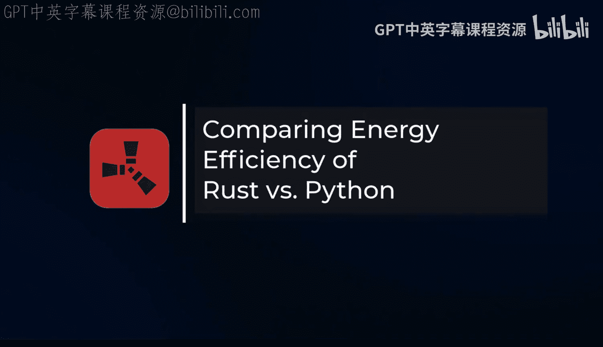
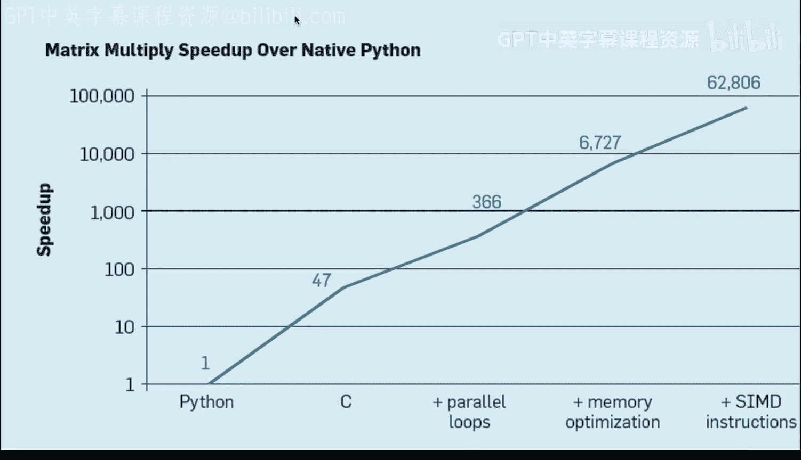
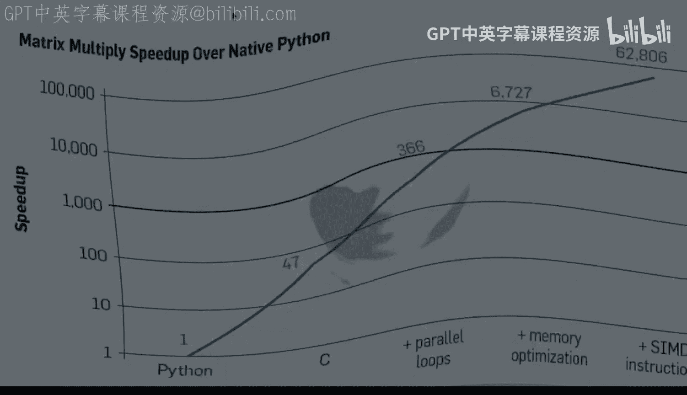

#  058：Rust与Python能效对比 🚀

在本节课中，我们将探讨一个常被忽视但至关重要的主题：编程语言的选择对计算能效的影响。我们将通过具体的研究数据，对比Python与Rust（或C语言）在能耗、计算时间和内存使用方面的表现，并讨论这对于机器学习运维和可持续性发展的意义。

---

## 概述

从Python转向Rust时，一个常见的误解是：“Python已经能用了，我不想改变现状，继续用我高效的语言就好。”本节将展示一个具体用例，说明为何许多有识之士应考虑Python语言的能效问题。我们将讨论两项研究：一项是关于不同语言的能耗与时间对比，另一项是关于计算性能的对比。你会发现，在许多场景下，尤其是处理繁重计算负载时，使用Python可能缺乏充分的理由。

---

## 编程语言的能效排名 📊

首先，我们来看一篇关于按能效对编程语言进行排名的论文。这项研究从能量角度比较了不同编程语言的效率。

如果我们直接关注核心结论，可以看到两种能效最高的语言是C和Rust。在针对不同操作进行全局结果标准化后，它们基本等效。从计算时间来看，C和Rust的差异也微乎其微。

那么，这与世界上最流行的语言Python相比如何呢？实际上，Ruby、Python和Perl在能耗和使用时间上都非常接近。**基本上，Python消耗的能量是Rust的约70倍**。在等效的解释型语言中，Python的能效表现也类似。

---

## 计算时间与内存使用对比

在计算时间方面，用Python完成某项任务所需的时间大约是Rust的70倍。在内存使用上，Python也存在一些问题。与Rust相比，Python的内存使用量大约是两倍。这还未涉及多线程编程，由于全局解释器锁的存在，Python无法跨多个核心执行多线程，人们通常使用内存密集型操作的多进程方式。

简而言之，如果你关心能耗和计算时间，Python在这两方面的表现都是最差的语言之一。从可持续性发展的角度来看，如果你的组织能轻松切换到Rust，这值得考虑。

---

## 计算性能的深度分析 ⚡

接下来，我们深入探讨计算性能的另一个研究。最近，谷歌的David Patterson博士在一次演讲中提到了一个关于矩阵乘法加速的幻灯片。

他提到，根据你编写代码的方式和具体任务，**矩阵乘法在优化后可比原生Python代码快上62,000倍**。这表明，就计算性能而言，Python并非理想的选择。人们应该考虑替代方案，并评估自身或组织是否有能力采用像Rust这样的语言。

借助Copilot等工具，提升到Rust这类语言的编程水平并非难事。观察语法可以发现，Rust与Python的差异并不大。深入考虑加速和能效，不仅可能对你的预算产生积极影响（例如为云服务节省50-70倍的计算成本），还能体现你对组织可持续性目标的深思熟虑。

---

## 总结

本节课我们一起学习了Python与Rust在能效和计算性能上的显著差异。关键点在于：
1.  Python的能耗约为Rust的**70倍**。
2.  Python的计算时间也约为Rust的**70倍**。
3.  在内存使用和多线程支持上，Python存在固有局限。
4.  通过优化或切换语言，计算任务可能获得**数万倍的性能提升**。

在机器学习运维中，选择高效的语言不仅关乎成本和性能，更是践行可持续计算的重要一步。希望本节能帮助你更明智地评估和选择适合项目的编程语言。