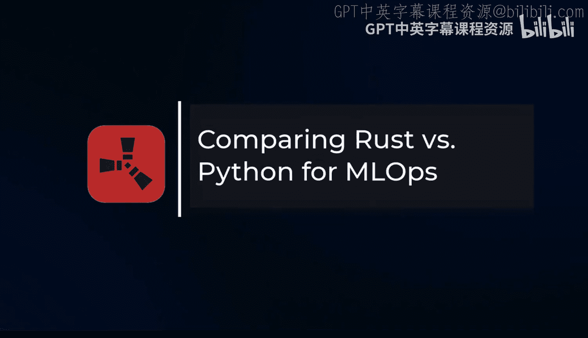
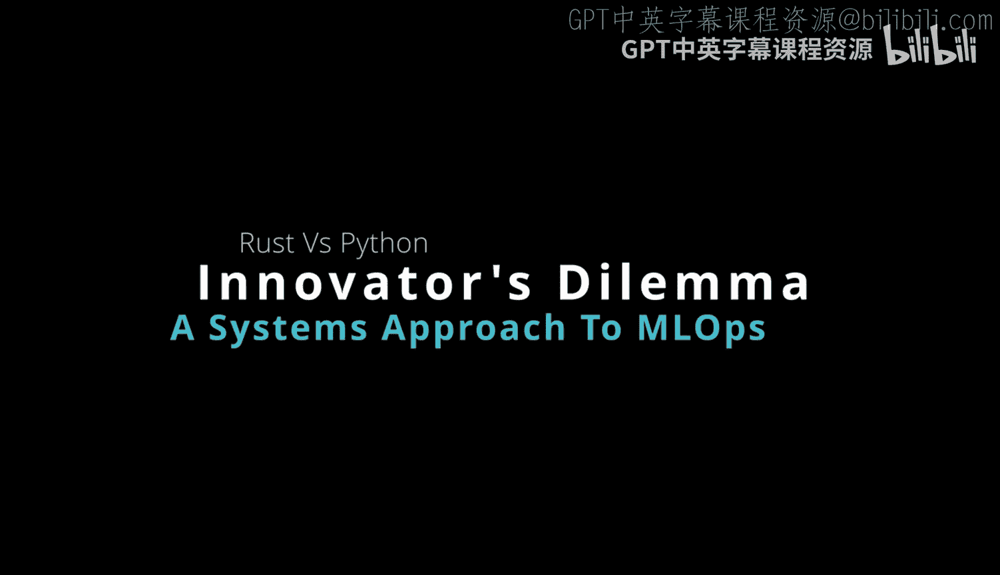

#  059：Rust与Python在MLOps中的对比 🦀🐍

在本节课中，我们将探讨在机器学习运维领域采用系统编程思维的重要性，并深入对比两种编程语言——Python和Rust——在解决MLOps核心问题时的不同表现。我们将从性能、效率、部署和语言设计哲学等多个维度进行分析。

## 概述：系统编程思维与MLOps

上一节我们介绍了MLOps的核心理念。本节中，我们来看看为何需要以“生产优先”的思维来对待机器学习运维。在我看来，MLOps首先是一个系统编程问题。

系统编程通常涉及对性能要求极高的底层操作。例如，Linux操作系统管理笔记本电脑的睡眠与唤醒，就是一种经典的、对性能和能效要求严苛的系统编程。同理，在机器学习运维中，性能同样至关重要。训练模型意味着处理海量数据集并调动庞大的计算资源，我们必须从中榨取尽可能高的效率。如果你的方法效率低下，导致成本比竞争对手高出数十倍，这将会带来严重的问题。

正是在这种对极致性能的追求下，像Rust这样的现代系统编程语言开始展现出其价值。

## 创新者的窘境与语言选择

在深入技术对比前，我们可以借助“创新者的窘境”这一概念来理解技术演进。克莱顿·克里斯坦森在其著作中指出，成功的公司往往因过于倾听现有客户的需求，而忽视了拥有颠覆性技术的新兴竞争者。

Python无疑取得了巨大的成功。它是目前采用最广泛的编程语言，这一点无可争议。然而，正如创新者的窘境所预示的，我们正看到一些新的颠覆性技术出现。固守“我们是第一”的心态，并非为手头问题寻找最佳解决方案的正确方式。

Python在API文档、代码可读性以及快速完成非计算密集型任务（如文件读写、文本处理）方面表现卓越，是理想的解决方案。但当我们讨论之前提到的**系统编程问题**时，情况就不同了。

## Rust与Python核心特性对比

以下是Rust与Python在多个关键维度的详细对比，这些维度对于MLOps至关重要。

### 能效与性能

*   **Python**：在相对能效排名中，Python是能耗最高的语言之一。
*   **Rust**：近期研究表明，Rust是能效最高的语言之一。

在计算速度方面：
*   **Python**：是计算速度最慢的语言之一，研究表明其速度可比Rust慢**高达70倍**。
*   **Rust**：是现有性能最高效的语言之一。

### 部署与打包

*   **Python**：没有“二进制部署”的概念，这不是其设计目标。标准库“内置电池”，但打包方案众多且不统一（如virtualenv、Pip、Conda、Poetry等）。
*   **Rust**：默认支持二进制部署。打包方案是内置且唯一的（`cargo`）。

### 开发工具与线程安全

*   **Python**：解释器适合快速验证想法，但未内置代码格式化工具、Linter或编译器。这些需要额外安装。
*   **Rust**：默认安装即包含所有这些提升软件工程生产力的工具（`rustfmt`, `clippy`, 编译器）。

在并发编程方面：
*   **Python**：由于历史设计妥协（全局解释器锁GIL），难以充分利用多核CPU进行高效的多线程编程。
*   **Rust**：编译器能帮助开发者编写安全的并发代码，可以轻松利用所有CPU核心，这对于现代多核机器至关重要。

### 内存效率与语言安全性

*   **Python**：内存效率相对较低。使用多进程可改善，但开销较大。类型安全是“后加”的特性，需借助额外工具（如`mypy`），并非语言原生设计。
*   **Rust**：内存效率至少是Python的**两倍以上**。语言从设计之初就以安全为核心，拥有强大的类型系统和所有权模型，能有效防止内存泄漏和数据竞争。

## 现实场景与应用

理解了这些特性差异后，让我们看一个MLOps中的具体场景。假设你的任务是：将一个Hugging Face预训练模型与一个命令行工具打包，构建一个高性能二进制文件，用于遍历数以百万计的文档并以最低成本进行摘要生成。

这对于Python而言并非最优解，因为Python并非为高效的多线程和系统级资源管理而设计。而Rust则是完成此类任务的理想选择。

此外，一个判断是否为系统编程的简单方法是：看它是否用于开发操作系统内核。Linux内核的开发并未使用Python，但正在引入Rust。这从侧面印证了Rust在系统编程领域的定位。

## 总结与展望

本节课中，我们一起学习了以系统编程视角看待MLOps的重要性，并详细对比了Python和Rust两种语言。

需要明确的是，这并不意味着Python是一个“差”的语言。恰恰相反，Python是一个取得了惊人成功的杰出语言。然而，过去的成功并不总能预测未来的成功。在MLOps这个对性能、能效和部署有严苛要求的领域，开发者时间比计算时间更宝贵的观点，在多核机器和MLOps时代之前或许成立，但今天已非如此。可持续性（包括计算效率和能源效率）变得非常重要。

Rust作为一种现代语言，正是为可持续的高性能系统编程而设计。因此，我相信对于MLOps中的许多核心挑战，**Rust是正确的语言选择**。它代表了应对当前及未来机器学习运维规模化挑战的一种颠覆性思路。