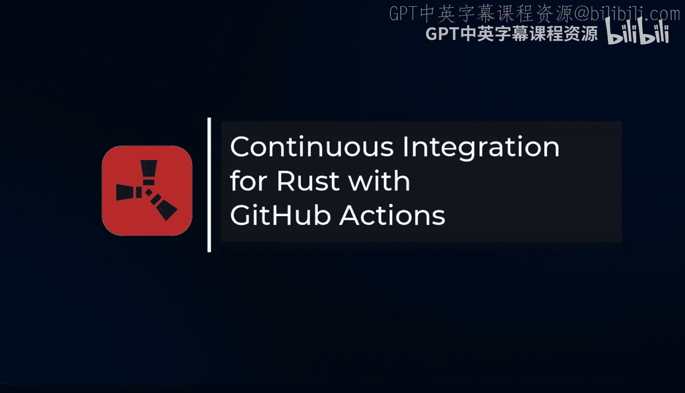
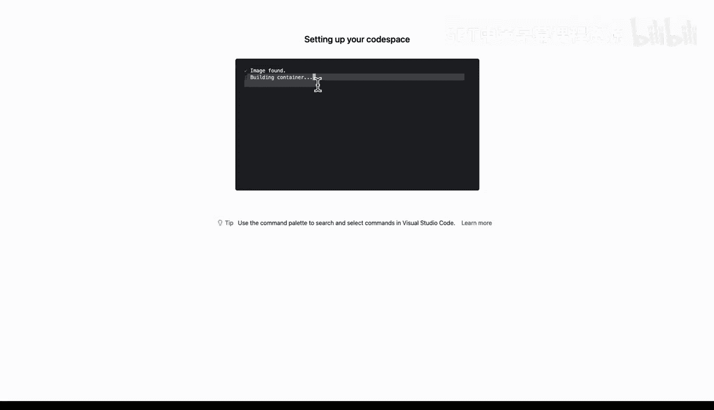
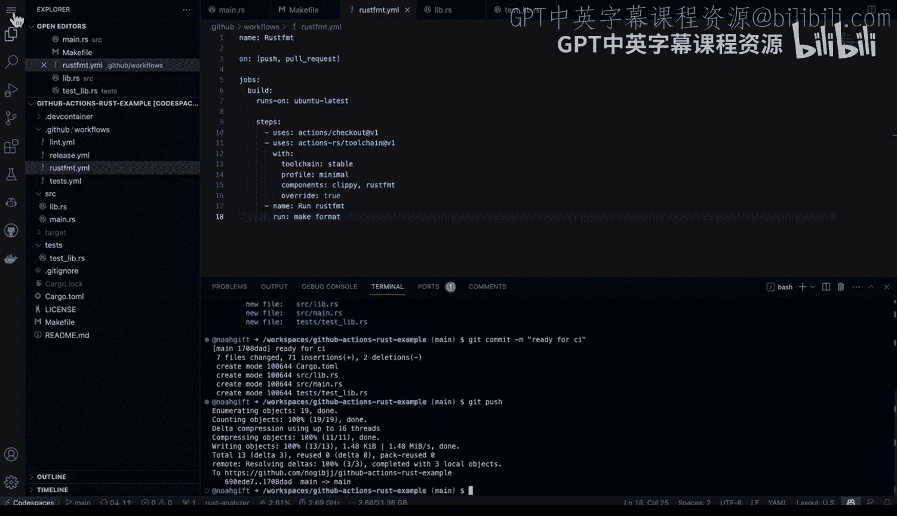
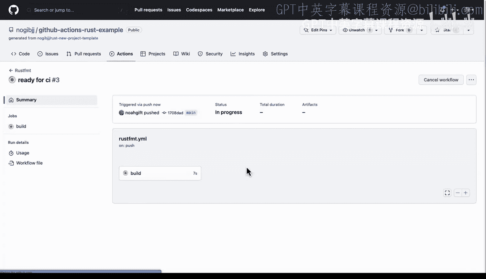
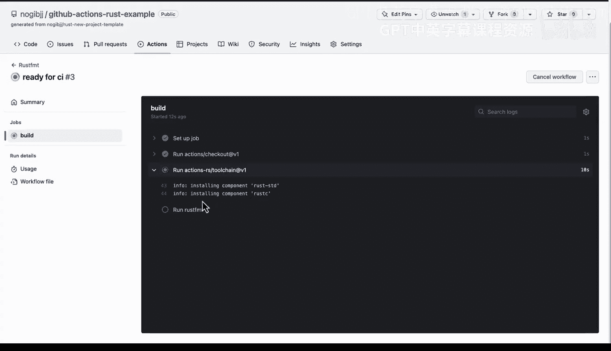
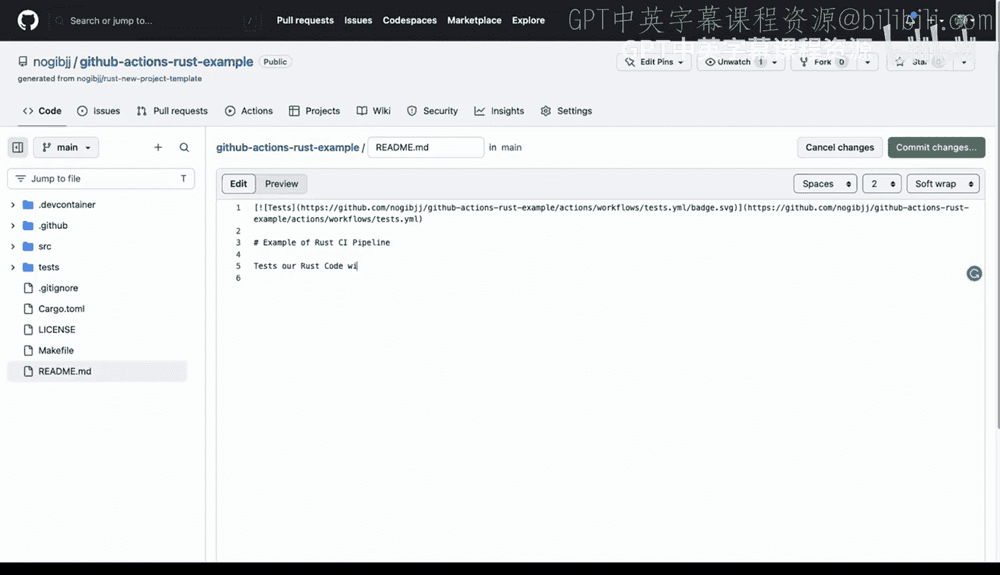
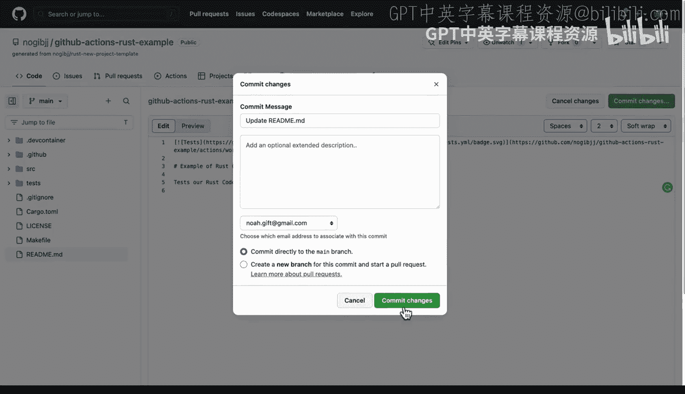
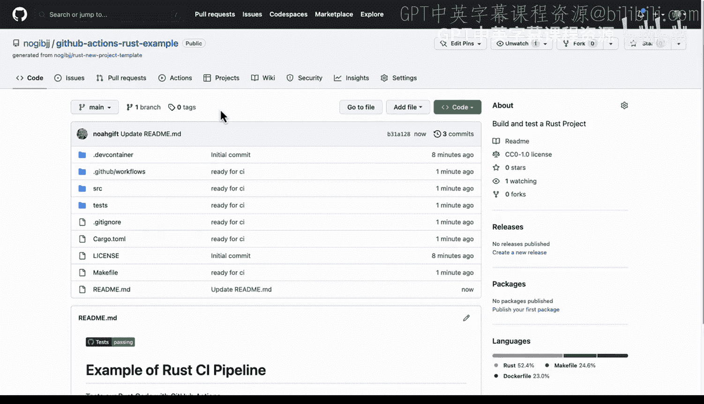
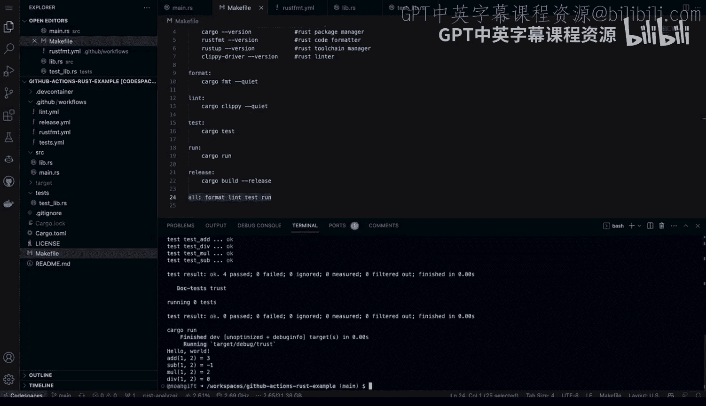
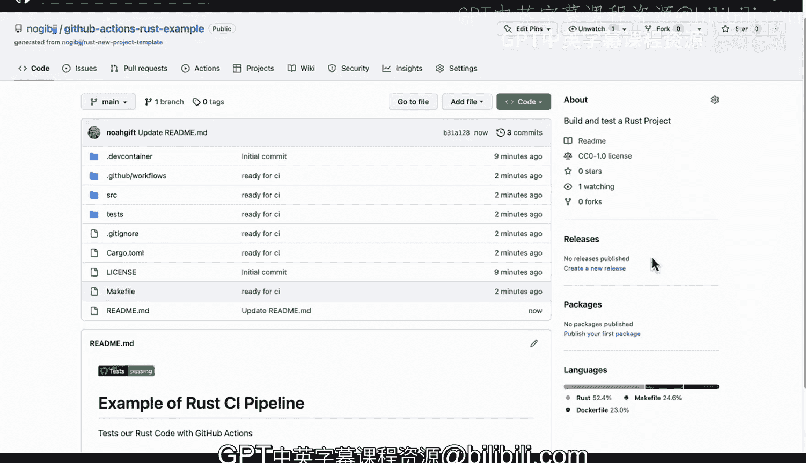

#  060：使用GitHub Actions实现Rust持续集成 🚀



在本节课中，我们将学习如何为一个Rust项目设置GitHub Actions持续集成（CI）流程。我们将从创建项目模板开始，逐步配置自动化测试、代码格式化和代码检查，最终实现一个完整的CI工作流。

---

## 创建新项目与仓库

首先，我们需要创建一个新的项目模板，用于设置GitHub Actions的持续集成。GitHub Actions是一种自动化测试和部署代码的方式。

以下是创建新仓库的步骤：
1.  使用提供的模板创建一个新的代码仓库。
2.  将仓库命名为 `github-actions-rust-example`。
3.  在描述中注明“构建和测试一个Rust项目”。

从一开始就为新项目设置持续集成，是DevOps的最佳实践。这有助于更快地构建微服务，因为持续集成提供了一个质量控制流程，可以持续改进代码质量。

接下来，我将创建一个新的GitHub Codespace环境。Rust编译能从强大的机器中受益，因此我将使用一台16核的机器，以便编译过程能快速进行。这个环境将为我设置一个基于Rust的开发环境，允许我在其中构建代码，并允许我推送更改以测试GitHub Actions工作流。



---

## 在Codespace中初始化项目

现在，我们位于GitHub Codespace环境中。通过输入 `which cargo` 命令，可以确认Cargo（Rust的包管理器）已经准备就绪。

以下是初始化Rust项目的步骤：
1.  使用 `cargo new test_rust` 命令创建一个名为“test_rust”的新项目。
2.  使用 `touch src/lib.rs` 命令创建库文件。
3.  使用 `mkdir -p tests` 命令创建测试目录。
4.  使用 `touch tests/test_lib.rs` 命令在测试目录中创建测试文件。

项目结构搭建完成后，接下来需要添加一些代码。我将从另一个项目中复制代码并粘贴进来。

*   将主程序代码粘贴到 `src/main.rs` 文件中。
*   将库函数代码粘贴到 `src/lib.rs` 文件中。
*   将测试代码粘贴到 `tests/test_lib.rs` 文件中。

粘贴完成后，需要对代码进行一些小的调整。例如，将测试模块的名称从 `unit_test` 改为 `test_rust`。Rust语言的一个优点是它优秀的工具链支持，我们可以使用查找替换功能轻松完成这个修改。

---

## 配置Makefile与本地验证

因为我们有一个Makefile，所以可以运行不同的命令来管理项目。

以下是Makefile支持的命令及其作用：
*   `make format`：格式化所有代码。
*   `make lint`：运行代码检查，确保代码符合规范。
*   `make test`：运行所有测试用例。

在本地运行 `make lint` 和 `make test` 后，确认所有检查都通过，测试也全部成功。这验证了我们的代码在本地是健康的。

现在，最关键的一步是验证我们的GitHub Actions工作流能否成功运行。工作流配置文件（位于 `.github/workflows/` 目录下）定义了CI流程，它将在Ubuntu系统上运行，拉取Rust工具链，并依次执行 `make lint`、`make format`、`make test` 等命令。

由于我们已经在本地测试了这些步骤，因此可以确信它们在CI环境中也能正常工作。我们注意到工作流中有一个 `make format-check` 步骤，但我们的Makefile中没有定义它。因此，我们可以稍作调整，将其改为 `make format`。

---

## 提交代码并触发CI流程

所有配置修改完成后，需要将更改提交到仓库以触发GitHub Actions。



以下是提交代码的步骤：
1.  运行 `git status` 查看更改。
2.  使用 `git add .github` 和 `git add *` 等命令添加所有更改的文件。
3.  运行 `git commit -m “Ready for continuous integration”` 提交更改。

提交完成后，推送操作会自动触发GitHub Actions工作流。我们可以转到仓库的“Actions”标签页查看运行情况。

---





## 查看与分析CI结果

在“Actions”页面，我们可以看到由刚才的提交触发的工作流正在运行。系统将逐步验证所有配置的步骤。

GitHub Actions的一个优点是每个步骤都是独立且清晰的。我们可以看到以下步骤：
*   **构建二进制发布版**：此步骤目前不是我们关注的重点。
*   **代码检查（Linting）**：显示成功。
*   **代码格式化（Formatting）**：显示成功。
*   **测试（Testing）**：显示成功。

所有核心步骤（代码检查、格式化、测试）都显示为成功状态。我们还可以为这个成功的工作流创建一个状态徽章（Status Badge）。这是一个很好的实践，可以直观地向所有人展示项目代码的质量状态。



我们可以复制徽章的Markdown代码，并将其添加到项目的README文件中，例如：
```markdown
# GitHub Actions Rust CI 示例
这是一个使用GitHub Actions测试Rust代码的CI流水线示例。
[](https://github.com/your-username/repo-name/actions)
```





---

## 总结：持续集成的核心

本节课中，我们一起学习了为Rust项目设置GitHub Actions持续集成的完整流程。

持续集成的核心在于：
1.  **本地开发与验证**：在本地编写代码，并使用Makefile等工具运行测试、格式化和检查，确保代码质量。
2.  **自动化流程**：将本地验证的步骤（通过 `make all` 可以一次性运行）配置到自动化构建系统（如GitHub Actions）中，确保每次代码提交都能自动执行这些质量关卡。
3.  **状态可视化**：通过状态徽章公开分享构建状态，向协作者和用户表明代码处于高质量且可用的状态。





这是DevOps实践中**持续集成（Continuous Integration）** 的基础组成部分。建立好这个基础后，你就可以在此基础上进一步实现**持续交付（Continuous Delivery）**，自动化地将代码部署到生产环境。整个设置过程是直接且高效的。