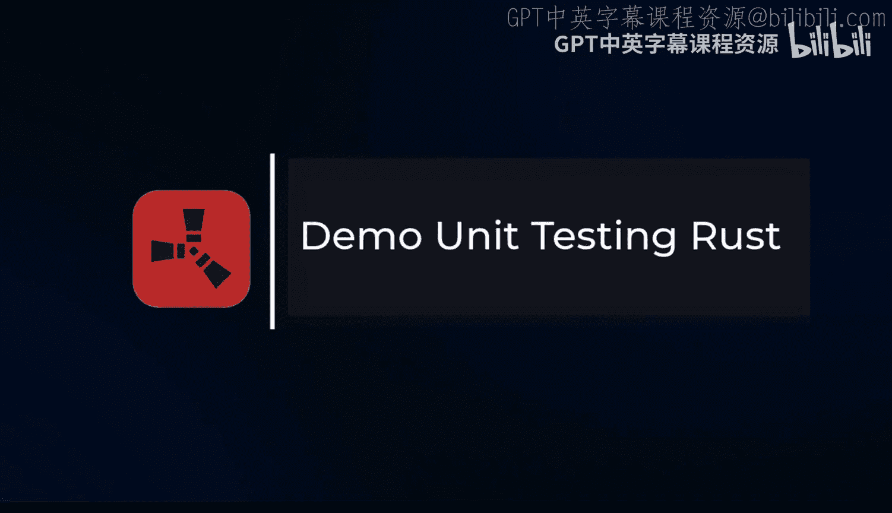
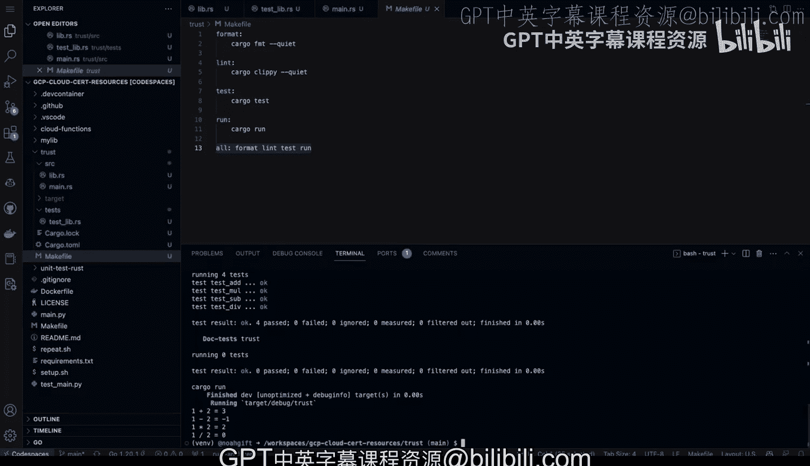

#  061：Rust单元测试演示 🦀




在本节课中，我们将学习如何为一个Rust项目构建单元测试。我们将从创建一个新项目开始，逐步构建一个包含数学运算的库，并为其编写测试。最后，我们将使用Makefile来组织构建和测试流程，实现可重复的自动化。

## 项目初始化与结构搭建

首先，我们需要创建一个新的Rust项目。在终端中执行以下命令：

```bash
cargo new trust
cd trust
```

初始项目只包含一个 `main.rs` 文件。为了组织代码，我们需要为测试和库代码创建专门的结构。

以下是创建项目结构的步骤：
1.  创建一个名为 `tests` 的目录来存放测试文件。
2.  在 `tests` 目录下创建一个空的测试文件 `test_lib.rs`。
3.  在 `src` 目录下创建库文件 `lib.rs`。

创建完成后，项目结构应如下所示：
```
trust/
├── Cargo.toml
├── src/
│   ├── lib.rs
│   └── main.rs
└── tests/
    └── test_lib.rs
```

## 编写库函数

上一节我们搭建了项目结构，本节中我们来看看如何编写核心的库函数。我们将创建一个简单的计算器库，包含加、减、乘、除四个基本函数。

打开 `src/lib.rs` 文件，并添加以下代码：

```rust
pub fn add(a: i32, b: i32) -> i32 {
    a + b
}

pub fn subtract(a: i32, b: i32) -> i32 {
    a - b
}

pub fn multiply(a: i32, b: i32) -> i32 {
    a * b
}

pub fn divide(a: i32, b: i32) -> i32 {
    a / b
}
```

## 编写单元测试

现在库函数已经就绪，接下来我们为它们编写单元测试。单元测试能帮助我们验证代码逻辑是否正确，并确保后续修改不会引入错误。

打开 `tests/test_lib.rs` 文件。首先，我们需要导入要测试的库模块。

```rust
use trust::{add, subtract, multiply, divide};

#[test]
fn test_add() {
    assert_eq!(add(2, 2), 4);
}

#[test]
fn test_subtract() {
    assert_eq!(subtract(5, 3), 2);
}

#[test]
fn test_multiply() {
    assert_eq!(multiply(3, 4), 12);
}

#[test]
fn test_divide() {
    assert_eq!(divide(10, 2), 5);
}
```

## 使用Makefile实现自动化

手动运行测试和检查代码格式虽然可行，但为了构建可重复的自动化流程，使用Makefile是一个好方法。Makefile可以将编译、测试、代码检查等步骤封装起来。

在项目根目录创建一个 `Makefile` 文件，内容如下：

```makefile
.PHONY: all test lint format run clean

all: lint test

test:
	cargo test

lint:
	cargo clippy -- -D warnings

format:
	cargo fmt --all -- --check

run:
	cargo run

clean:
	cargo clean
```

这个Makefile定义了以下几个命令：
*   `make test`: 运行所有单元测试。
*   `make lint`: 使用Clippy进行代码静态分析，检查潜在问题。
*   `make format`: 检查代码格式是否符合`rustfmt`标准。
*   `make run`: 编译并运行主程序。
*   `make all`: 依次执行代码格式检查、静态分析和测试，这是提交代码前的完整检查流程。
*   `make clean`: 清理编译产物。

现在，你可以通过简单的命令来执行整个质量保证流程。例如，运行 `make all` 会依次进行代码格式化检查、静态分析和单元测试。

## 集成与运行主程序

最后，让我们修改 `src/main.rs` 文件，使其调用我们编写的库函数，从而验证整个项目的集成情况。

将 `src/main.rs` 的内容替换为以下代码：

```rust
use trust::{add, subtract, multiply, divide};

fn main() {
    println!("2 + 3 = {}", add(2, 3));
    println!("5 - 2 = {}", subtract(5, 2));
    println!("3 * 4 = {}", multiply(3, 4));
    println!("8 / 2 = {}", divide(8, 2));
}
```

现在，你可以使用 `cargo run` 或 `make run` 来运行程序，并看到计算结果输出。

## 总结



本节课中我们一起学习了如何为一个Rust项目构建完整的单元测试流程。我们从创建项目结构开始，编写了包含基本数学运算的库函数，并为每个函数编写了对应的单元测试。通过引入Makefile，我们将测试、代码检查和格式化等步骤自动化，形成了一个可靠且可重复的质量保证流程。这种模式是构建稳健软件的基础，可以轻松集成到持续集成/持续部署（CI/CD）系统中，例如GitHub Actions，为后续的微服务开发和持续交付奠定坚实基础。