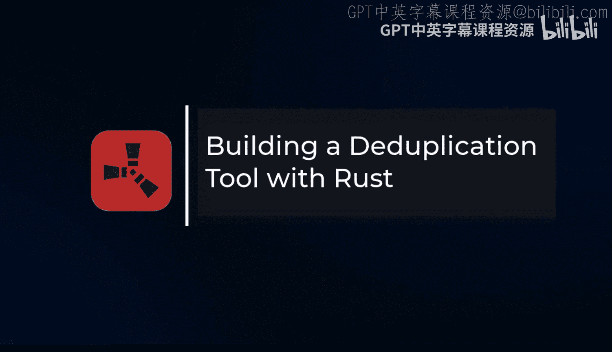
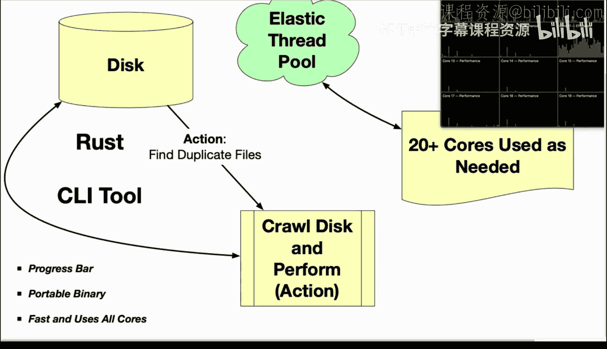
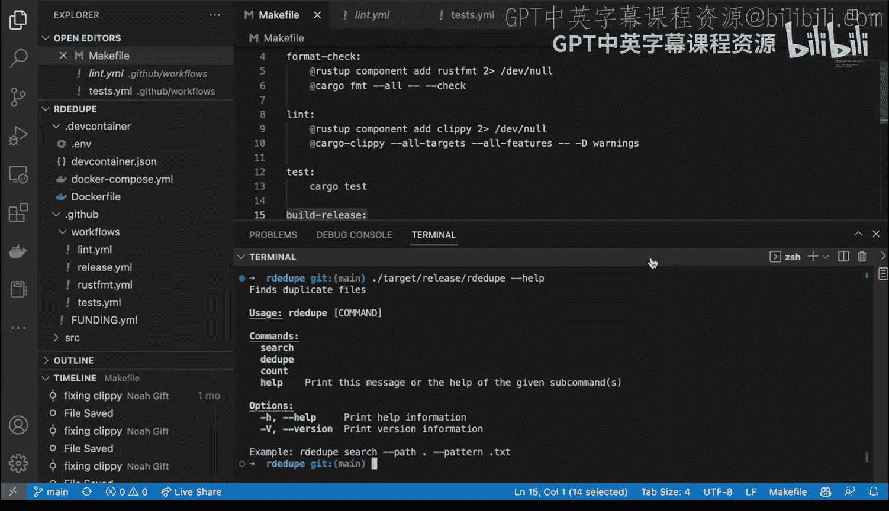
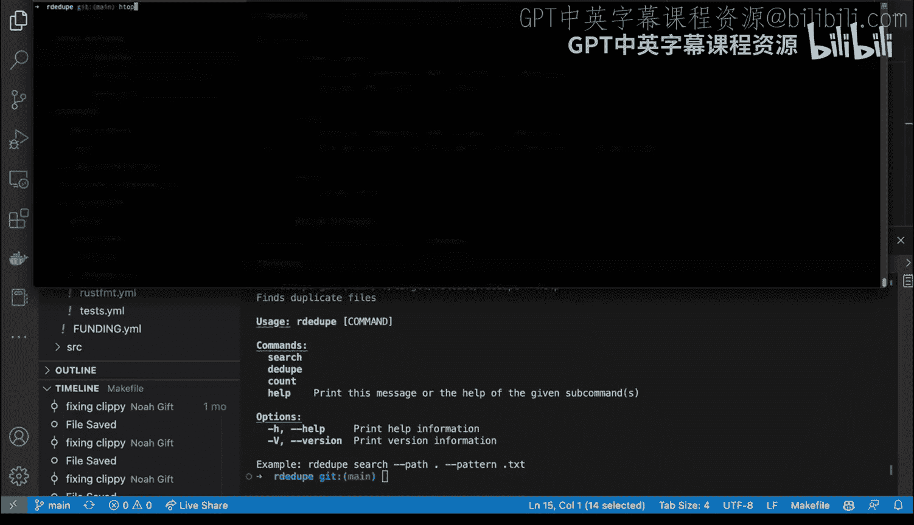
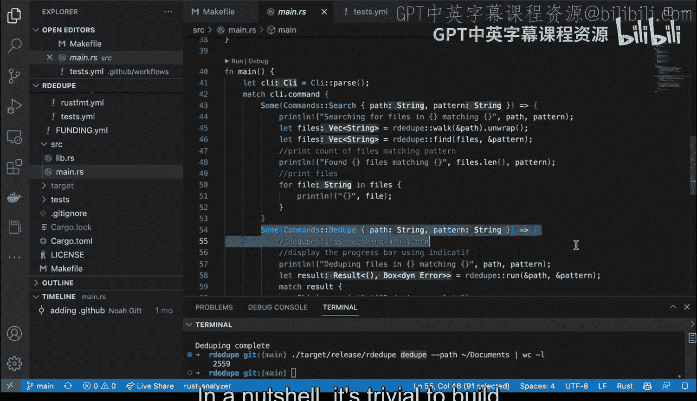
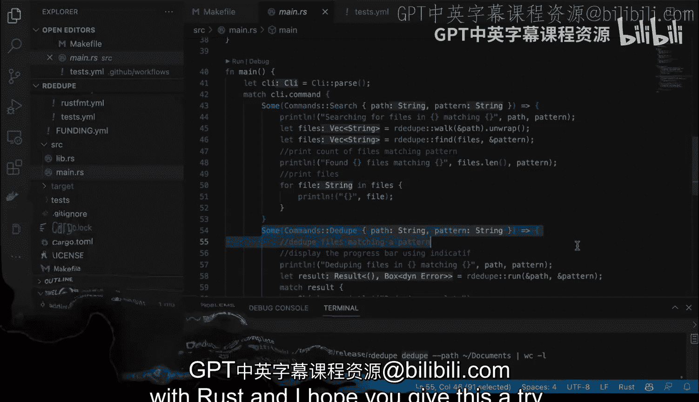

#  062：使用Rust构建去重工具



在本节课中，我们将学习如何使用Rust编程语言构建一个高性能、内存效率高的数据去重工具。我们将探讨Rust在数据工程领域的优势，并逐步解析一个实际项目的结构与核心代码。

## 概述

数据工程是典型的系统编程问题，而Rust是一门系统编程语言。与脚本语言相比，Rust能够构建出多线程、高效、低内存占用且可移植的响应式工具。本节课将通过构建一个文件去重工具，展示Rust在构建高性能数据工程工具方面的能力。

## Rust在数据工程中的优势

上一节我们介绍了Rust作为系统编程语言的定位，本节中我们来看看它具体为何适合数据工程任务。

Rust相比Python等脚本语言的关键优势在于能够构建高性能工具。在处理例如PB级文件服务器或Amazon EFS等场景时，高效利用内存和高性能代码至关重要。Rust的代码执行速度可比Python快70倍，并且由于线程间共享内存，其内存占用极低。

我们的目标是：在20核的Mac上运行时，能够充分利用所有核心，而非仅使用一个核心来回切换。同时，工具应具备进度条显示功能，能够分发可移植的二进制文件，并且速度极快、效率极高，从而构建出高性能的数据工程工具。

## 项目结构与开发流程

了解了目标后，我们来看看如何组织一个典型的Rust数据工程项目。

以下是构建此类高性能二进制文件并分发给他人使用的推荐项目结构：



*   **开发容器**：配置开发容器，便于与他人共享项目并确保一致的测试环境。
*   **Makefile自动化**：使用Makefile集成常用命令。
    *   `make lint`：在每次代码变更后运行代码检查。
    *   `make release`：构建高性能的发布版本二进制文件，便于分发给他人。
    *   `make format`：确保代码格式正确。
    *   `make test`：运行测试，确保不引入业务逻辑问题。
*   **项目文档**：在项目中提供相关链接和说明。这种模式相比Python有巨大优势，因为Python无法直接分发二进制文件，必须提供详细的软件安装说明。

## 代码解析：核心库

现在，让我们深入代码，看看这个去重工具是如何实现的。我们首先分析核心逻辑所在的库文件。

我倾向于将主要逻辑放在库（lib）中，然后通过命令行工具来调用它。这种模式非常适合数据工程。

在`Cargo.toml`文件中，我们定义了项目依赖，包括用于开发和生产环境的配置、命令行参数解析、目录遍历、校验和计算、高效线程池以及与线程池交互的进度条。这个模式对于构建其他工具也非常有用。





以下是库文件中的核心函数：

**遍历目录**：该函数接受一个路径字符串，并返回一个文件路径的向量（`Vec<String>`）。其代码与Python实现差异不大。
```rust
pub fn walk_directory(path: &str) -> Result<Vec<String>, Box<dyn Error>> {
    // ... 遍历目录并收集文件路径 ...
}
```

**模式匹配**：用于根据模式过滤文件。代码量很少，同样与Python类似。
```rust
pub fn filter_files_by_pattern(files: Vec<String>, pattern: &str) -> Vec<String> {
    // ... 使用通配符模式匹配过滤文件 ...
}
```

**计算校验和**：这个函数稍复杂一些。它计算文件的校验和，同时集成了进度条来显示处理进度。最后，将所有结果放入一个字典（`HashMap`）中返回。
```rust
pub fn calculate_checksums(files: Vec<String>, progress_bar: &ProgressBar) -> Result<HashMap<String, Vec<String>>, Box<dyn Error>> {
    // ... 多线程计算文件校验和，并更新进度条 ...
}
```

**查找重复项**：最后，我们检查上述返回的字典，如果同一个校验和对应多个文件，则将其报告为重复项。这就是最终的输出结果。
```rust
pub fn find_duplicates(checksums: HashMap<String, Vec<String>>) -> Vec<Vec<String>> {
    // ... 筛选出校验和出现次数大于1的文件组 ...
}
```

## 代码解析：主程序与执行

核心逻辑封装好后，我们来看看主程序如何将它们组织起来并执行。

在主文件（`main.rs`）中，开头有一些样板代码。重要的是命令映射部分：

1.  定义命令：我们定义了`search`（搜索）、`ddupe`（去重）、`count`（计数）等命令。
2.  映射执行逻辑：在这里，我们将这些命令映射到对应的库函数上。例如，`ddupe`命令就精确地映射到了我们刚才在库中看到的去重逻辑。

这种模式使得构建极其强大且内存高效的工具变得非常可行。

## 总结





本节课中我们一起学习了如何使用Rust构建一个高性能的文件去重工具。我们探讨了Rust在数据工程中相比脚本语言的优势，包括其高性能、低内存占用和强大的并发能力。我们分析了一个实际项目的结构，包括开发容器、Makefile自动化的最佳实践，并逐步解析了从目录遍历、文件过滤、校验和计算到重复项查找的核心代码逻辑。最后，我们看到了如何通过主程序将各个模块组织成一个完整的命令行工具。总而言之，使用Rust构建高性能的数据工程工具是直接且高效的，希望你能尝试实践。