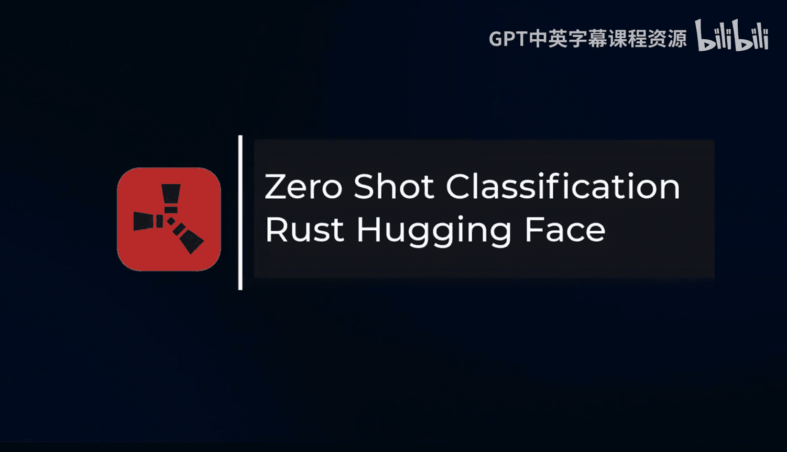
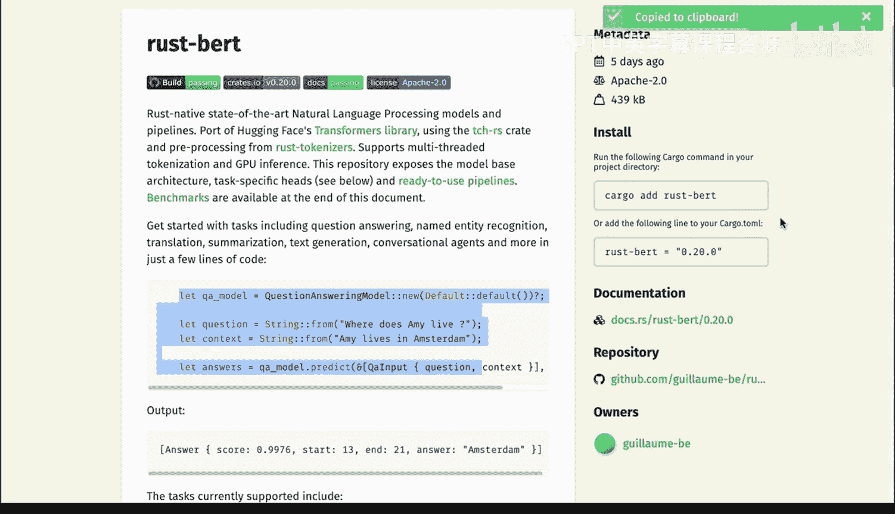
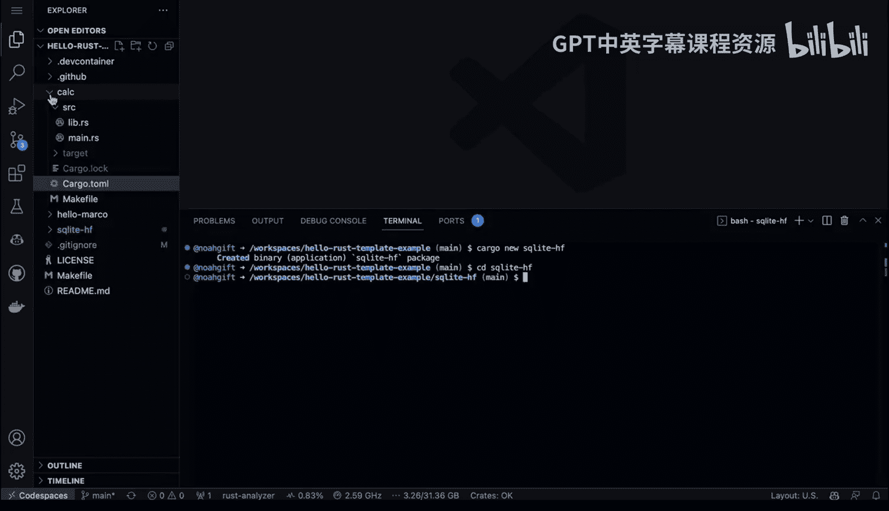
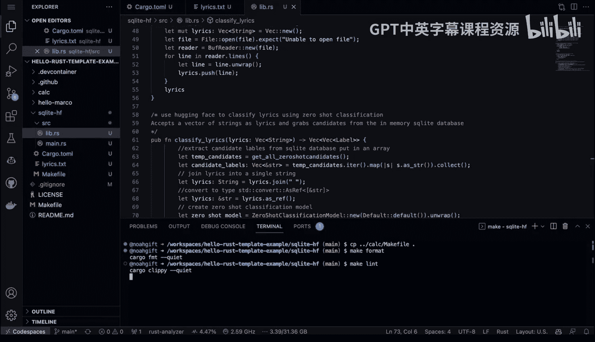
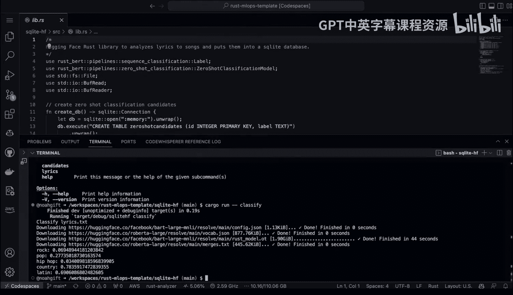

#  063：Rust与Hugging Face零样本分类 🚀



在本节课中，我们将学习如何利用Rust语言和Hugging Face生态系统构建一个高性能的机器学习运维应用。具体来说，我们将创建一个歌词分析器，它能从文件中读取歌词，使用零样本分类模型进行分析，并将结果存入SQLite数据库。我们将看到Rust如何以其卓越的性能和“生产优先”的特性，成为MLOps的理想选择。

---

## 为什么选择Rust进行MLOps？⚡

上一节我们介绍了课程目标，本节中我们来看看为什么Rust是机器学习运维的绝佳语言。

机器学习运维的核心是将模型从开发环境部署到生产环境。许多人认为Python是机器学习的主导语言，但Rust在这方面展现出巨大潜力。

Rust是进行机器学习运维的优秀候选语言，因为它为许多常用操作提供了绑定。例如，PyTorch可以非常方便地与GPU协同工作。事实上，Rust在许多操作上的速度平均可以达到Python的**70倍**。

Rust的另一个优势是其**二进制可移植性**。从项目伊始，Rust就秉持“生产优先”的理念。你可以将一个模型打包成二进制文件，然后直接部署到生产环境。这与Python常说的“生产优先”不同，Rust在模型和二进制可移植性上提供了更实际的解决方案。

对于像Hugging Face这样的应用，使用Rust的优势在于：**能耗更低**、**计算时间更短**，并且可以利用多线程编程充分发挥所有核心的性能。如果你需要分析数百万首歌曲并进行摘要或零样本分类，就应该使用高性能语言，而不是有史以来最慢的语言之一。

因此，Rust是高性能MLOps的绝佳工具。接下来，我将展示如何结合Hugging Face来实现。

---

## 项目架构概述 🏗️

上一节我们探讨了Rust的优势，本节中我们来看看一个具体的生产系统架构示例。

假设我是一家音乐公司，文件存储系统中有数百万首歌曲。我想使用现代大语言模型来分类我的唱片收藏，以便从中获利或用于推荐引擎。

以下是该系统可能的架构：

首先，需要一个SQL数据库，其中包含一些零样本分类的候选类别。例如：摇滚、流行、嘻哈、乡村、拉丁等。你可以在这里放入任何想要的类别，核心思想是拥有一些初始分类。

接下来，需要以尽可能快和高效的方式转录那数百万首歌曲。你肯定不希望花费数百万美元进行转录。这正是基于Rust的方法大显身手的地方。Rust在多线程代码方面性能卓越，如果你想爬取文件系统、查看所有不同的歌曲，然后以极高的内存和计算效率转录它们，这就是正确的方法。

获得转录文本后，可以再次将其传入Rust的Hugging Face绑定库进行零样本分类。最终，可以将分类结果存回SQL数据库。这是一个非常真实的生产系统。也许已经有人这么做了，但我们将亲手构建它。

---

## 开始构建：环境与依赖设置 🛠️

上一节我们规划了系统架构，本节中我们开始动手搭建开发环境并初始化项目。

我们将借助Copilot和Cargo生态系统的力量来加速开发。第一步是在GitHub中构建，使用强大的Codespace实例，并遵循“提示 -> 代码生成 -> 格式化 -> 检查 -> 测试 -> 运行 -> 部署”的工作流，Copilot将在“提示”环节协助我们。

首先，让我们查看Rust的相关库。`rust-bert`库提供了即用的NLP流水线和语言模型。需要指出的是，有人认为Rust缺乏MLOps库，但这并不正确。`rust-bert`库允许你使用PyTorch，同时`rust-tokenizers`提供了预处理功能。`rust-tokenizers`的第一句话就是：“得益于Rust实现，速度极快”。正因为性能优势，Rust在Hugging Face中被大量使用，这是关键的MLOps能力。

同样，查看`rust-bert`的示例，你会发现它的语法非常简洁，在很多方面看起来就像Python。我们只需要复制代码就可以开始。

现在，我们在新目录中构建项目。打开一个Codespace环境，然后创建新项目：

```bash
cargo new sqlite_hf
cd sqlite_hf
```

接下来，我们需要配置`Cargo.toml`文件以添加依赖。以下是所需的依赖项：

```toml
[dependencies]
rust-bert = "0.21.0"
tokio = { version = "1.0", features = ["full"] }
rusqlite = "0.30.0"
anyhow = "1.0"
```

然后，创建必要的项目文件结构：

```bash
touch src/lib.rs
touch lyrics.txt
```

在`lyrics.txt`中，我们可以粘贴一些喜欢的歌曲歌词，作为我们分析的测试数据。

---

## 核心代码实现：数据库与歌词处理 📝

上一节我们设置了项目基础，本节中我们开始编写核心功能代码：初始化数据库和读取歌词。

首先，在`lib.rs`中开发我们的库代码。提示词在借助Copilot开发时非常关键。我们的第一个提示可以是：“使用Hugging Face库分析歌曲歌词，并将其放入SQLite数据库”。

为了演示方便，我将直接导入已知有用的库。首先，创建第一个零样本分类的候选类别。以下代码演示了如何在内存中创建SQLite数据库并插入候选类别（在实际世界中，我们会持久化到磁盘）：

```rust
use rusqlite::{Connection, Result};

pub fn initialize_database() -> Result<Connection> {
    let conn = Connection::open_in_memory()?; // 实际应用应持久化
    conn.execute(
        "CREATE TABLE IF NOT EXISTS zero_shot_candidates (
            id INTEGER PRIMARY KEY,
            category TEXT NOT NULL UNIQUE
        )",
        [],
    )?;

    let categories = vec!["rock", "pop", "hip hop", "country", "latin"];
    for category in categories {
        conn.execute(
            "INSERT OR IGNORE INTO zero_shot_candidates (category) VALUES (?)",
            &[&category],
        )?;
    }
    Ok(conn)
}
```





查询SQLite数据库在Rust中非常简单，代码看起来很像Python：

```rust
pub fn get_all_candidates(conn: &Connection) -> Result<Vec<String>> {
    let mut stmt = conn.prepare("SELECT category FROM zero_shot_candidates")?;
    let category_iter = stmt.query_map([], |row| row.get(0))?;

    let mut categories = Vec::new();
    for category in category_iter {
        categories.push(category?);
    }
    Ok(categories)
}
```

接下来，我们需要从文件中读取歌词。以下函数从指定文件路径读取歌词，并返回一个字符串向量：

```rust
use std::fs;
use anyhow::Result as AnyResult;

pub fn read_lyrics_from_file(file_path: &str) -> AnyResult<Vec<String>> {
    let contents = fs::read_to_string(file_path)?;
    // 假设每行歌词是一个条目，或根据实际情况分割
    let lines: Vec<String> = contents.lines().map(String::from).collect();
    Ok(lines)
}
```

关于Rust的一个有趣之处是`let`关键字用于创建**不可变变量**。这是一个安全机制，能使你的代码更加健壮。


---

## 集成Hugging Face进行零样本分类 🤖

上一节我们处理了数据和数据库，本节中我们集成Hugging Face模型来完成核心的零样本分类任务。

现在，我们可以使用Hugging Face生态系统来构建分类功能。我们将创建一个函数，接收歌词字符串向量（对于Python用户来说，这就像一个可变列表）并进行分类。

以下是使用`rust-bert`进行零样本分类的示例代码框架：

```rust
use rust_bert::pipelines::zero_shot_classification::ZeroShotClassificationModel;
use anyhow::Result as AnyResult;

pub fn classify_lyrics(lyrics: Vec<String>, candidates: Vec<String>) -> AnyResult<Vec<String>> {
    // 创建零样本分类模型（首次运行会下载模型）
    let model = ZeroShotClassificationModel::new(Default::default())?;

    // 假设我们将所有歌词连接成一个文本进行分析
    // 实际应用中可能需要更精细的处理，如分句或分段
    let combined_text = lyrics.join(" ");

    // 执行零样本分类
    let output = model.predict(
        vec![combined_text],   // 输入文本
        candidates,            // 候选标签
        None,                  // 假设使用默认的假设模板
        1,                     // 每个输入返回的标签数量
    )?;

    // 处理结果，这里简单返回第一个（也是唯一一个）输入的顶级标签
    let result_labels: Vec<String> = output[0]
        .iter()
        .map(|classification| classification.text.clone())
        .collect();

    Ok(result_labels)
}
```

最后，我们可以在`main.rs`中组合所有这些功能：

```rust
use sqlite_hf::{initialize_database, get_all_candidates, read_lyrics_from_file, classify_lyrics};
use anyhow::Result;

#[tokio::main]
async fn main() -> Result<()> {
    // 1. 初始化数据库并获取候选类别
    let conn = initialize_database()?;
    let candidates = get_all_candidates(&conn)?;
    println!("候选分类: {:?}", candidates);

    // 2. 从文件读取歌词
    let lyrics = read_lyrics_from_file("lyrics.txt")?;
    println!("已读取 {} 行歌词。", lyrics.len());

    // 3. 使用Hugging Face模型分类歌词
    let classification_results = classify_lyrics(lyrics, candidates)?;
    println!("分类结果: {:?}", classification_results);

    // 4. （可选）将结果存回数据库...
    // ...

    Ok(())
}
```

我们可以运行`cargo run`来构建和测试，或者运行`cargo make`（如果配置了）来执行更完整的检查流程。

---

## 总结 🎯

本节课中，我们一起学习了如何利用Rust构建一个完整的MLOps应用。我们从解释Rust在性能、能效和“生产优先”理念上的优势开始，然后设计了一个用于分析海量歌曲歌词的系统架构。通过动手实践，我们逐步实现了SQLite数据库的初始化、歌词文件的读取，并最终集成了Hugging Face的零样本分类模型。





这个原型虽然简单，但展示了Rust在高性能、并发处理和资源效率方面的强大能力，使其能够轻松扩展到处理数百万用户和文档的真实生产场景。你已掌握了使用Rust进行机器学习运维的基础，可以继续探索更复杂的模型、数据库持久化或分布式处理。