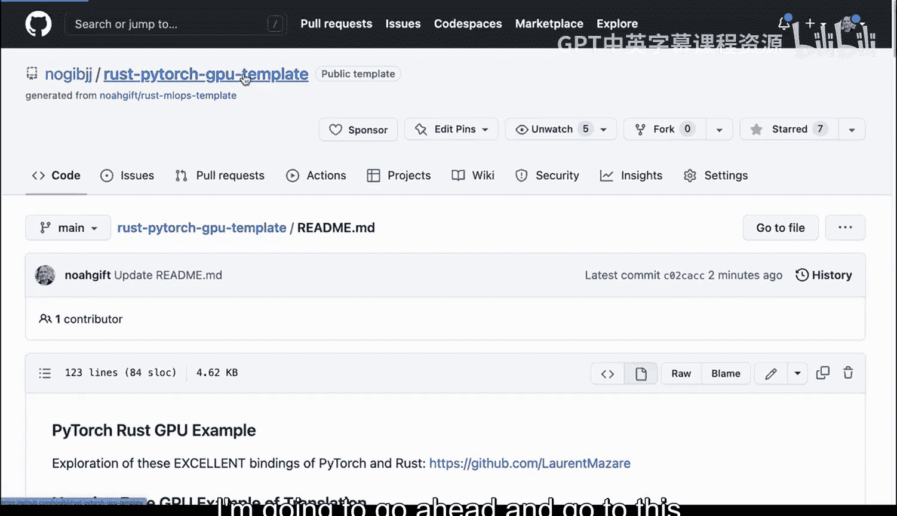
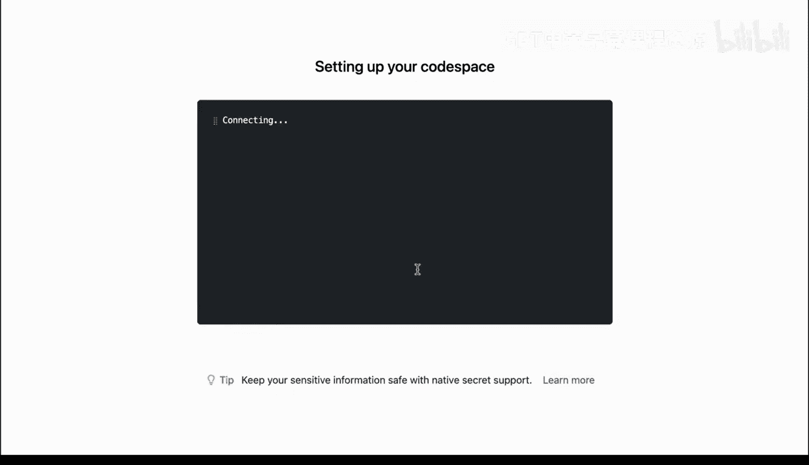
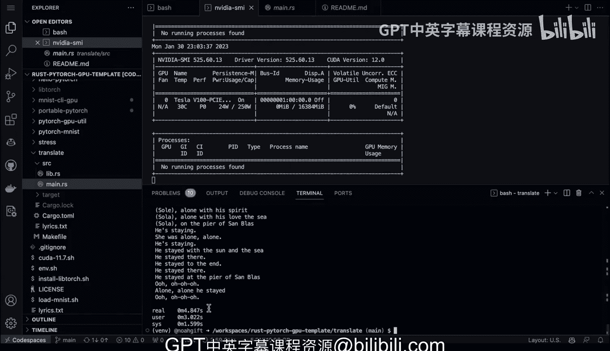

#  064：Rust-GPU-Hugging Face 翻译器 🚀


在本节课中，我们将学习如何结合 Rust 编程语言、GPU 加速以及 Hugging Face 的预训练模型，快速构建一个高性能的批量文本翻译工具。我们将使用 GitHub Codespaces 的 GPU 环境，通过 Rust 绑定来调用 Hugging Face 的模型，实现西班牙语到英语的快速翻译。

---

## 概述与架构

上一节我们介绍了 MLOps 中的多种工具链。本节中我们来看看如何利用 Rust 的高性能特性进行机器学习推理。

使用 Rust 最强大的方式之一，是深入使用预训练模型和 GPU，构建高性能的命令行工具，以进行批量机器学习推理。我将向你展示，在启用 GPU 的 GitHub Codespaces 中，为其构建 Rust 绑定，并在几分钟内构建出一个翻译工具是多么简单。

我们即将构建的架构如下：
1.  在 Codespaces 中启用 GPU。
2.  使用 Hugging Face 的 Rust 绑定库。
3.  结合两者，将一首西班牙语歌曲翻译成英语。
整个过程仅需几秒钟，并且可以观察到 GPU 被有效利用。对于希望构建批量机器学习工具的人来说，Rust + GPU + Hugging Face 是一个理想的解决方案。

---

## 环境与依赖设置

首先，我们需要一个配置好的开发环境。以下是设置步骤：



以下是启动和验证环境的步骤：
1.  使用一个预配置的代码仓库模板，它包含了在 Codespaces 中使用 GPU 所需的一切。
2.  启动 Codespace 后，首先运行命令 **`nvidia-smi -l 1`** 来监控 GPU 状态。初始时 GPU 应处于空闲状态。
3.  进入项目目录，查看代码结构。

---



## 项目代码解析

现在，让我们深入查看翻译工具的项目代码。项目主要包含库（lib）和主程序（main）两部分。

### 依赖配置

项目的依赖关系在 `Cargo.toml` 文件中定义，非常简单：

```toml
[dependencies]
rust-bert = "0.21.0"  # Hugging Face 模型的 Rust 绑定
clap = { version = "4.4", features = ["derive"] }  # 命令行参数解析
anyhow = "1.0"  # 简化错误处理
```

### 核心库函数

库文件（`lib.rs`）中定义了核心功能：

1.  **读取文件为字符串**：一个基础函数，用于读取文件内容。
    ```rust
    pub fn read_file_to_string(path: &str) -> Result<String, anyhow::Error> {
        std::fs::read_to_string(path).map_err(|e| e.into())
    }
    ```
2.  **读取文件为文本行数组**：将文件按行读取，便于批量送入翻译模型。
    ```rust
    pub fn read_file_to_lines(path: &str) -> Result<Vec<String>, anyhow::Error> {
        let content = read_file_to_string(path)?;
        Ok(content.lines().map(String::from).collect())
    }
    ```
3.  **翻译函数**：这是核心函数，它创建翻译管道，指定源语言（西班牙语）和目标语言（英语），然后对输入的文本行数组进行批量翻译。
    ```rust
    pub fn translate_spanish_to_english(texts: Vec<String>) -> Result<Vec<String>, anyhow::Error> {
        // 创建翻译管道
        let translation_model = rust_bert::pipelines::translation::TranslationModel::new(
            rust_bert::pipelines::translation::TranslationConfig::new(
                rust_bert::pipelines::translation::Language::Spanish,
                rust_bert::pipelines::translation::Language::English,
            ),
        )?;

        // 执行翻译并返回结果
        let output = translation_model.translate(&texts);
        Ok(output)
    }
    ```

### 命令行界面

主程序（`main.rs`）使用 `clap` 库来构建命令行工具，将库中的函数映射为子命令：

```rust
use clap::{Parser, Subcommand};

#[derive(Parser)]
struct Cli {
    #[command(subcommand)]
    command: Commands,
}

#[derive(Subcommand)]
enum Commands {
    /// 翻译指定文件中的西班牙语文本
    Translate { path: String },
    /// 打印文件内容
    Print { path: String },
}

fn main() -> Result<(), anyhow::Error> {
    let cli = Cli::parse();
    match cli.command {
        Commands::Translate { path } => {
            let lines = mylib::read_file_to_lines(&path)?;
            let translated = mylib::translate_spanish_to_english(lines)?;
            for line in translated {
                println!("{}", line);
            }
        }
        Commands::Print { path } => {
            let content = mylib::read_file_to_string(&path)?;
            println!("{}", content);
        }
    }
    Ok(())
}
```

这种模式非常强大，可以轻松扩展更多功能。

---

## 运行与效果验证

一切就绪后，让我们运行这个工具并观察其性能。

以下是运行翻译和验证 GPU 使用的步骤：
1.  首先，可以通过运行 **`cargo run -- --help`** 来查看工具的使用帮助。
2.  在运行翻译前，在另一个终端窗口运行 **`nvidia-smi -l 1`** 以实时监控 GPU 利用率。
3.  执行翻译命令，例如：**`cargo run -- translate ./lyrics.txt`**，其中 `lyrics.txt` 包含西班牙语歌词。
4.  观察过程：翻译在几秒内完成，同时在监控终端可以看到 GPU 使用率出现峰值，证明计算任务被成功卸载到了 GPU 上。

这个实践清晰地展示了 Rust、GPU 和 Hugging Face 组合的威力：你可以构建出远超 Python 等解释型语言运行速度的批量处理工具。

---

## 总结



本节课中我们一起学习了如何搭建一个基于 Rust、GPU 和 Hugging Face 的批量文本翻译工具。我们从环境配置开始，逐步解析了项目的依赖管理、核心库函数（包括文件读取和模型调用）以及命令行接口的构建。最后，我们成功运行了工具，并验证了其利用 GPU 进行高速推理的能力。这个流程为构建高性能的批量机器学习应用提供了一个高效、可复用的模板。