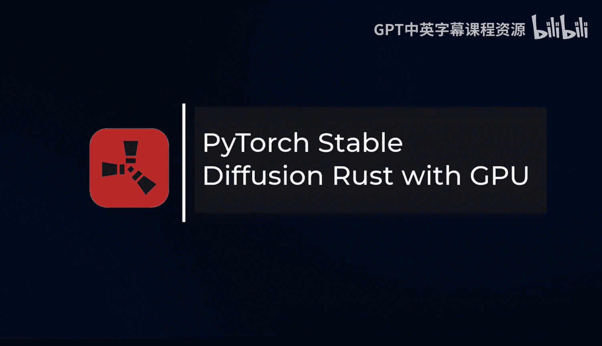
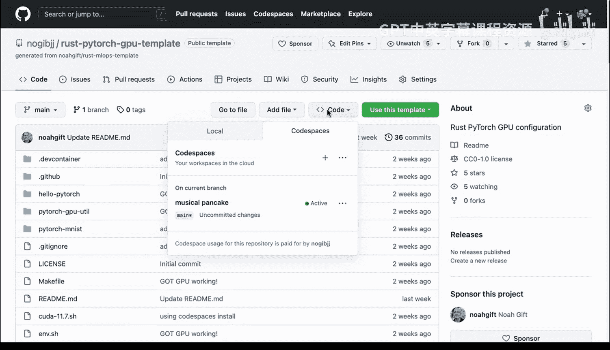
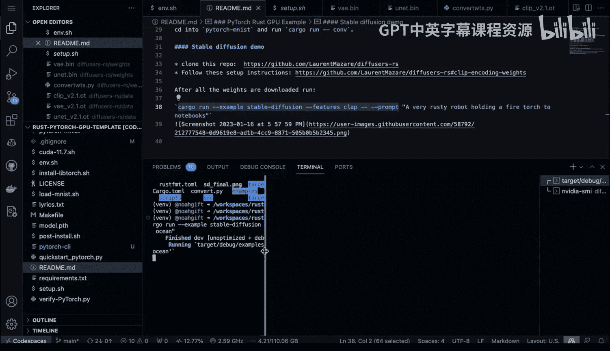
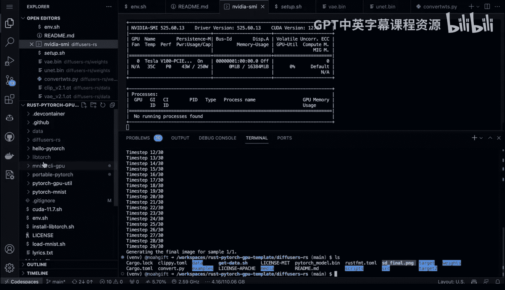
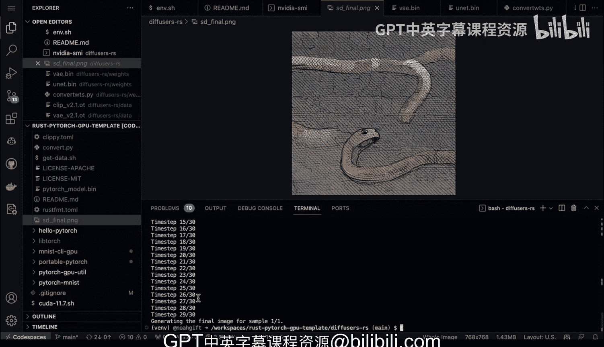

#  065：Rust、GPU、PyTorch与Stable Diffusion实践 🚀



在本节课中，我们将学习如何利用Rust语言，结合PyTorch和Hugging Face生态，来运行高性能的Stable Diffusion图像生成模型。我们将看到Rust如何通过其出色的性能、可移植性和打包能力，为深度学习研究和应用部署提供强大支持。

---

## 深度学习与Rust的机遇

机器学习领域最令人兴奋的发展之一是深度学习。从大语言模型到使用Stable Diffusion进行文生图等，涌现了许多令人惊叹的技术。Python程序员们已经从中获得了许多乐趣。

然而，Rust语言的一个有趣之处在于，你同样可以在Rust中使用PyTorch和Hugging Face。事实上，在某些情况下，其速度至少可以快**70倍**。如果你关心**可移植性**、**性能**，或者需要将预训练模型打包后分发给他人，Rust在许多方面是无可替代的选择。Rust可以轻松地将所有组件打包在一起，并利用Cargo等出色的工具进行管理和执行不同任务。

因此，在某种程度上，如果你想要一个高性能的深度学习研究环境，Rust是一个非常优秀的工具。

---

## 实践步骤：在Rust中运行Stable Diffusion

接下来，我们将一步步学习如何在Rust中实际使用带有PyTorch绑定的Stable Diffusion模型。我们还将演示如何调用GPU，并观察其在GitHub Codespaces环境中的使用情况。

### 项目与工具概览



我们使用Laurent Mazare维护的 `tch-rs` 包。这个包的出色之处在于它能非常好地将Rust与PyTorch绑定，包括执行GPU操作。其原理是绑定到PyTorch的C++ API。

以下是使用它的一个关键步骤：设置环境变量。例如，我设置了以下变量，从而成功启用了GPU支持：
```bash
export LIBTORCH=/path/to/libtorch
export LD_LIBRARY_PATH=${LIBTORCH}/lib:$LD_LIBRARY_PATH
```
通过 `tch-rs`，你可以训练模型，也可以使用预训练模型。我们最终的目标是运行Stable Diffusion示例来生成图像。

---

### 环境配置与代码执行

我将使用我的一个仓库模板，该模板已启用GPU支持。在Codespaces环境中，最大的收获是：通过一些设置代码，我能够将Torch CUDA的环境变量配置到bash或shell中。完成此步骤并`pip install`安装PyTorch后，Rust就能与Stable Diffusion协同工作了。

我们只需进入stable diffusion目录。我提前下载了所有权重数据，这是过程中比较棘手的一步。之后，便可以按照笔记执行。



现在，让我们打开一个终端，并使用以下命令实时监控GPU使用情况：
```bash
nvidia-smi -l 1
```
目前GPU使用率为0。

---

### 运行图像生成

接下来，我们运行以下命令来生成图像。我们将使用提示词“rusty code in the ocean”：
```bash
cargo run --example stable_diffusion -- "rusty code in the ocean"
```
运行后，我们将看到GPU使用率迅速上升并达到饱和状态。这个过程展示了高性能代码的魅力：我们可以利用Stable Diffusion这样的尖端库，直接与GPU通信，快速构建原型。

系统会依次构建Transformer和Autoencoder。完成后，图像文件将保存在 `diffusers` 目录下。例如，我们生成了名为 `rusty_code_in_the_ocean.png` 的图片。



我们可以轻松地修改提示词，快速生成新的图像。例如，将提示词改为“Python is so slow but rust is so fast”，然后再次运行命令，就能得到新的结果。

---

### 核心优势与总结

即使不是Rust专家，也可以像我一样，复现Stable Diffusion的示例链接，并将其作为一个原型工具来使用。这展示了利用Rust生态系统的广泛可能性。

本节课中，我们一起学习了：
1.  Rust在深度学习领域的高性能和可移植性优势。
2.  如何通过 `tch-rs` 包在Rust中绑定并使用PyTorch（包括GPU支持）。
3.  一步步配置环境并运行Stable Diffusion模型来生成图像。
4.  观察了GPU在代码执行过程中的利用率变化。



Rust凭借其强大的性能、安全的并发模型和卓越的打包工具Cargo，为机器学习运维和高效原型开发提供了极具吸引力的选择。希望你能尝试一下这个强大的技术栈。