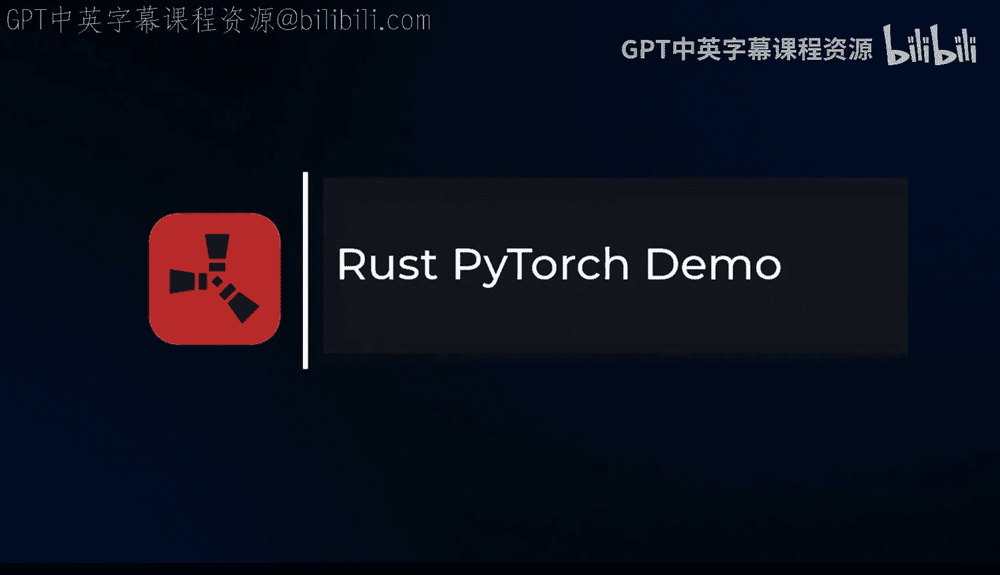
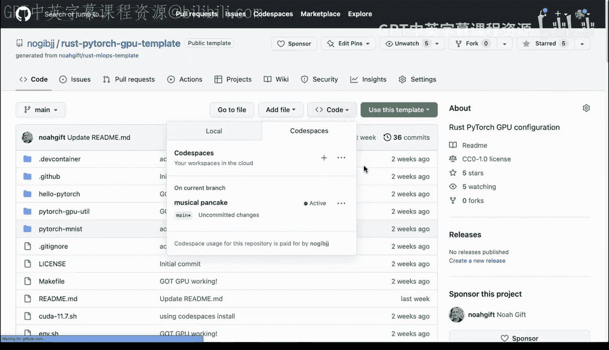
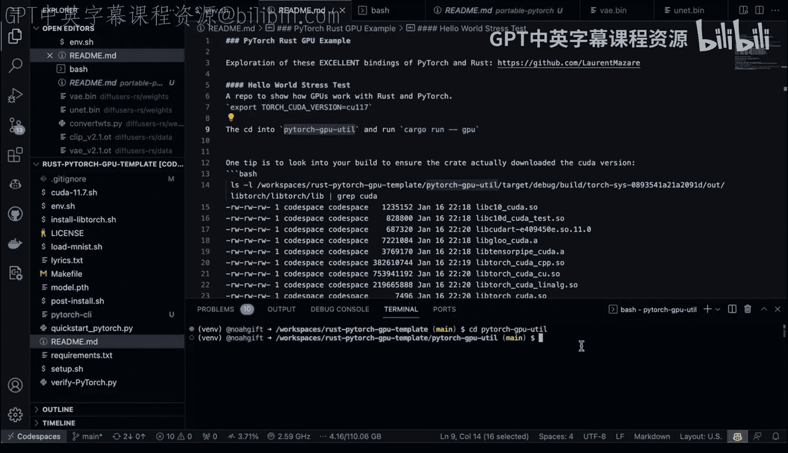
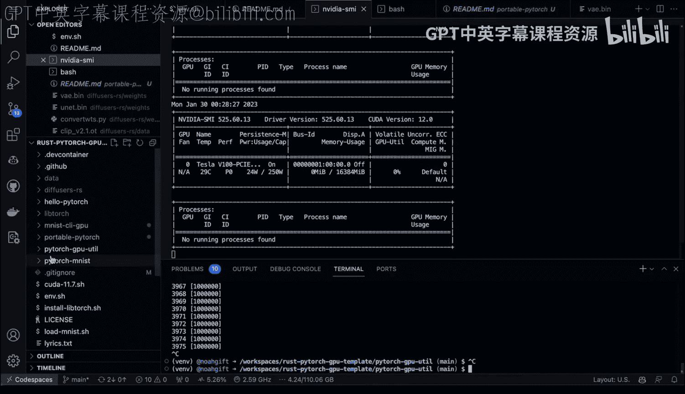
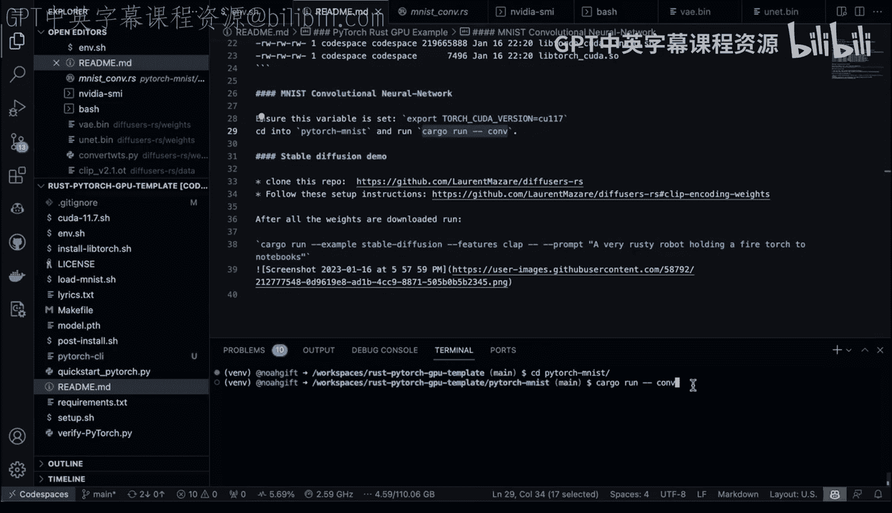
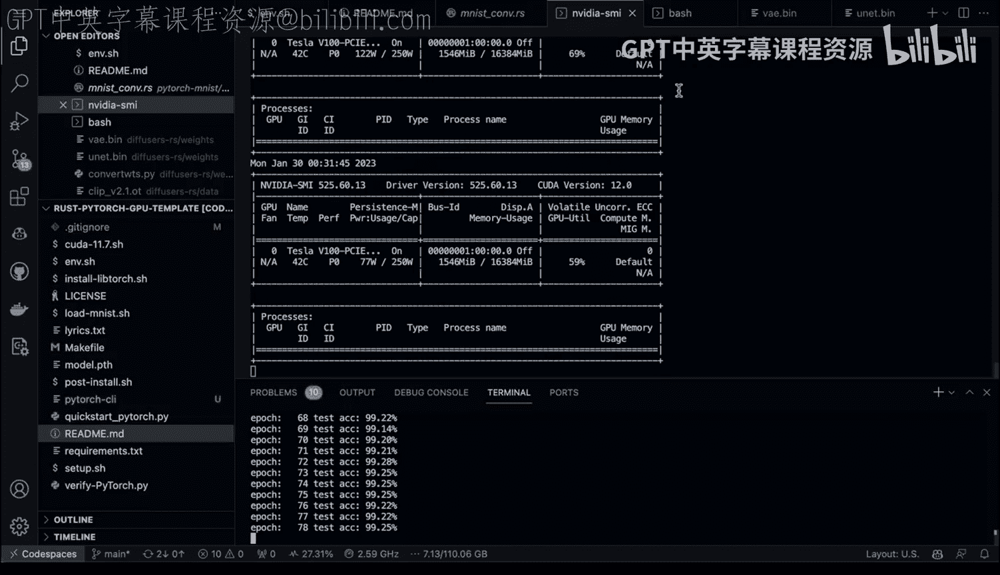
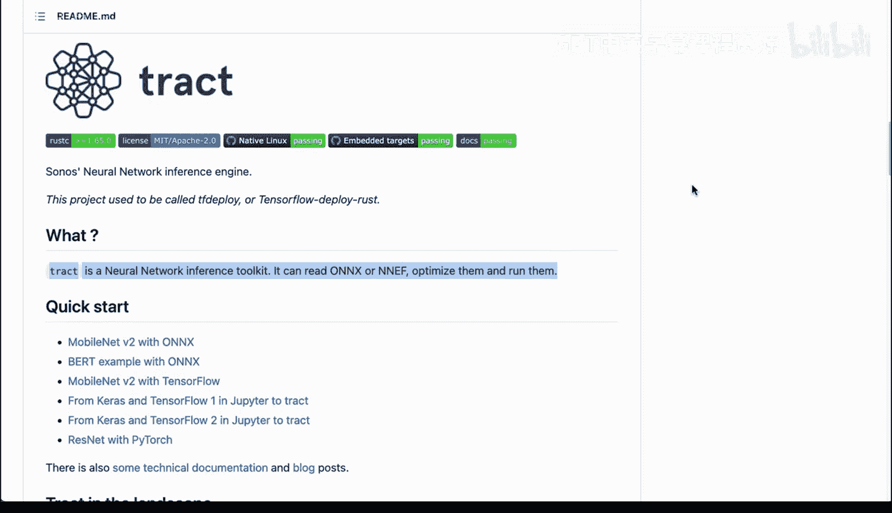
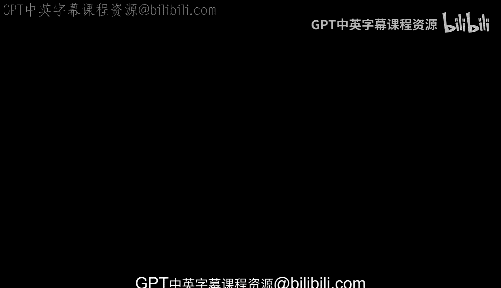

#  066：Rust与PyTorch演示 🦀🔥



在本节课中，我们将学习如何在生产环境中使用Rust语言结合PyTorch进行机器学习模型的训练与推理。我们将探讨Rust的实际应用价值，并通过具体示例展示其与GPU加速和现代部署技术的结合。

---

## 概述

很多人对在生产环境中使用Rust存在顾虑，认为它是一门较新的语言。然而，Rust自2010年诞生以来，已在诸多关键系统中得到验证。本节课旨在消除这些疑虑。我们将演示如何使用Rust的PyTorch绑定进行模型训练，并利用GPU加速。同时，我们也将介绍由AWS开发、用于支撑AWS Lambda服务的**Firecracker**微虚拟机技术，说明Rust如何支撑起大规模、高并发的生产级服务。

---

## Firecracker：AWS Lambda的基石

上一节我们提到了Rust在生产环境中的可行性，本节中我们来看看一个关键例证：Firecracker。

Firecracker是一项由AWS开发的基于服务器的技术，专门用于支撑其无服务器计算服务AWS Lambda。考虑到AWS在云计算领域的领先地位，其最受欢迎的服务之一选择用Rust构建，这足以证明Rust在生产环境中的能力和可靠性。

Firecracker是一个轻量级虚拟化方案，专为无服务器计算设计。它具有以下显著优势：

*   可以在125毫秒内启动一个微虚拟机。
*   经过实战检验，系统开销极低。
*   是一个开源项目。

如果我们查看其源代码架构，会发现这是一个用Rust构建的非常复杂的系统。Firecracker能够在一个实例上运行数千个多租户微虚拟机，是一种极其高效的虚拟化实现方式。这项技术非常适合用于机器学习模型的推理服务部署。

---



## Rust PyTorch GPU绑定实战

既然我们知道了PyTorch提供了Rust绑定，并且有Firecracker这样的Rust技术栈，接下来让我们深入实际，看看如何在Rust中使用PyTorch进行GPU加速计算。

我将通过一个代码空间来演示，使用Rust PyTorch GPU绑定实际上非常简单。



以下是几个可供探索的项目示例：

*   **portable-pytorch**：一个致力于模型便携性的项目。
*   **pytorch-mnist**：一个使用Rust训练MNIST数据集的示例。

我们首先进入`pytorch-gpu`目录，运行一个压力测试。在终端中执行命令 `cargo run --features gpu`。同时，我们可以打开另一个终端，运行 `nvidia-smi -l 1` 来实时监控GPU利用率。



我们可以看到，GPU很快就被完全占用。这段Rust代码有效地饱和了GPU的计算能力。如果我们查看源代码，会发现实现非常简洁：

```rust
// 示例代码：在Rust中指定PyTorch张量使用GPU
let device = Device::Cuda(0);
let tensor = Tensor::randn(&[1000, 1000], (Kind::Float, device));
```

代码量很少，就能实现针对GPU的操作。这主要借鉴了Rust PyTorch绑定主要作者的示例。

另一个有趣的例子是训练一个完整的模型。我们进入`pytorch-mnist`目录。查看其源代码，主要文件是一个卷积神经网络（CNN）的实现。

在代码中，我们导入必要的绑定，设置网络结构，定义训练循环，最后构建并运行神经网络。其逻辑与Python版的PyTorch代码并无太大差异。

运行训练命令后，我们可以再次通过`nvidia-smi`观察到GPU被迅速占用并用于模型训练。这表明，使用Rust这种高性能系统编程语言来训练深度学习模型是完全可行且高效的。



---

## Rust PyTorch的优势与MLOps实践

我的使用经验表明，Rust的PyTorch绑定质量非常高。此外，它还有一些额外优势：

1.  **更简单的打包**：得益于Cargo包管理器，依赖管理和项目构建比Python的`pip`和虚拟环境更加简单和一致。安装所需工具只需利用Cargo生态系统即可。
2.  **可复现的模型**：使用Rust可以更容易地创建可复现的模型构建流程。

一个与此相关的新兴趋势是**模型打包与分发**。人们正在认真考虑如何使用ONNX等便携式格式将模型打包，并集成到工具中分发给他人。这正是一种MLOps的核心实践：将你的模型及其运行环境一起封装，并部署到任何地方。

我强烈建议大家多关注这类演示。越多的人使用Rust这样的系统编程语言来探索机器学习示例，MLOps社区就越能从这些像“变色龙”一样灵活、可移植的工具中受益。

---



## 总结

本节课中，我们一起学习了：
1.  Rust语言在生产环境（尤其是AWS Lambda的Firecracker）中已得到大规模验证，并非“新”而“不可靠”。
2.  通过Rust的PyTorch绑定，可以方便地进行GPU加速的模型训练与推理，代码简洁高效。
3.  基于Cargo的打包机制和Rust的性能特性，为构建可复现、易分发的机器学习工具链提供了优秀基础。
4.  将模型与运行环境打包分发，是现代化MLOps的重要一环，而Rust在其中大有可为。





希望本教程能帮助你打消对Rust在机器学习领域应用的疑虑，并激发你尝试将高性能系统编程与机器学习工作流相结合的兴趣。