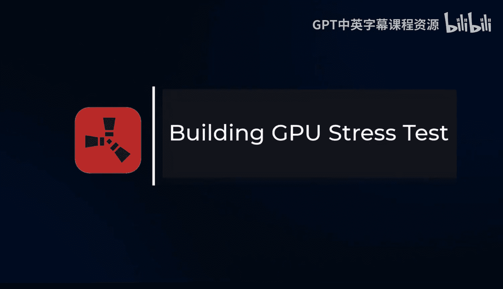
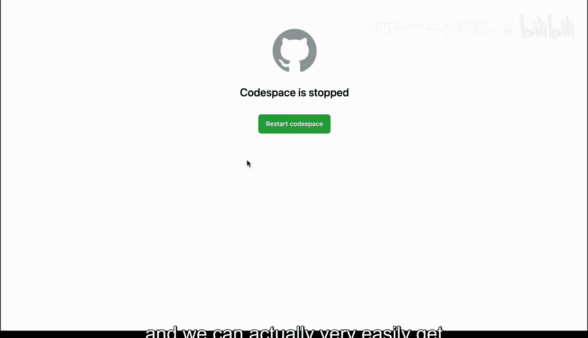
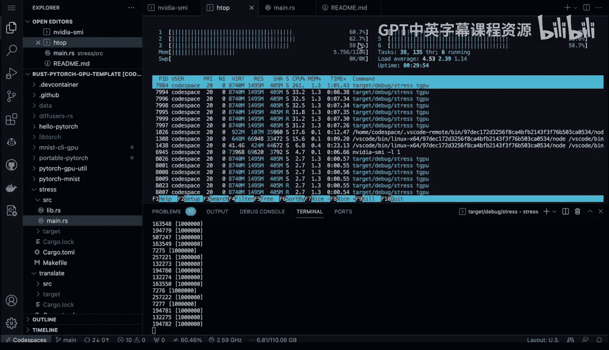

#  067：构建GPU压力测试工具 🚀



在本教程中，我们将学习如何使用 Rust 语言，结合其系统编程能力和 PyTorch 绑定，构建一个能够对 CPU 和 CUDA 支持的 GPU 进行压力测试的工具。我们将利用 Rust 的 `rayon` 库实现多线程，以最大化 GPU 的利用率。

---

## 概述

Rust 的一个强大用途是构建能与 GPU 通信的系统工具。幸运的是，PyTorch 的 Rust 绑定工作得很好。我们将组装一个工具，它不仅可以通过 PyTorch 与 CPU 通信并使其饱和，还能与支持 CUDA 的 GPU 通信，利用 PyTorch 使其饱和。同时，我们将利用 Rust 的 `rayon` 库实现真正的多核并行，通过多线程向 GPU 发送数据，以进行全面的压力测试。

接下来，我们来看看构建这个压力测试工具的架构。

## 架构设计

让我们看看如何利用 Rust 的系统编程能力和 PyTorch 的 Rust 绑定，为支持 CUDA 的 GPU 构建压力测试工具的架构。

以下是构建此工具的关键步骤：

1.  **环境准备**：首先，需要访问一个支持 CUDA 的 GPU 环境。这可以通过 GitHub Codespaces、AWS、GCP 或 Azure 实例实现。
2.  **监控配置**：配置 NVIDIA SMI 监控，以便在压力测试期间观察 GPU 的利用率。
3.  **绑定集成**：集成 Rust 的 PyTorch 绑定，这是与 GPU 通信的核心。
4.  **工具构建**：使用 Rust 的 `clap` 库构建命令行工具，提供三种不同的压力测试执行方式。
5.  **测试执行**：
    *   **CPU 测试**：向 CPU 设备发送数据。
    *   **GPU 测试**：向 CUDA 设备发送数据。
    *   **多线程 GPU 测试**：利用 `rayon` 库，以多线程方式向 GPU 发送数据，进行完全的压力测试。

现在，让我们开始构建这个工具。

## 项目结构与依赖

首先，我们需要设置正确的 Cargo 项目结构。这是本教程的关键要点之一。



以下是我们将使用的 `Cargo.toml` 文件中的依赖项：

```toml
[dependencies]
clap = { version = "4", features = ["derive"] }  # 用于构建命令行界面
tch = "0.13.0"                                   # Rust 的 PyTorch 绑定
rayon = "1.8"                                    # 用于并行计算的库
```

我们使用了三个主要依赖：
1.  `clap`：用于构建命令行工具。
2.  `tch`：Rust 的 PyTorch 绑定。
3.  `rayon`：允许我们编写多线程代码。

接下来，我们遵循一个模式：库代码放在 `src/lib.rs` 中，而命令行工具的主逻辑放在 `src/main.rs` 中。

## 库代码实现

让我们先看看库代码。在库代码中，我们构建了几个函数，每个函数都很简单。

以下是 `src/lib.rs` 的核心内容：

```rust
use rayon::prelude::*;
use tch::{Device, Tensor};

/// 执行 CPU 负载测试
pub fn cpu_load_test() {
    let device = Device::Cpu;
    let data: Vec<_> = (0..1000).map(|i| i as f64).collect();
    for _ in 0..100 {
        let tensor = Tensor::of_slice(&data).to(device);
        // 执行一些计算，例如
        let _ = tensor * 2;
    }
    println!("CPU 负载测试完成。");
}

/// 执行 GPU 负载测试
pub fn gpu_load_test() {
    if let Ok(device) = Device::cuda_if_available() {
        if device.is_cuda() {
            let data: Vec<_> = (0..1000).map(|i| i as f64).collect();
            for _ in 0..100 {
                let tensor = Tensor::of_slice(&data).to(device);
                let _ = tensor * 2;
            }
            println!("GPU 负载测试完成。");
        } else {
            println!("未检测到 CUDA 设备，回退到 CPU。");
            cpu_load_test();
        }
    } else {
        println!("无法获取 CUDA 设备。");
    }
}

/// 使用多线程执行 GPU 负载测试
pub fn threaded_gpu_load_test() {
    if let Ok(device) = Device::cuda_if_available() {
        if device.is_cuda() {
            // 使用 rayon 进行并行迭代
            (0..4).into_par_iter().for_each(|_| {
                let data: Vec<_> = (0..250).map(|i| i as f64).collect(); // 分割数据
                for _ in 0..25 {
                    let tensor = Tensor::of_slice(&data).to(device);
                    let _ = tensor * 2;
                }
            });
            println!("多线程 GPU 负载测试完成。");
        } else {
            println!("未检测到 CUDA 设备。");
        }
    } else {
        println!("无法获取 CUDA 设备。");
    }
}
```

这段代码的关键点在于：
*   `cpu_load_test` 函数将向量数据发送到 CPU 设备。
*   `gpu_load_test` 函数将迭代目标改为 CUDA 设备。
*   `threaded_gpu_load_test` 函数使用 `rayon` 的 `into_par_iter().for_each()` 操作实现多线程，并将数据推送到 CUDA 设备。

这样，我们就有了三种完全不同的测试方式。

## 主程序与命令行界面

现在，我们转到 `src/main.rs`。这里使用了完全相同的模式，本质上是样板代码。

以下是 `src/main.rs` 的核心内容：

```rust
use clap::{Command, Arg, SubCommand};
use stress_tool::{cpu_load_test, gpu_load_test, threaded_gpu_load_test}; // 假设库 crate 名为 `stress_tool`

fn main() {
    let matches = Command::new("GPU 压力测试工具")
        .version("1.0")
        .author("作者")
        .about("使用 Rust 和 PyTorch 进行 CPU/GPU 压力测试")
        .subcommand(SubCommand::with_name("cpu").about("运行 CPU 压力测试"))
        .subcommand(SubCommand::with_name("gpu").about("运行 GPU 压力测试"))
        .subcommand(SubCommand::with_name("t-gpu").about("运行多线程 GPU 压力测试"))
        .get_matches();

    match matches.subcommand() {
        Some(("cpu", _)) => {
            println!("开始 CPU 压力测试...");
            cpu_load_test();
        }
        Some(("gpu", _)) => {
            println!("开始 GPU 压力测试...");
            gpu_load_test();
        }
        Some(("t-gpu", _)) => {
            println!("开始多线程 GPU 压力测试...");
            threaded_gpu_load_test();
        }
        _ => {
            // 如果没有提供子命令，显示帮助信息
            let _ = Command::new("GPU 压力测试工具")
                .subcommand(SubCommand::with_name("cpu").about("运行 CPU 压力测试"))
                .subcommand(SubCommand::with_name("gpu").about("运行 GPU 压力测试"))
                .subcommand(SubCommand::with_name("t-gpu").about("运行多线程 GPU 压力测试"))
                .print_help();
        }
    }
}
```

这个模式非常强大，因为你只需在库中编写几行代码，然后将这些函数映射到命令行子命令上。唯一需要注意的是确保库中的函数是 `pub`（公开的）。

## 运行与监控

现在，要运行这个工具，我们可以使用 Cargo。

首先，构建并查看帮助菜单：

```bash
cargo run -- --help
```

这将编译并显示帮助菜单，对应我们定义的三个命令：`cpu`、`gpu` 和 `t-gpu`。

进行压力测试时，有两种监控非常有帮助：

1.  **CPU 监控**：可以使用 `htop` 等工具。
2.  **GPU 监控**：使用 `nvidia-smi` 命令。

**运行 CPU 测试**：
```bash
cargo run -- cpu
```
此时，工具会向 CPU 发送大量数据，你会看到 CPU 使用率饱和。而在 GPU 监控中，不会看到任何活动。这验证了代码确实在使用 CPU 设备。

**运行 GPU 测试**：
```bash
cargo run -- gpu
```
现在，工具会向 GPU 发送数据。切换到 GPU 监控（如 `nvidia-smi`），你会看到 GPU 利用率开始上升，可能达到约 25% 的负载。同时，CPU 核心仍在被使用。

**运行多线程 GPU 测试**：
```bash
cargo run -- t-gpu
```
这是使用 `rayon` 的代码。运行后，你会看到发送到 GPU 的负载显著增加，可能达到之前的 2 到 3 倍。同时，观察 CPU 负载，你会发现它实际上降低了。这是因为当你开始向 GPU 发送足够多的任务时，它可以有效地卸载系统上的部分计算资源。

## 总结

本节课中，我们一起学习了如何使用 Rust 构建一个强大的 GPU 压力测试工具。我们了解了如何利用 Rust 的系统编程特性、PyTorch 的 Rust 绑定以及 `rayon` 并行库，来实现对 CPU 和 CUDA GPU 的负载测试。



通过构建这样的基准测试工具，你可以真切地感受到环境中发生了什么。特别是在像使用 GPU 进行 PyTorch 训练这样的分布式计算问题中，除非进行基准测试，否则你无法真正了解其运行状况。Rust 是执行训练、推理、构建便携二进制工具的完美选择，它作为系统编程语言，是 MLOps（机器学习运维）中的理想工具。