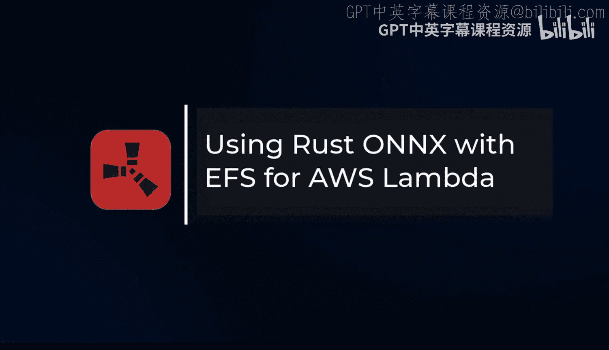
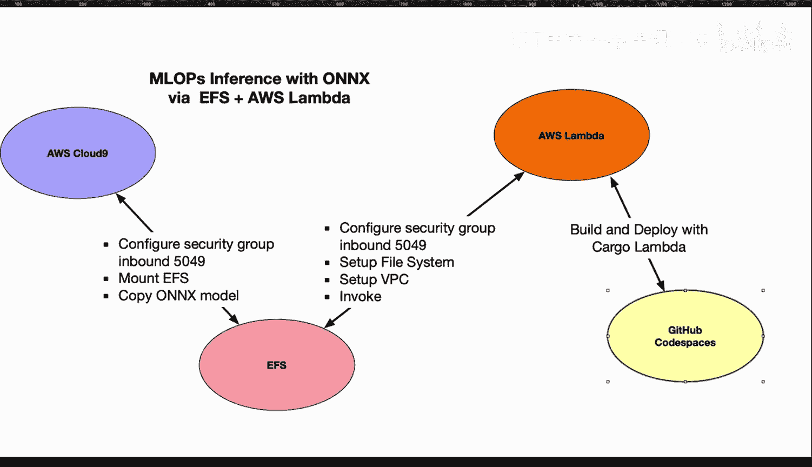
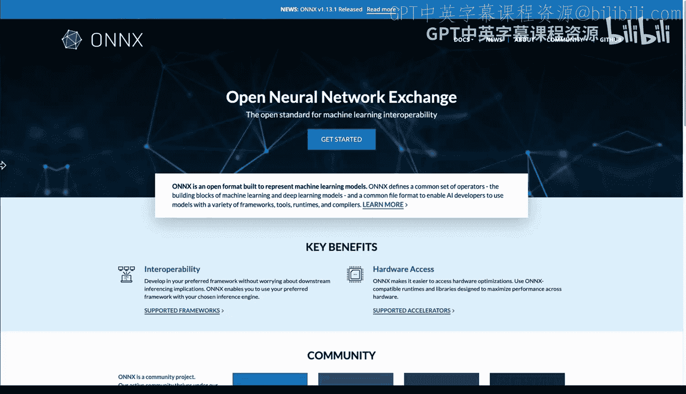
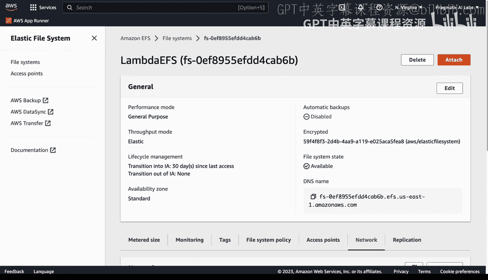
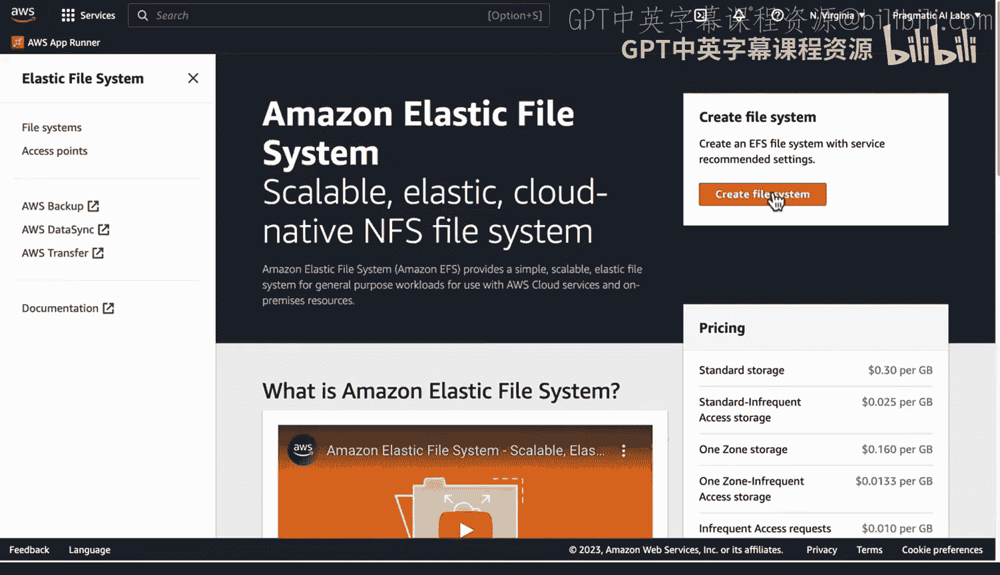
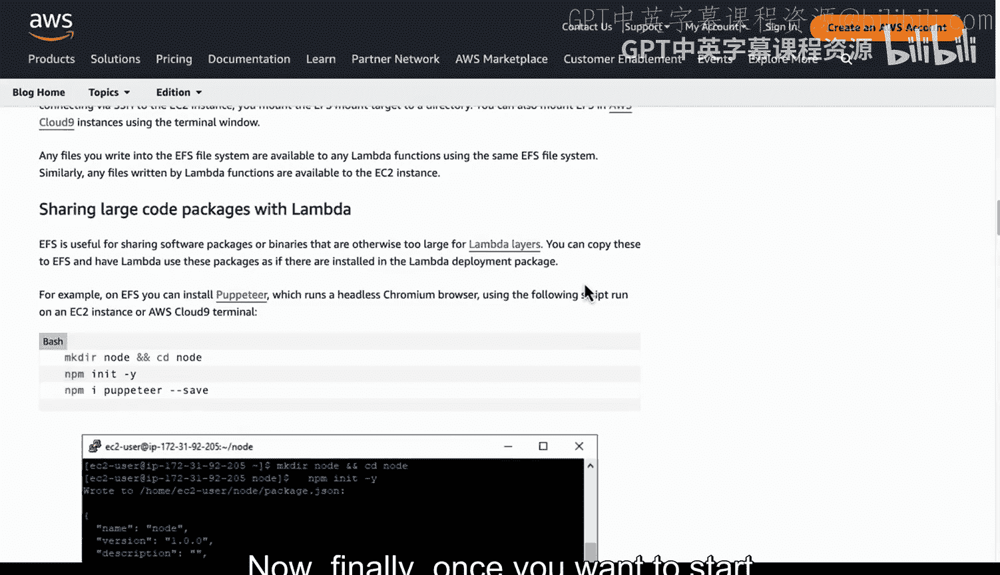
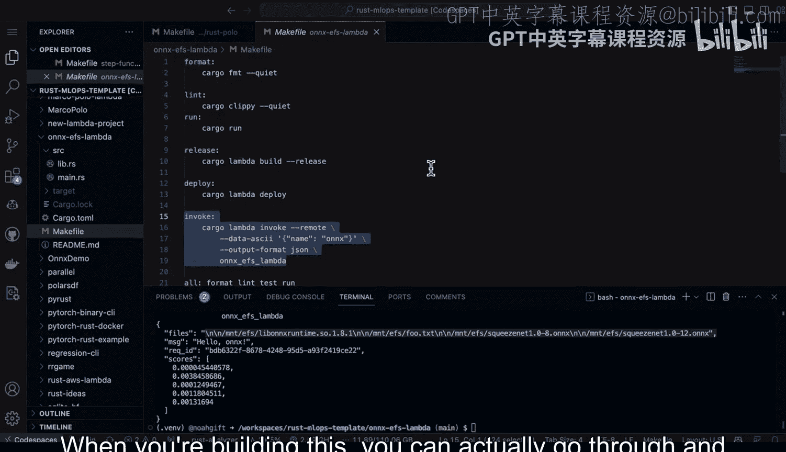
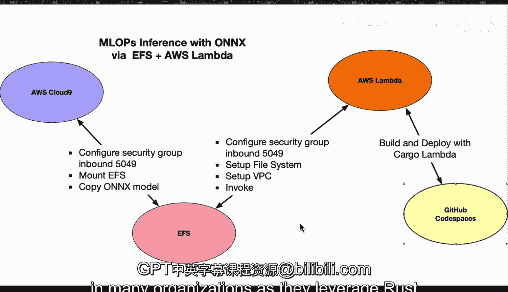

#  068：在AWS Lambda中使用Rust、ONNX与EFS进行模型推理 🚀



在本节课中，我们将学习如何构建一个基于无服务器架构的机器学习推理服务。具体来说，我们将使用**Rust**语言、**ONNX**模型格式，通过**AWS EFS**文件系统挂载模型，并最终在**AWS Lambda**上部署和调用。这种组合方式能充分发挥无服务器架构免运维、易部署的优势，同时利用Rust的高性能和ONNX的模型通用性。

---

## 项目架构概述

上一节我们介绍了项目的目标，本节中我们来看看其核心架构。整个流程的目标是：使用AWS Lambda这类无服务器技术来提供模型推理服务。其优势在于无需管理基础设施，部署简单，尤其适合使用像Rust这样可以编译为单一二进制文件的高性能语言。

为了实现这一点，我们需要让Lambda函数能够访问存储在EFS文件系统中的ONNX模型文件。因此，整个架构涉及以下几个关键AWS服务的配置与联通。

---

## 第一步：设置EFS文件系统 📁

首先，我们需要创建并配置一个Amazon EFS文件系统，用于存储我们的ONNX模型。





1.  **创建EFS文件系统**：在AWS控制台找到EFS服务，创建一个新的文件系统。通常使用默认配置即可。
2.  **配置安全组**：这是关键且容易出错的一步。EFS文件系统关联的安全组必须**开放端口5049**的入站规则。这是EFS客户端（如Cloud 9或Lambda）与EFS服务通信所必需的端口。
3.  **在开发环境挂载EFS**：为了将模型文件放入EFS，我们需要在一个可以访问该EFS的环境中挂载它。AWS Cloud 9是一个不错的选择。以下是挂载步骤：
    *   在EFS控制台找到你的文件系统，点击“附加”按钮。
    *   选择“使用EFS挂载助手”的选项，它会生成一个挂载命令。
    *   在你的Cloud 9实例中运行该命令，即可将EFS挂载到指定目录。

完成以上步骤后，你就可以将1个或多个ONNX模型文件复制到挂载的EFS目录中。



---



## 第二步：配置AWS Lambda函数 ⚙️

接下来，我们需要配置Lambda函数，使其能够访问上一步创建的EFS。

1.  **将Lambda接入VPC**：在Lambda函数的配置中，必须将其放入一个VPC。这个VPC需要包含我们之前为EFS配置的、开放了5049端口的安全组。这样Lambda才能与EFS通信。
2.  **添加文件系统配置**：在Lambda配置的“文件系统”部分，添加对EFS的访问。
    *   **文件系统ID**：填入你创建的EFS的ID。
    *   **访问点**：你需要在EFS控制台中创建一个“访问点”。创建后，将访问点ID填入此处。
    *   **本地挂载路径**：指定一个路径（例如`/mnt/efs`），Lambda函数将在运行时把EFS挂载到此路径下。

有一篇AWS官方文章《在无服务器应用程序中将Amazon EFS用于Lambda》详细介绍了这些步骤，建议参考。

---

## 第三步：开发与测试Rust Lambda函数 🦀

当基础设施就绪后，我们就可以专注于应用代码的开发了。我们使用Rust和`cargo-lambda`工具进行本地开发和测试。

以下是核心代码结构的解析：

```rust
// 示例：从EFS加载模型并进行推理
use onnxruntime::environment::Environment;
use std::path::Path;

fn load_model_from_efs() {
    // 模型文件路径指向EFS的挂载点
    let model_path = Path::new("/mnt/efs/models/squeezenet.onnx");
    // 使用ONNX Runtime加载模型
    // ... 后续推理代码
}
```



代码关键点：
*   **模型加载**：代码通过指定的本地挂载路径（如`/mnt/efs/models/squeezenet.onnx`）从EFS读取ONNX模型文件。
*   **辅助调试函数**：建议编写一个列出挂载点文件列表的函数，用于验证EFS是否成功挂载及模型文件是否存在。
*   **推理执行**：使用ONNX Runtime库执行实际的模型推理并返回结果。

为了方便测试，可以创建一个`Makefile`：

```makefile
invoke:
    cargo lambda invoke --remote \
          --data-ascii '{"image_url": "https://example.com/cat.jpg"}'
```

这个命令会打包你的Rust代码，部署到Lambda，并发送一个测试事件来触发函数执行，从而验证整个流程。

---

## 关键要点与总结 ✅

本节课中我们一起学习了如何构建一个结合了Rust、ONNX、EFS和AWS Lambda的MLOps推理流水线。我们来回顾一下核心要点和需要牢记的步骤：



以下是成功部署此架构必须检查的清单：

*   **端口5049**：确保EFS的安全组以及Lambda所在的VPC安全组都允许5049端口的通信。这是所有组件互联的基础。
*   **遵循EFS挂载指南**：严格按照AWS控制台提供的EFS挂载说明进行操作。
*   **模型文件就位**：将训练好的ONNX模型从开发环境复制到EFS的指定目录。
*   **Lambda VPC配置**：确认Lambda函数已正确配置VPC，并且该VPC能访问EFS的安全组。
*   **文件系统访问点**：在EFS中创建访问点，并在Lambda配置中正确引用。

从开发体验角度，**GitHub Codespaces**是一个理想的开发环境，它集成了Copilot等工具，可以方便地进行代码编写和远程测试。



总而言之，**Rust + ONNX + EFS + AWS Lambda** 是一种新兴且强大的MLOps实践模式。它利用无服务器技术简化了运维，通过高性能语言和通用模型格式优化了推理效率，非常适合需要在生产环境中快速、高效部署机器学习模型的团队。