#  069：通过Cloud Shell使用Python和Rust接入GCP

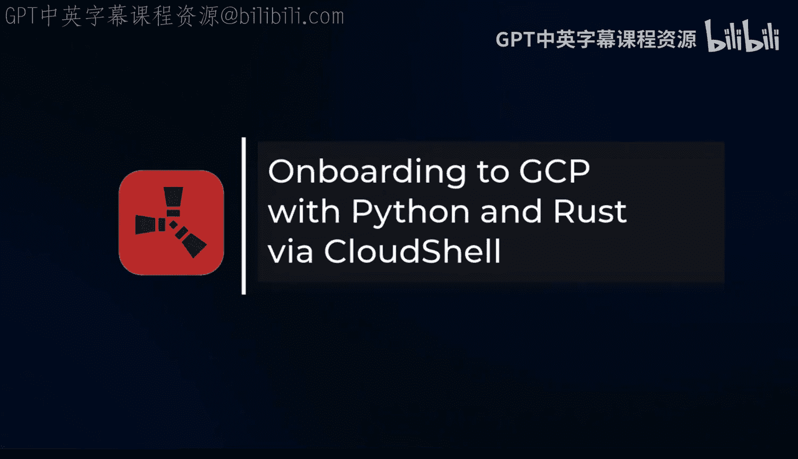

在本节课中，我们将学习如何开始使用Google Cloud Platform。我们将重点介绍其免费套餐，并演示如何通过Cloud Shell环境，使用Python和Rust两种编程语言来接入和操作GCP服务。

## 概述：Google Cloud免费套餐

首先，我们来看一下Google Cloud的免费套餐。

如果你在Google Cloud免费套餐上启动，你可以访问20种免费产品。

你还会获得**$300**的免费额度，但需要在三个月内使用。免费套餐包含的部分产品有：计算引擎、云存储、BigQuery、Kubernetes、应用引擎、Cloud Run、Cloud Build、Stackdriver、Filestore、Pub/Sub、云函数、Vision AI、语音转文本、自然语言API、AutoML等。

这里确实有大量的免费服务。

## 启动并探索Cloud Shell

接下来，我们开始实际操作。我将进入云控制台仪表板。

你可以在这里看到所有内容的概览。首先，我们有项目信息。在项目信息中，你可以决定例如如何向项目添加人员、配置项目设置等。

此外，中间的仪表板显示了一些最近访问的服务。

你还有一个资源选项卡，可以切换查看不同的资源，例如，如果你想启动虚拟机。

右侧还有状态信息。

当你使用GCP时，这通常是你最常使用的起点。请注意，我在这里选择了一个项目。如果我想创建一个新项目，我会点击“创建新项目”。

对于初次使用Google Cloud Platform的用户，我建议启动Cloud Shell。

让我们开始操作。Cloud Shell的优势在于，你可以立即开始在这个环境中构建解决方案、尝试想法。

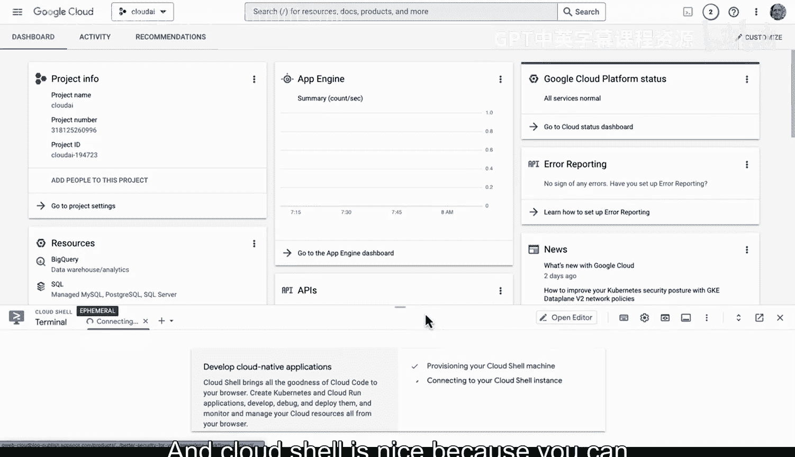

## 配置Python开发环境

我喜欢做的第一件事是创建一个Python虚拟环境，以便测试Python项目并在Cloud Shell中运行它们。我将首先执行以下命令：

```bash
python3 -m venv .venv
```

然后，我会把这个虚拟环境放在一个隐藏的主目录中。

创建成功。接下来，我喜欢编辑我的`.bashrc`文件。

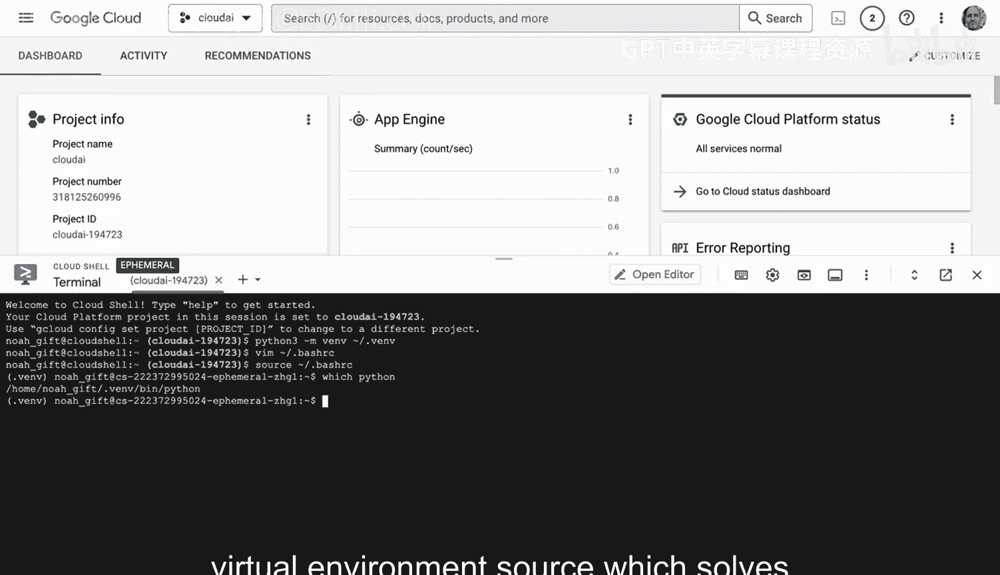

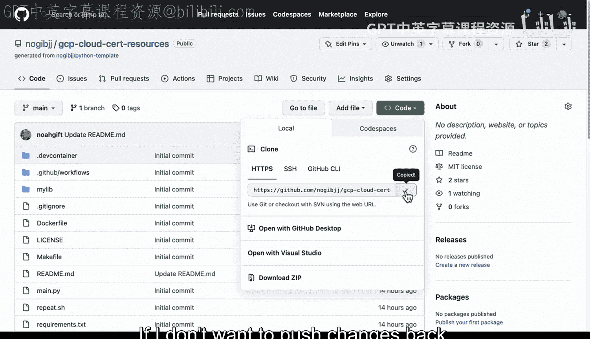

在这里，我可以添加一行来激活Python虚拟环境。

```bash
source .venv/bin/activate
```

这是一个有用的小技巧，现在每次我打开这个环境时，都会自动激活Python虚拟环境，这解决了许多与Python相关的奇怪问题。

如果我想进入一个存放代码的仓库，例如我这里有一些Python代码，并且我不想推送更改回去，我可以直接在这个环境中进行`git clone`。

让我们执行这个操作。输入`git clone`命令。

现在，我有了我的Python代码。如果我`cd`进入这个仓库。

我们可以看到我有一个测试文件，还有一些其他文件。

我喜欢使用`Makefile`，因为它允许我使用快捷命令。我们甚至可以进入编辑器查看代码，这是Google Cloud平台内部一个很好的资源。

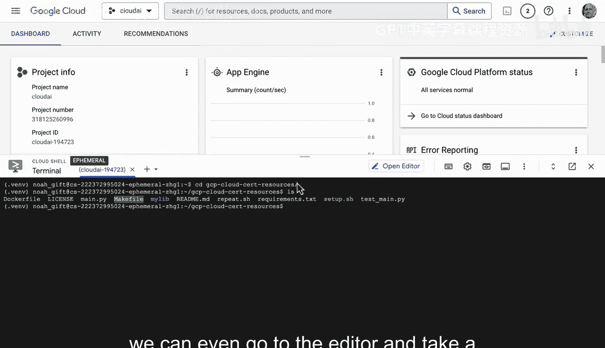

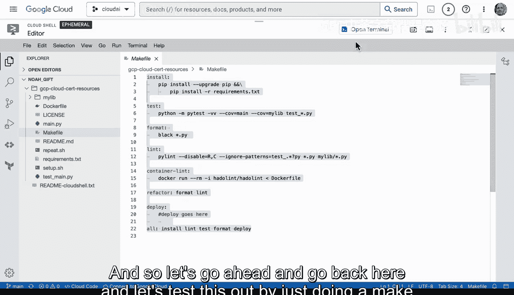

进入这个目录，我们在这里看到一个`Makefile`。你可以看到我可以执行`install`、`test`、`format`、`lint`、`container`、`refactor`等命令。这包含了在Google Cloud环境中工作时非常常见的所有操作。如果你查看教程，也会看到类似的内容。

让我们返回这里，通过执行`make install`和`make lint`来测试一下。

我们输入`make install`，这将根据我的`requirements.txt`文件安装所有包。

安装完成后，我可以对我的代码进行代码检查。这个公式实际上适用于任何语言，不仅仅是Python。

我们执行`make lint`。看起来我们的代码检查成功了。

你甚至可以查看这个文件，看看`main`函数里有什么，这是一个非常简单的应用程序。

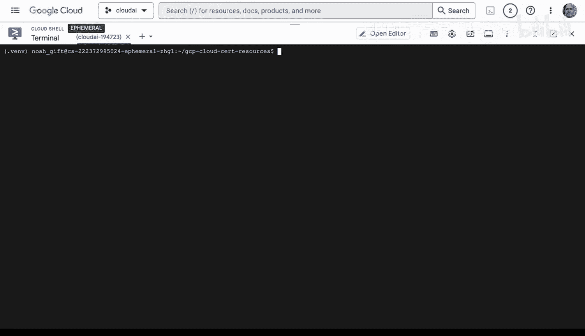

## 配置Rust开发环境

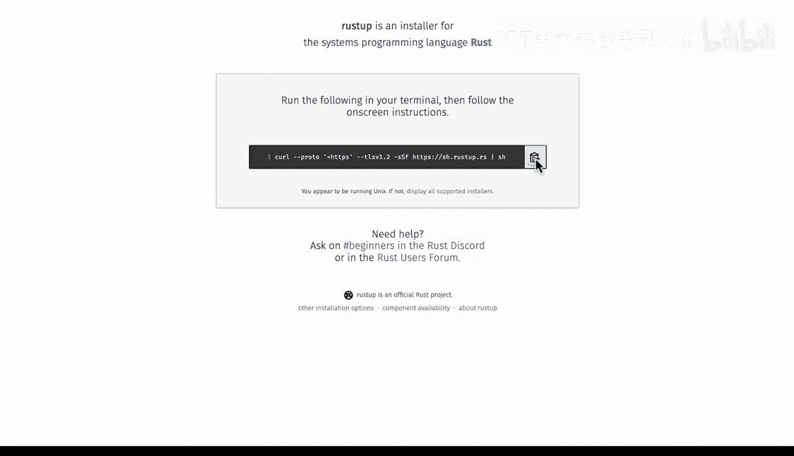

现在我们已经让Python正常工作了，我们还能做什么呢？我们还可以安装Rust。

我将访问`rustup.rs`，复制安装命令，然后在这里粘贴执行。这将下载Rust环境，包括`cargo`和`clippy`代码检查工具。

基本上，我们拥有了成为Rust开发者所需的一切。

我喜欢用Rust编程的原因之一是，根据你所做的事情，它的性能可能比Python好**40倍到1000倍**。

因此，如果你想进行高性能计算，这通常是一个非常好的选择。安装程序已经将其添加到了我的路径中。

所以，如果我在这里，我可以实际运行`cargo`。我可以创建另一个“Hello World”项目。

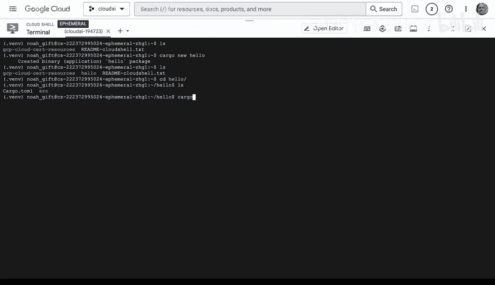

```bash
cargo new hello
```

这将在这里创建一个示例目录。进入目录后，与Python不同，我不需要做任何额外的步骤，我只需直接运行`cargo run`。

如果我们输入`cargo run`，它会编译并输出我们的“Hello World”。

如果我们想查看该项目的结构，可以在这里查看。你可以看到，在`Cargo.toml`中，这是一个非常简单的“Hello World”文件。如果我想在这里添加依赖，例如GCP SDK，我可以在这里完成。

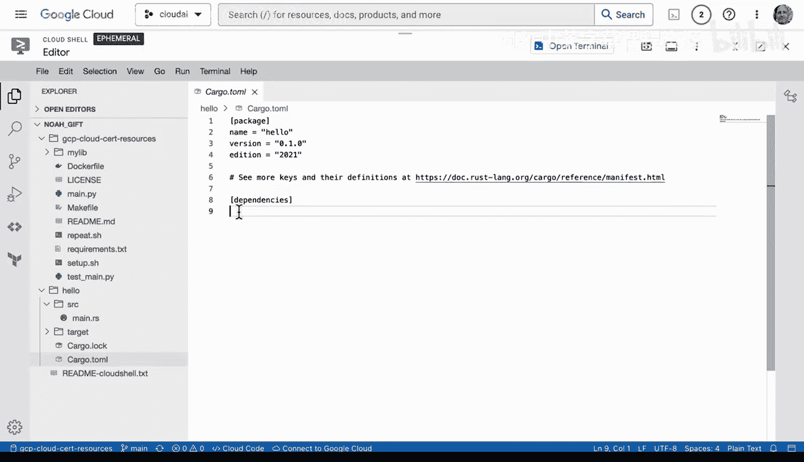

这是一个很好的概述，展示了作为一名开发者你需要做的一些事情。我认为Python和Rust是两种非常理想的编程选择。

## 管理GCP虚拟机实例

我要做的最后一件事是启动一个虚拟机并查看它。哦，这里，我们看到已经启动了一个实例。

如果我想创建一个新的，我可以在这里点击“创建实例”，并启动某种类型的机器。例如，如果我想启动一个微型实例，你可以看到我将花费的成本估算会显示在这里，它是按小时计费的。

如果我想要一台非常大的机器，查看这里，在这个特定环境中，一台32核的机器需要**$500**。因此，确保你查看启动不同机器时的各项指标是很重要的。

由于我已经有一个正在运行的实例，我需要做的就是通过命令行来查询它。

在Google Cloud的教程中，查看如何列出机器的命令行概览是非常常见的。

我的历史命令中已经有一个相关命令。我们可以查看最近的一条命令，这也是一个获得快捷方式的好方法，就是运行`history`。

如果我输入`gcloud compute instances list`。

我们可以看到，我实际上可以控制它。如果我愿意，我甚至可以使用这个基础命令来启动东西。

```bash
gcloud compute instances
```

你还可以运行`help`来获取关于特定命令的更多信息。

这确实是一个面向命令行的服务。因此，如果你理解命令行，你将能很好地使用Google Cloud。

## 总结

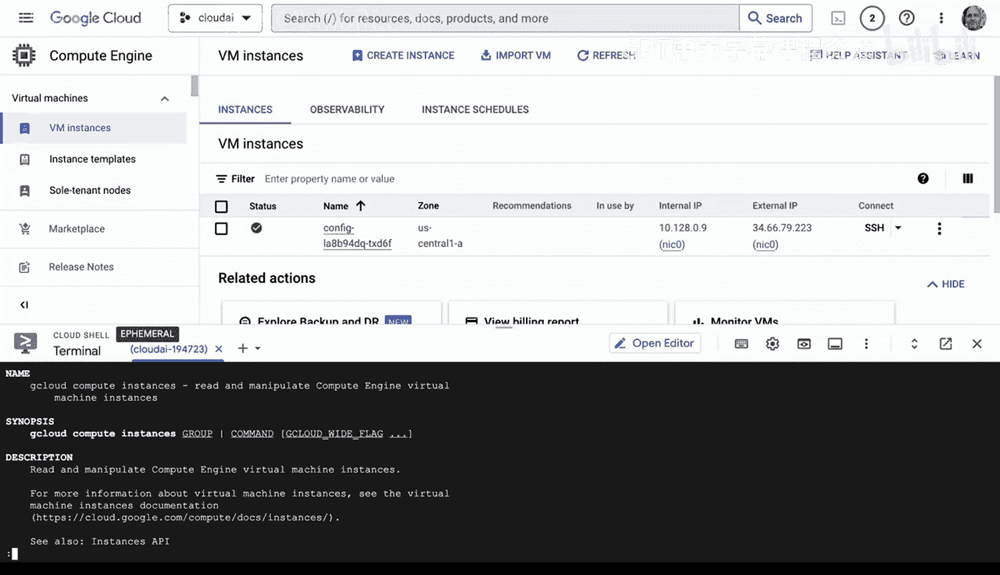

本节课中，我们一起学习了如何开始使用Google Cloud Platform。我们介绍了其免费套餐，演示了如何通过Cloud Shell配置Python和Rust开发环境，并展示了如何通过命令行管理GCP资源（如虚拟机实例）。希望你能亲自尝试这些命令。