#  071：通过Google Cloud Run构建部署Rust微服务

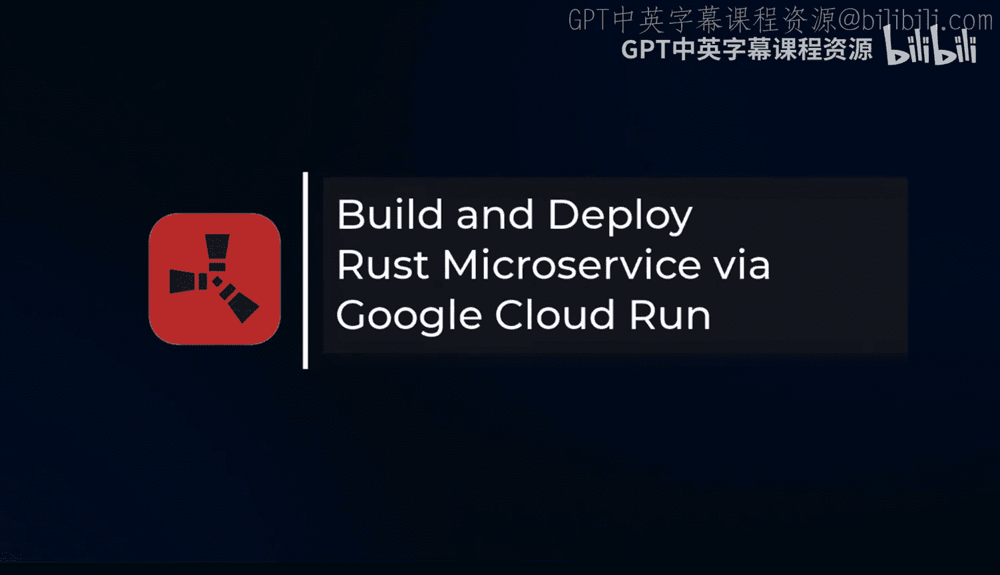

在本节课中，我们将学习如何在Google Cloud Platform上，为Rust编写的微服务构建一个容器化部署流程，并利用Cloud Run实现服务托管。

## 概述

我们将从一个已构建好的Rust微服务代码仓库开始。部署完成后，服务将拥有一个Cloud Run管理界面，并能通过URL访问。其核心架构是实现一个在Google云平台上持续交付的容器化Rust微服务。

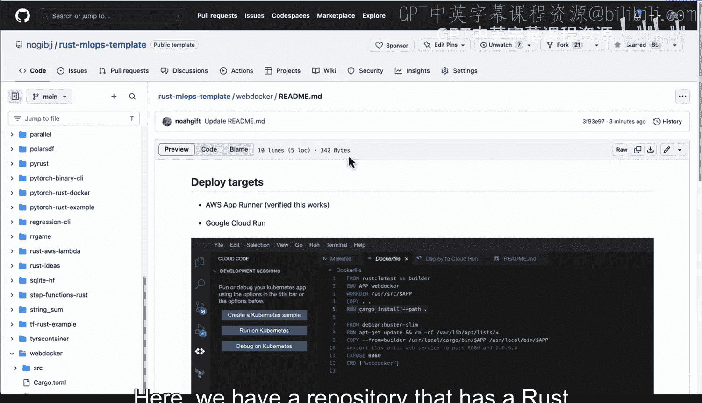


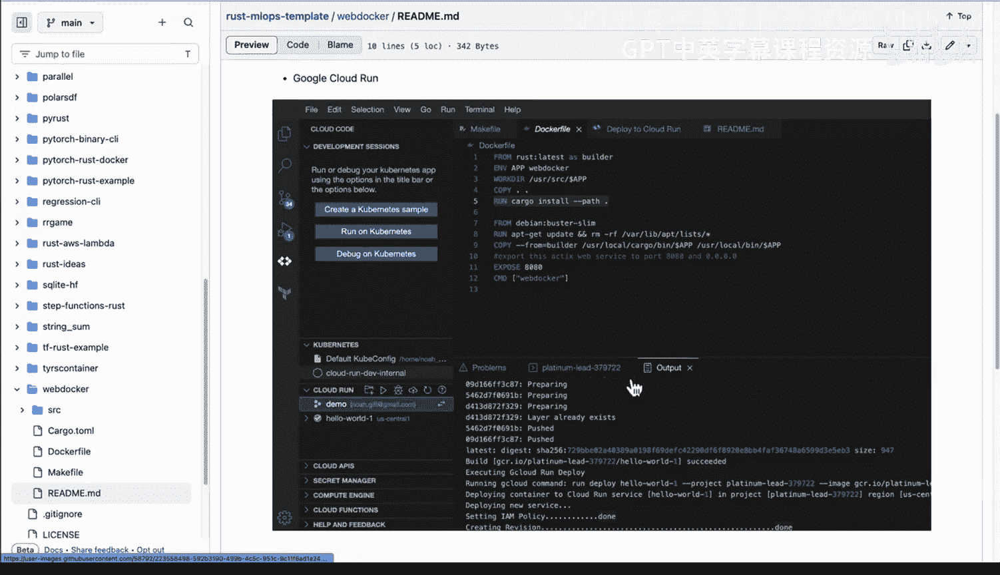

代码存放在GitHub仓库中。任何代码变更都会触发GCP Cloud Build环境，进而自动将更新部署到容器即服务（CaaS）平台Cloud Run上。Rust作为一种微服务框架，能够实现低内存、高性能的计算。我们的目标是构建一个能够随代码更新而持续推送到生产环境的流程。


## 开始构建

首先，我们需要打开Cloud Shell并选择打开编辑器。这个编辑器具有一些定制化功能，便于我们本地构建和测试Cloud Run微服务。

点击这里的Cloud Code图标，会看到一个Cloud Run图标。我们需要先进行一次授权。授权完成后，就可以开始创建新的应用程序了。

接下来，我们选择“创建新的Cloud Run应用”。在模板选择步骤，可以选择任意模板，因为后续我们会修改代码。这里选择Go模板作为起点。创建应用后，可以根据习惯更改编辑器的颜色主题，例如选择深色主题。然后，打开一个新的终端。

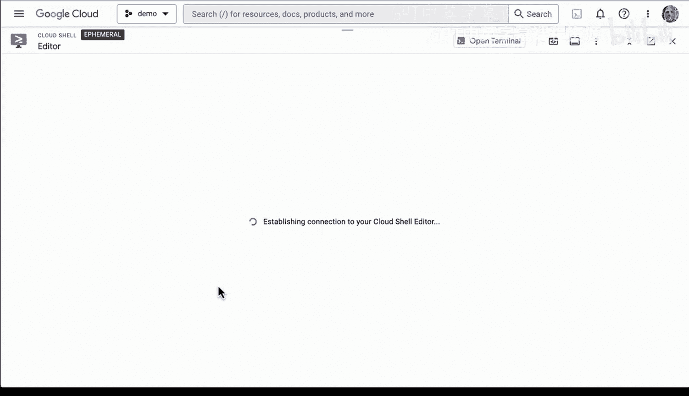

## 准备项目环境

环境设置完成后，我们需要清理并修改项目，使其能够运行Rust代码。

以下是需要清理的目录和文件：
*   删除Go模板生成的目录。
*   删除Go相关的代码文件。


清理完毕后，项目就准备就绪了。接下来，我们将把Rust应用的代码文件复制到当前仓库中。

## 配置Dockerfile

首先，复制Rust应用的Dockerfile代码，并将其粘贴到本仓库中。

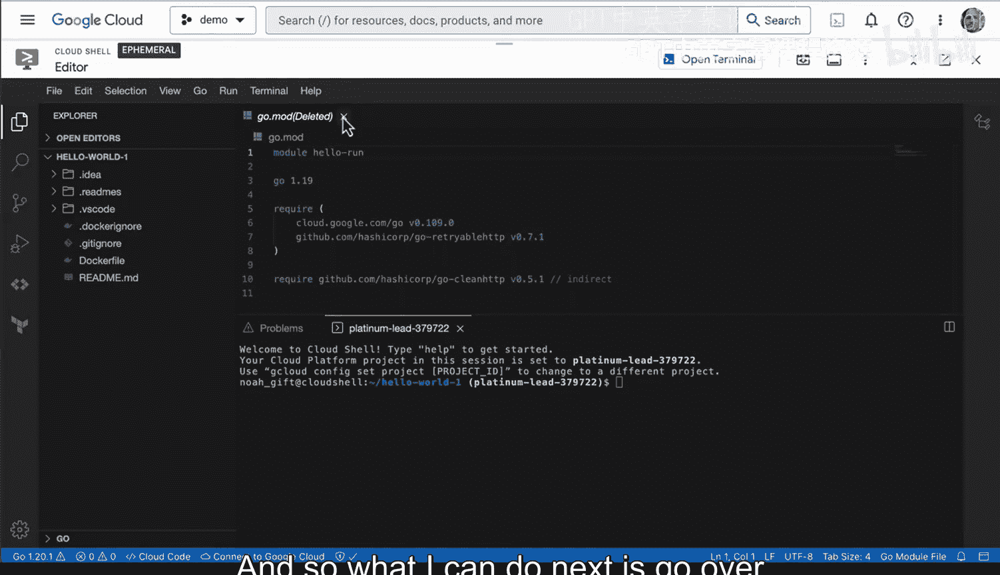
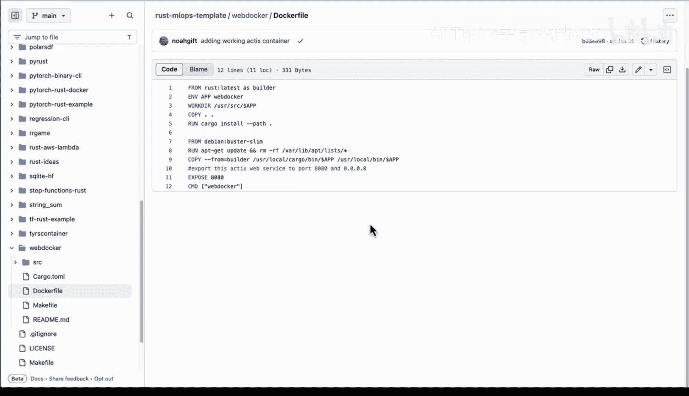
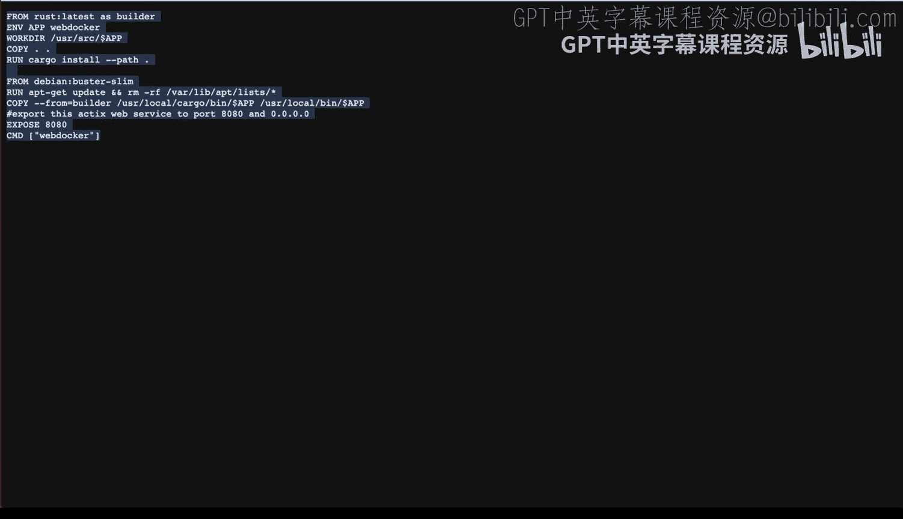

我们将Go的Dockerfile替换为Rust的Dockerfile。这个Dockerfile定义了一个简单的构建过程：创建二进制文件，将其推入一个精简的容器，并从8080端口暴露服务。


## 获取并设置Rust源代码


接下来，我们需要获取Rust的源代码文件。我们将进入源代码目录，并创建`lib.rs`和`main.rs`文件。

对于Rust项目，一个简便的方法是使用`cargo`工具。首先检查`cargo`是否已安装。如果未安装，可以通过`rustup`工具快速安装。

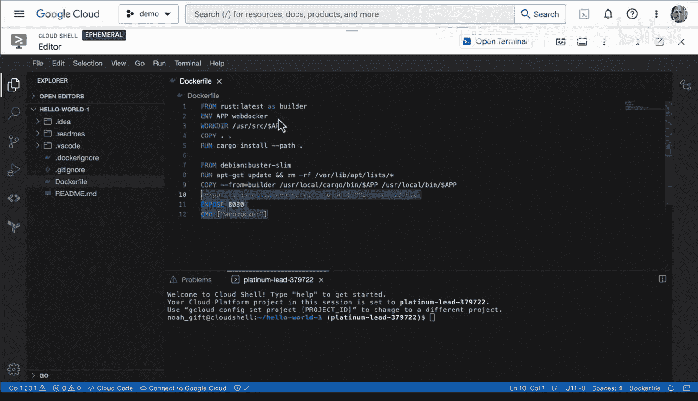
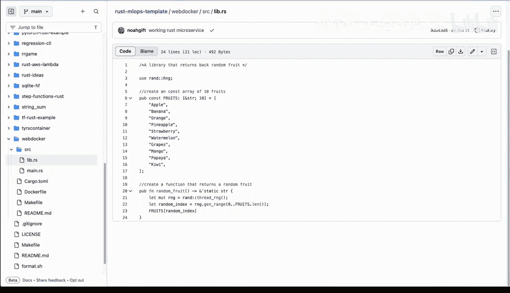
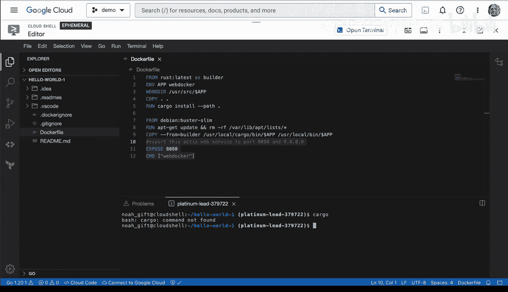

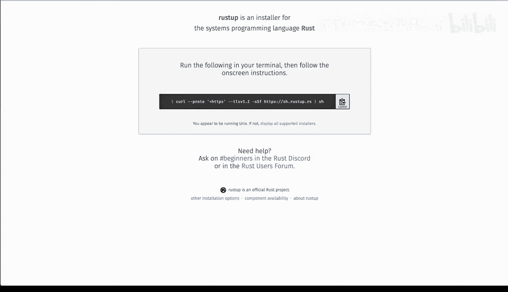

`rustup`是用于在终端环境中安装Rust的工具，安装过程高效快捷。Rust生态系统安装完成后，我们使用`cargo new`命令初始化一个新项目。

执行以下命令来初始化项目结构：
```bash
source $HOME/.cargo/env
cargo new web-docker
```


这将在本地创建一个名为`web-docker`的项目结构。接着，我们在`src`目录下创建`lib.rs`文件：
```bash
touch src/lib.rs
```


创建好这两个文件后，我们将之前准备好的Rust应用代码复制过来。

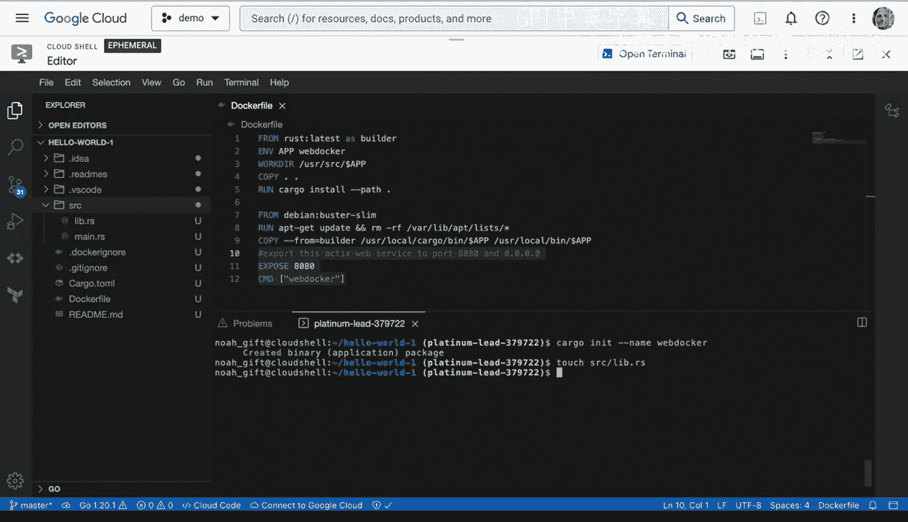
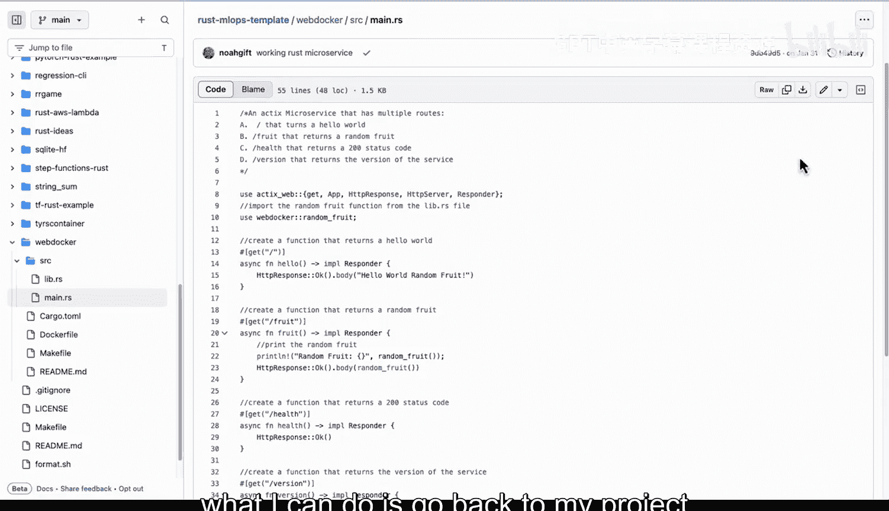

## 理解应用代码

在部署前，最好先在本地测试以确保代码能正常工作。

服务器代码非常直观，包含一些导入语句和Web处理函数。例如，它定义了健康检查、版本信息、随机返回水果等端点。

`lib.rs`文件中的代码则负责生成随机水果的逻辑。


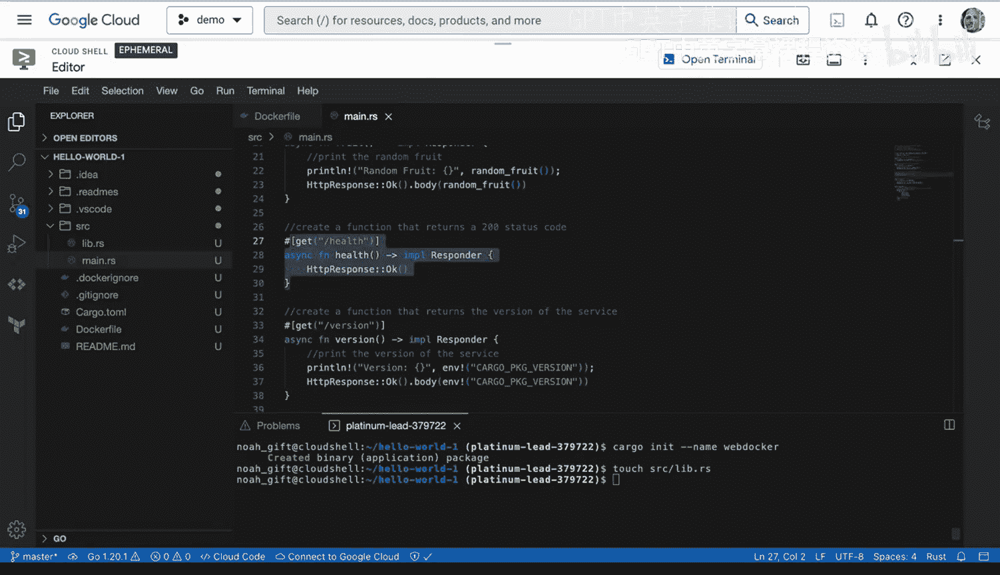
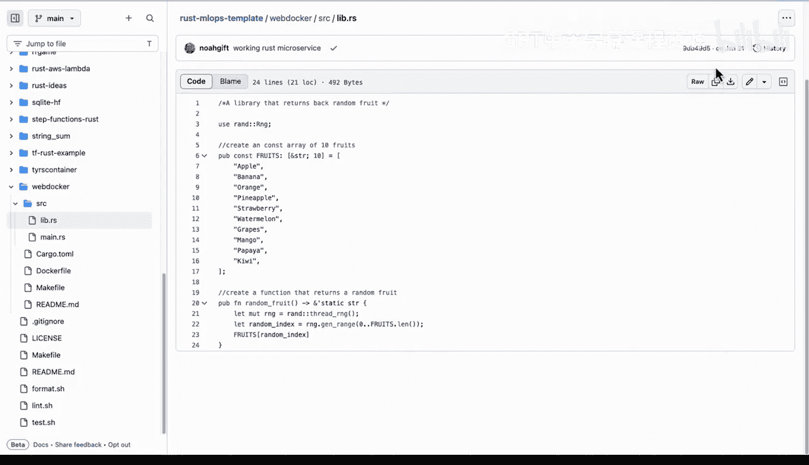


这是一个非常简单的REST风格应用程序。

## 配置项目依赖

我们还需要配置项目的依赖项，它们定义在`Cargo.toml`文件中。


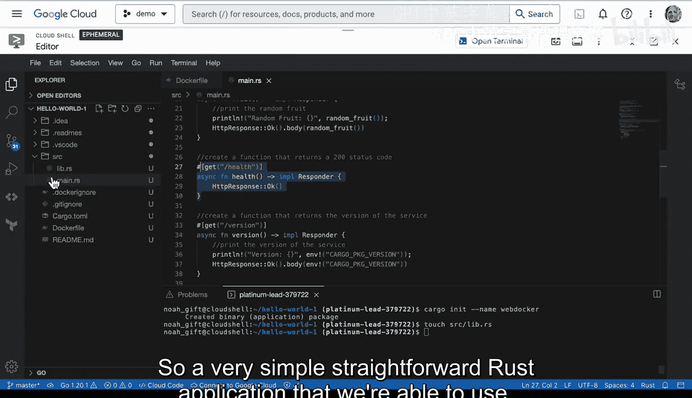

我们将依赖项内容复制并粘贴到项目的`Cargo.toml`文件中。


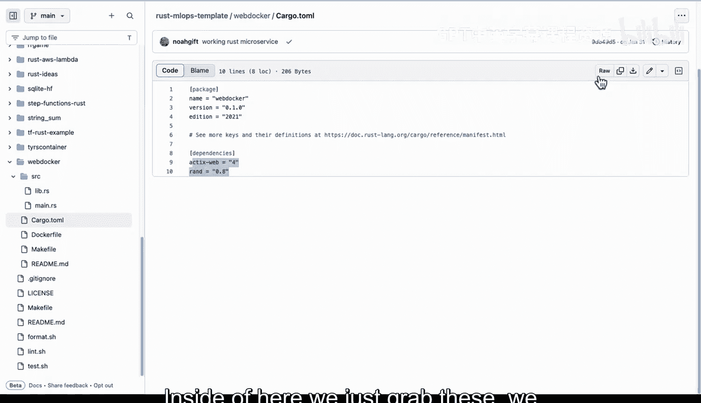


完成此步骤后，只需在终端中运行`cargo run`命令。该命令会自动安装所有依赖并启动Web微服务。

## 本地测试与云部署

在本地测试通过后，下一步就是进行云部署。

部署过程非常直接。在编辑器中，找到Cloud Run图标，点击“上传到Cloud Run”。

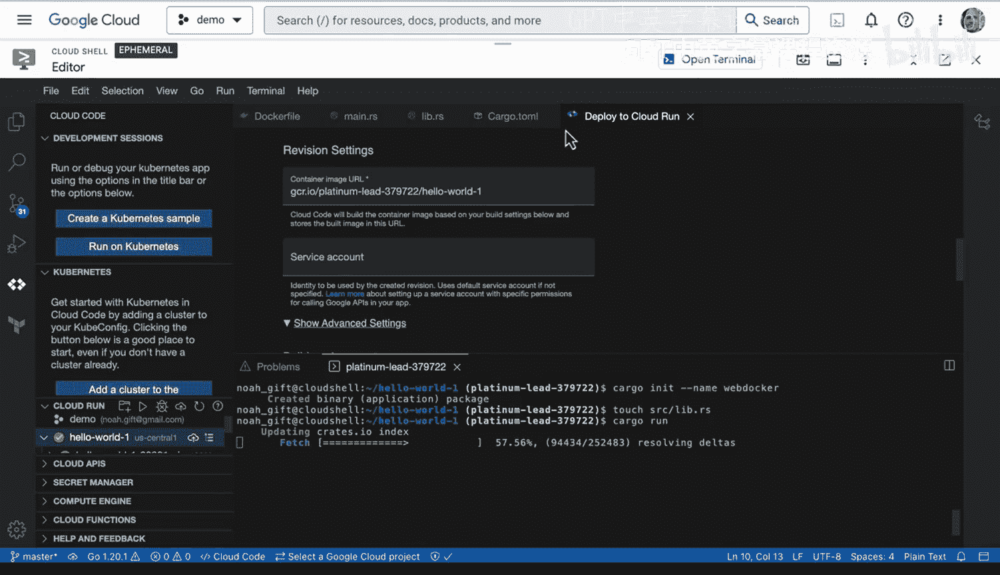

系统将开始分析工作空间、构建容器化应用，并将其推送到生产环境。按照部署向导完成所有必要步骤后，服务就会部署成功。

## 验证部署结果

部署完成后，我们可以在Cloud Run控制台查看服务状态。服务运行后，我们可以复制其提供的URL。

打开一个新终端，使用`curl`命令访问该URL，可以验证服务是否正在运行。例如，访问`/fruit`端点，它会随机返回一个水果名称。这表明我们的容器化微服务已在生产环境成功运行。


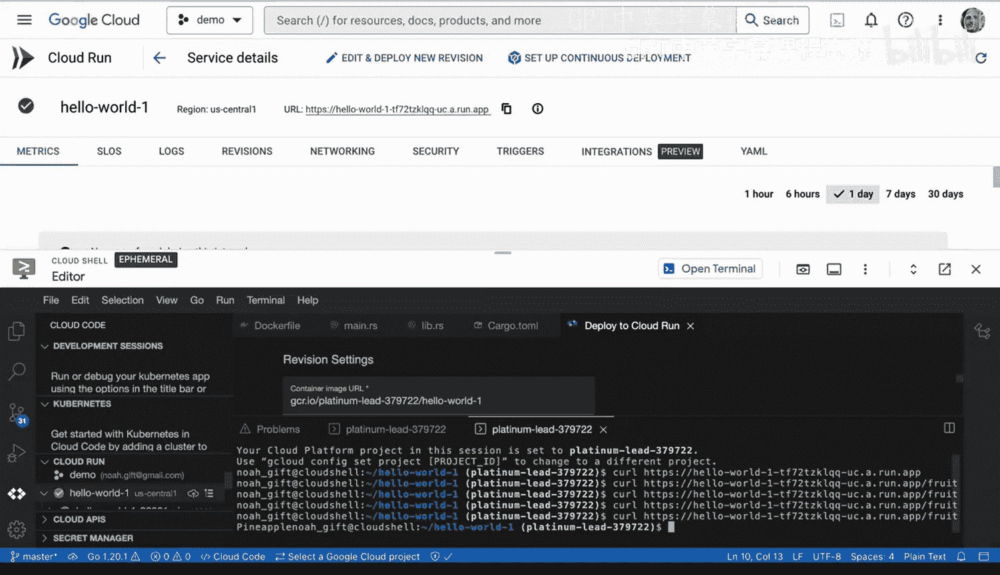

## 配置持续交付

整个流程始于GitHub，代码存储在那里。当需要实现持续交付时，可以配置Cloud Build流程。Cloud Build会监听代码仓库的变更，并自动将更新部署到生产环境，从而实现持续交付。

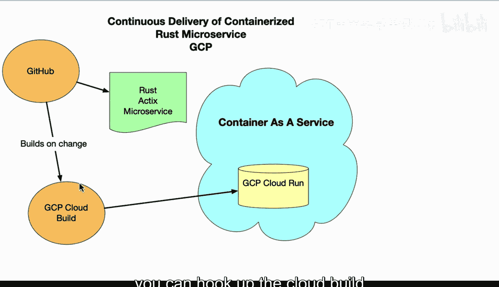


## 总结


本节课我们一起学习了在Google Cloud Platform上部署Rust微服务的完整流程。我们从设置Cloud Shell环境开始，准备了Rust项目代码和Dockerfile，并在本地进行了测试。随后，我们利用Cloud Run将容器化应用部署到云端，并验证了服务的可用性。最后，我们了解了如何通过集成Cloud Build与GitHub来实现代码变更的持续自动交付。这个流程展示了构建和运维现代化、高性能微服务的一种高效方法。