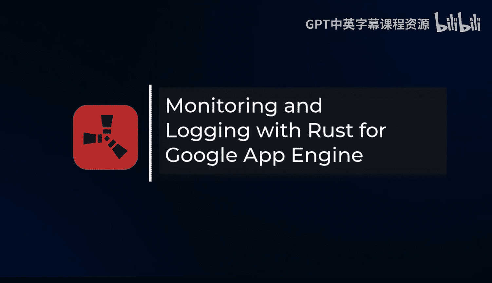
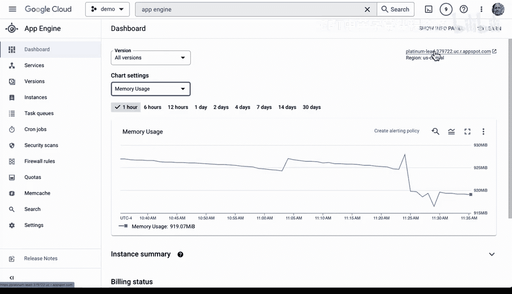
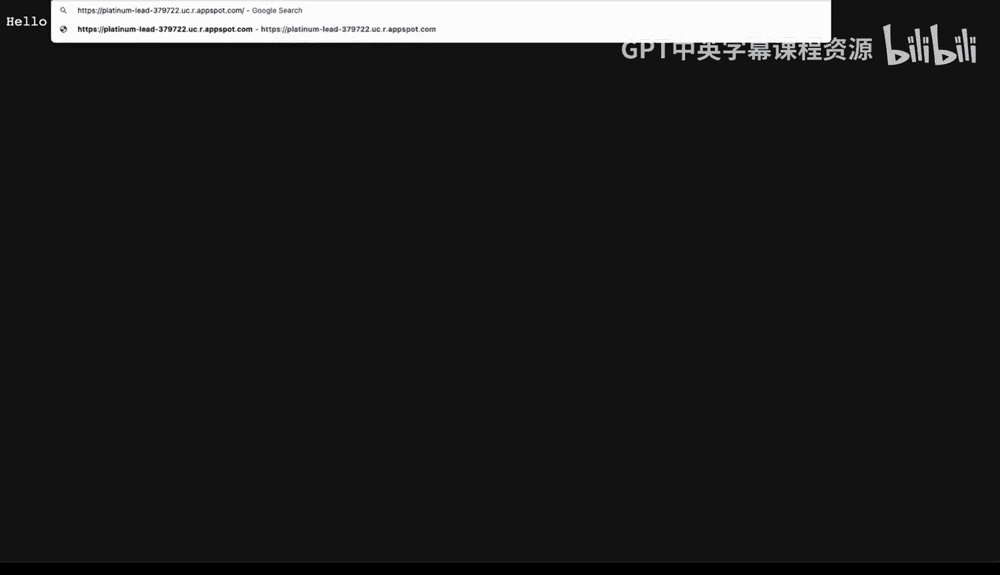
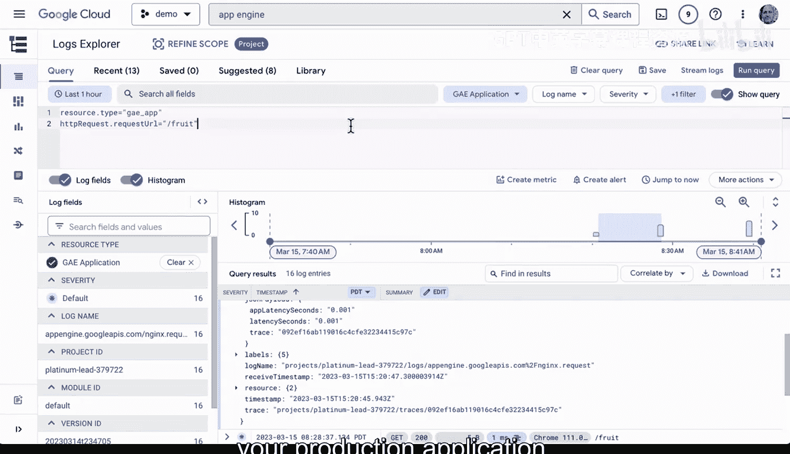

#  072：Google App Engine的Rust监控与日志 📊

在本节课中，我们将学习如何为一个部署在Google App Engine上的Rust微服务设置和使用监控与日志功能。我们将从查看应用仪表盘开始，然后深入探索日志查询，以全面了解生产环境中的服务运行状况。

## 应用概览与仪表盘监控

上一节我们介绍了微服务部署的基本概念，本节中我们来看看如何监控一个已部署的应用。这里有一个使用Actix Web框架的Rust微服务。代码中包含一个路由 `/fruit` 和一个返回“hello world”的函数。该应用已被容器化，非常适合部署到App Engine。

如果我们访问该服务在App Engine上的部署版本，可以看到一个仪表盘，它展示了所有重要的运行摘要。

以下是仪表盘中提供的关键监控信息：
*   **请求数量**：可以查看应用接收到的请求总数。
*   **计费状态**：监控与使用量相关的成本。
*   **错误信息**：如果存在任何错误，可以在此处查看。
*   **请求类型与延迟**：可以按类型筛选请求，并查看延迟情况，例如加载延迟。
*   **流量统计**：查看接收和发送的流量数据。
*   **资源利用率**：监控CPU等资源的使用情况。
*   **实例信息**：查看已部署的实例数量，例如当前有两个实例在运行。
*   **内存使用量**：这对微服务至关重要，甚至可以基于此创建警报策略。
*   **缓存查询**：仪表盘还提供了多种缓存查询数据。

如果想直接访问应用，操作很简单。我们只需访问相应URL，这里是我们的Rust微服务，调用 `/fruit` 端点并可以反复运行测试。因此，仅凭这个仪表盘，就能获得非常直观和全面的监控服务。

此外，我们还可以在此查看版本信息，了解当前是哪个版本在提供服务流量。在本例中，我们看到当前版本承担了100%的流量。我们甚至可以直接从这个仪表盘停止或启动服务。所以，如果你有一个容器化的Rust微服务运行在Google App Engine上，这个仪表盘堪称一站式监控管理平台。

## 深入日志查询与分析

除了仪表盘，另一项非常实用的功能是查看日志。我们可以进一步深入细节。其中一种方法是创建自定义查询。我们可以按资源类型进行筛选，从而清晰掌握发生的一切。我们还可以创建指标、设置警报，甚至执行SQL查询。

接下来，我将演示一个简单的操作：查询我们已知会被调用的 `/fruit` 这个URL。让我们运行一个查询。

查询结果显示，我们可以清楚地看到每次调用的应用延迟（以秒为单位）、项目名称以及调用发生的时间戳。如果需要，我也可以基于此创建警报，例如，如果调用次数过于频繁，可以触发相应的操作。

我们还可以切换查看不同的日志名称和严重级别。总之，结合Google App Engine的仪表盘和详细的日志浏览器，你便拥有了调试一个基于Rust的App Engine微服务所需的一切工具，足以应对生产环境中的应用调试需求。

## 课程总结

本节课中，我们一起学习了如何利用Google App Engine的内置工具监控和调试Rust微服务。我们首先探索了功能全面的仪表盘，它可以提供从请求、错误到资源利用率的全景视图。接着，我们深入日志系统，学习了如何执行自定义查询来追踪特定请求并分析性能数据。掌握这些监控和日志技能，是确保机器学习应用在生产环境中稳定、高效运行的关键。