#  073：Rust微服务负载测试 🚀

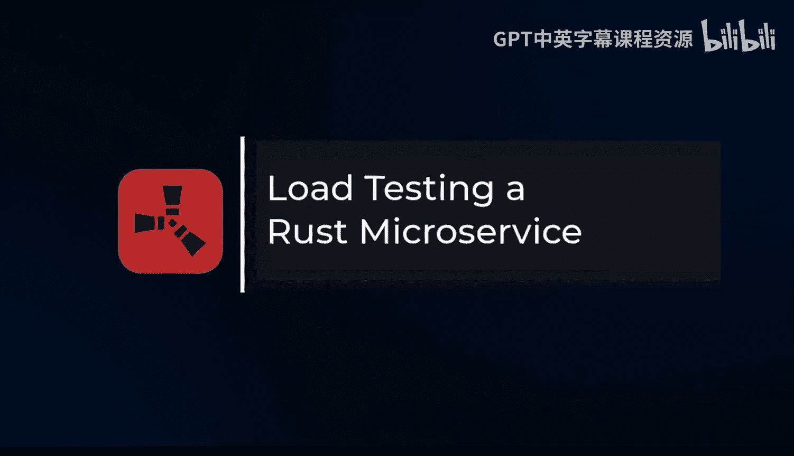

在本节课中，我们将学习如何使用Locust工具对部署在Google App Engine上的Rust微服务进行负载测试。负载测试是确保应用在生产环境中能按预期工作的重要方法，它可以模拟用户请求、检查资源使用情况并测试自动扩缩容能力。

## 安装与配置Locust

上一节我们介绍了负载测试的重要性，本节中我们来看看如何安装和配置测试工具Locust。

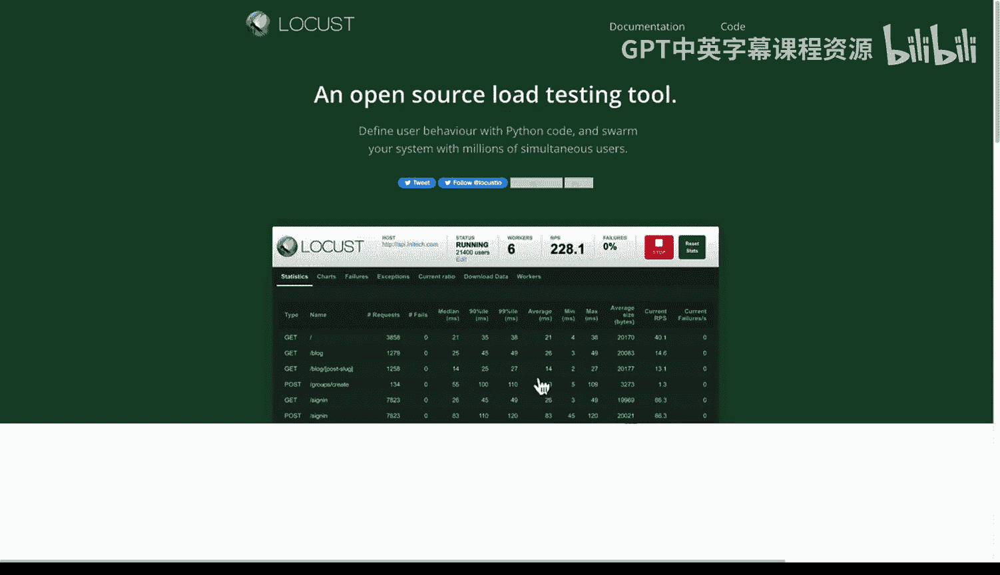

首先，我们需要安装Locust。这可以通过Python的包管理器pip轻松完成。

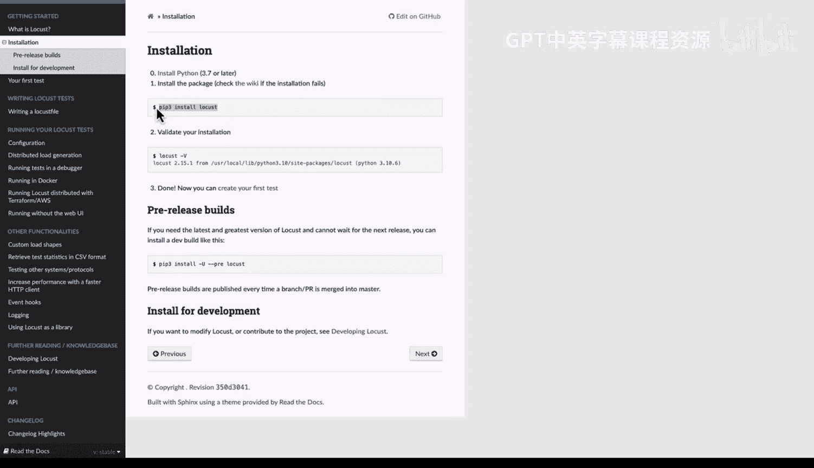

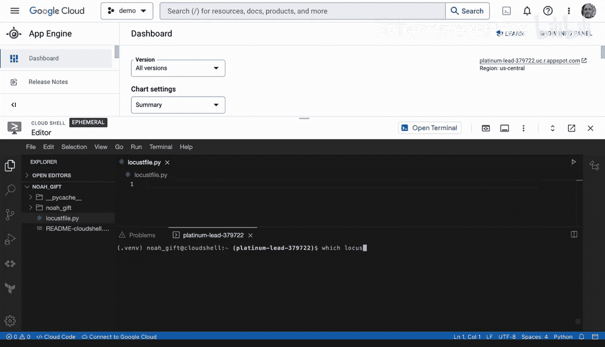

以下是安装步骤：
*   在已激活的虚拟环境中，执行命令：`pip install locust`
*   安装完成后，可以通过命令 `which locust` 来验证安装位置。

安装完成后，我们需要编写一个Locust测试文件。这个文件将定义测试场景，例如将客户端请求（GET或POST等）映射到我们服务的具体路由上。

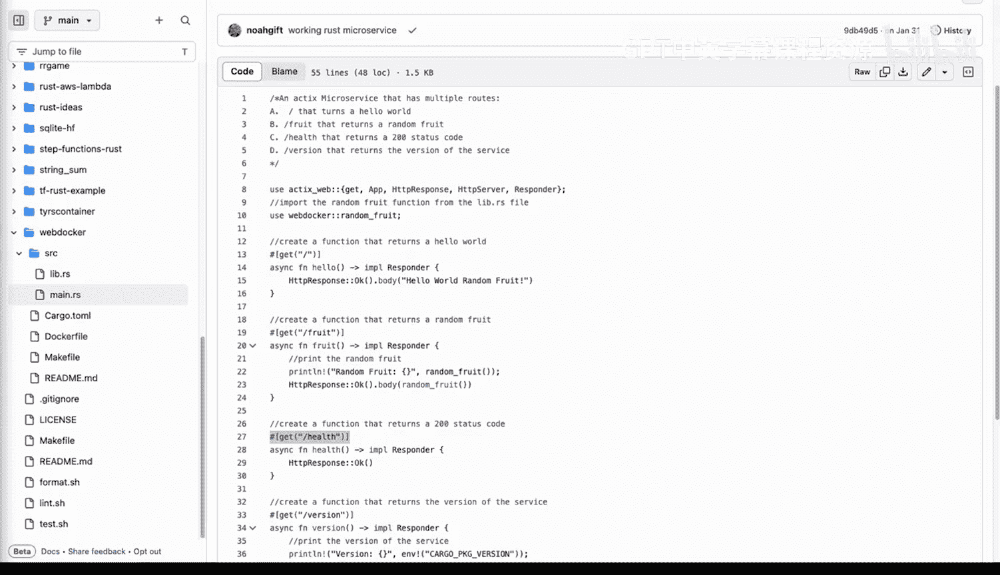

## 编写Locust测试文件

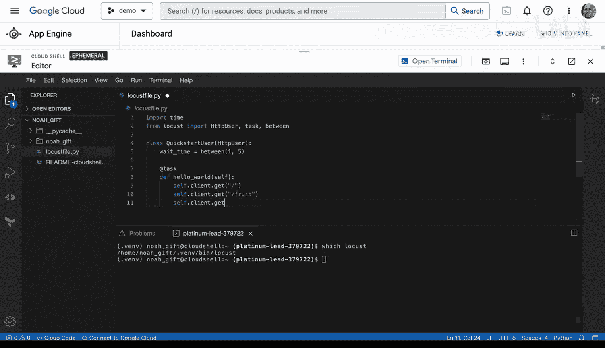

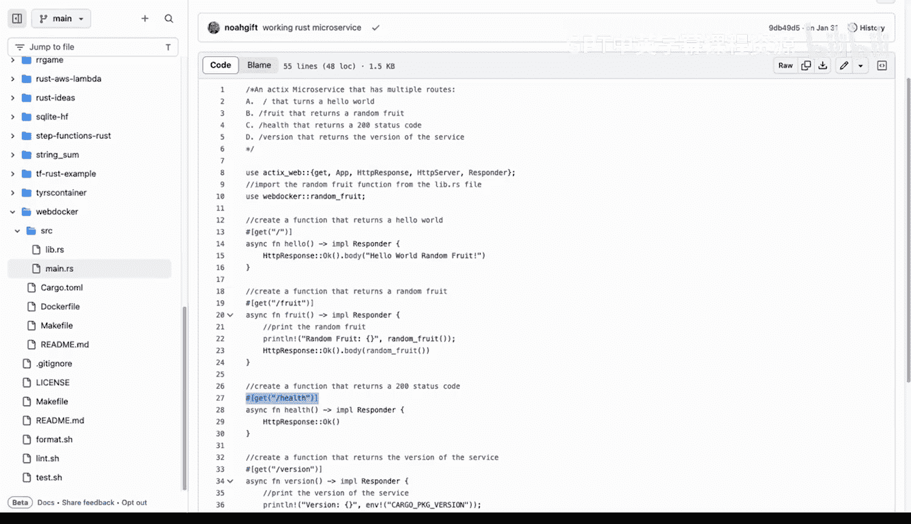

现在我们已经安装了Locust，接下来需要创建测试脚本来定义要模拟的用户行为。

我们的Rust应用部署在Google App Engine上，包含多个路由。为了进行全面测试，我们将对三个路由进行负载测试：默认路由、水果数据路由和健康检查路由。

以下是我们将在Locust文件中定义的任务代码示例：
```python
from locust import HttpUser, task, between

class QuickstartUser(HttpUser):
    wait_time = between(1, 5)

    @task(3)
    def default_route(self):
        self.client.get("/")

    @task(2)
    def fruit_route(self):
        self.client.get("/fruit")

    @task(1)
    def health_route(self):
        self.client.get("/health")
```
这段代码定义了一个模拟用户类，它会以不同的权重（3，2，1）随机访问三个路由，并在每次请求间等待1到5秒。

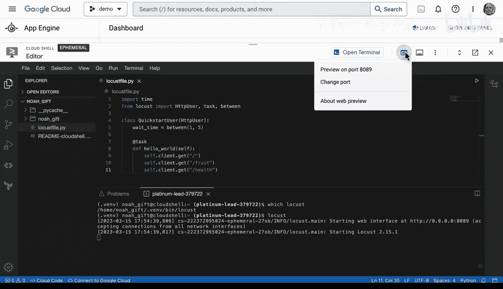

## 执行负载测试

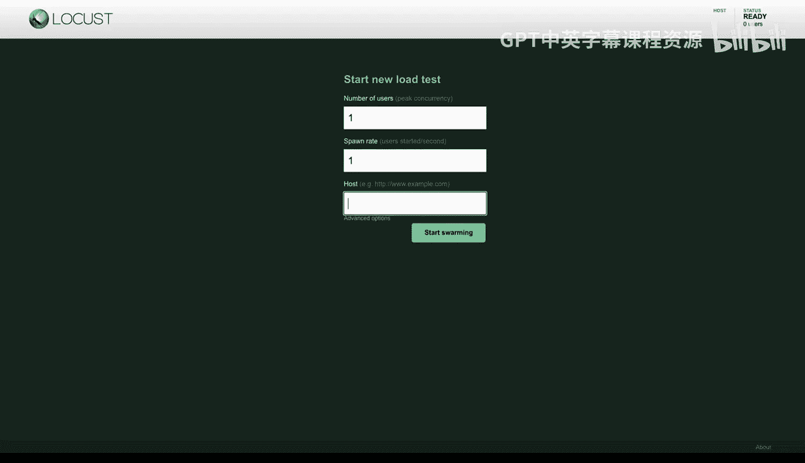


准备好测试脚本后，我们就可以启动Locust并开始模拟用户负载了。

在Google Cloud环境中，我们可以方便地进行测试，因为应用已经部署好。只需在终端输入 `locust` 命令，它将在本地启动一个Web界面（默认端口8089）。

启动Locust后，我们需要在浏览器中访问其Web界面。首先进行一个简单的测试来验证配置是否正确。

以下是初始测试的配置步骤：
*   在Locust Web界面中，输入目标主机的URL（即App Engine应用的地址，注意末尾不要加斜杠）。
*   设置用户数为1，孵化率（每秒新增用户数）为1。
*   点击“Start swarming”开始测试。

测试开始后，界面会显示实时数据，包括请求响应时间（毫秒）的最大值、最小值、平均值，以及每秒请求数。我们可以观察图表，确认请求是否按预期进行，并且没有出现失败或异常。

## 进行高并发负载测试

简单的验证测试通过后，我们可以增加负载，进行更有压力的并发测试，以评估应用的性能极限。

现在让我们停止当前测试，开始一个新的、负载更高的测试场景。

以下是高并发测试的配置：
*   设置并发用户数为100。
*   设置孵化率为25（即每秒新增25个用户，4秒内达到100用户）。
*   再次确认目标URL正确无误。
*   点击“Start swarming”开始高强度负载测试。

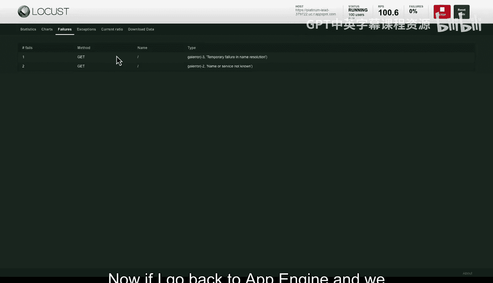

这次测试会产生显著不同的负载。我们可以看到每秒请求数大幅上升。测试结果会显示成功率、错误率以及App Engine的响应时间。一个健壮的应用应该能够优雅地处理这种工作负载，并保持较低的响应时间。我们还可以在App Engine的控制台中查看更详细的监控图表和日志，以了解应用在实时负载下的表现。

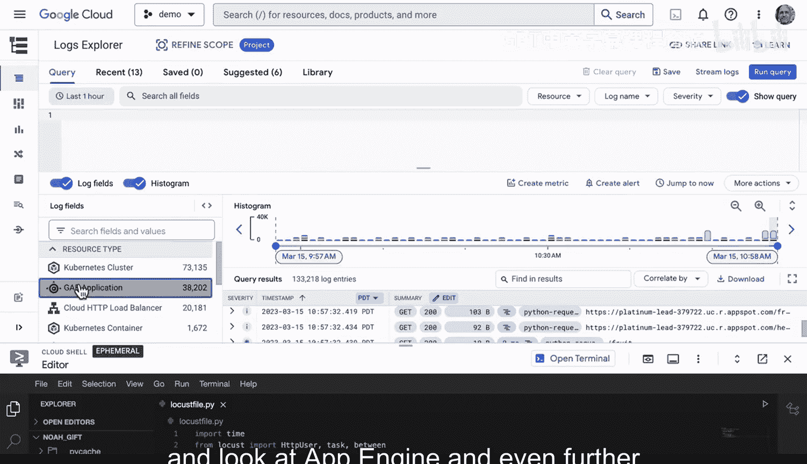

## 总结

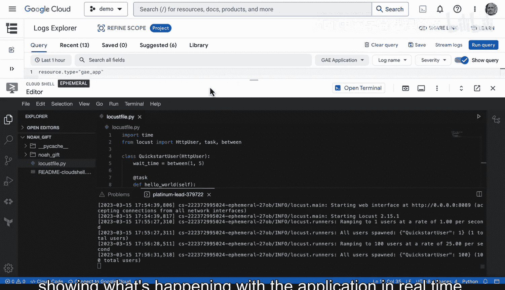

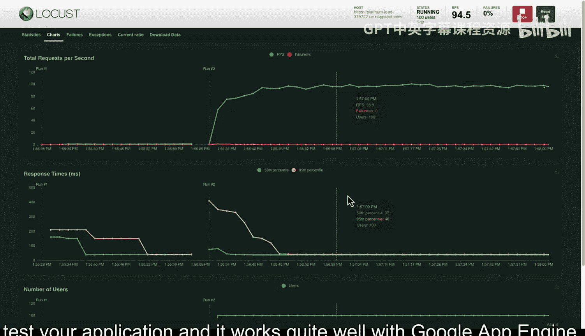


本节课中我们一起学习了如何使用Locust对Google App Engine上的应用进行负载测试。我们完成了从安装Locust、编写测试脚本、执行简单验证测试到进行高并发压力测试的全过程。Locust是一个直接有效的负载测试工具，它能很好地与Google App Engine配合，帮助我们确保应用在投入生产前具备可靠的性能表现。