#  074：在AWS上构建容器化Rust微服务 🚀

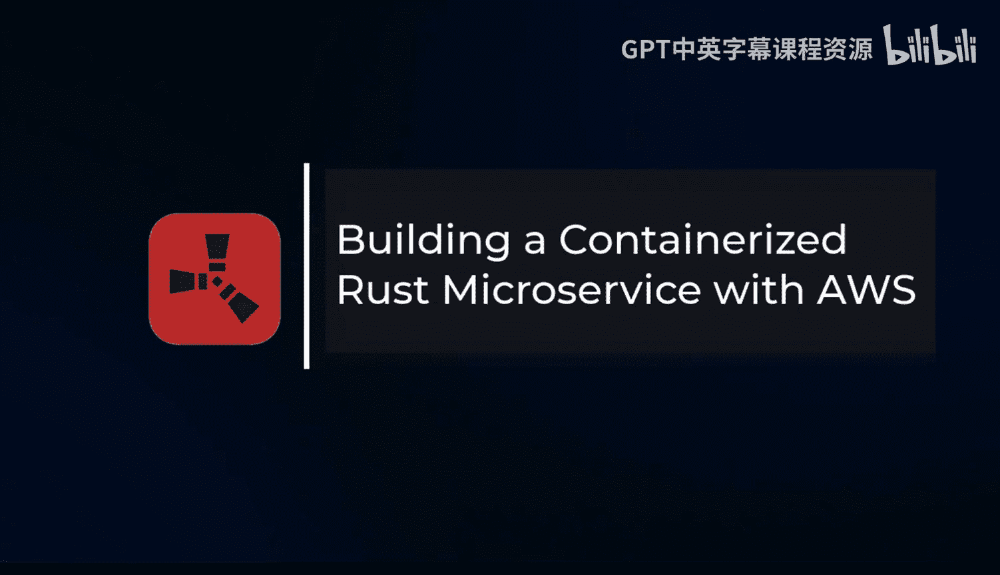

在本节课中，我们将学习如何构建一个容器化的Rust微服务，并将其部署到AWS云平台。我们将使用Actix Web框架、Docker容器技术以及AWS App Runner服务，实现一个能够随机返回水果名称的简单REST API服务。

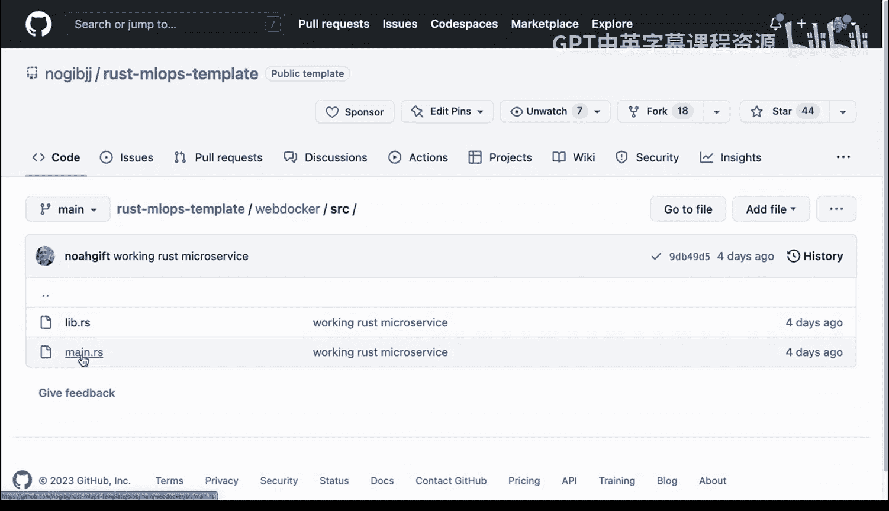

## 项目结构概述

首先，我们来看一下这个容器化Actix微服务的整体结构。这个结构与我参与的许多项目类似，包含了一些常见的配置文件。

以下是项目的主要文件：
*   **Makefile**：用于定义构建、格式化和运行等自动化命令。
*   **Dockerfile**：定义了如何构建该服务的Docker镜像。
*   **Cargo.toml**：Rust项目的配置文件，列出了项目依赖。
*   **lib.rs**：库文件，包含核心的业务逻辑。
*   **main.rs**：程序的主入口文件，负责启动Web服务器和定义路由。

## 深入代码解析

上一节我们概述了项目结构，本节中我们来详细看看各个核心文件的内容和作用。

### Dockerfile 解析

这个Dockerfile采用了一种高效的构建策略。它首先使用一个完整的Rust环境作为构建器（builder），这个环境包含了所有开发所需的资源。然后，它将编译好的、独立的可执行文件复制到一个全新的、更精简的容器中。这种方法能生成体积非常小的最终镜像。

```dockerfile
# 使用Rust官方镜像作为构建阶段
FROM rust:latest as builder
WORKDIR /usr/src/app
COPY . .
RUN cargo build --release

# 创建最终运行阶段，使用极简的Debian镜像
FROM debian:buster-slim
COPY --from=builder /usr/src/app/target/release/web-docker /usr/local/bin/web-docker
EXPOSE 8080
ENTRYPOINT ["web-docker"]
```

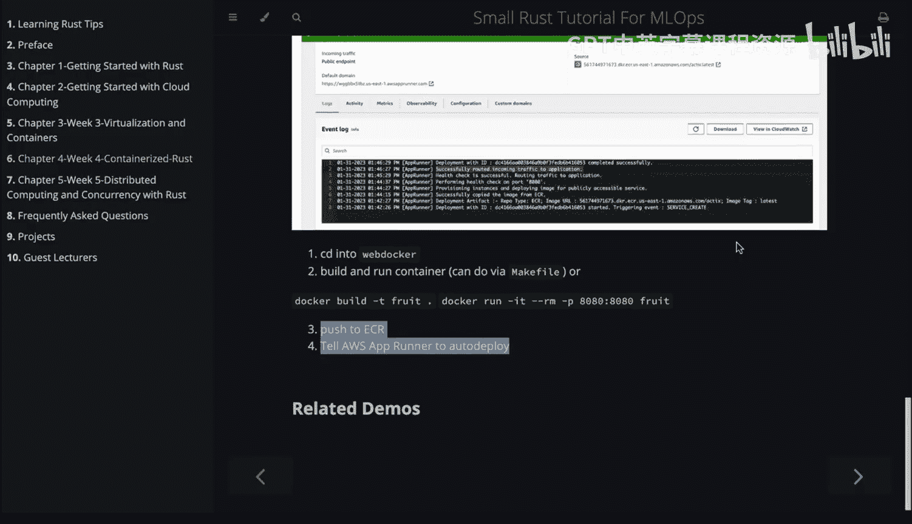

### 依赖与库文件

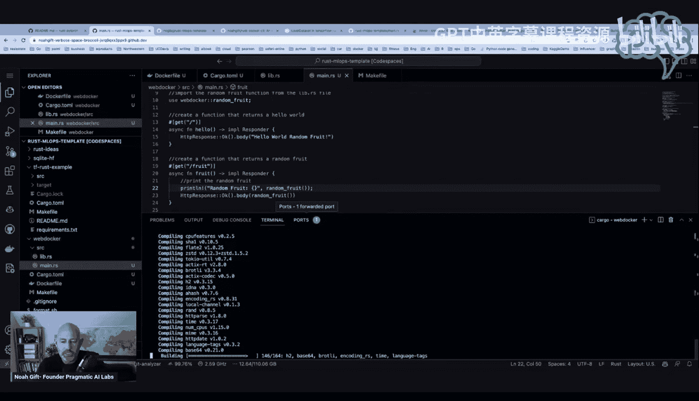

`Cargo.toml`文件定义了项目依赖，主要包括`rand`（用于生成随机数）和`actix-web`（Web框架）。

`lib.rs`文件中的逻辑非常简单，它定义了一个公开的函数`random_fruit`，用于从一个预定义的水果列表中随机返回一个名称。

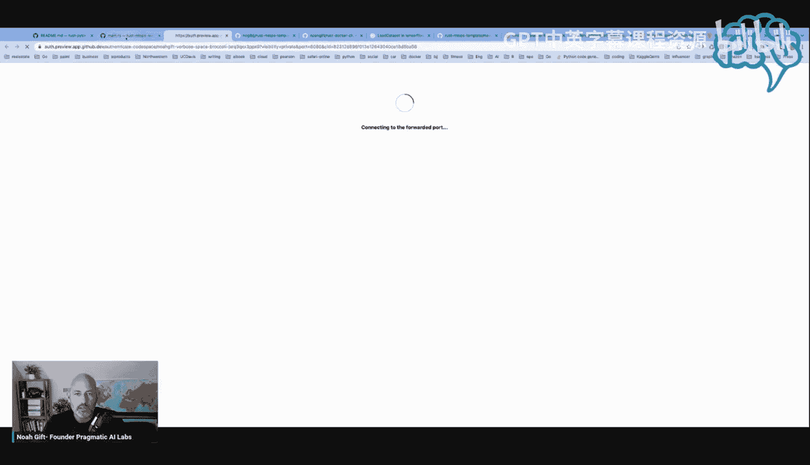

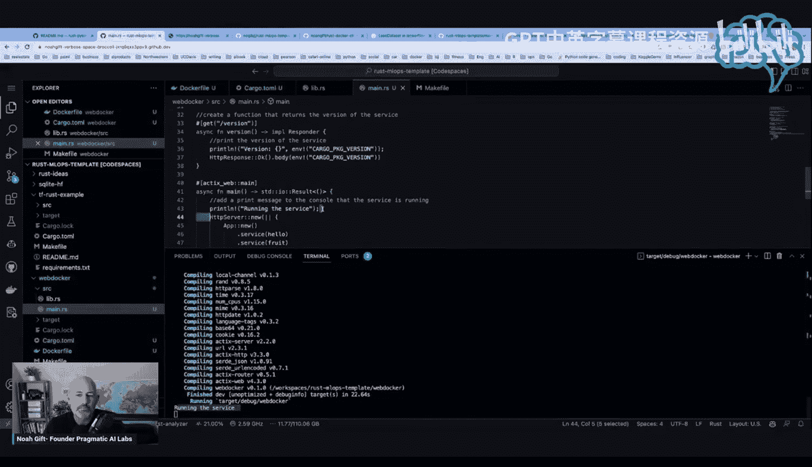

```rust
// 在 lib.rs 中
pub fn random_fruit() -> &‘static str {
    let fruits = [“apple”, “banana”, “cherry”, “durian”, “orange”];
    let idx = rand::random::<usize>() % fruits.len();
    fruits[idx]
}
```

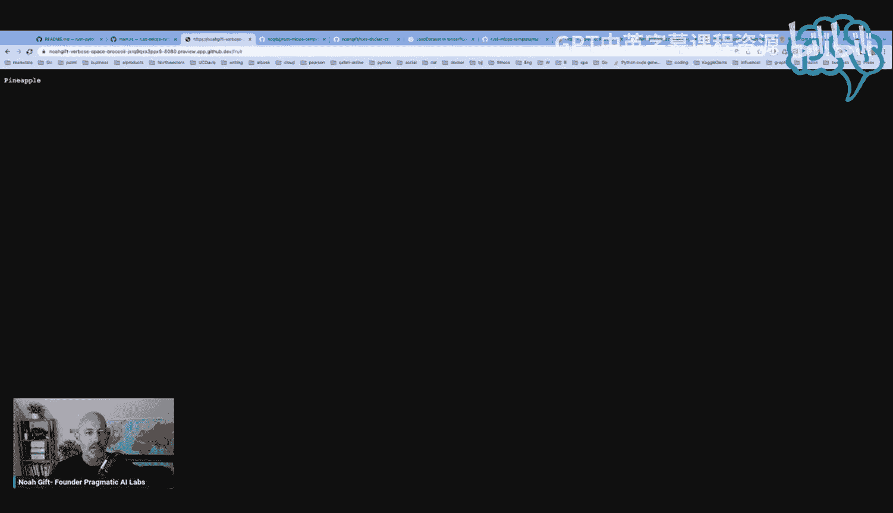

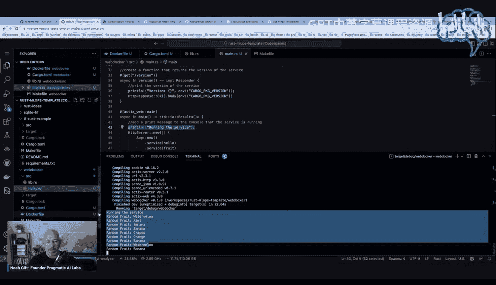

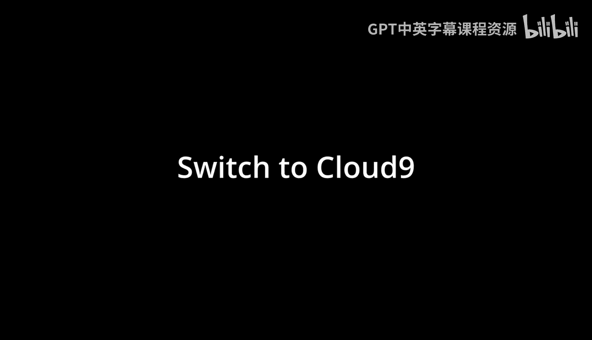

### 主程序与路由

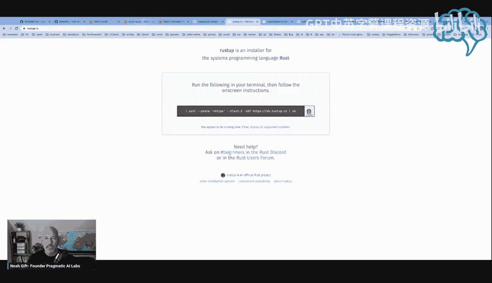

`main.rs`文件是应用的核心，它看起来很像一个Flask或FastAPI应用。它导入了必要的依赖，然后设置了Web服务器的路由。

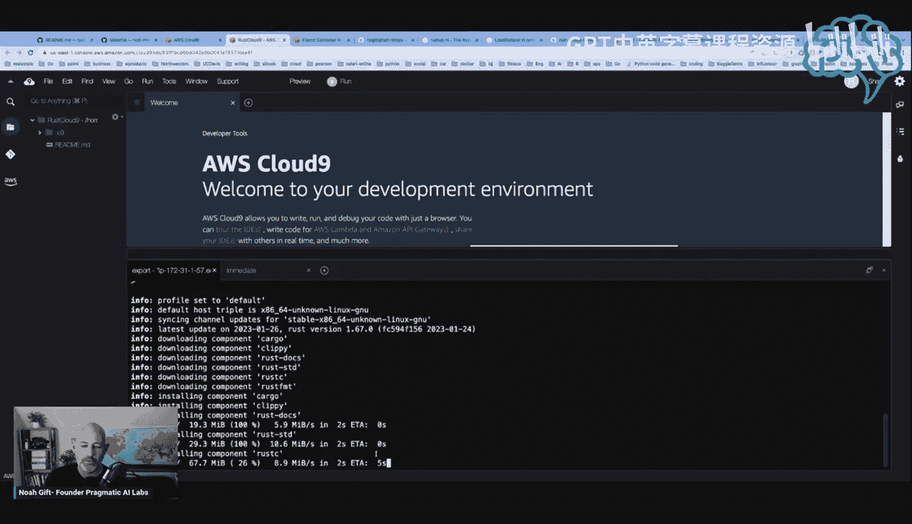

以下是路由定义：
*   **GET /**：返回一个简单的“Hello World”欢迎信息。
*   **GET /fruit**：调用`lib.rs`中的`random_fruit`函数，返回一个随机的水果名。
*   **GET /health**：用于健康检查的端点。
*   **GET /version**：返回应用版本信息。

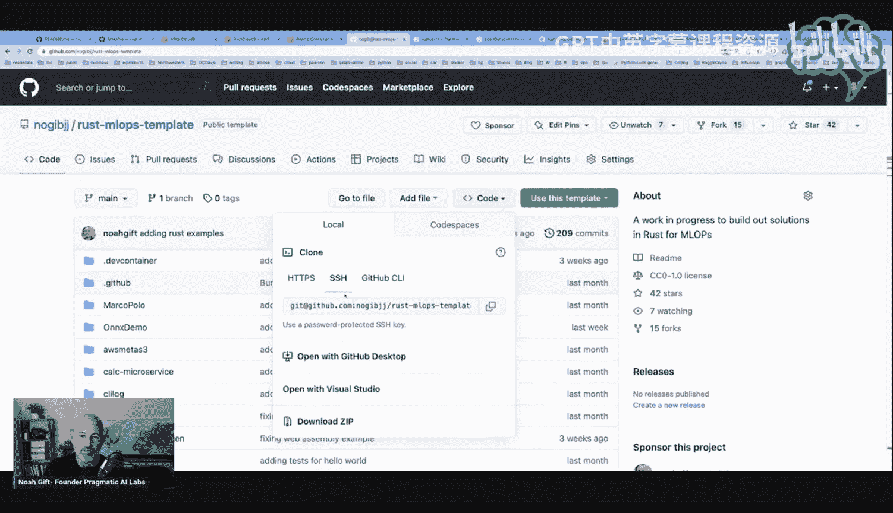

最后，在`main`函数中注册这些服务并启动服务器。

## 本地构建与运行

理解了代码结构后，我们来看看如何在本地构建和运行这个服务。这个过程非常简单。

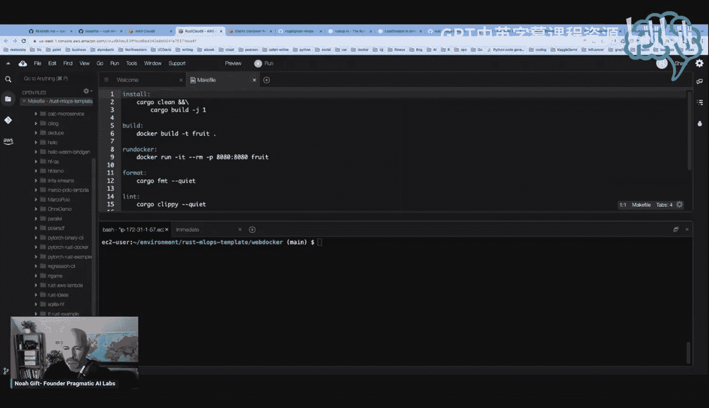

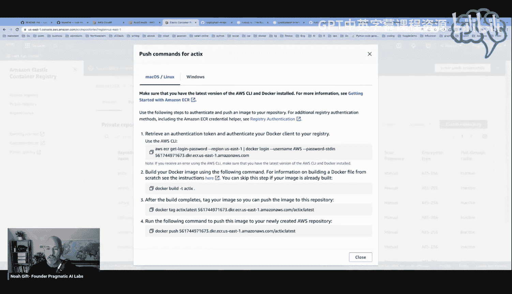

以下是使用Makefile的步骤：
1.  运行 `make format` 来格式化代码。
2.  运行 `make build` 来编译项目。
3.  运行 `make run` 来启动本地服务。

服务启动后，你可以在浏览器中访问 `http://localhost:8080` 来测试各个端点，例如访问 `/fruit` 来获取随机水果。

## 在AWS上部署

在本地验证无误后，下一步就是将其部署到AWS云平台，实现服务的线上访问。

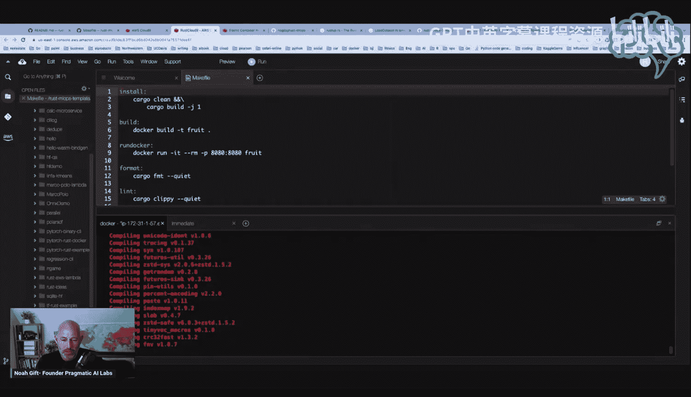


### 构建并推送Docker镜像

首先，我们需要将项目构建成Docker镜像，并推送到AWS的弹性容器注册表（ECR）。
1.  在AWS控制台创建ECR仓库。
2.  使用AWS CLI获取登录命令，在本地终端完成Docker到ECR的认证。
3.  执行 `docker build -t your-ecr-repo-uri .` 命令构建镜像。
4.  执行 `docker push your-ecr-repo-uri` 命令将镜像推送到ECR。

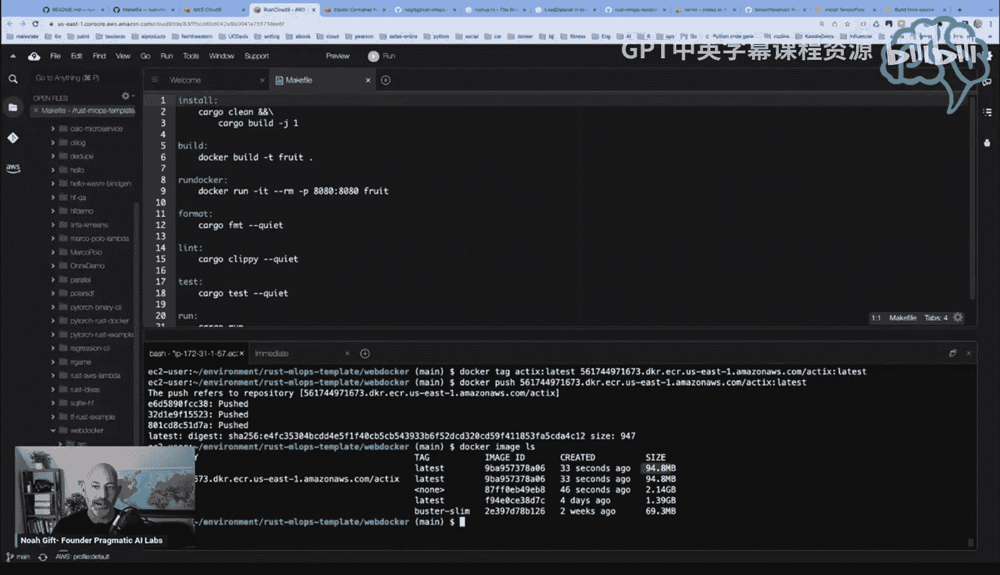

### 使用App Runner部署

镜像推送成功后，就可以使用AWS App Runner服务进行部署了，这是一个全托管的容器应用服务。

在App Runner控制台创建新服务的步骤如下：
1.  选择“容器注册表”作为源。
2.  选择你刚刚推送镜像的ECR仓库。
3.  配置服务名称（例如 `rust-actix-demo`）。
4.  选择部署触发方式（手动或自动。选择自动后，每次向ECR推送新镜像，App Runner会自动重新部署）。
5.  点击“创建并部署”。

部署完成后，App Runner会提供一个可访问的URL。通过这个URL，你就可以像在本地一样访问 `/`、`/fruit` 等所有API端点了。

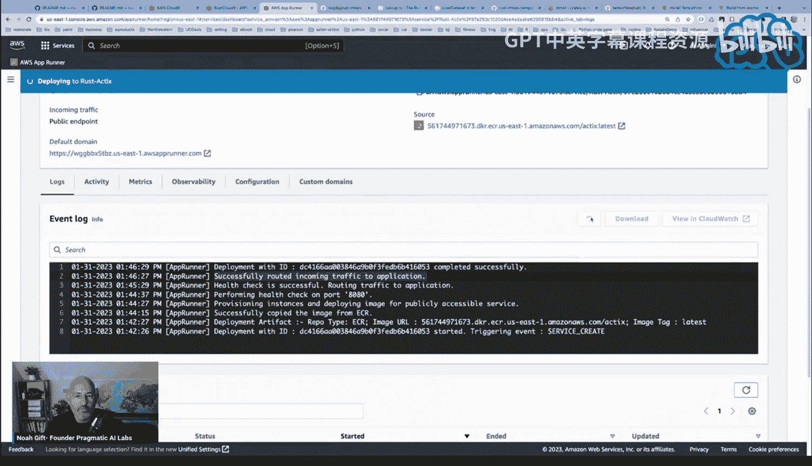

## 总结与优势

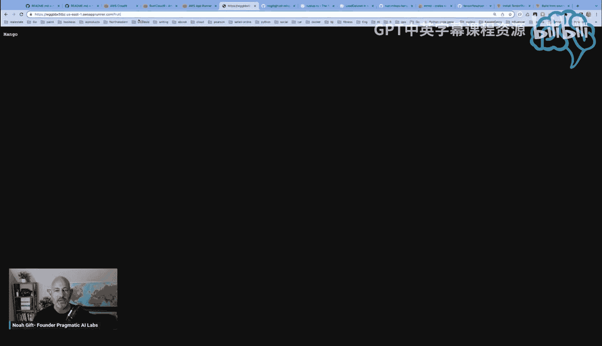


本节课中我们一起学习了如何使用Rust和Actix Web框架构建一个微服务，将其容器化，并最终部署到AWS App Runner上。


这个演示凸显了Rust在微服务领域的几个关键优势：
*   **极小的二进制体积**：最终生成的Docker镜像体积可以控制在100MB以下，这得益于Rust的零成本抽象和高效的编译输出。使用 `docker images` 命令可以查看镜像大小。
*   **卓越的性能**：Rust提供了接近C/C++的运行效率，非常适合高性能后端服务。
*   **内存安全**：在提供高性能的同时，通过所有权系统保证了内存安全，避免了常见的内存错误。
*   **简单的部署流程**：结合Docker和AWS App Runner这类托管服务，部署变得非常顺畅和自动化。

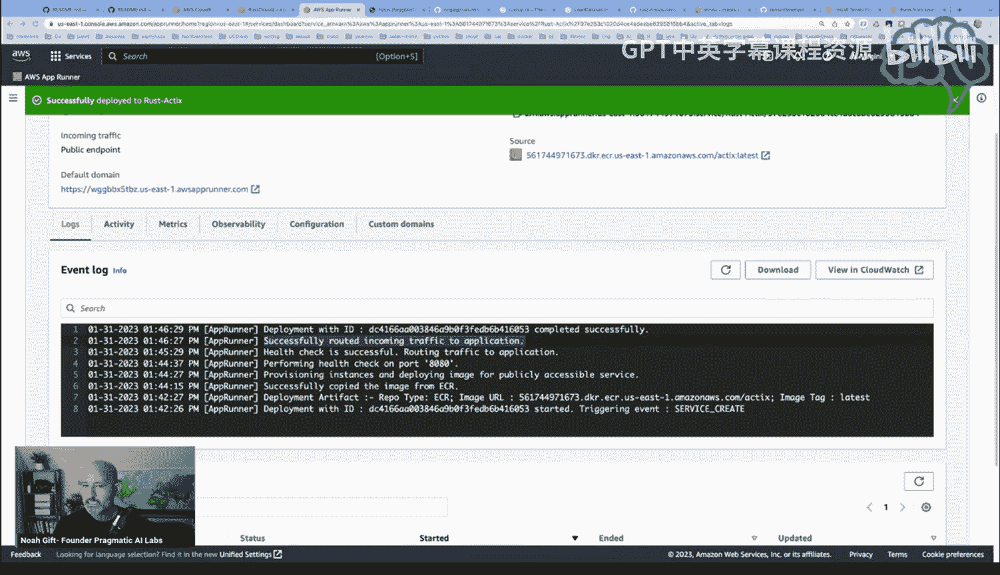


因此，对于追求高性能、高资源利用率和安全性的微服务场景，Rust是一个非常值得认真考虑的选择。