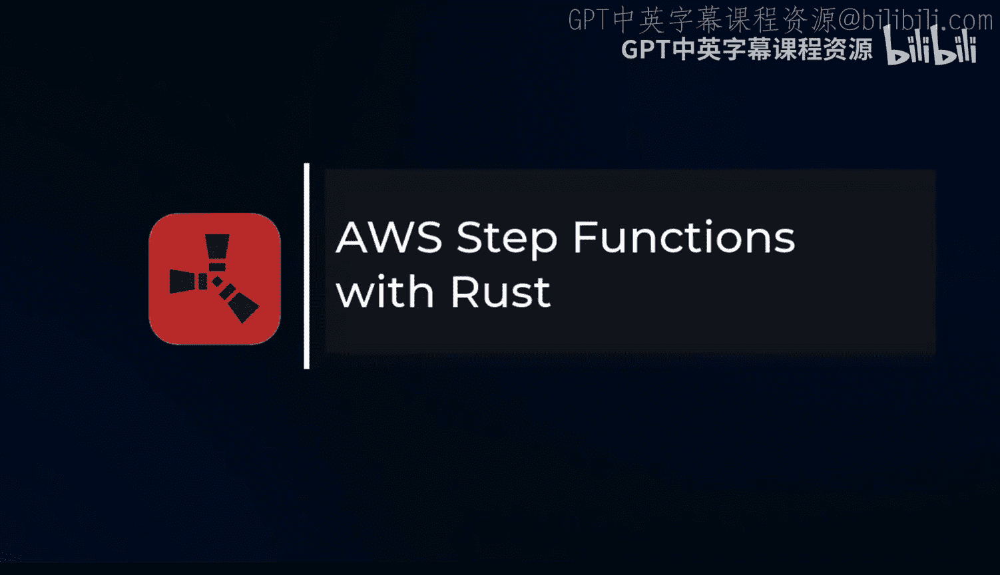
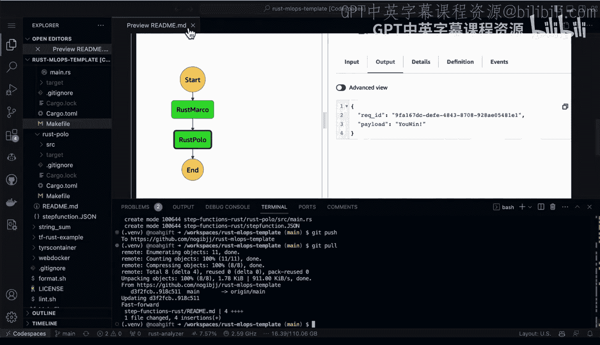
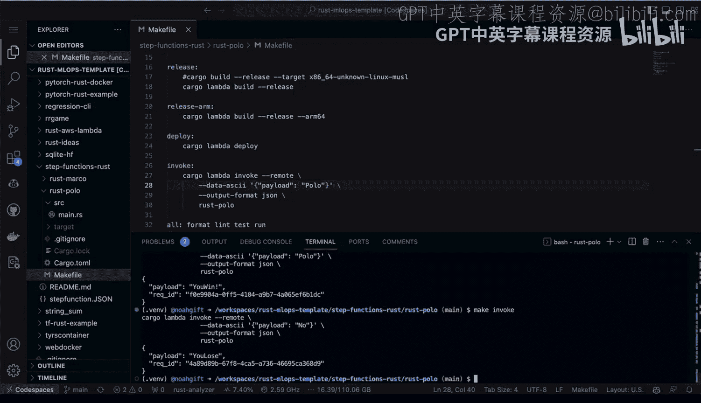
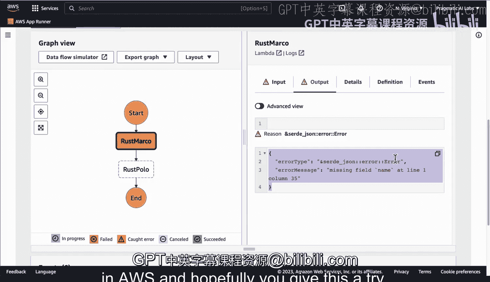

#  075：使用Rust构建AWS Step Functions工作流 🚀



在本节课中，我们将学习如何使用Rust语言来构建和部署AWS Step Functions工作流。Step Functions是强大的无服务器工作流服务，它允许你将多个AWS Lambda函数串联起来，构建复杂的、可视化的业务流程。我们将通过一个简单的“Marco Polo”游戏示例，演示从编写Rust Lambda函数到在AWS控制台拖拽构建工作流的完整过程。

---

## 概述：Step Functions与Rust

上一节我们介绍了Step Functions的基本概念。本节中，我们来看看如何用Rust语言实现它。



Step Functions在构建无服务器工作流方面非常强大，因为它可以将多个操作链接起来，将一个Lambda函数的输出作为另一个Lambda函数的输入进行处理。其最有趣的地方在于，你可以通过拖放的方式创建自己的工作流，就像玩乐高积木一样。下图展示了一个工作流的示意图：


当工作流运行时，你可以深入检查每个函数的输出和下一个函数的输入，这在调试方面是无与伦比的优势。那么，可以用Rust来实现吗？答案是肯定的。

---

## 第一步：创建Rust Lambda函数

首先，我们需要创建Step Functions中要使用的Lambda函数。我们将创建两个函数：`rust_marco` 和 `rust_polo`。

以下是创建过程的核心步骤，我们使用了优秀的 `cargo-lambda` 工具库。

1.  **创建第一个函数 (`rust_marco`)**
    使用命令 `cargo lambda new rust_marco` 创建项目。

2.  **查看源代码**
    进入项目目录查看 `src/main.rs` 文件。函数定义了输入和输出的数据结构，并在 `handler` 函数中处理业务逻辑。

    ```rust
    // 输入事件的结构体
    #[derive(Deserialize)]
    struct StepFunctionInput {
        name: String,
    }

    // 输出响应的结构体
    #[derive(Serialize)]
    struct LambdaResponse {
        body: String,
    }

    // 主要的处理函数
    async fn function_handler(event: LambdaEvent<StepFunctionInput>) -> Result<LambdaResponse, Error> {
        // 从输入事件中提取 name 字段
        let name = event.payload.name;

        // 核心逻辑：如果输入是“Marco”，则回复“Polo”
        let body = if name == "Marco" {
            "Polo".to_string()
        } else {
            "Nobody".to_string()
        };

        // 添加追踪日志，便于在AWS控制台调试
        tracing::info!("Processed name: {}, Responding with: {}", name, body);

        // 构造并返回响应
        let resp = LambdaResponse { body };
        Ok(resp)
    }
    ```

3.  **构建与部署**
    我们可以使用 `Makefile` 来简化构建和部署命令。
    *   `make release`：运行 `cargo lambda build --release` 编译Rust代码。
    *   `make deploy`：将编译好的函数部署到AWS Lambda。
    *   `make invoke`：远程调用该Lambda函数进行测试。

---

## 第二步：创建第二个函数 (`rust_polo`)

现在，我们来看如何创建第二个函数，它将接收第一个函数的输出。

1.  **创建项目**
    同样使用 `cargo lambda new rust_polo` 创建。

2.  **编写业务逻辑**
    这个函数将检查输入中是否包含“Polo”，并返回相应的结果。

    ```rust
    async fn function_handler(event: LambdaEvent<LambdaResponse>) -> Result<LambdaResponse, Error> {
        // 接收上一个Lambda函数的输出 body
        let received_body = event.payload.body;

        // 核心逻辑：如果包含“Polo”，则返回“You win”
        let body = if received_body.contains("Polo") {
            "You win".to_string()
        } else {
            "You lose".to_string()
        };

        tracing::info!("Received: {}, Responding: {}", received_body, body);

        let resp = LambdaResponse { body };
        Ok(resp)
    }
    ```

3.  **测试函数**
    同样使用 `make invoke` 命令进行测试。如果传入的payload是 `{"body":"Polo"}`，将返回 `{"body":"You win"}`。

---

## 第三步：在AWS控制台组装Step Functions工作流

我们已经有了两个Rust Lambda函数，接下来看看如何将它们串联成一个工作流。

1.  **创建状态机**
    在AWS Step Functions控制台，点击“创建状态机”。



2.  **拖拽构建工作流**
    在可视化编辑器中：
    *   从左侧拖拽一个“Lambda调用”任务到画布，将其配置为调用 `rust_marco` 函数。
    *   再拖拽第二个“Lambda调用”任务，将其配置为调用 `rust_polo` 函数。
    *   用箭头连接两个任务，表示执行顺序。

    

3.  **配置与创建**
    为状态机命名（例如 `rust_marco_polo_chain`），然后点击创建。

---

## 第四步：执行与调试工作流

工作流创建完成后，我们可以执行它并观察运行细节。

1.  **启动执行**
    在状态机详情页点击“开始执行”。需要提供一个输入，例如：
    ```json
    {
      "name": "Marco"
    }
    ```

2.  **观察执行过程**
    执行页面会可视化展示流程。你可以点击每个步骤查看详情：
    *   `rust_marco` 的输入是 `{"name":"Marco"}`，输出是 `{"body":"Polo"}`。
    *   `rust_polo` 接收到 `{"body":"Polo"}`，输出 `{"body":"You win"}`。

3.  **测试失败场景**
    如果启动执行时输入 `{"name":"Other"}`，`rust_marco` 将返回 `{"body":"Nobody"}`。这会导致 `rust_polo` 判断失败，最终工作流执行失败。控制台会清晰显示错误发生的位置和原因，非常利于调试。

    

---

## 总结


本节课中我们一起学习了如何使用Rust构建AWS Step Functions工作流。我们首先使用 `cargo-lambda` 创建并部署了两个简单的Rust Lambda函数。然后，在AWS Step Functions控制台通过拖拽的方式，将这两个函数连接成一个可执行的工作流。最后，我们执行了该工作流，并观察了成功与失败两种场景下的运行状态和调试信息。这种方法结合了Rust的性能与安全性和Step Functions的可视化与强大编排能力，是构建可复用的无服务器服务的优秀实践。希望你能尝试使用这种方法。