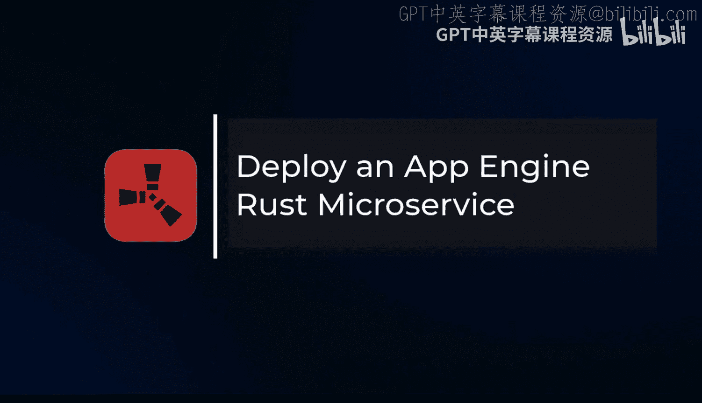
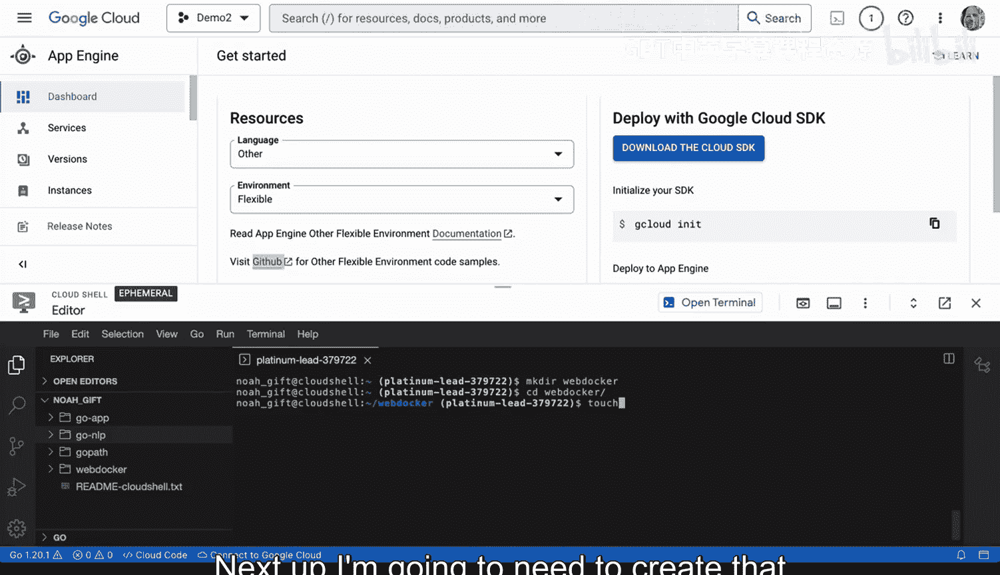
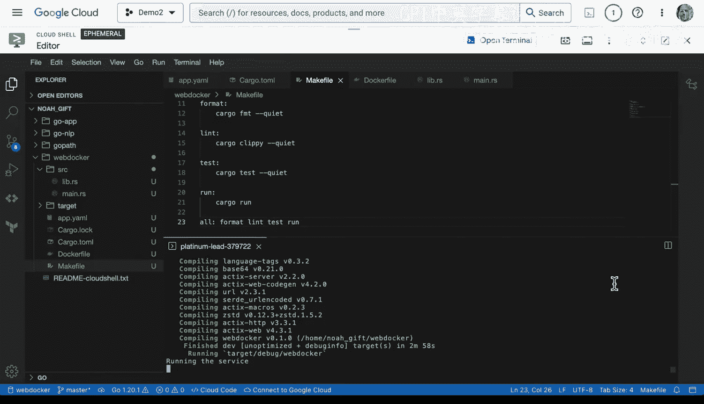
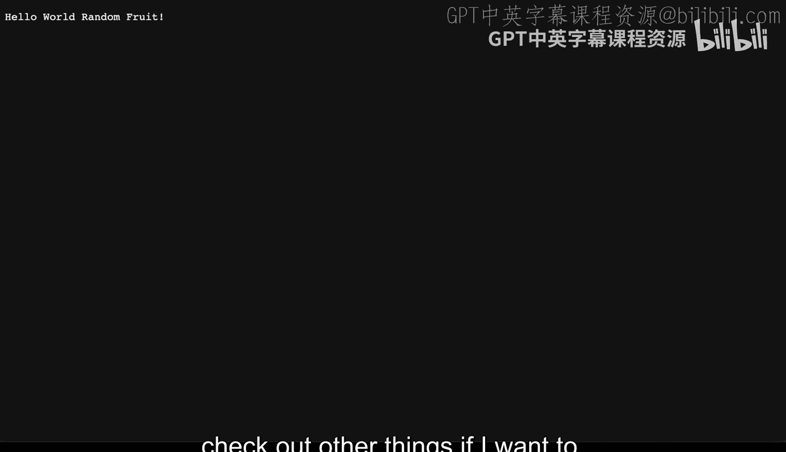
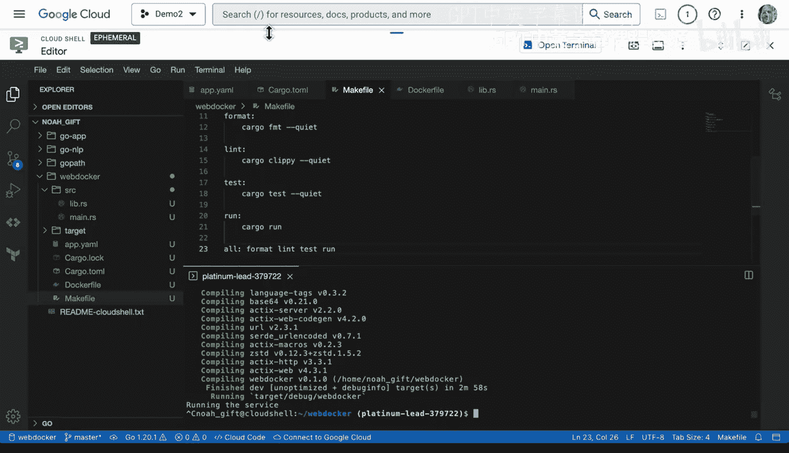
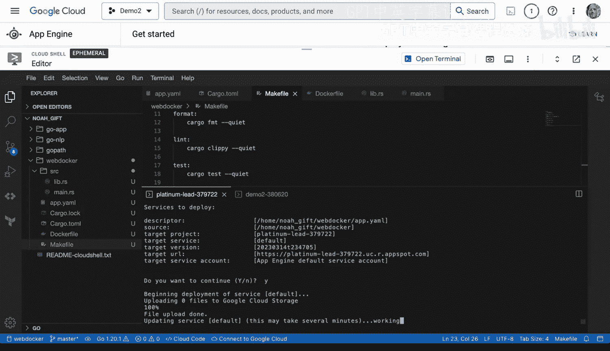
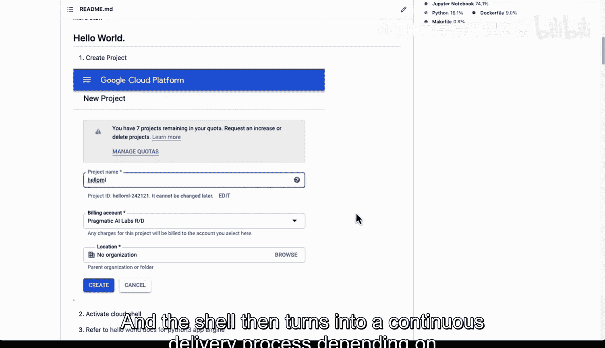

#  076：部署App Engine Rust微服务



在本节课中，我们将学习如何使用Google App Engine的灵活环境来部署一个用Rust语言编写的微服务。我们将从创建项目目录开始，逐步配置App Engine、编写Rust代码、构建Docker镜像，最终完成部署。

## 概述

我们将创建一个名为“web_docker”的Rust微服务项目，并通过App Engine将其部署到云端。整个过程涉及创建配置文件、编写应用代码、配置Docker，并使用GCloud命令行工具进行部署。

## 创建项目目录与配置文件

首先，我们需要创建一个项目目录并进入该目录。

```bash
mkdir web_docker
cd web_docker
```



接下来，创建App Engine的配置文件 `app.yaml`。这个文件用于告知App Engine我们的部署配置。

```yaml
runtime: custom
env: flex
```

## 初始化Rust项目

现在，我们初始化一个Rust项目。

```bash
cargo init --name web_docker
```

此命令会生成 `Cargo.toml` 文件。我们需要在其中添加项目依赖。

以下是 `Cargo.toml` 文件的内容示例：

```toml
[package]
name = "web_docker"
version = "0.1.0"
edition = "2021"

[dependencies]
actix-web = "4"
serde = { version = "1", features = ["derive"] }
rand = "0.8"
```

## 配置Dockerfile

为了在App Engine的灵活环境中运行，我们需要一个Dockerfile来定义容器环境。

创建 `Dockerfile` 文件：

```dockerfile
# 使用Rust官方镜像作为构建环境
FROM rust:1.68 as builder
WORKDIR /usr/src/app
COPY . .
RUN cargo build --release

# 使用轻量级Debian镜像作为运行环境
FROM debian:buster-slim
COPY --from=builder /usr/src/app/target/release/web_docker /usr/local/bin/web_docker
CMD ["web_docker"]
```

## 编写Rust应用代码

我们需要编写应用的核心逻辑。首先创建 `src/lib.rs` 文件，其中包含一个随机水果生成器。

```rust
use rand::Rng;
use serde::Serialize;

#[derive(Serialize)]
pub struct Fruit {
    name: String,
}

pub fn random_fruit() -> Fruit {
    let fruits = vec!["Apple", "Banana", "Cherry", "Date", "Elderberry"];
    let mut rng = rand::thread_rng();
    let index = rng.gen_range(0..fruits.len());
    Fruit {
        name: fruits[index].to_string(),
    }
}
```

接着，创建 `src/main.rs` 文件，定义Web服务的路由。

```rust
use actix_web::{get, App, HttpResponse, HttpServer, Responder};
use web_docker::random_fruit;

#[get("/")]
async fn index() -> impl Responder {
    let fruit = random_fruit();
    HttpResponse::Ok().body(format!("Welcome! Random fruit: {}", fruit.name))
}

#[get("/health")]
async fn health() -> impl Responder {
    HttpResponse::Ok().body("OK")
}



#[actix_web::main]
async fn main() -> std::io::Result<()> {
    HttpServer::new(|| {
        App::new()
            .service(index)
            .service(health)
    })
    .bind("0.0.0.0:8080")?
    .run()
    .await
}
```

## 本地测试与验证

在部署之前，我们应在本地测试应用是否正常运行。

运行以下命令启动服务：



```bash
cargo run
```




服务启动后，可以通过浏览器访问 `http://localhost:8080` 来验证。页面应显示“Welcome! Random fruit: [随机水果名]”。访问 `http://localhost:8080/health` 应返回“OK”。

## 准备部署

在部署前，需要清理 `target` 目录以避免上传不必要的构建文件，并设置构建超时时间。

```bash
rm -rf target
gcloud config set app/cloud_build_timeout 1600
```

设置较长的超时时间是因为Rust编译过程可能耗时较长。

## 部署到App Engine

一切就绪后，使用以下命令进行部署：



```bash
gcloud app deploy
```

此命令会将应用打包并部署到Google App Engine。部署过程可能需要几分钟时间，请耐心等待。部署成功后，应用将在生产环境中运行。

## 扩展与多语言支持

App Engine的灵活环境支持多种编程语言。例如，如果你想使用Python，可以在 `app.yaml` 中指定官方运行时。

```yaml
runtime: python37
```

你还可以通过添加 `cloudbuild.yaml` 文件来配置更复杂的自动化部署流程。这种灵活性使得你可以轻松地在Rust、Python、Go等语言之间切换，并根据需要采用不同的持续交付策略。

## 总结



本节课中，我们一起学习了如何将一个Rust微服务部署到Google App Engine。我们从创建项目、编写配置文件和应用代码开始，接着配置Docker并完成本地测试，最后使用GCloud命令行工具成功部署应用。App Engine的灵活环境为不同语言的微服务部署提供了强大且便捷的支持。