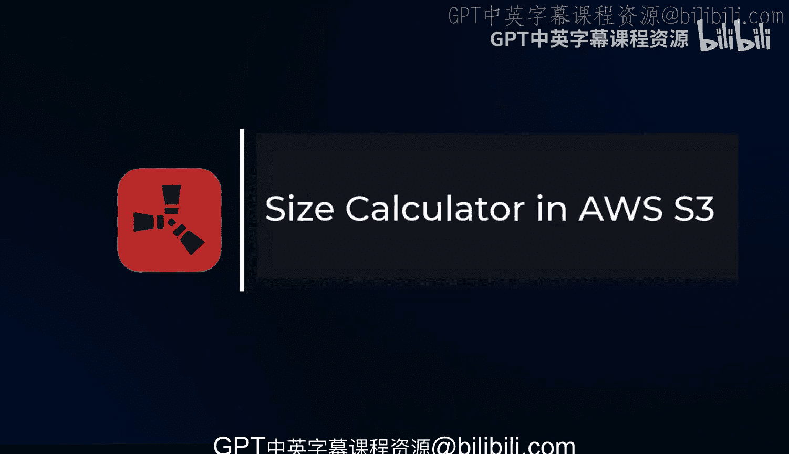
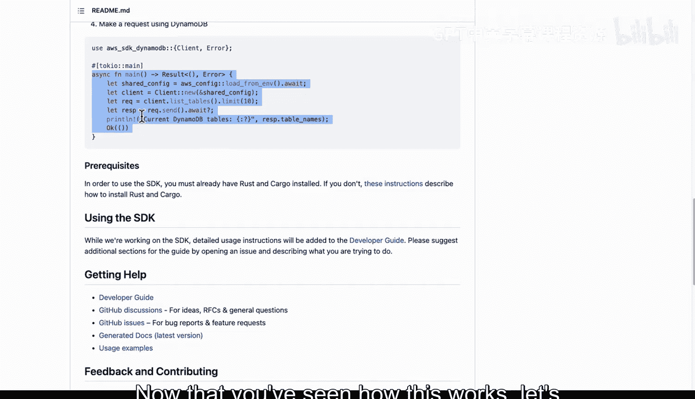
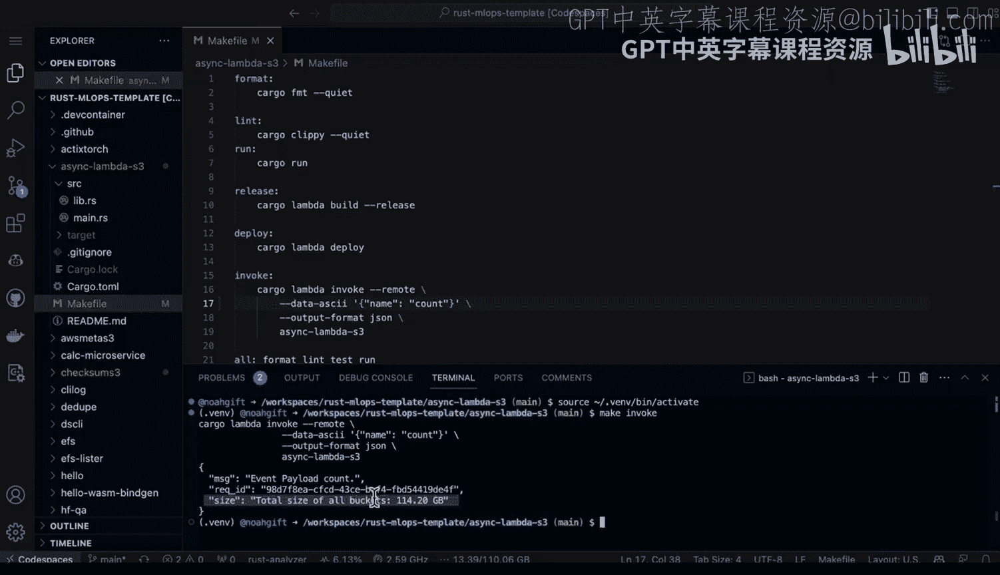
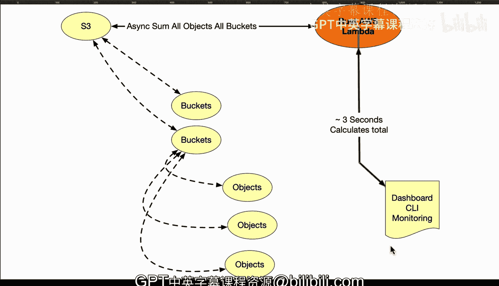

#  077：AWS S3容量计算器 🧮



在本节课中，我们将学习如何使用Rust语言和AWS SDK构建一个高性能的异步Lambda函数。这个函数的核心功能是监控AWS S3存储服务，具体来说，它会异步地遍历账户中的所有S3存储桶，计算每个桶中所有对象的总存储容量，并将结果汇总。这种模式非常适合构建高效的系统监控工具。

## 架构概述 🏗️

上一节我们介绍了MLOps中监控工具的重要性，本节中我们来看看一个具体的实现案例。下图展示了一个基于Rust的AWS Lambda函数架构。这是一个系统编程类型的Lambda，它能够与S3服务进行异步通信。


该Lambda函数可以处理包含成千上万个文件的S3存储桶。它会异步地遍历所有存储桶，检查每个桶内的每个对象，并执行特定操作。在这个作为监控工具的特定Lambda中，它会计算每个对象的大小并累加得到总量。在我的特定存储桶配置下，运行大约需要三秒钟。计算结果之后，可以将其推送到仪表盘（如Grafana）、监控系统或计费系统中。这一切都通过强大的异步Rust SDK实现。

## 代码实现解析 💻

现在我们已经了解了这个工具的功能，接下来让我们深入看看它的代码是如何工作的。

首先，我们需要使用AWS SDK。以下是一个代码示例，展示了如何开始使用SDK和Tokio异步运行时库。这个环境将展示如何异步地列出AWS环境中的所有表。

```rust
use aws_sdk_s3 as s3;
use tokio; // 异步运行时库
```

在看过基本用法后，让我们直接查看代码本身。在Github CodeSpaces中，我有一个异步AWS Lambda项目。你可以看到部分代码，例如我声明了 `use aws_sdk_s3`，并首先创建了一个AWS S3客户端。

```rust
// 创建S3客户端
let config = aws_config::load_from_env().await;
let client = s3::Client::new(&config);
```

然后，我编写了一个列出所有存储桶的函数。你可以看到我将其定义为 `pub async fn list_all_buckets()`。再次强调，`async` 关键字赋予了我们以异步网络方式运行此函数的能力。



```rust
// 异步列出所有存储桶
pub async fn list_all_buckets(client: &s3::Client) -> Result<Vec<String>, s3::Error> {
    // ... 实现代码
}
```

最后，我能够通过累加桶中每个对象的大小来计算存储桶的容量，这非常实用。


最终，我在这里使用 `list_buckets` 函数获取账户中所有存储桶的列表，然后遍历它们并计算每个桶的大小。

如果查看 `main.rs` 文件，它的主要作用是使用Lambda运行时库来创建一个便于人类阅读的辅助方法。至于函数处理器（`function handler`），它能够运行我们之前设置的代码，然后返回响应。

在这个特定的 `main` 方法中，它会依次调用其他方法。接下来，让我们也看看 `Cargo.toml` 文件。

## 项目依赖与运行 🛠️

以下是项目的主要依赖项，在 `Cargo.toml` 文件中定义：

```toml
[dependencies]
serde = { version = “1”, features = [“derive”] } # 用于序列化/反序列化
tokio = { version = “1”, features = [“full”] }   # 异步运行时库
aws-sdk-s3 = “1”                                  # AWS S3 SDK
humansize = “2”                                   # 用于将字节数转换为易读格式（如KB，MB）
```

在 `Makefile` 中，我们可以看到为了调用这个Lambda，可以直接运行make命令。让我们实际操作一下，我会将命令名称改为更简洁的，比如 `run` 或 `count`。我们就执行 `make invoke`。

在这个例子中，如果我没有启用 `cargo-lambda`，很容易修复。只需进入我们的虚拟环境（这是我安装cargo-lambda的方式），然后再次运行。大约三秒钟后，它会异步地完成计算并统计出总存储量。在我的案例中，所有存储桶的总容量是114 GB。

现在，让我们看看Lambda本身。如果我们转到AWS Lambda控制台，可以看到这个异步Lambda函数。我也可以在这里面进行测试。

我只需点击“测试”，就能看到之前的调用记录。在这个案例中，我有一个负载（payload），内容只是 `{“name”: “run”}`，这实际上是一个空负载。我点击测试，就能看到它运行的过程。这是一个非常棒的模式。




## 模式优势与应用场景 🚀

使用Rust构建高性能系统监控Lambda是一个极佳的模式。再次说明，这个Lambda的功能是计算所有存储桶的大小，但你可以想象如何构建与其他组件通信的工具，例如EFS、EMR、所有EBS存储，或者其他类型的系统监控工具。这些工具能够非常高效地运行，并且持续时间很短。在这个案例中，运行只花费了大约2.5秒，并且我可以在最低配置层级运行它，因此它是一个内存使用率非常低的Lambda。

总而言之，使用Rust构建高性能系统工具非常简单。在这个案例中，我们成功将其集成到Lambda中，我可以从Grafana等仪表盘工具调用它、在终端调用它、在定时事件（例如每天一次）中调用它，或者将结果集成到仪表盘中。



## 总结 📝


本节课中我们一起学习了如何利用Rust的异步特性和AWS SDK构建一个用于监控S3存储容量的Lambda函数。我们分析了其架构、核心代码逻辑、项目依赖以及实际运行方式。这种高性能、低资源消耗的模式，为构建各类云原生系统监控和运维工具提供了强大的技术方案。