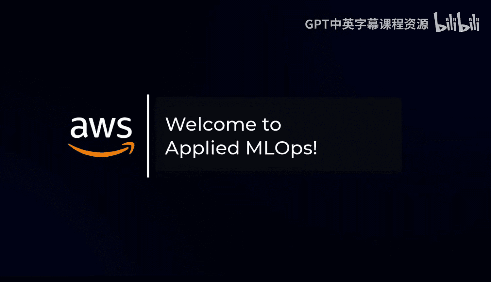

#  078：认识课程讲师诺亚·吉夫特 👨‍🏫

欢迎来到应用机器学习运维课程。我是诺亚·吉夫特，是这门课程的讲师。

我是杜克大学的兼职教授。我的正式头衔是驻校执行官。我同时在信息系统硕士项目、跨学科数据科学项目以及人工智能产品创新项目中任教。

这门课程尤其令人兴奋，因为它涵盖了许多使用云平台将机器学习项目投入生产所必需的基础技能。

## 课程概述

在本课程中，我们将学习如何利用AWS平台，将机器学习模型从开发阶段推进到生产部署。课程内容涵盖了数据工程、探索性数据分析、模型构建以及最终的MLOps实践。

## 课程内容详解

上一段我们介绍了课程的整体情况，接下来，我们将详细拆解课程每周的核心内容。

### 第一周：AWS数据工程

在第一周，我们将重点学习使用AWS技术进行数据工程。以下是本周将涵盖的关键主题：

*   **AWS机器学习入门**：了解如何在AWS上启动机器学习项目。
*   **创建数据仓库**：为机器学习任务构建和管理数据存储库。
*   **数据摄取与转换**：识别并实施数据获取和预处理解决方案。

这部分内容不仅有助于准备AWS机器学习认证，更重要的是，它能帮助你构建可在AWS平台上投入生产的解决方案。

### 第二周：探索性数据分析

在学习了数据工程基础后，第二周我们将聚焦于使用AWS技术进行探索性数据分析。以下是本周的核心任务：

*   **数据清洗与准备**：对原始数据进行清理和预处理。
*   **特征工程**：从数据中提取和构建有效的特征。
*   **分析与可视化**：分析和可视化数据，为机器学习建模做准备。

数据清洗和预处理是机器学习流程中至关重要的环节。AWS平台的优势在于提供了许多无服务器解决方案，帮助你高效构建基础设施。MLOps的目标之一是追求效率，因此利用AWS的无服务器技术进行预处理非常重要。

### 第三周：AWS建模技术

完成了数据准备，第三周我们将进入建模阶段，学习如何使用AWS技术构建模型。以下是需要掌握的内容：

*   **模型选择**：如何为当前任务选择合适的模型（例如，是深度学习问题还是简单线性回归）。
*   **超参数选择**：确定需要调整的关键超参数。
*   **解决方案权衡**：了解使用AWS这类供应商时的权衡，例如是选择完整的解决方案（如AWS Canvas）还是SageMaker的自动调优方案。
*   **模型训练与评估**：在平台上训练机器学习模型，并对其进行评估。

### 第四周：AWS MLOps实践

最后，在第四周，我们将深入探讨使用AWS进行MLOps实践。这是将模型投入生产的最终阶段。以下是本阶段的核心议题：

*   **效率与运维化**：如何使流程高效，以及如何实际运维一个机器学习模型。
*   **生产环境设计考量**：在部署模型到生产环境时需要考虑的不同选择，例如：
    *   **编程语言选择**：使用何种语言部署。
    *   **部署目标与计算资源**：目标是CPU还是GPU。
    *   **优化技术**：是否使用像ONNX这样的技术来优化模型，以提高推理效率。
*   **部署与维护**：如何部署模型，并确保其能够持续运行，处理生产系统的负载。

## 课程总结

本节课中，我们一起认识了讲师诺亚·吉夫特，并详细了解了本课程的结构与核心内容。本课程是希望深入实践、利用AWS平台进行机器学习的宝贵资源。完成本课程不仅有助于掌握实用的MLOps技能，也能为你备考AWS机器学习认证提供有力支持。