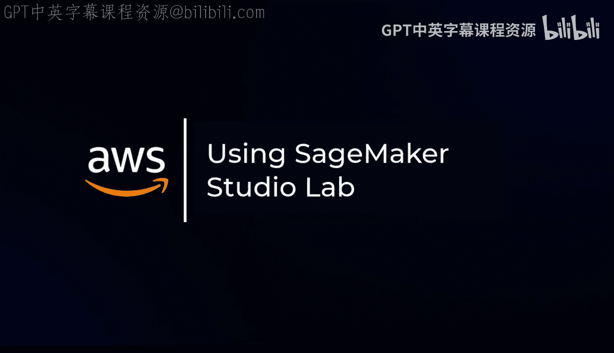
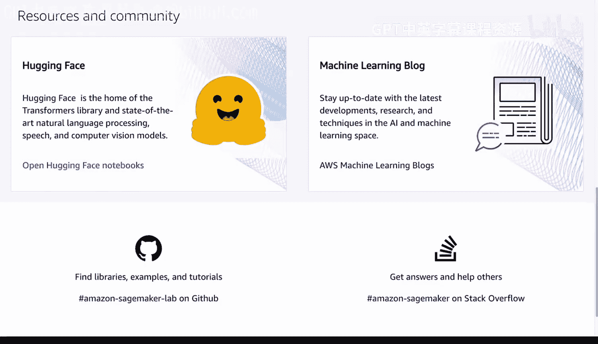
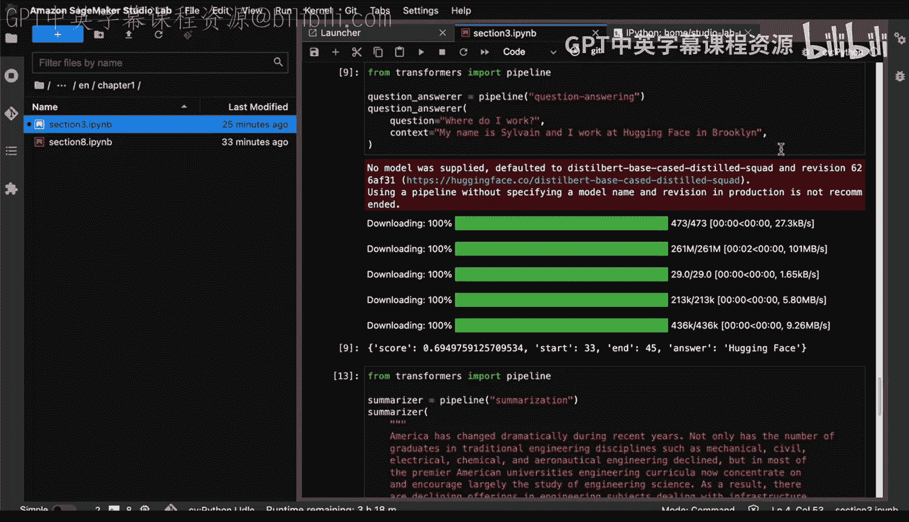
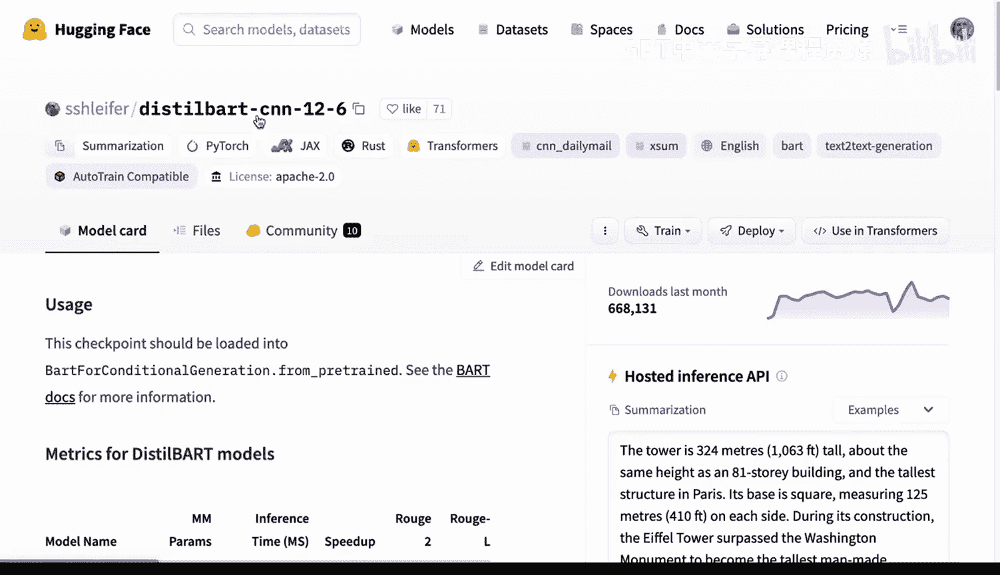
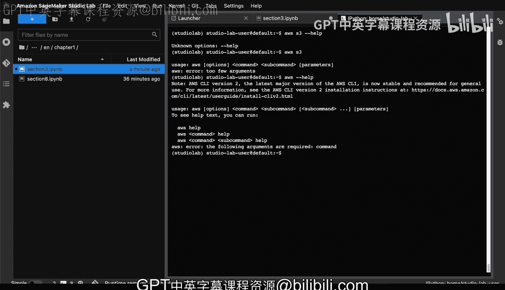

#  079：使用SageMaker Studio Lab 🧪



在本节课中，我们将要学习如何使用Amazon SageMaker Studio Lab。这是一个免费的机器学习项目原型开发环境，基于Jupyter Notebook，并提供了CPU和GPU选项。我们将探索其界面、功能，并学习如何利用它来运行和实验Hugging Face的预训练模型。

---

## 概述

Amazon SageMaker Studio Lab是一个基于Jupyter Notebook的免费环境，专为机器学习项目原型设计。它提供CPU和GPU选项，其中GPU选项特别适合运行涉及预训练模型的现代机器学习工作流。该环境集成了丰富的资源，包括AWS机器学习大学课程和Hugging Face教程，方便用户快速上手。

---

## 环境界面与功能

上一节我们介绍了SageMaker Studio Lab的基本概念，本节中我们来看看它的用户界面和核心功能。

界面左侧是文件系统浏览器，可以查看和管理所有项目文件。点击相应的图标可以查看正在运行的笔记本和终端会话。


以下是界面中几个关键功能图标的作用：



*   **文件浏览器图标**：用于浏览和管理项目文件系统。
*   **运行中图标**：显示所有正在运行的笔记本和终端会话。
*   **Git集成图标**：提供版本控制功能，可以与Git仓库进行集成。
*   **目录图标**：显示Jupyter Notebook的目录大纲。
*   **实验功能图标**：用于启用实验性功能。

---

## 使用终端与环境管理

了解界面后，我们可以通过终端进行更深入的操作。终端是管理环境和监控资源的有力工具。

如果打开一个终端，可以执行各种命令。例如，要查看所有可用的Conda环境，可以输入：

```bash
conda env list
```

此命令会列出所有已创建的环境，方便用户在不同环境间切换或创建新环境。

另一个有用的功能是监控GPU使用情况。这对于运行本地模型训练（如Hugging Face的迁移学习）尤为重要。要监控GPU，可以输入命令：

```bash
nvidia-smi -l 1
```

该命令会每秒刷新一次，显示GPU驱动版本、CUDA版本、当前利用率以及GPU型号（例如Tesla T4）等信息。


---

## 运行Hugging Face教程

现在我们已经熟悉了环境的基本操作，接下来可以运行一些实际的机器学习代码。SageMaker Studio Lab预置了Hugging Face的教程资源。

在文件系统中，可以找到“huggingface-course”目录，其中包含了与O‘Reilly出版的Hugging Face书籍对应的各章节笔记本。例如，打开第一章的第三节笔记本，可以开始学习Transformer模型。

首先，通常需要安装必要的库。在笔记本单元格中运行：

```python
!pip install datasets evaluate transformers
```

这条命令会从Hugging Face安装`transformers`库及其相关依赖。安装完成后，就可以利用GPU环境运行预训练模型。

---



## 体验Transformer管道

安装好库之后，我们就可以使用Hugging Face的`pipeline` API来轻松调用各种预训练模型进行推理。

`pipeline`函数封装了从模型加载到推理的全过程。例如，进行情感分析：

```python
from transformers import pipeline

classifier = pipeline("sentiment-analysis")
result = classifier("I love this course!")
print(result)
# 输出可能为：[{'label': 'POSITIVE', 'score': 0.9998}]
```



除了情感分析，`pipeline`还支持多种任务：

*   **零样本分类**：给定一段文本和一组候选标签，模型会判断文本与哪个标签最相关。
*   **文本生成**：根据提供的开头，自动生成后续文本。
*   **掩码填充**：将句子中的`[MASK]`标记替换为模型认为最合适的词语。

这些任务都可以在SageMaker Studio Lab的GPU支持下快速运行，让用户直观体验Transformer模型的能力。


---

## 与AWS服务的集成

SageMaker Studio Lab作为AWS生态系统的一部分，也提供了与AWS服务的集成可能性，为将来将项目迁移到完整的AWS环境做准备。

在终端中，如果配置了相应的凭证，可以直接使用AWS命令行工具。例如，可以尝试列出S3桶：

```bash
aws s3 ls
```

通过查看帮助菜单（`aws help`），可以探索所有可用的命令。这种集成使得在原型开发后期，能够更平滑地将数据和模型工作流迁移到Amazon S3、SageMaker等生产级服务中。

---

## 总结

本节课中我们一起学习了如何使用Amazon SageMaker Studio Lab这个强大的免费工具。我们从其界面和基本功能开始，学习了如何通过终端管理环境并监控GPU资源。接着，我们动手实践，运行了Hugging Face的教程，并使用`transformers`库的`pipeline`接口体验了情感分析、文本生成等多种机器学习任务。最后，我们了解了它与AWS服务的集成潜力。SageMaker Studio Lab是一个极佳的实验环境，能有效帮助初学者和开发者原型化机器学习想法，并为后续部署到AWS云平台打下基础。



