#  080：开始使用AWS CloudShell 🚀

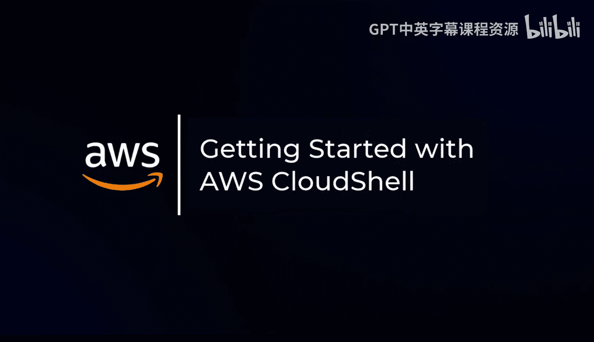

在本节课中，我们将学习如何使用AWS CloudShell。AWS CloudShell是一个基于浏览器的命令行工具，可以直接访问AWS资源和服务。我们将探索其核心功能，包括如何启动、管理环境、上传下载文件，以及如何利用它来操作AWS服务（如S3存储桶）。

---

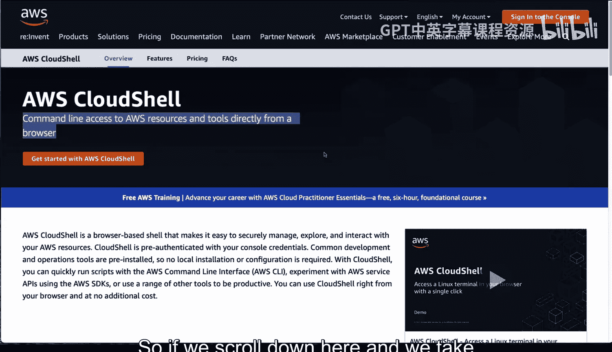

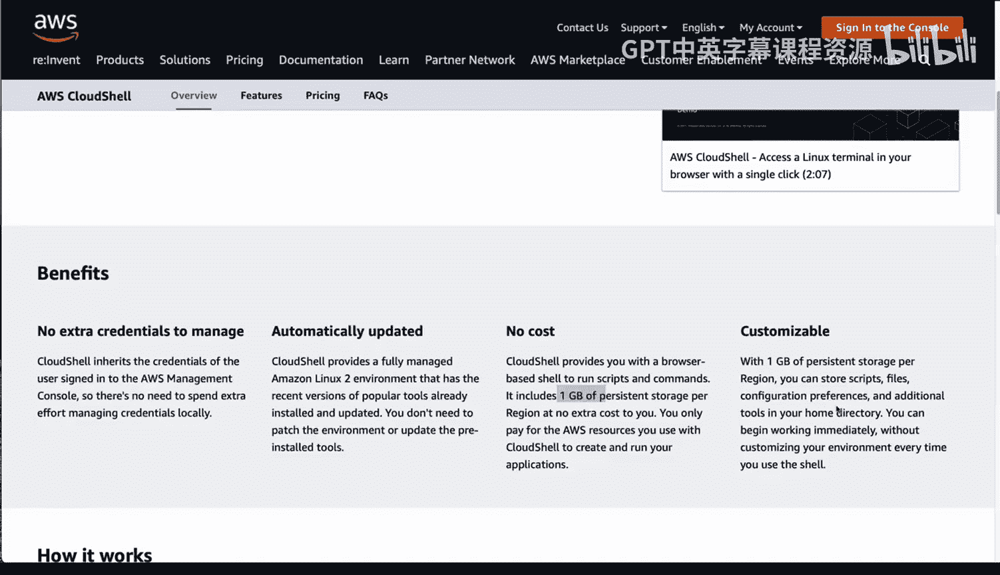

## 什么是AWS CloudShell？ 💡

AWS CloudShell是一个基于浏览器的命令行界面，用于访问AWS资源和工具。其关键特性在于，它允许用户在任何地方（如图书馆或咖啡馆）通过浏览器直接登录并开始工作。由于它运行在AWS生态系统内部，因此操作速度非常快。

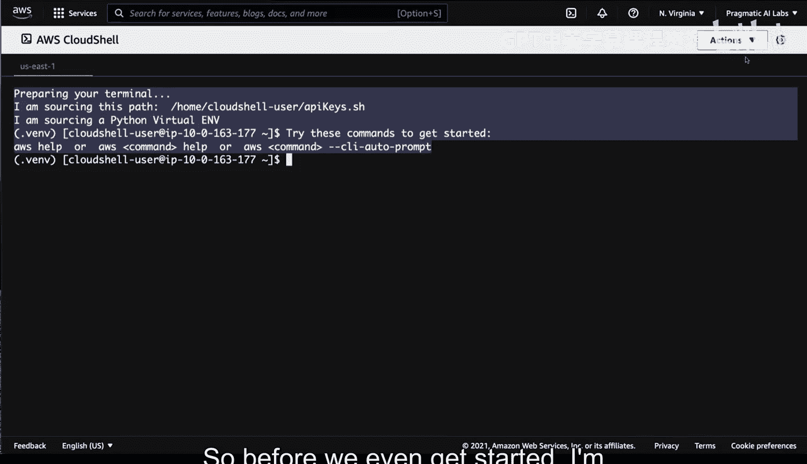

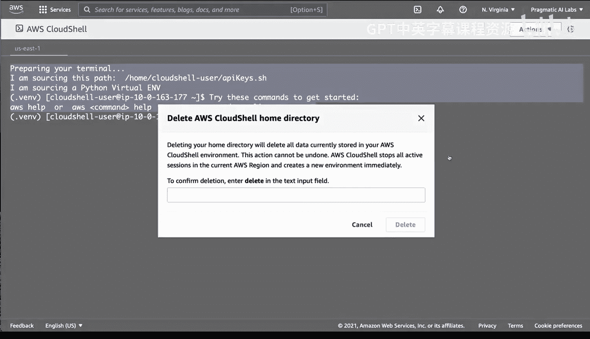

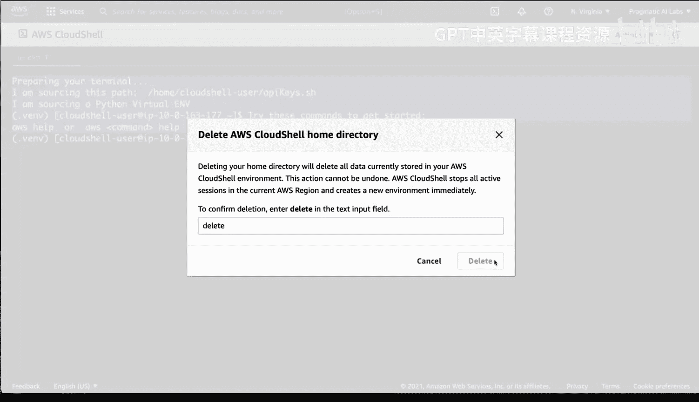

以下是其主要优点：
*   **无需管理额外凭证**：访问权限基于IAM角色。
*   **自动更新**：操作系统和工具会自动更新至最新版本。
*   **免费使用**：服务本身不产生费用。
*   **附带存储**：提供1GB的持久性存储空间。
*   **可定制**：用户可以根据需要定制环境。

简而言之，AWS CloudShell是用于以编程方式控制AWS平台的接口之一。

---

## 启动与重置环境 🔄

现在，让我们启动CloudShell环境。在AWS管理控制台的任何区域，都可以找到并启动CloudShell。

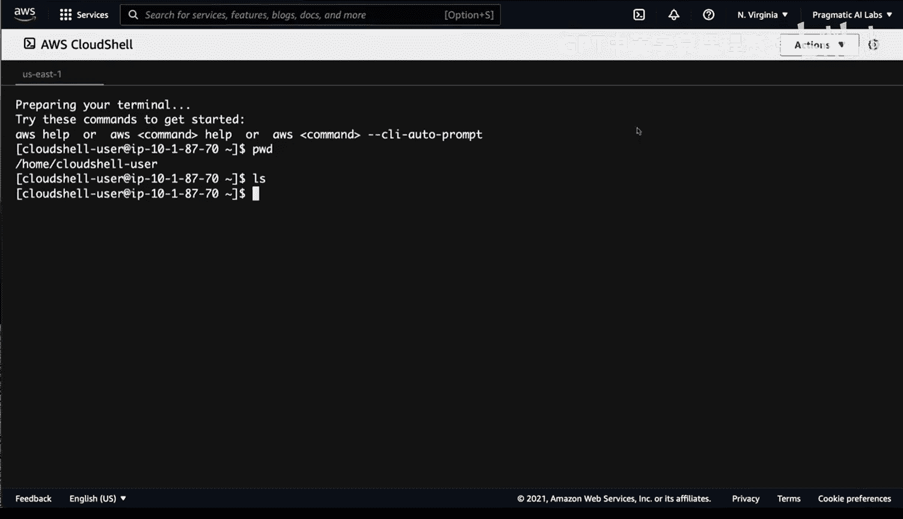

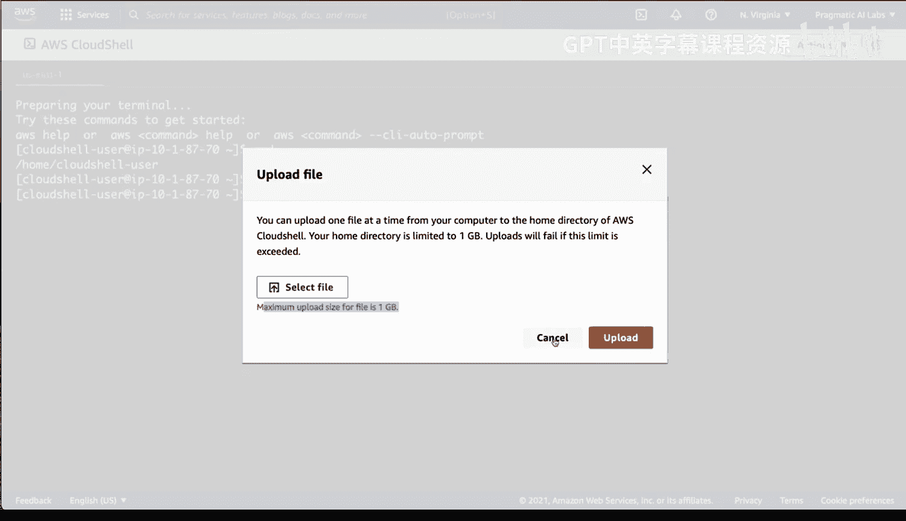

启动后，你可能会看到之前工作的记录。在开始新任务前，有一个实用技巧：你可以重置整个CloudShell环境。如果你在环境中进行了大量实验并导致混乱，这个功能非常有用。重置后，环境将恢复为初始状态。

---

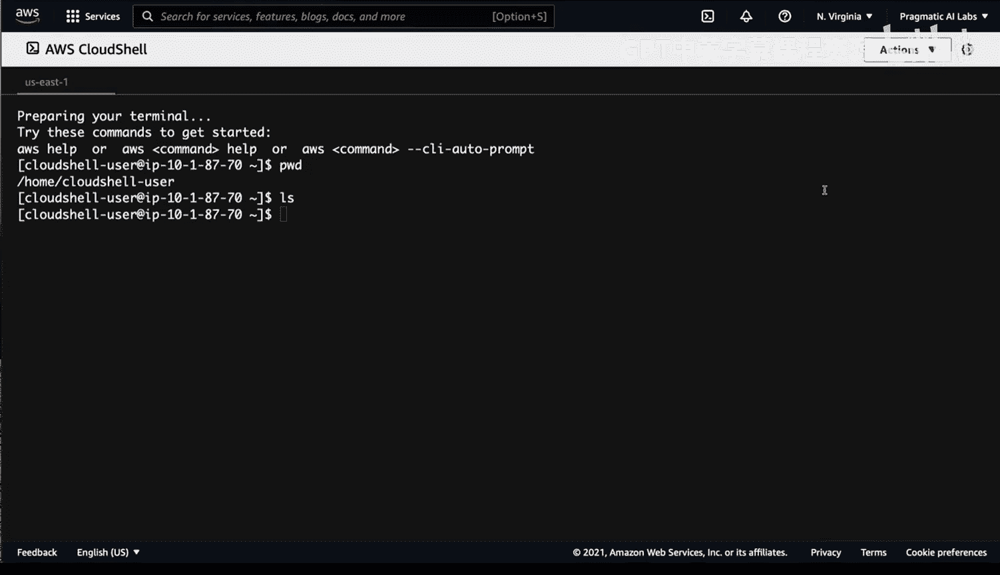

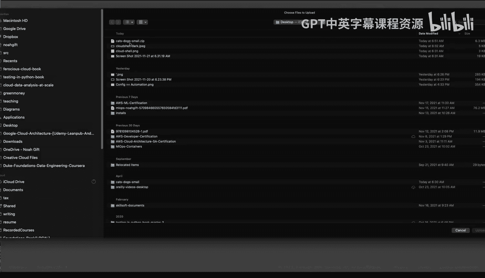

## 界面操作与多任务处理 🖥️

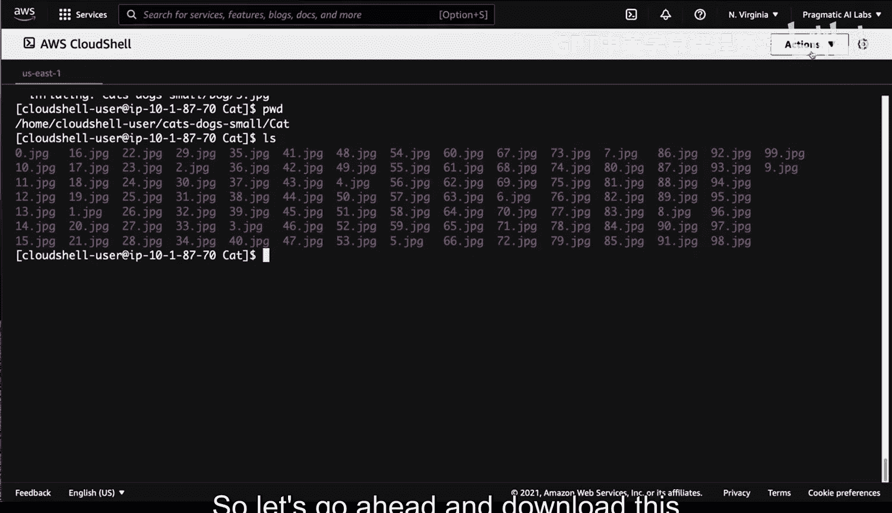

接下来，我们看看CloudShell界面中的“操作”菜单。这里有几个非常有用的功能：

*   **打开新Shell**：你可以打开多个独立的Shell标签页。
*   **上下分割视图**：将界面分为上下两个面板。这在处理前后端分离的任务时非常方便，例如，你可以在上半部分运行一个Flask或FastAPI服务，在下半部分调用它。
*   **左右分割视图**：将界面分为左右两列。这可以让你构建一个类似仪表盘的终端工作区。

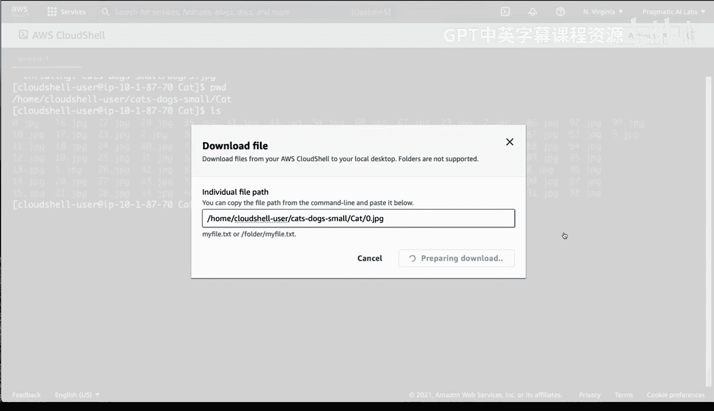

此外，你还可以上传和下载文件。

---

## 文件上传与下载 📁

CloudShell允许你从本地计算机上传文件到其主目录（`/home`），也支持从CloudShell下载文件到本地。主目录的存储空间限制为1GB，这对于许多任务来说已经足够。

**上传文件**：你可以一次上传一个文件。这对于数据工作非常常见，例如上传一个CSV文件或用于机器学习的其他数据文件。

**下载文件**：你需要知道目标文件在CloudShell中的完整路径。例如，路径可能类似于 `/home/cloudshell-user/cats_dogs_small/cat.0.jpg`。

你可以使用 `df -h` 命令查看文件系统使用情况，以监控剩余的存储空间。

---

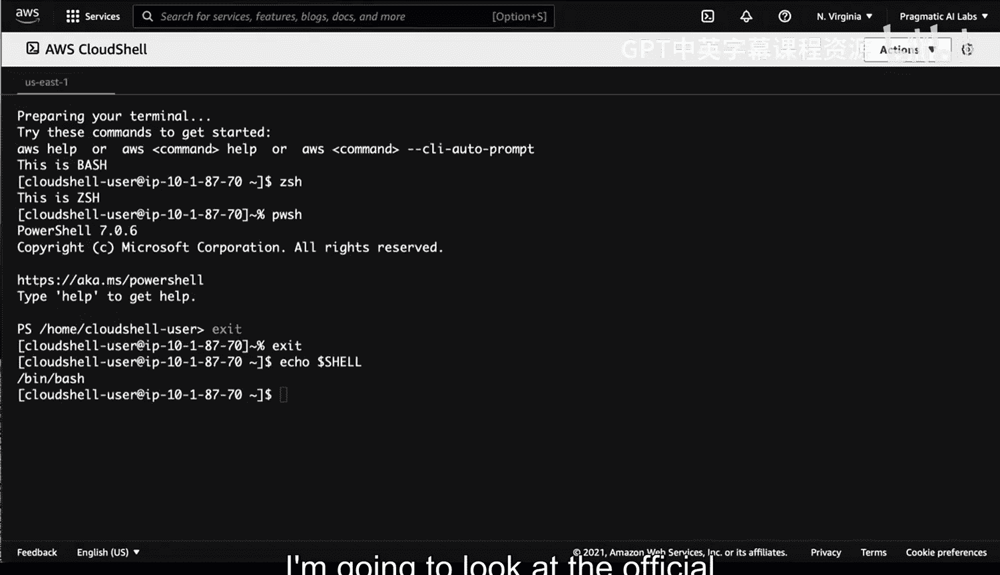

## 支持多种Shell环境 🐚

CloudShell默认使用Bash shell，但你也可以使用其他流行的shell环境。

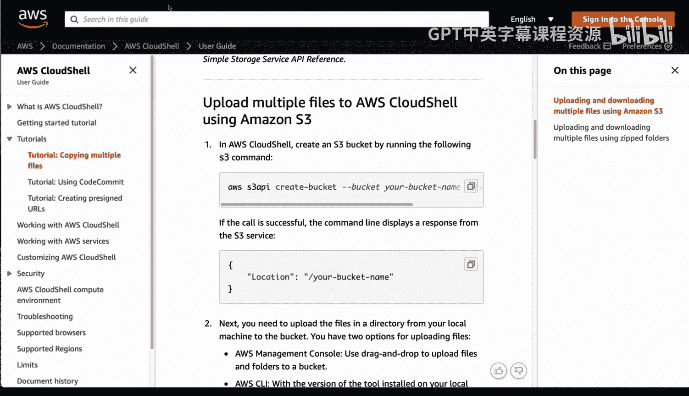

*   **Bash**：默认环境。你可以编辑 `~/.bashrc` 文件来自定义它。
*   **Zsh**：许多开发者喜爱的shell，提供更多命令和功能（如自动补全）。你可以通过运行 `zsh` 命令切换到Zsh，并编辑 `~/.zshrc` 文件进行配置。
*   **PowerShell**：如果你是.NET开发者，可以使用PowerShell环境。只需运行 `pwsh` 命令即可进入。

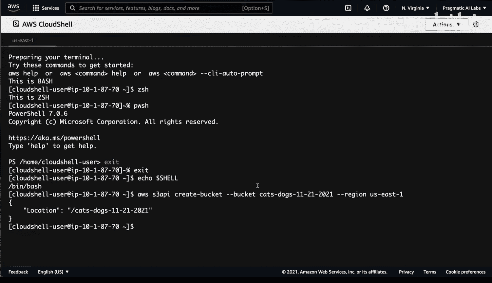

这意味着无论你习惯使用Bash、Zsh还是PowerShell，都可以在CloudShell中找到合适的工作环境。

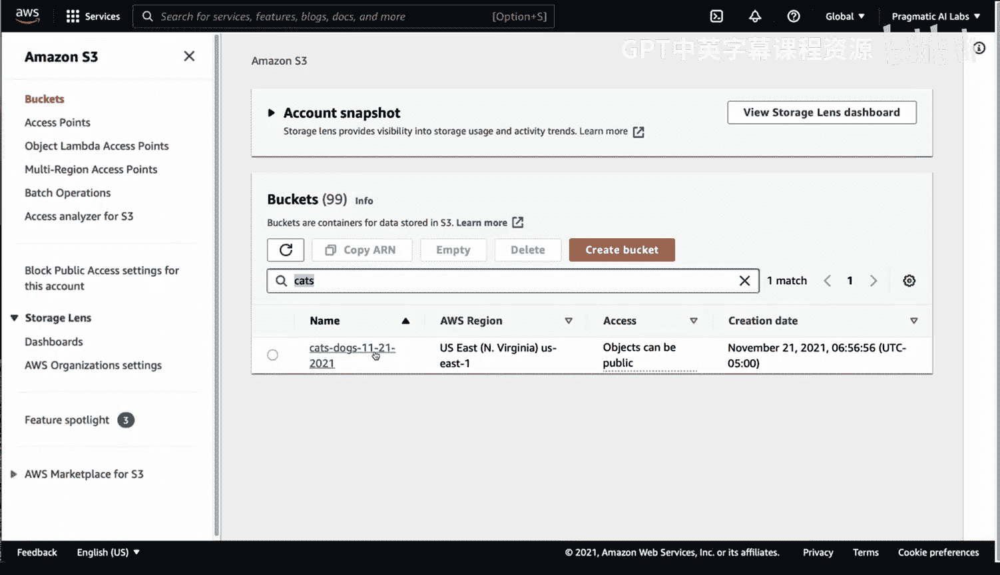

---

## 实战：使用CloudShell操作AWS S3 🛠️

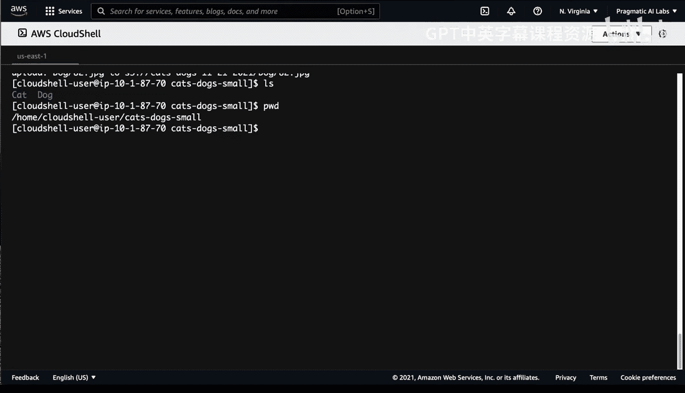

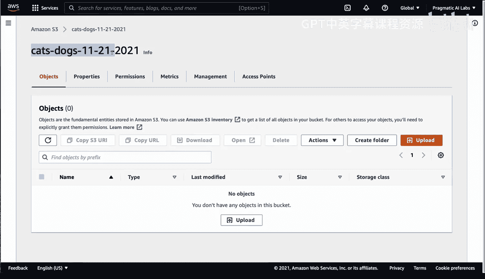

现在，让我们使用CloudShell进行一些实际工作。我们将演示如何通过命令行创建S3存储桶并同步文件。

**1. 创建S3存储桶**
我们可以完全通过命令行创建存储桶，无需使用AWS控制台。命令格式如下：
```bash
aws s3 mb s3://你的存储桶名称
```
例如，创建一个名为 `cats-dogs-11212021` 的存储桶：
```bash
aws s3 mb s3://cats-dogs-11212021
```
创建后，你可以使用 `aws s3 ls` 命令列出所有存储桶来验证。

**2. 同步本地文件到S3**
假设我们已将一些文件上传到CloudShell的当前目录。我们可以使用 `sync` 命令将这些文件同步到S3存储桶。
```bash
aws s3 sync . s3://你的存储桶名称/
```
这个命令会将当前目录（`.`）下的所有文件同步到指定的S3存储桶中。`sync` 命令是高效的，它只会上传新增或更改的文件。

**3. 从S3下载文件**
同样，你也可以从S3下载文件。例如，如果你想下载一个ZIP文件，可以先确认其路径，然后使用下载功能。

---

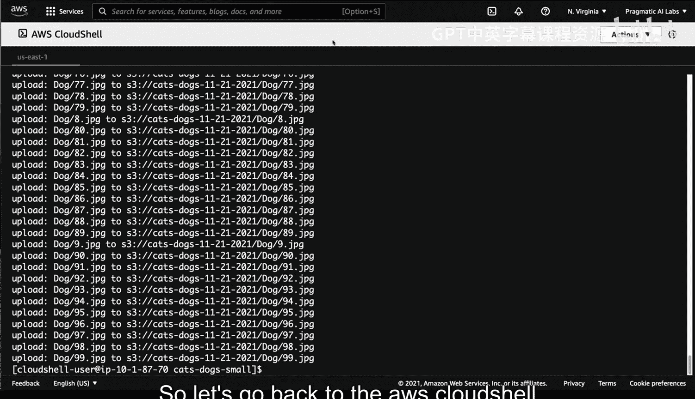

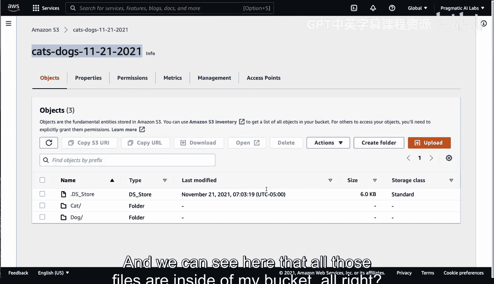

## 总结 📝

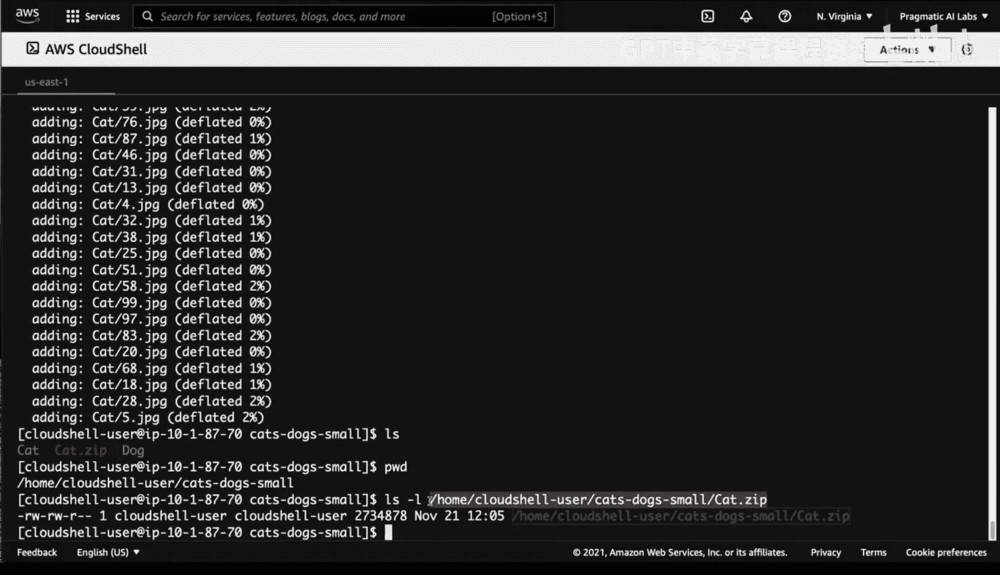


本节课我们一起学习了AWS CloudShell的核心功能。我们了解了它作为一个基于浏览器的命令行工具的优势，包括便捷的访问、内置的AWS工具链和免费存储。我们实践了如何启动和重置环境、使用多任务视图、上传下载文件，以及切换不同的Shell环境（Bash、Zsh、PowerShell）。最后，我们通过创建S3存储桶和同步文件的实战演示，展示了如何使用CloudShell高效地操作AWS服务。掌握CloudShell将极大提升你在AWS平台上进行开发、数据工程和机器学习运维工作的效率。