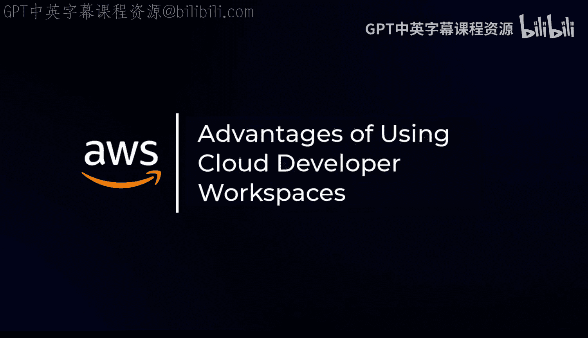
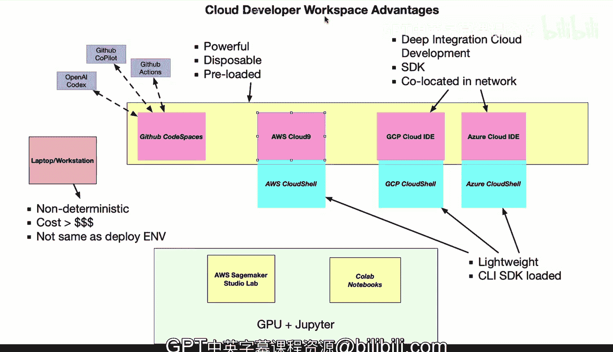

#  081：使用云开发者工作区的优势 ☁️💻

在本节课中，我们将要学习云开发者工作区相较于传统本地开发环境的优势。我们将探讨其核心特点、不同云平台提供的解决方案，以及它如何为软件工程、数据科学和机器学习运维工作流带来变革。

---

## 传统本地环境的挑战

上一节我们介绍了机器学习运维的基本概念，本节中我们来看看开发环境的选择。首先，让我们审视传统的笔记本电脑或工作站开发环境。

这种环境存在几个关键问题：
*   **环境非确定性**：没有标准化的保证环境。
*   **存在干扰包**：可能安装了你不希望存在的软件包。
*   **硬件成本高**：获取GPU和大容量固态硬盘等高性能硬件的成本高昂。
*   **与部署环境脱节**：如果你的应用最终部署在云端，本地开发环境（除少数特例外）与生产环境存在差异。

虽然可以使用容器技术来缓解部分问题，但这并非根本解决方案。

## 云端开发环境的兴起

现在，让我们将目光转向云端。云开发者工作区是当前软件工程、数据工程、数据科学和机器学习工程领域一个非常有趣的新趋势。本质上，如果你不使用基于云的开发环境，你将错过许多在个人笔记本电脑上无法获得的新功能。

以下是主流的云开发环境选项：

**集成开发环境类**
这类环境更适用于软件工程、机器学习工程和运维工作流。
*   **GitHub Codespaces**：其独特优势在于与GitHub Actions（持续集成系统）和GitHub Copilot（基于OpenAI Codex的代码辅助工具）的深度集成，并且整个生态与GitHub紧密耦合。
*   **AWS Cloud9**：提供定制化功能，包括基于角色的权限管理（无需在代码中硬编码API密钥），并与AWS Lambda、S3、API Gateway等服务深度集成，便于构建无服务器应用。
*   **AWS Cloud Shell / GCP Cloud Shell / Azure Cloud Shell**：这些是更轻量级的云端命令行环境，适合执行简单的软件工程任务，并支持在Bash、Zsh或PowerShell之间切换。
*   **GCP Cloud IDE 与 Azure Cloud IDE**：谷歌云和微软Azure也提供了各自的云端代码编辑器。

**笔记本环境类**
这类环境更适合以笔记本为中心的工作流程。
*   **Colab Notebooks**：允许在云端构建兼容Jupyter、并能使用GPU的系统。甚至可以使用专业版本。
*   **AWS SageMaker Studio Lab**：允许用户免费使用AWS平台提供的GPU来运行Jupyter笔记本。

## 核心优势与未来展望

观察这些环境，你会发现一个共同趋势：世界正在转向这些功能强大、即用即弃、预配置好的环境。它们与云服务深度集成，SDK已预先安装，并且最关键的是——**与数据同地协作**。

试想一下，如果你在咖啡馆需要处理TB级的数据，在本地和云端之间来回传输数据将非常困难。但如果数据本就存储在云端，而你启动了一个云开发环境，你就直接与数据位于同一位置，消除了数据传输的瓶颈。

因此，云开发者工作区的优势代表着未来发展方向。它提供了标准化、高性能、且与基础设施和数据无缝集成的开发体验。我强烈推荐大家深入探索并采用这种工作方式。

---

本节课中，我们一起学习了云开发者工作区相比传统本地环境的巨大优势。我们了解了它如何解决环境一致性、硬件成本和数据本地化等核心挑战，并概览了各大云平台提供的具体解决方案。拥抱云开发环境，将助力你的机器学习项目更加高效和可扩展。