#  082：在CloudShell中原型化AI API 🚀


在本节课中，我们将学习如何在AWS CloudShell环境中，利用命令行工具快速原型化和测试AI服务API。我们将从简单的情绪分析开始，逐步深入到如何获取、处理外部数据，并构建一个完整的数据处理流水线。

---


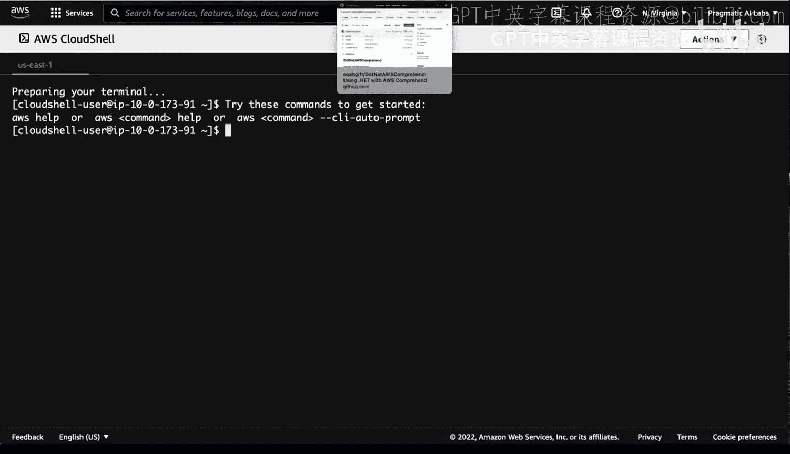

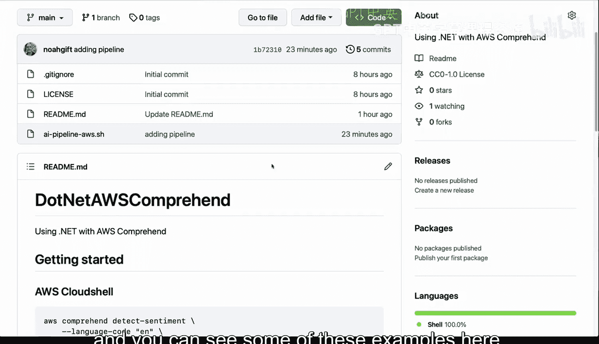

## 概述

AWS提供了丰富的AI服务，例如高级文本分析、代码审查、聊天机器人、预测和文档分析等。我们将从CloudShell开始，这是一个无需设置本地环境即可快速尝试和原型化想法的理想平台。

## 开始使用AWS Comprehend

首先，我们使用AWS Comprehend服务进行情绪分析。这是一个分析文本情感（积极、消极或中性）的服务。

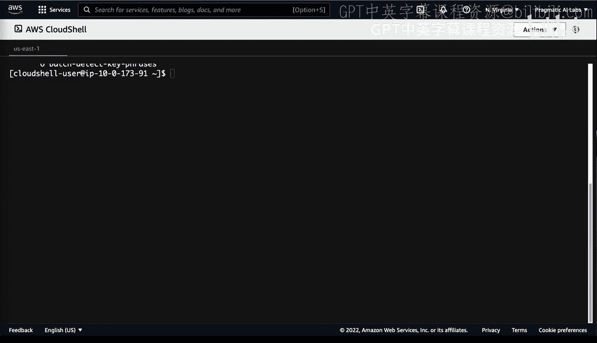

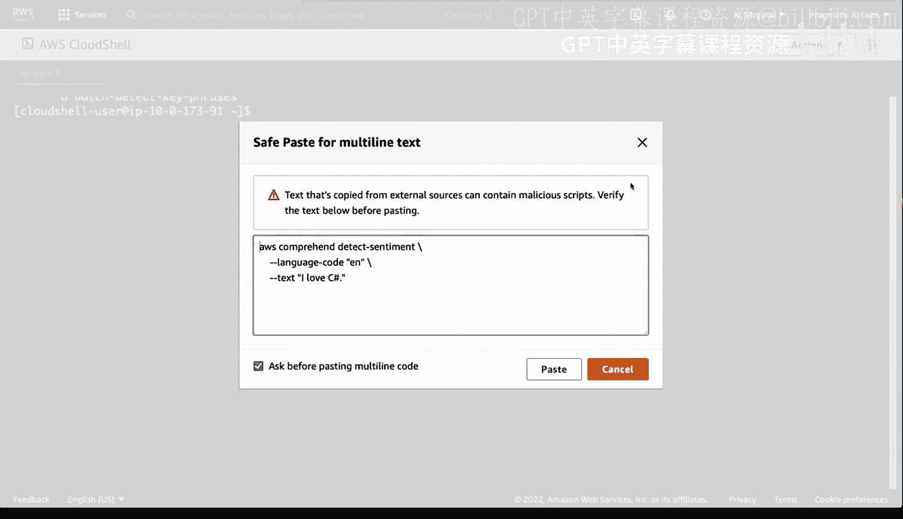

在CloudShell中，我们可以通过`aws comprehend`命令来访问该服务。使用`--help`参数可以查看所有可用的子命令。

```bash
aws comprehend help
```

以下是可用的子命令示例：
*   `batch-detect-dominant-language`
*   `classify-document`
*   `detect-sentiment`

我们将从`detect-sentiment`开始，分析一句简单文本的情感。

## 执行第一个情感分析

我们可以构建一个命令来分析“I love C#”这句话的情感。为了使命令更易读，我们使用换行符来分隔参数。

```bash
aws comprehend detect-sentiment \
    --language-code "en" \
    --text "I love C#"
```

执行上述命令后，服务会返回一个JSON格式的结果，其中包含`Sentiment`字段，其值为`POSITIVE`。这表明我们的首次AI API调用成功了。

## 处理更复杂的文本输入

上一节我们介绍了如何分析短文本，但在实际应用中，我们可能需要分析来自网页等外部源的长文本。本节中我们来看看如何获取并处理这类数据。

AWS Comprehend对单次输入的文本有长度限制（少于5000字节）。为了处理更长的文本，我们需要先获取内容，然后截取合适的部分。

首先，我们安装一个名为`links`的终端网页浏览工具，它可以将网页内容以纯文本形式输出。

```bash
sudo yum install links -y
```

安装完成后，我们可以用它来获取维基百科上关于阿尔伯特·爱因斯坦的文章。

```bash
links -dump https://en.wikipedia.org/wiki/Albert_Einstein | less
```

使用`wc`命令可以查看获取到的文本字节数，这远超过5000字节的限制。

```bash
links -dump https://en.wikipedia.org/wiki/Albert_Einstein | wc -c
```

为了符合API限制，我们使用`head`命令截取前5000字节的文本。

```bash
links -dump https://en.wikipedia.org/wiki/Albert_Einstein | head -c 5000
```

## 将文本集成到AI命令中

现在我们已经能获取文本，接下来需要将其作为变量传递给AWS Comprehend命令。在Bash中，我们可以使用反引号或`$()`将命令输出赋值给变量。

我们将截取后的文本存储在一个变量中：

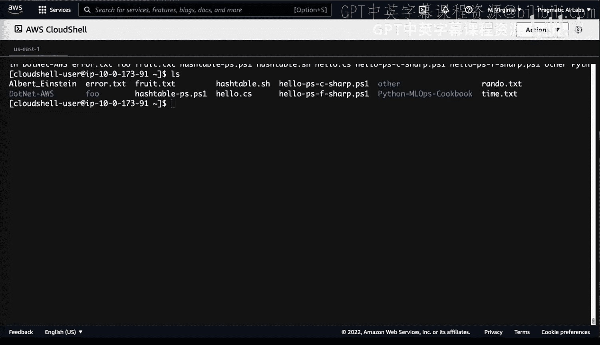

```bash
TEXT=$(links -dump https://en.wikipedia.org/wiki/Albert_Einstein | head -c 5000)
```

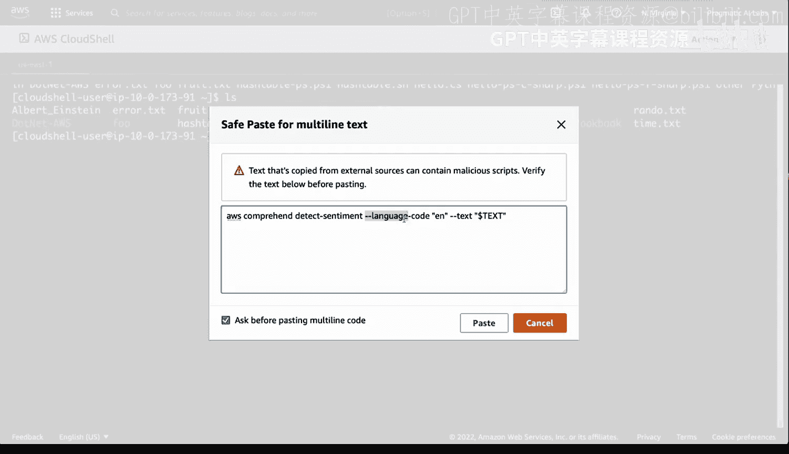

然后，在情感分析命令中引用这个变量：

```bash
aws comprehend detect-sentiment \
    --language-code "en" \
    --text "$TEXT"
```

分析长篇文章的情感，结果可能显示为`NEUTRAL`（中性）或带有`POSITIVE`（积极）倾向，这为数据科学分析提供了有趣的视角。

## 探索实体检测功能

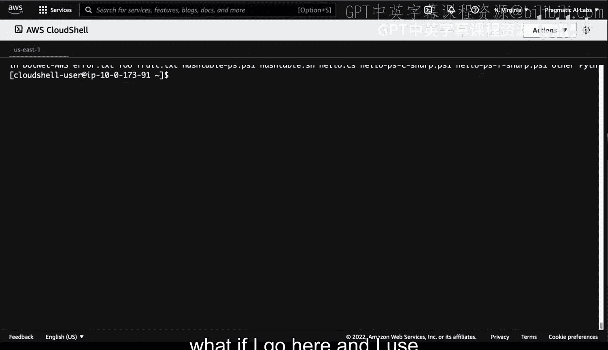

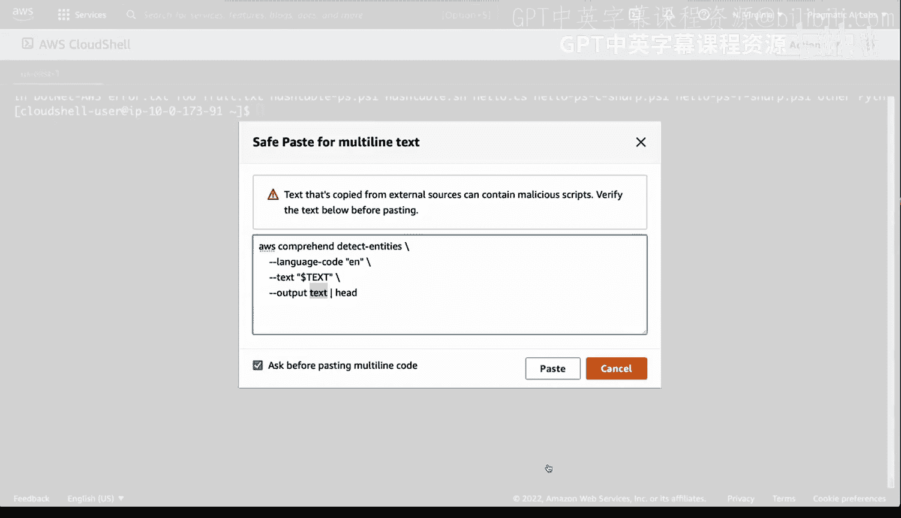

除了情感分析，AWS Comprehend还能识别文本中的关键实体（如人名、地点、组织）。本节我们将使用`detect-entities`子命令，并学习如何处理其输出。

基本的实体检测命令如下：

```bash
aws comprehend detect-entities \
    --language-code "en" \
    --text "$TEXT" \
    --output text
```

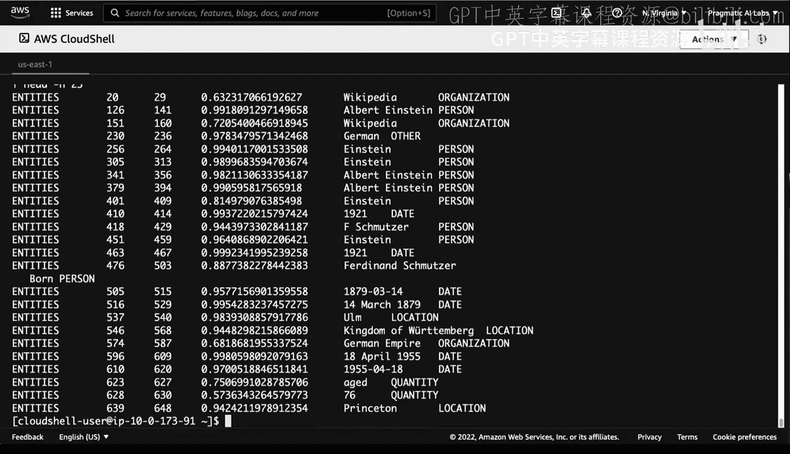

命令将以表格形式输出，其中一列包含了识别出的实体名称。

## 构建AI数据处理流水线

为了从实体检测结果中获得更有价值的洞察，我们可以构建一个Bash流水线，来统计每个实体出现的频率。

以下是完整的流水线命令，它执行了多个步骤：提取实体、清洗文本、排序并计数。

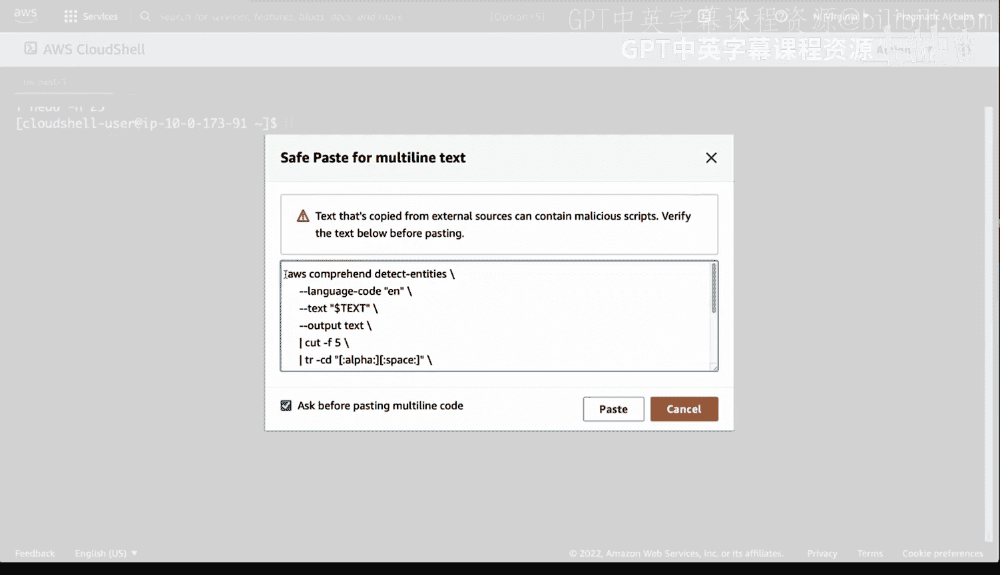

```bash
aws comprehend detect-entities \
    --language-code "en" \
    --text "$TEXT" \
    --output text | \
awk '{print $3}' | \
tr -d '[:punct:]' | tr '[:upper:]' '[:lower:]' | tr -d '\n' | \
sort | \
uniq -c | \
sort -nr | \
head -10
```

让我们分解这个流水线的每一步：
1.  **`aws comprehend detect-entities ...`**: 调用API检测实体，并以文本格式输出。
2.  **`awk '{print $3}'`**: 使用`awk`提取输出结果中的第三列（实体名称）。
3.  **`tr -d '[:punct:]' | tr '[:upper:]' '[:lower:]'`**: 使用`tr`命令删除标点符号并将所有字母转换为小写，以实现标准化。
4.  **`sort`**: 对清洗后的实体列表进行排序，这是`uniq -c`正确计数的前提。
5.  **`uniq -c`**: 统计每个唯一实体出现的次数。
6.  **`sort -nr`**: 按计数降序排序，使出现最频繁的实体排在最前面。
7.  **`head -10`**: 只显示前10个最常出现的实体。

运行此流水线，我们会得到类似“Einstein”、“University”、“German”等高频实体列表，这快速揭示了文章的核心内容。

## 总结

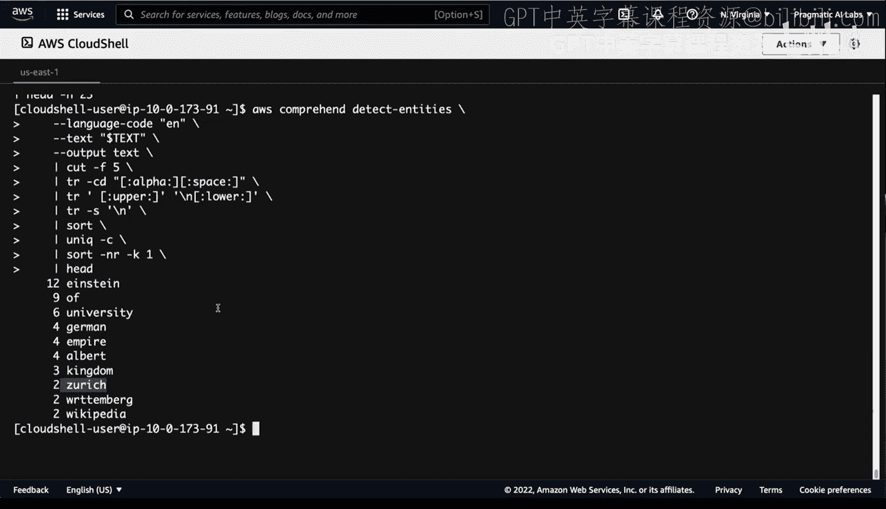

本节课中我们一起学习了如何在AWS CloudShell中利用命令行原型化AI API。我们从简单的情感分析入手，逐步掌握了如何从外部获取文本数据、处理API的长度限制、将数据集成到命令中，最后构建了一个复杂的Bash流水线来自动化实体提取和频率统计。这个过程证明，即使不依赖Python或R等高级语言，仅使用CloudShell和Bash也能快速进行AI服务的概念验证和复杂的数据处理。