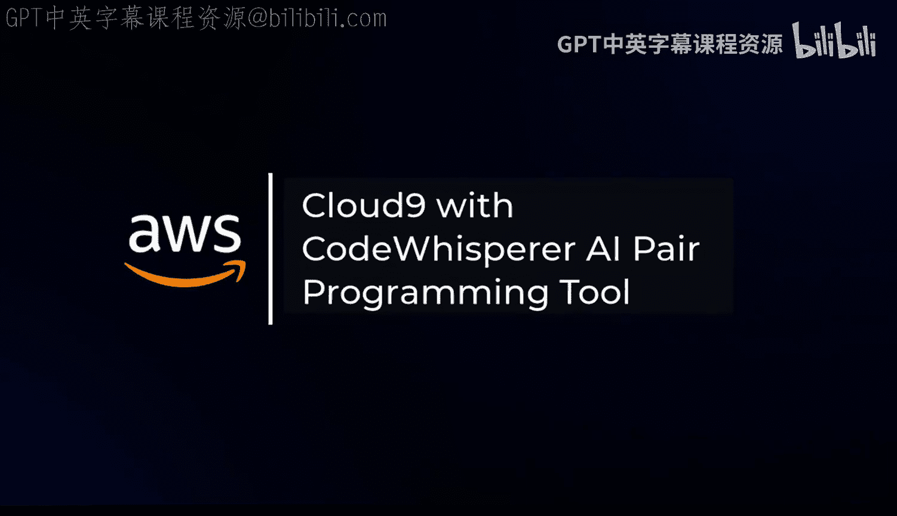
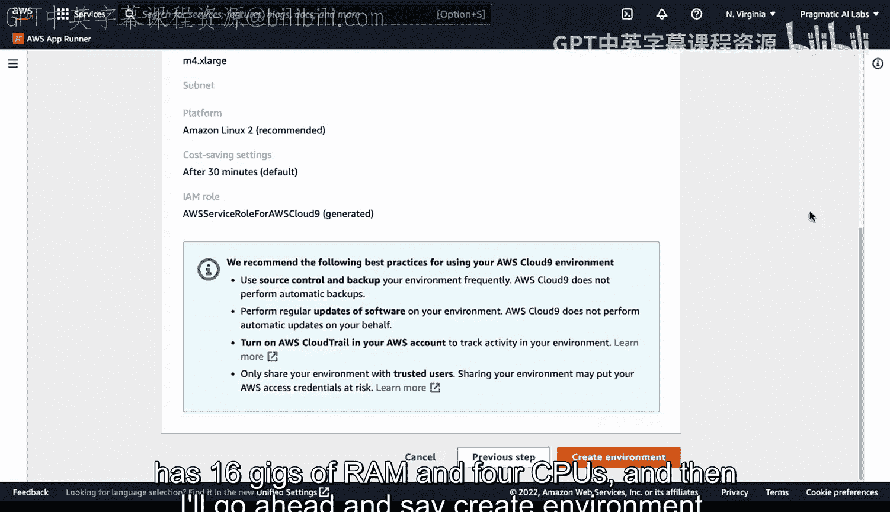
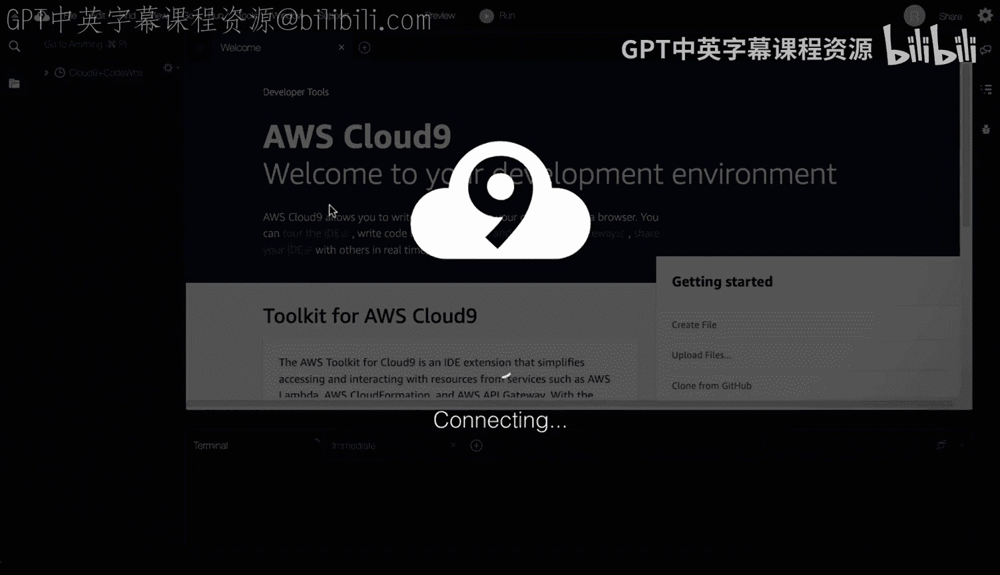
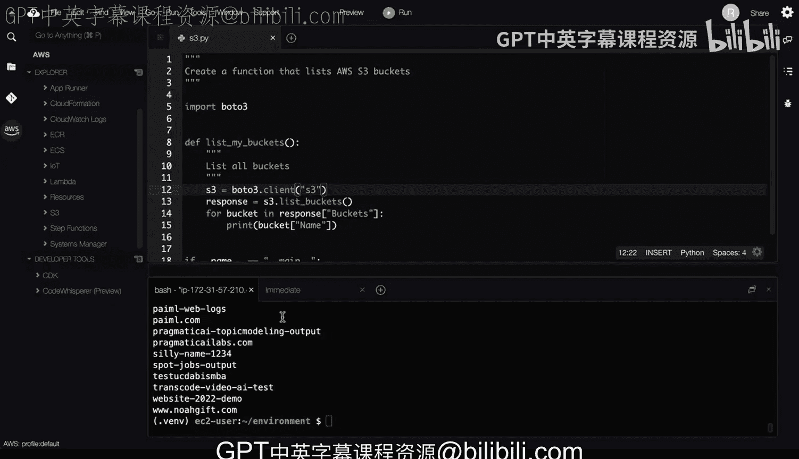

#  083：使用AWS Cloud9与CodeWhisperer进行AI结对编程



在本节课中，我们将学习如何在AWS Cloud9集成开发环境中，利用CodeWhisperer这一AI结对编程工具来辅助开发工作。我们将涵盖从环境创建到编写和调试代码的完整流程。

## 概述

了解Cloud9的最佳途径是查阅官方文档。AWS官方文档提供了关于如何在Cloud9中处理环境以及新功能开发的详细指南。随着新特性的开发，相关文档会持续更新。文档中包含大量资源，例如如何访问AWS工具包。接下来，我们将深入探索这些资源。

## 创建Cloud9环境

首先，确保你选择了正确的区域来创建Cloud9资源。你可以选择多个不同的区域。在本例中，我们将选择北弗吉尼亚区域。

以下是创建新环境的步骤：



1.  点击创建新环境。
2.  将环境命名为 `Cloud9_CodeWhisperer_Demo`。
3.  可以添加描述，例如“用于演示”。
4.  如果需要，可以从命令行工具查询并拉取信息。

通常，选择适合你解决问题的实例规格是一个好习惯。如果只是进行探索，可以保留所有默认设置，并选择包含Amazon Linux 2。在本例中，我们将选择一个稍大的实例：具有16GB内存和4个CPU。最后，点击“创建环境”。

## 熟悉Cloud9界面



环境创建完成后，启动速度相当快。你将可以访问这个界面。加载时，欢迎屏幕会提供关于环境的更多信息。

界面右侧的资源区域允许你与他人共享此环境以进行结对编程。右侧的小齿轮选项卡是设置区域。你还可以通过选择调试图标来调试代码。

文件菜单包含各种有助于工作的功能，例如代码折叠或将代码向左或向右移动。

## 使用终端

开始使用Cloud9时，最重要的事情之一是熟悉终端。这里是所有强大功能的起点。

一个很好的展示方式是，如果我输入 `aws s3 ls --help`，可以看到这里有一个帮助菜单，我可以与之交互，它会确切地告诉我这个特定工具的功能。所有AWS工具都已安装在此环境中。

例如，我可以输入 `aws s3 ls` 来列出我拥有的所有存储桶，然后使用 `wc -l` 来统计可用的存储桶数量。这本质上是一个可以让你通过命令行操作所有资源，甚至在此环境内外复制数据的平台。

例如，如果我想上传文件，我可以使用上传本地文件功能，从我的文件系统中选择文件（例如截图、代码或其他需要与S3同步的内容）。然后，我可以使用 `aws s3 cp` 命令将其复制到我关心的存储桶中。

## 访问AWS工具包

除了终端，你还可以在此选项卡中访问文件系统、源代码控制和AWS工具包。

AWS工具包可能是这里最有用的组件，因为在这个区域，你可以访问许多具有深度集成的不同服务。这意味着我可以在此调用这些服务。如果需要，我甚至可以部署新服务、查看容器注册表、与Lambda交互，并能够与所有这些不同的资源进行交互。

例如，如果我查看其中一个Lambda函数，我可以选择“在AWS上调用”，并实际向该Lambda发送有效负载，或者甚至可以下载并在本地进行操作。Cloud9内置了大量优秀的右键点击式集成。

## 配置AI结对编程环境

另一个很酷的功能是，它预装了云开发工具包，并且具备代码补全能力。在本例中，这被称为CodeWhisperer，即AI结对编程。

一个好的实践方式是首先设置一个虚拟环境。让我们开始操作：

```bash
python3 -m venv venv
source venv/bin/activate
pip install boto3
pip install black
```

我发现格式化工具在与AI结对程序员协作时非常有帮助。`pip install black` 将允许我格式化代码。

## 使用CodeWhisperer编写代码

设置完成后，我可以回到文件树视图，创建一个名为 `s3_demo.py` 的文件来尝试这个代码结对编程工具。

右键点击并打开文件。然后，我可以为这个工具设定我想要它做什么的提示。这种新工作方式的强大之处在于，你可以在此设置一个提示，说明你的意图。

例如，我输入提示：“创建一个列出AWS S3存储桶的函数”。这样，它就对我想要做的事情有了更多了解。

然后，我可以让它提示我接下来该做什么。例如，我输入 `import boto3`，它会识别。接着，我可以输入 `def list_buckets():`，它足够智能，知道我将尝试列出存储桶。它会给我所有需要的信息，并提供一些很好的建议。

你必须保持警惕，确保遵循语言的最佳实践。这就是我喜欢使用格式化工具的原因。使用Python格式化工具，我可以运行 `black s3_demo.py` 来清理代码，确保一切就绪。

现在，我需要告诉它帮我构建最后一部分。它会给出建议，例如需要创建S3实例，然后将其传递给列表存储桶函数，最后运行这段代码。

## 调试与优化

获得代码后，我可以再次运行格式化命令以确保格式正确。然后运行 `python s3_demo.py`。如果遇到错误，例如提示“没有服务属性”，这意味着我需要稍微清理一下代码。

更好的方式可能是调整代码。例如，将 `s3 = boto3.resource('s3')` 改为 `s3 = boto3.client('s3')`，并调整打印信息。这样，代码就能正常工作了。

## 总结

在使用AI结对程序员时，事情并非总是完美的，就像与普通人协作一样。但是，如果你能善用它的长处，同时结合外部工具，你可以获得很好的反馈。



Cloud9环境和CodeWhisperer是使用AWS工具包时的绝佳工具。能够同时使用AWS工具包和CodeWhisperer是一个很好的集成。目前它处于预览阶段，未来会越来越好，并将构建出深度集成并针对你的AWS工作流定制的解决方案。