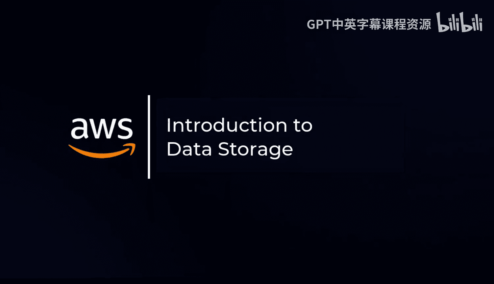
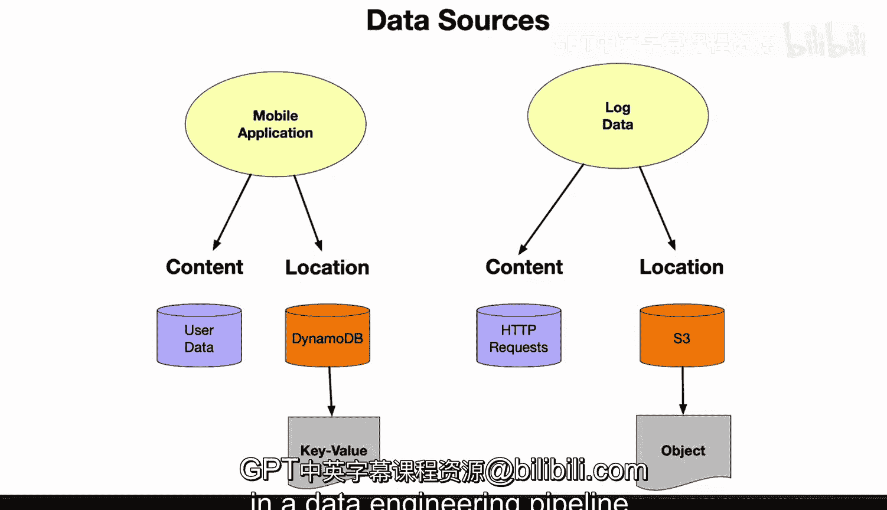

#  084：数据存储简介 📚

在本节课中，我们将要学习数据工程策略中的一个基础环节：如何识别和编目组织内的各种数据源。这是构建有效数据处理流程的第一步。

## 数据源识别与编目 📋

上一节我们介绍了数据工程的重要性，本节中我们来看看如何系统地识别和盘点公司内的数据源。当组织开始实施数据工程策略时，首要且关键的一步是编目公司内所有不同的数据来源。

例如，你可以从一个移动应用程序开始，查看其用户数据，并分析这些数据存储在何处。这些数据通常可能存储在像 DynamoDB 这样的键值存储数据库中，其中包含特定用户档案信息的记录。这个用户记录就可以作为一个数据源被编目，以便数据工程师后续能够对其进行处理。

## 数据源编目实践 📝

以下是进行数据源编目时可以遵循的步骤：

首先，确定你想要编目的数据类型。以日志数据为例，你需要识别它是什么。

接着，你可以将数据源信息记录在一个电子表格中，这个表格包含了所有其他数据源的清单。

在编目时，需要记录内容类型。例如，对于 HTTP 请求日志，可以记录有多少 200 状态码的请求、多少 400 状态码的请求，以及发出这些请求的 URL 是什么。

此外，还需要识别数据的存储位置。例如，亚马逊 S3 是存储原始日志数据的绝佳位置，它属于基于对象的存储。

## 从编目到处理策略 🔄

一旦你将数据源信息编目到主数据源列表中，就可以围绕如何在数据工程管道中实际处理这些数据来制定策略。这为后续的数据清洗、转换和分析工作奠定了基础。

本节课中我们一起学习了数据存储的初步概念，重点是数据源的识别与编目。我们了解到，通过系统地盘点数据源（如用户数据、日志数据）及其存储位置（如 DynamoDB、S3），可以为构建高效的数据处理流程做好充分准备。这是实现成功机器学习运维的基石。