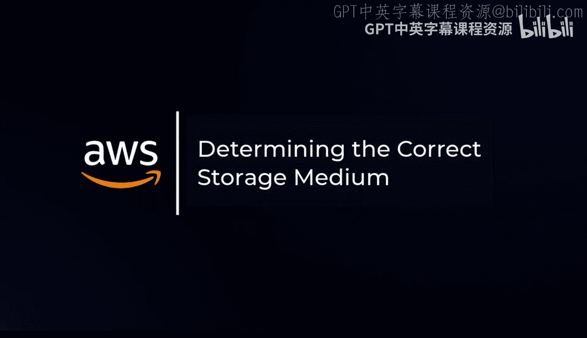
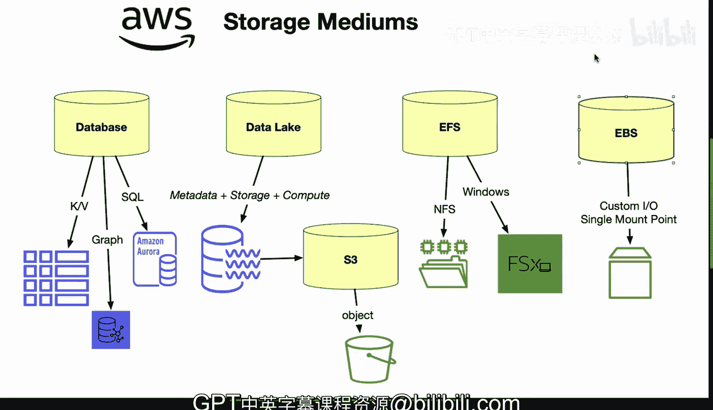

#  085：确定正确的存储介质 💾

在本节课中，我们将学习AWS提供的多种存储介质，了解它们各自的特点和适用场景，以便为不同的数据科学和机器学习任务选择最合适的存储方案。

AWS提供了多种不同的存储介质，包括多种类型的数据库。

## 数据库类型

以下是AWS提供的几种主要数据库类型：

*   **键值数据库**：例如 **DynamoDB**。这类数据库非常适合存储用户记录或游戏统计数据。
*   **图数据库**：例如 **Neptune**。它允许你构建和分析关系，这通常是新数据科学工作流中的重要部分，例如识别特定社交网络中的关键人物，并计算中心性等描述性统计量。
*   **SQL数据库**：例如 **Amazon Aurora** 和 **RDS**。这些SQL数据库非常适合执行传统的基于事务的查询。

## 数据湖与对象存储

上一节我们介绍了不同类型的数据库，本节中我们来看看数据湖和对象存储。

另一种存储介质是**数据湖**。数据湖建立在S3之上，从计算和存储的角度来看，S3可以提供近乎无限的扩展能力。但数据湖在其之上增加了元数据层，以便对S3中的内容建立索引。AWS Glue就是一个很好的例子，它可以索引S3的特定部分，之后你可以通过Athena进行查询。

S3本身显然是一个出色的对象存储机制。任何需要生命周期管理、存储大文件，或者适合“全有或全无”访问模式（即一次性完整读取或写入，无需增量读写）的场景，S3都是绝佳选择。

## 文件系统

除了对象存储，AWS也提供了适用于不同工作负载的文件系统解决方案。

同样，EFS生态系统也有几种不同的类型。一种是NFS风格的EFS，它的优势在于可以按需增量扩展磁盘。根据施加的负载或存储的数据量，EFS可以自动增长，并且集群或挂载点在整个生态系统中可以保持统一。这种网络挂载点的实用技术已经存在数十年，但在云环境中，它由AWS全托管，这是一个巨大的优势。

EFS还有适用于Windows的FSX部分，这对于许多需要集中式挂载点的工作流也非常方便，同时由AWS为你管理存储。

## 块存储

最后，还有**EBS**。EBS的一个优势是能够提供自定义磁盘。这意味着，如果你需要为某些交易或机器学习训练任务配置一个非常快速的文件系统，你可以为特定任务定制、配置它，然后在任务完成后将其删除。

需要注意的一点是，EBS只能通过单个挂载点使用。

## 总结

总而言之，AWS几乎提供了你能想到的每一种存储介质，并且在每种存储介质下还有更细分的子类别。作为数据科学家、机器学习工程师或数据工程师，你的职责是根据手头工作的需求，正确选择和组合这些存储介质。

本节课中我们一起学习了AWS的核心存储服务，包括键值数据库、图数据库、SQL数据库、数据湖、对象存储S3、弹性文件系统EFS以及块存储EBS。理解每种存储的特性和最佳适用场景，是构建高效、可扩展的机器学习运维流水线的基础。