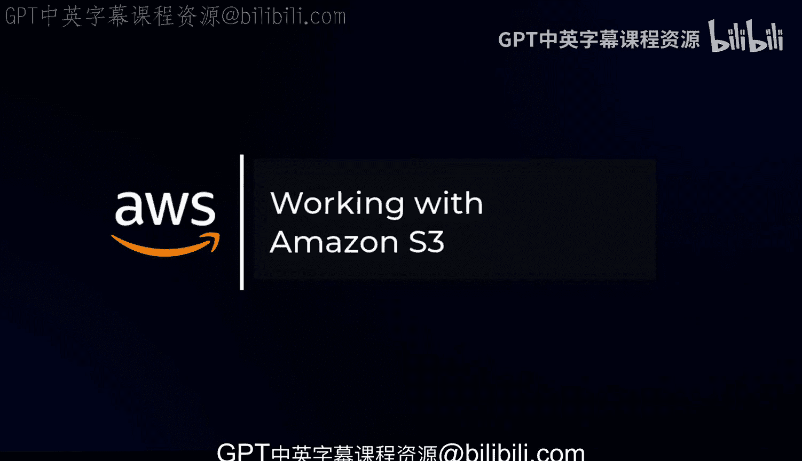
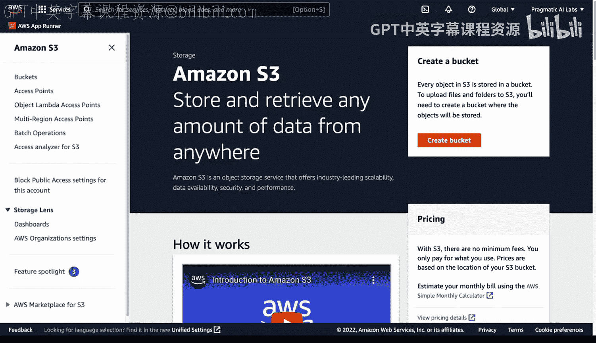
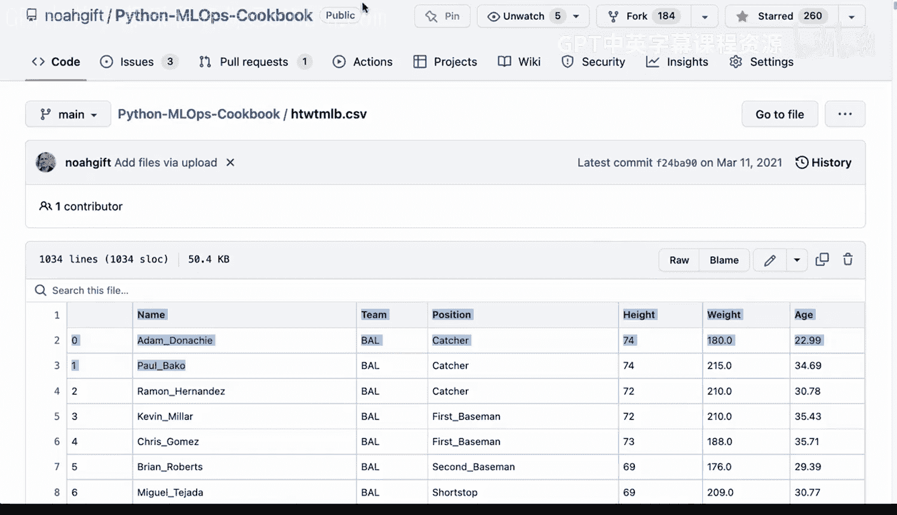
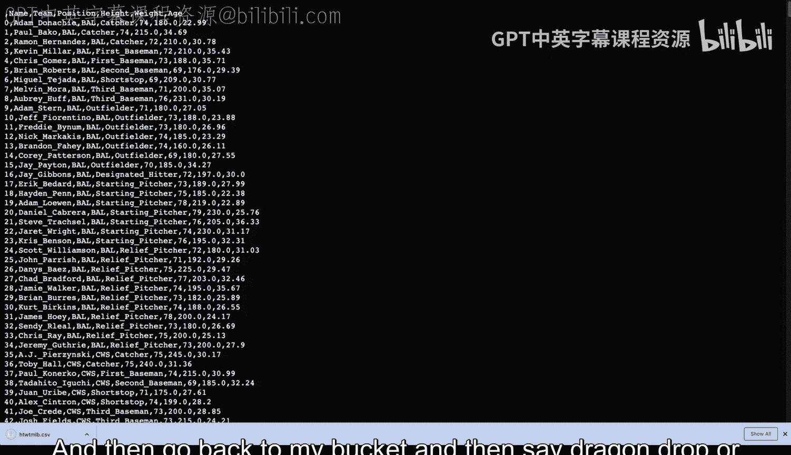
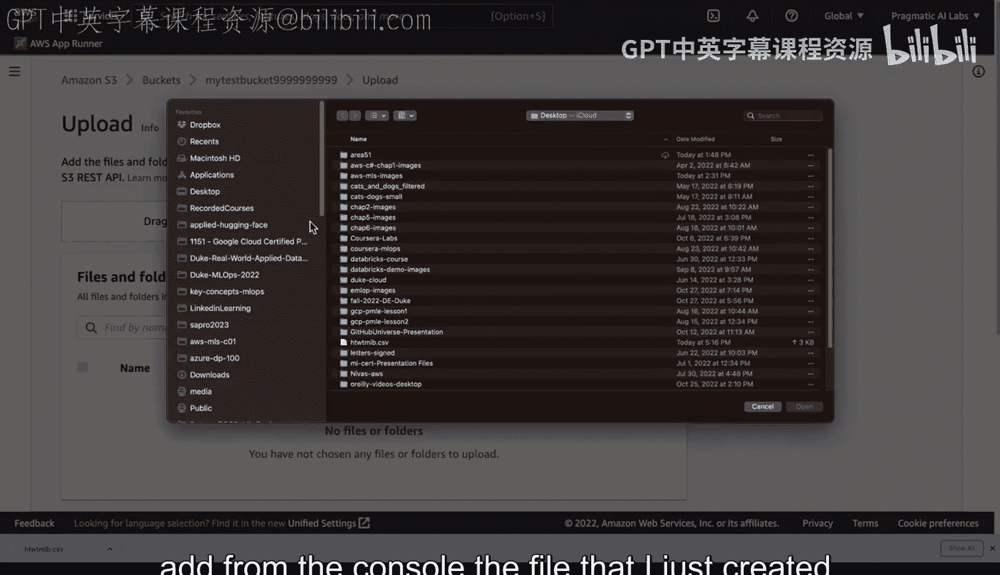
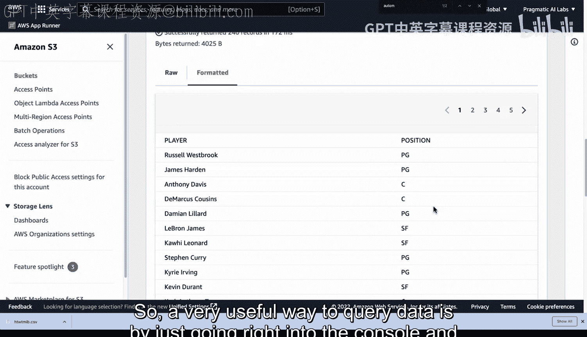
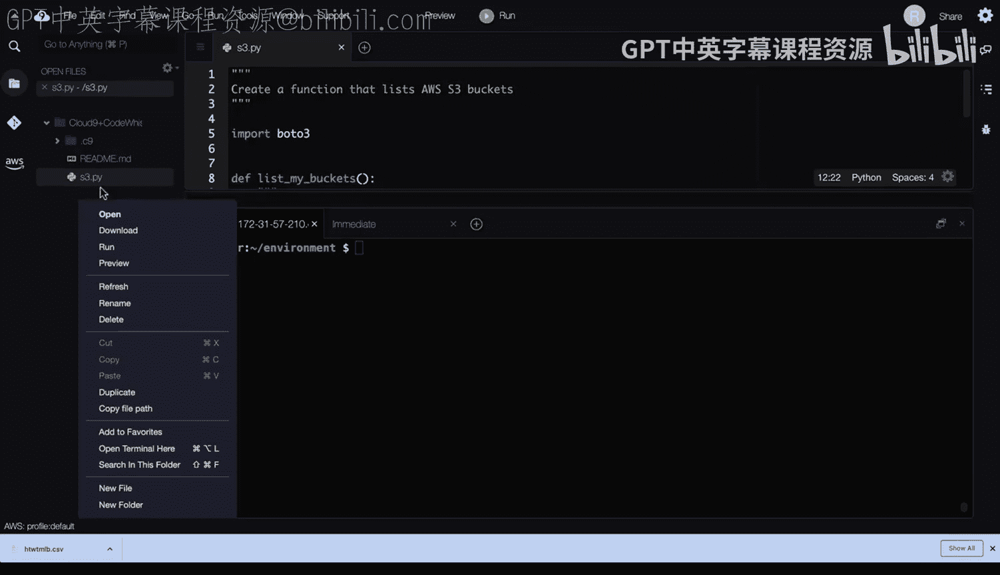
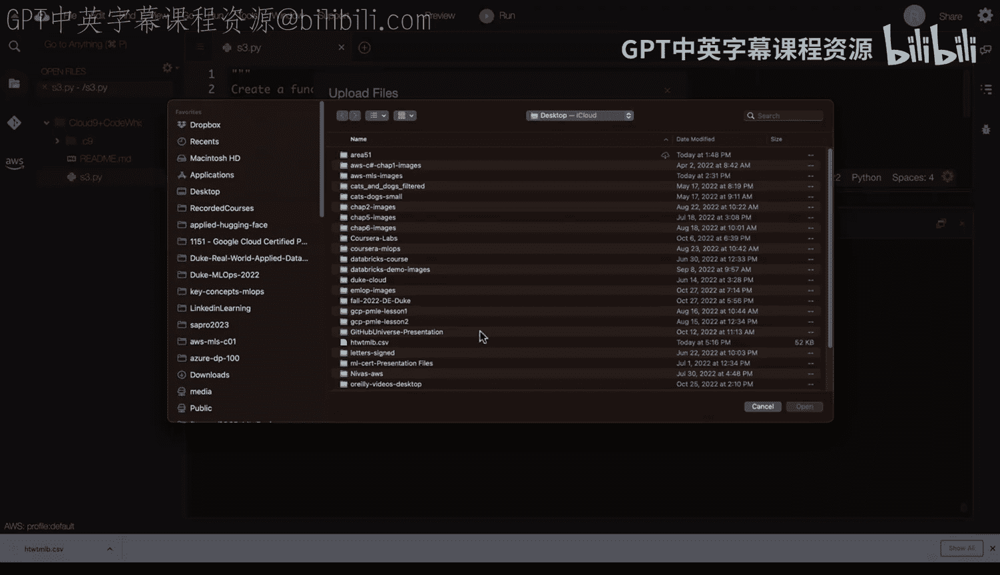
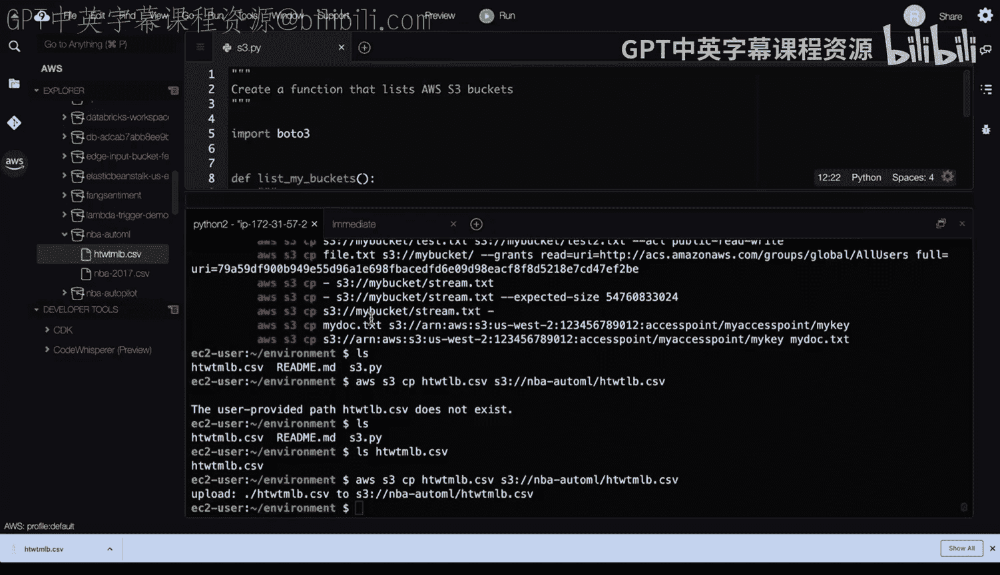
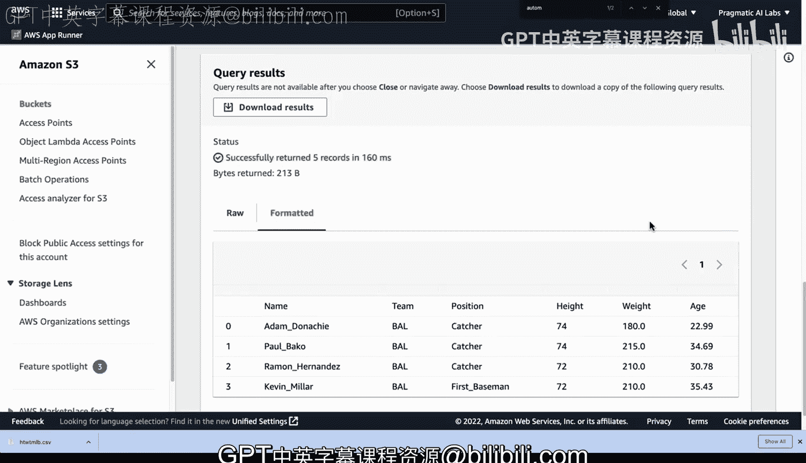

#  086：使用Amazon S3



## 概述
在本节课中，我们将学习Amazon S3的核心概念与基本操作。Amazon S3是每位工程师或机器学习工程师都需要了解的核心服务。我们将从控制台操作开始，逐步介绍如何创建存储桶、上传文件，以及使用高级功能如S3 Select查询数据。此外，我们还将探索如何通过AWS Cloud 9和命令行工具与S3进行交互，构建一个高效的数据处理工作流。



---

## 认识Amazon S3控制台
Amazon S3提供了多种访问方式，既可以通过控制台，也可以通过开发者工具进行功能强大的交互。首先，一个很好的起点是查看“存储桶”列表。在这里，你可以浏览账户中的所有存储桶，并决定对它们进行何种操作。

## 创建你的第一个存储桶
开始使用S3的简单方法之一是创建一个存储桶。

在控制台中，选择“创建存储桶”即可轻松完成。你可以为存储桶命名，例如 `my-test-bucket-12345`。然后，点击创建即可。



需要注意的是，存储桶名称必须在全球范围内唯一。如果你使用了一个非常常见的名称，可能会遇到命名冲突。一个简单的解决方法是使用一个较长的随机字符串来创建一个临时存储桶。





## 上传与管理文件
创建好临时存储桶后，你可以轻松地向其中上传文件。你可以直接从控制台上传。

例如，你可以将一个本地文件（如一份棒球数据CSV文件）拖放到存储桶中，或通过控制台的“上传”按钮添加。

这个工作流的优势在于，它能让你立即访问S3生态系统中的高级功能。

## 使用S3 Select查询数据
现在，让我们来看看S3的一些高级功能。假设我们有一个包含NBA数据集的存储桶。

选中一个文件后，你会看到许多选项，包括“属性”、“权限”、“版本”。其中一个更有趣的功能是“对象操作”下的“使用S3 Select查询”。

想象你有一个包含数百万行的TB级文件，直接理解其内容会很困难。但借助S3 Select，你可以使用SQL语言进行查询。

控制台会提供一些默认设置，如CSV分隔符和输出设置，甚至提供一个默认查询语句。例如，要查看CSV文件的前5行，你可以直接运行查询，并以原始或格式化形式查看结果。这对于数据科学家来说非常宝贵。

此外，你还可以从模板中添加SQL语句。例如，你可以选择一个查询球员姓名和位置的模板，稍作修改后运行，便能快速获得所需数据。



这是一种非常实用的数据查询方式，你可以直接在控制台中探索数据。





## 通过AWS Cloud 9与命令行交互
除了控制台，你还可以使用AWS Cloud 9作为与S3交互的界面。例如，你可以通过Cloud 9上传和下载数据。

在Cloud 9的文件菜单中，你可以右键点击并选择“上传本地文件”，将数据文件上传到工作环境。

更强大的方式是通过终端命令行操作。一个很好的入门方法是使用AWS CLI工具。例如，输入 `aws s3 cp --help` 可以查看该命令的所有帮助信息。

为了快速找到特定操作（如复制文件）的示例，你可以使用管道和grep命令进行搜索：
```bash
aws s3 cp --help | less | grep -A 5 -B 5 "copying"
```
这会显示相关的文档和示例模式，便于你学习和模仿。

根据帮助文档，将一个文件从本地复制到S3存储桶的命令格式很直观。例如：
```bash
aws s3 cp ./local_file.csv s3://your-bucket-name/path/
```
执行此命令后，文件便会上传到指定的S3路径。你可以返回AWS控制台，刷新对应的存储桶目录，确认文件已存在。



## 整合工作流
最后，一个有趣的实践是，回到S3控制台，打开刚刚通过命令行上传的文件，再次使用S3 Select功能对其进行查询。你可以执行与之前类似的SQL查询，深入分析数据。

由此可见，Cloud 9、命令行工具和控制台之间形成了一个强大的生态系统，它们协同工作得非常好。



## 总结
本节课中，我们一起学习了Amazon S3的基本操作与核心功能。我们从控制台创建存储桶和上传文件开始，接着探索了使用S3 Select直接查询大型数据集的高级技巧。然后，我们了解了如何通过AWS Cloud 9和AWS CLI命令行工具与S3进行高效交互，实现文件的上传与管理。对于数据科学家和机器学习工程师而言，掌握这种结合图形界面与命令行工具的工作流，是管理和分析云端数据的推荐实践。