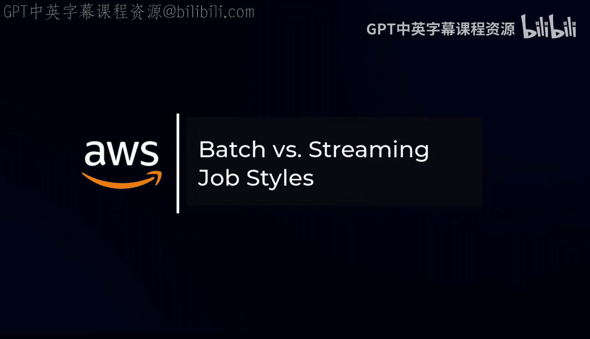
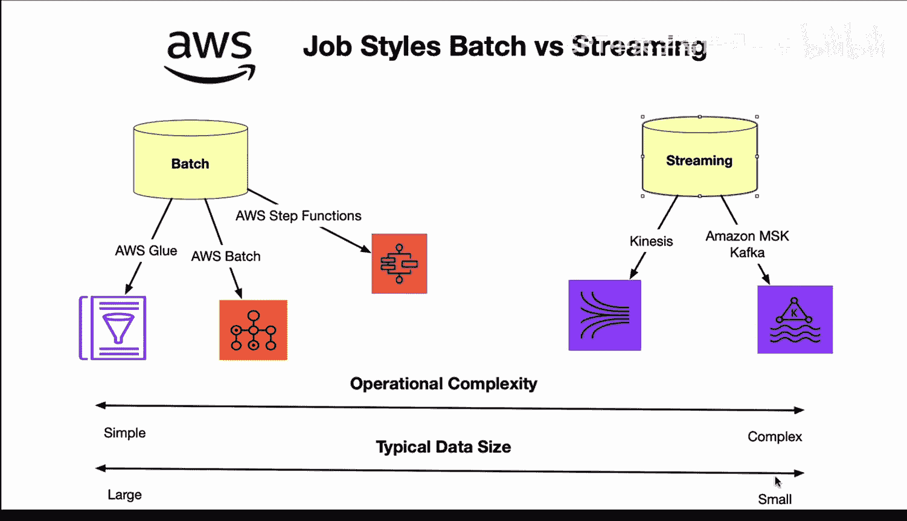

**机器学习运维：10.01.02：批处理与流式作业风格对比** 🚀

在本节中，我们将探讨AWS平台上两种核心的数据处理作业风格：批处理与流式处理。我们将了解它们各自的特点、适用场景以及AWS提供的相关服务。

---

### **概述：两种作业风格**

AWS提供了几种不同的作业处理思路。一种是**批处理**，另一种是**流式处理**。

上一节我们介绍了数据处理的基本概念，本节中我们来看看这两种风格的具体实现和区别。

---

### **批处理作业**

批处理是指对累积的大量数据进行一次性、集中式的处理。这种方式通常更简单：你获取一批数据，对其运行操作，然后得到结果。

AWS平台上有三项服务充分体现了批处理的概念并将其整合：

以下是三项核心的AWS批处理服务：

1.  **AWS Glue**：这是一项无服务器的数据集成服务。它创建元数据，允许你对S3或数据库中的数据执行操作并进行转换。它是处理海量数据批处理任务的一个典型例子。
2.  **AWS Batch**：这是一个通用的、基于批处理的框架。你可以用它大规模处理任何任务。它非常擅长在容器中运行大量作业，以及使用GPU进行模型训练。
3.  **AWS Step Functions**：这项服务允许你对不同的步骤进行参数化和编排。一个很好的例子是协调多个Lambda函数，让输入数据在它们之间顺序传递。

---

### **流式处理作业**

流式处理是指对连续到达的数据流进行实时或近实时的处理。与批处理相比，流式处理更为复杂，因为你必须在数据到达时立即处理，这增加了出错的可能性。

在AWS平台上，两种流行的流式处理技术是：

以下是两种主流的AWS流式处理技术：

*   **Amazon Kinesis**：你可以向Kinesis发送小的数据载荷（payload），它会在接收到这些载荷时立即进行处理。
*   **Apache Kafka（通过Amazon MSK）**：Amazon Managed Streaming for Kafka (MSK) 提供了完全托管的Kafka服务，用于构建高吞吐量的实时数据流管道。

---

### **核心对比与选择考量**

在比较批处理和流式处理时，可以从数据规模和操作复杂性两个维度来思考：

以下是区分两者的关键点：

*   **操作复杂性**：
    *   批处理更简单。你获取一批数据，执行操作，然后得到结果。
    *   流式处理更复杂。你必须实时处理不断涌入的数据，因此出错的几率更高。

*   **数据规模**：
    *   批处理非常适合处理**大型数据集**。当然，它也能处理小数据，但通常你会将任务批量处理以利用如AWS Batch这样的服务进行大规模操作。
    *   流式处理通常处理**较小的、连续的数据单元**。你会在数据到达时立即处理它们。这是区分批处理和流式处理的一个有效方式。

---

### **总结**

本节课中，我们一起学习了AWS上的两种数据处理风格。**批处理**适用于对海量历史数据进行离线、集中式计算，其服务如Glue、Batch和Step Functions侧重于可扩展性与任务编排。**流式处理**则适用于对连续数据流进行实时分析，其服务如Kinesis和MSK侧重于低延迟和高吞吐。选择哪种风格取决于你的具体需求：是处理规模庞大的静态数据，还是需要实时响应动态流入的数据。理解它们的差异是设计高效数据管道的关键。