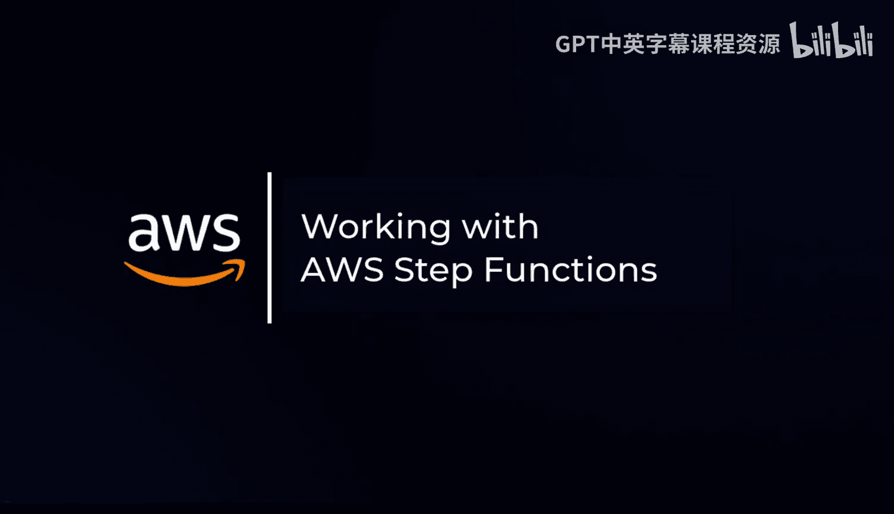
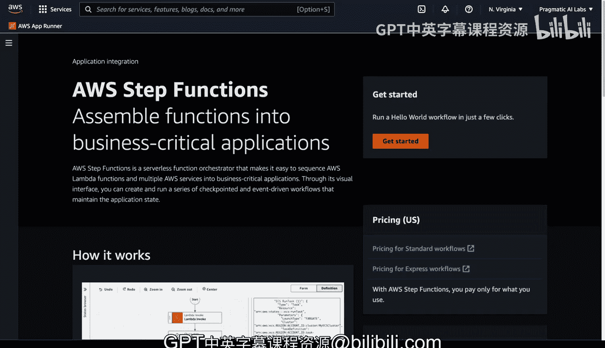
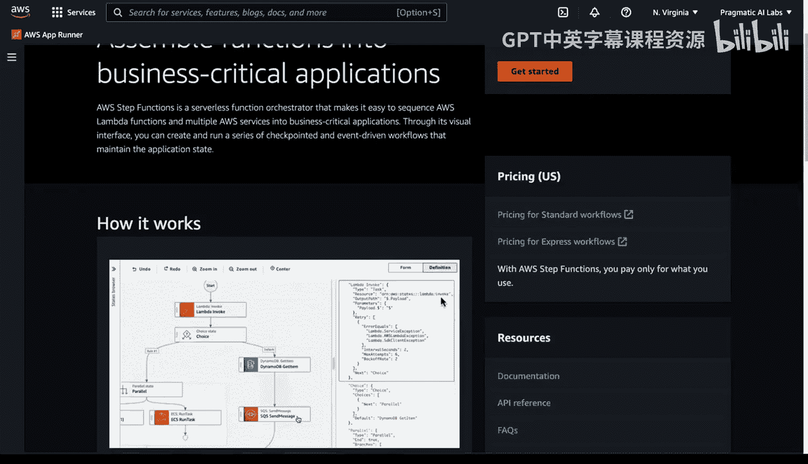
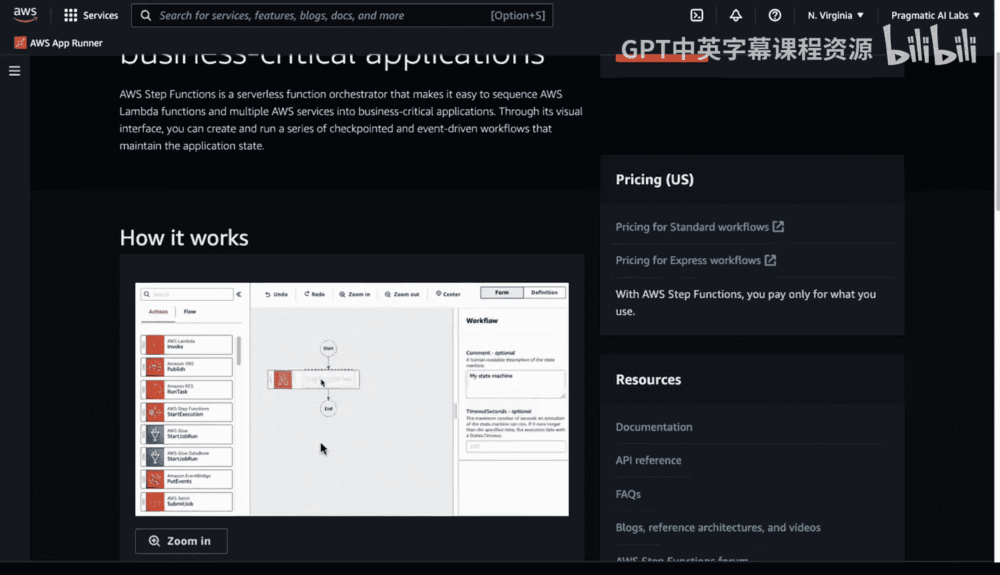
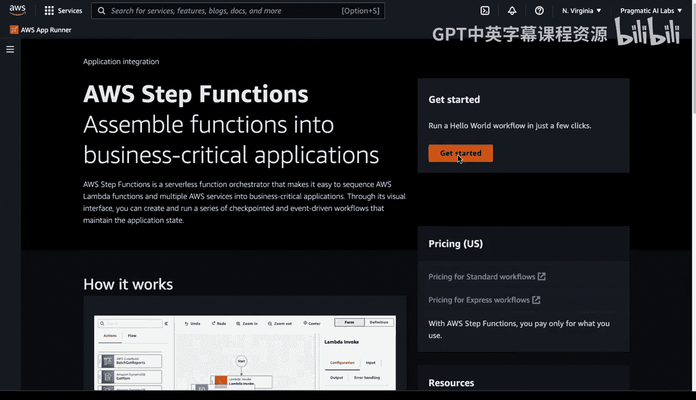
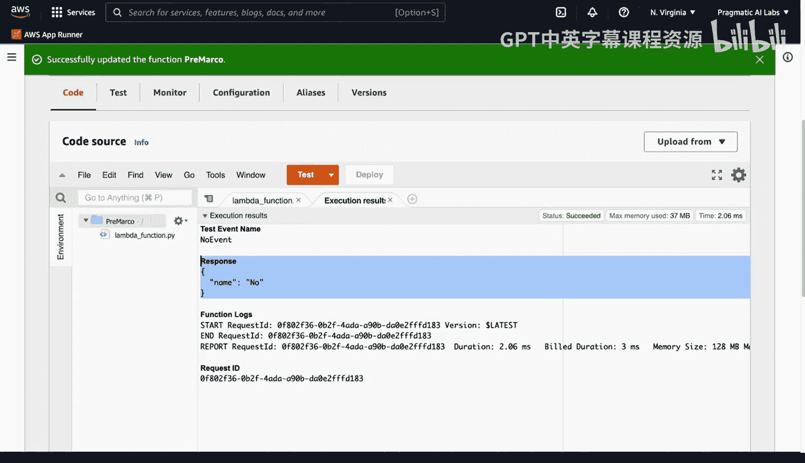
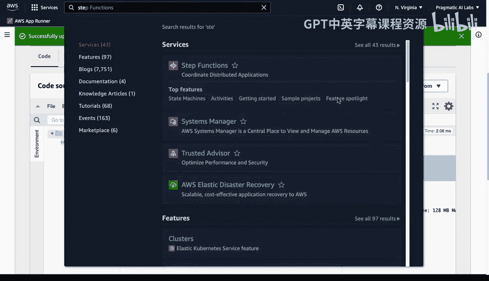
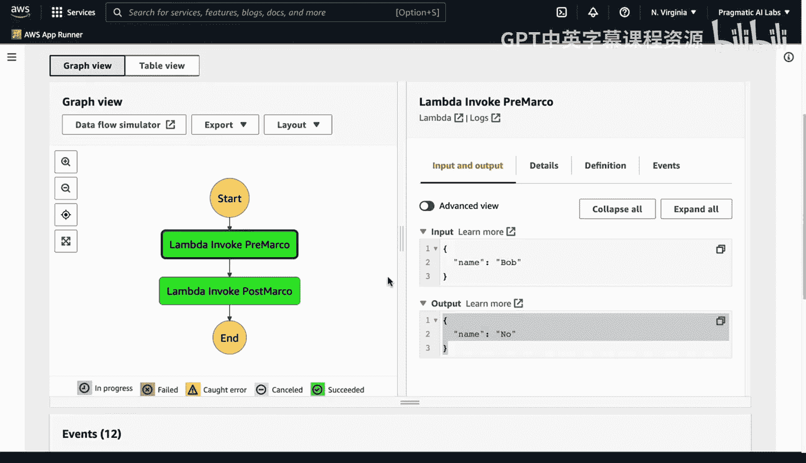

#  090：使用AWS Step Functions编排工作流 🚀



在本节课中，我们将学习如何使用AWS Step Functions来编排和自动化机器学习或数据处理工作流。AWS Step Functions是一个可视化的工作流服务，非常适合协调AWS上多个不同的服务与任务。







上一节我们介绍了工作流编排的概念，本节中我们来看看如何实际使用AWS Step Functions来构建一个简单的自动化流程。

## 什么是AWS Step Functions？ 🤔



AWS Step Functions是用于编排作业的理想工具，尤其擅长协调AWS上许多不同的服务。其核心优势在于可视化设计一系列步骤（选择、并行、条件判断等），并将其放入一个管道中运行，同时提供出色的执行过程监控。

## 入门指南：从“Hello World”开始

一个好的入门方式是点击“入门指南”，它会提供一个“Hello World”示例。这个示例本质上是一个JSON定义，其中包含了不同的“状态”。

以下是该示例工作流的简化表示：
```json
{
  "StartAt": "PassState",
  "States": {
    "PassState": {
      "Type": "Pass",
      "Result": "Hello",
      "Next": "WaitState"
    },
    "WaitState": {
      "Type": "Wait",
      "Seconds": 3,
      "Next": "FinalState"
    },
    "FinalState": {
      "Type": "Pass",
      "Result": "World",
      "End": true
    }
  }
}
```

该工作流从一个“Pass”状态开始，输出“Hello”，然后等待三秒，接着执行“Final”状态输出“World”，最后结束。运行这个工作流非常简单：创建状态机并执行它。Step Functions会详细展示每个步骤的发生情况与结果。这种强大的可视化监控能力是其显著优点。

在演示中看到这一点很好，但如果我们想自己从头构建一些东西呢？

## 实战：构建一个Lambda函数编排管道 🛠️

我们可以通过编排自己的Lambda函数来构建一个管道。我们将创建两个Lambda函数，并用Step Functions将它们连接起来。

### 第一步：创建“Premarco” Lambda函数

首先，我们创建一个名为`premarco`的Lambda函数，使用Python运行时。

这个函数的功能是：接收一个包含`name`字段的载荷（payload），如果`name`的值是“Marco”，则返回“polo”；否则返回“no”。

以下是该函数的代码：
```python
def lambda_handler(event, context):
    name = event.get('name', '')
    if name == 'Marco':
        return {'name': 'polo'}
    else:
        return {'name': 'no'}
```

创建后，我们可以配置一个测试事件来验证它。例如，使用输入`{"name": "Marco"}`，函数应返回`{"name": "polo"}`。部署并测试该函数，确认其工作正常。

### 第二步：创建“Postmarco” Lambda函数

接下来，我们创建第二个名为`postmarco`的Lambda函数，同样使用Python运行时。

这个函数的功能是：检查输入载荷中的`name`字段。如果值是“polo”，则返回祝贺信息；否则返回鼓励信息。

以下是该函数的代码：
```python
def lambda_handler(event, context):
    name = event.get('name', '')
    if name == 'polo':
        return {'message': 'Great job!'}
    else:
        return {'message': 'Keep trying!'}
```

同样，部署这个函数并创建测试事件进行验证，确保它能根据输入返回正确的消息。

为了确保两个函数在管道中能正确传递数据，我们调整了`premarco`函数的返回格式，使其输出一个包含`name`键的字典（如`{"name": "polo"}`）。`postmarco`函数则期望接收相同结构的输入。

### 第三步：在Step Functions中编排工作流





现在，我们转到AWS Step Functions控制台，创建一个新的状态机，并选择“可视化设计”。

以下是构建工作流的步骤：
1.  添加第一个状态，类型为“调用Lambda函数”。我们将其命名为“Lambda Invoke Premarco”，并选择之前创建的`premarco`函数。
2.  添加第二个状态，同样类型为“调用Lambda函数”。我们将其命名为“Lambda Invoke Postmarco”，并选择`postmarco`函数。将第一个状态的输出作为第二个状态的输入。

这样，我们就定义了一个简单的顺序工作流：先执行`premarco`，将其输出传递给`postmarco`执行。

我们将这个状态机命名为“PrePostMarcoPipeline”并创建它。

### 第四步：测试工作流执行

创建完成后，我们可以开始执行（Start Execution）这个状态机。执行时需要提供输入载荷。

**测试用例一：成功路径**
输入载荷为：`{"name": "Marco"}`
工作流执行过程如下：
1.  `premarco`函数接收`{"name": "Marco"}`，返回`{"name": "polo"}`。
2.  `postmarco`函数接收`{"name": "polo"}`，返回`{"message": "Great job!"}`。
在Step Functions的可视化界面中，我们可以清晰地看到每个步骤的输入和输出。

**测试用例二：非成功路径**
输入载荷为：`{"name": "Bob"}`
工作流执行过程如下：
1.  `premarco`函数接收`{"name": "Bob"}`，返回`{"name": "no"}`。
2.  `postmarco`函数接收`{"name": "no"}`，返回`{"message": "Keep trying!"}`。

通过Step Functions的界面，我们可以监控整个流程的每一步，这正是其强大之处。

## 总结 📝

本节课中我们一起学习了AWS Step Functions的核心用法。我们首先了解了它作为可视化工作流编排工具的价值。然后，我们通过一个“Marco Polo”风格的实践示例，逐步创建了两个Lambda函数，并使用Step Functions将它们串联成一个自动化管道。最后，我们通过不同的输入测试了工作流的执行，并观察了其详细的执行过程与结果。



这种“Marco Polo”示例是熟悉Step Functions基础概念的绝佳方式。一旦掌握了这些基础，你就可以利用它构建更复杂的数据摄取、数据处理和机器学习工作流，实现任务的自动化与协调。