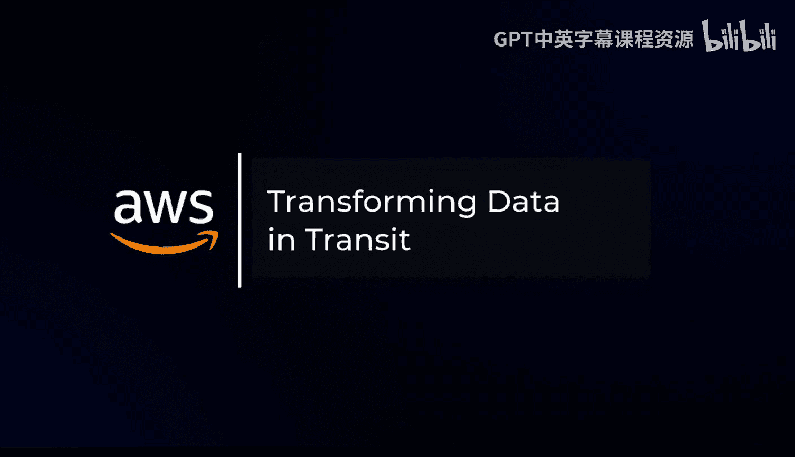
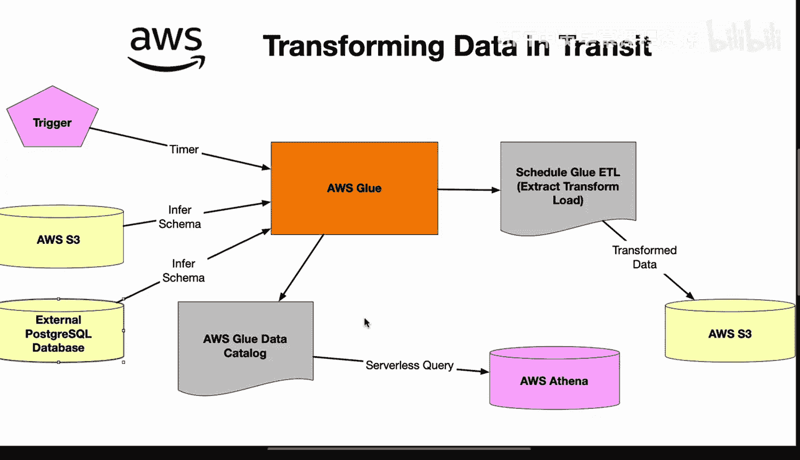

#  091：传输中的数据转换 🔄

在本节课中，我们将学习如何在AWS平台上进行传输中的数据转换，并重点了解AWS Glue这一无服务器ETL系统的运作模式。

上一节我们介绍了数据转换的基本概念，本节中我们来看看一个具体的、在AWS平台上实现传输中数据转换的架构示例。

## 架构概览与流程解析

首先，让我们从头到尾解析这张架构图。整个流程由一个定时器触发开始。

以下是该数据转换流程的核心步骤：

1.  **定时器触发**：一个定时器会周期性地触发AWS Glue作业。
2.  **执行ETL操作**：AWS Glue是一个无服务器的ETL系统。这意味着你可以将其指向多个数据源。
3.  **数据源整合**：例如，你可能在S3中有一个包含数百万行数据的大型CSV文件，同时还有一个外部的PostgreSQL数据库。Glue可以将这两者关联起来。
4.  **创建ETL管道**：基于这些数据源，你可以创建一个提取、转换、加载的操作。
5.  **数据转换与输出**：Glue会转换这些数据，并将其放入S3中的另一个存储桶。

这样，你就得到了一个强大的、可重复使用的操作，它能够持续生成数据的新版本。因为外部数据库可能由你合作的供应商进行更新，而定期运行的触发器会转换这些新数据并放入新的存储桶。

## AWS Glue的附加优势

AWS Glue的另一个优点是，它可以为你自动编目这个新的存储桶并创建元数据记录。

这意味着，之后你的数据科学家实际上可以使用Athena来查询这个数据目录，而无需将数据全部从S3中拉取出来。他们可以运行无服务器查询，进行数据可视化，甚至可能基于Athena加Glue的组合进行数据操作。

因此，在你的生态系统内部，Glue带来了许多无服务器的便利。这种特定的架构是一个非常常见的模式，对许多组织来说都是一个合适且相当易于理解和维护的方案。

---

本节课中我们一起学习了AWS平台上利用Glue进行传输中数据转换的完整流程。我们了解到，通过定时触发无服务器的ETL作业，可以整合多源数据（如S3文件和外部数据库），进行转换后输出到新的存储位置。同时，Glue的自动数据编目功能与Athena查询服务的结合，为数据科学家提供了高效、便捷的数据访问与分析能力。这种架构模式兼具实用性、可维护性和可扩展性。