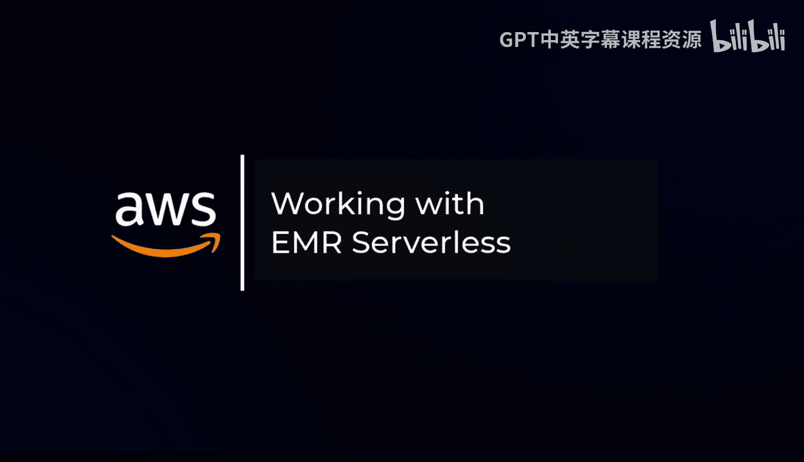
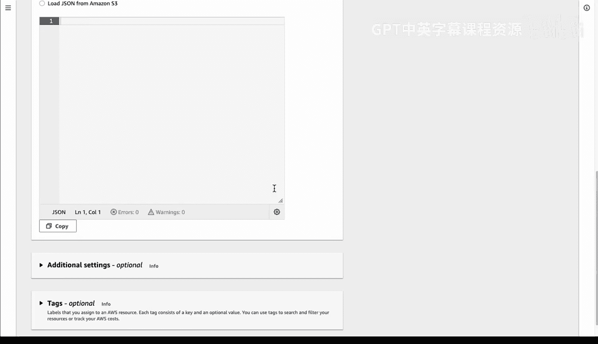

#  093：使用EMR Serverless

在本节课中，我们将学习如何在AWS平台上使用EMR Serverless来运行数据处理作业。我们将了解其核心功能，包括创建应用、提交作业以及使用托管笔记本进行问题诊断。

## 概述

EMR是AWS平台上可用于运行MapReduce等大数据处理任务的服务之一。通过EMR Serverless，我们可以无需管理底层集群，直接提交作业并利用托管环境进行分析。

## 创建Serverless应用

上一节我们介绍了EMR Serverless的基本概念，本节中我们来看看如何创建一个具体的应用。

从EMR Studio界面，我们可以启动无服务器应用并提交作业。我们还可以使用这些完全托管的Jupyter笔记本，将笔记本附加到集群，然后诊断作业中的问题。

以下是创建Spark应用的步骤：
1.  在EMR Studio界面中，选择创建应用。
2.  选择创建Spark应用。
3.  可以选择默认配置进行创建。

现在我们已经创建了这个应用。如果需要，我们可以提交一个作业。这个作业可以运行特定的配置，接受一些参数，并且我们还可以通过额外的JSON负载来配置这个作业。

## 总结

本节课中我们一起学习了AWS EMR Serverless的基本使用。我们了解了如何通过EMR Studio界面创建无服务器应用、提交可配置参数的作业，以及利用托管笔记本环境来辅助开发和诊断问题。这为在云上运行大规模数据处理任务提供了一个简化管理的强大选项。