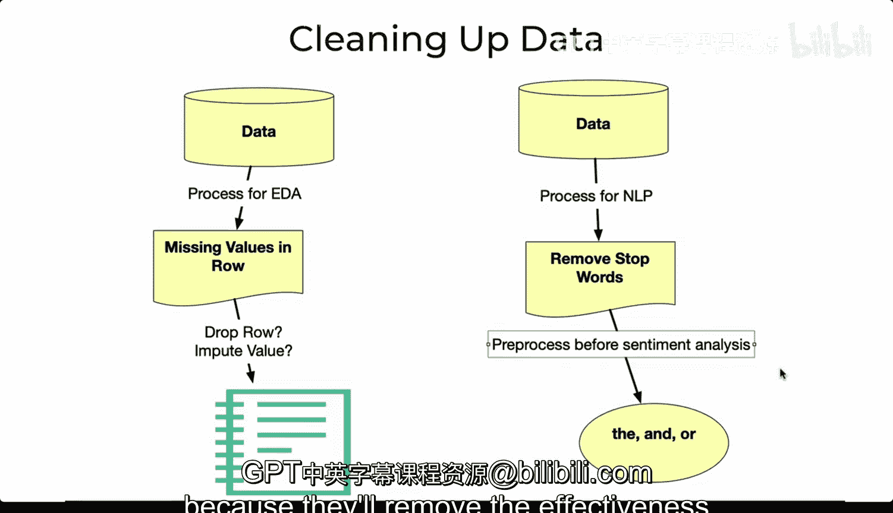

#  094：数据清洗

在本节课程中，我们将学习如何处理“脏数据”。脏数据是现实世界数据集中常见的问题，它可能包含缺失值、无关字符或不一致的格式。为了进行有效的分析或模型训练，我们必须先对数据进行清洗和预处理。我们将探讨两种常见的数据清洗场景：处理缺失值和为自然语言处理任务准备文本数据。

## 处理缺失值 🔍

上一节我们介绍了脏数据的概念，本节中我们来看看如何处理数据中的缺失值。这是数据清洗中最常见的任务之一。当你拥有一些数据，并希望在进行分析之前进行探索性数据分析时，查找并处理缺失值是关键的第一步。

以下是处理缺失值的常见步骤：

*   **查找缺失值**：在Python的pandas库中，你可以使用 `df.isna()` 或 `df.isnull()` 方法来识别数据框中的缺失值。
*   **决定处理策略**：作为数据科学家，你需要根据具体情况决定如何处理这些缺失值。主要有两种策略：
    *   **删除行**：如果数据量很大，缺失值所在的行占比很小，直接删除这些行可能是一个简单有效的选择。可以使用 `df.dropna()` 方法。
    *   **填充值**：如果数据量较小，或者删除行会导致信息严重丢失，则可以选择填充缺失值。一个常见的方法是使用该列的中位数或平均值进行填充。例如，使用 `df[‘column_name’].fillna(df[‘column_name’].median(), inplace=True)`。

## 文本数据预处理 📝

处理完数值型数据的缺失值后，我们转向另一种常见的数据类型：文本。在自然语言处理领域，对原始文本进行预处理是至关重要的，这能显著提升后续任务（如情感分析）的效果。

以下是针对NLP的文本预处理常见步骤：

*   **分词**：将连续的文本序列切分成独立的单词或符号（即词元）的过程。例如，句子“I love MLOps!” 会被分词为 `[‘I’, ‘love’, ‘MLOps’, ‘!’]`。
*   **去除停用词**：停用词是指在语言中非常常见但通常对文本含义贡献不大的词语，例如英文中的“the”、“and”、“or”、“because”。在情感分析等任务中，去除这些词可以减少噪声，让模型更专注于有实际意义的词汇。

本节课中我们一起学习了数据清洗的两个核心场景。首先，我们介绍了如何处理数据集中的缺失值，包括查找缺失值以及根据数据情况选择删除或填充的策略。接着，我们探讨了为自然语言处理任务进行文本预处理的常见步骤，特别是分词和去除停用词。这些预处理步骤是构建高质量机器学习模型不可或缺的基础工作，能确保我们输入模型的数据是干净、一致且富有信息量的。