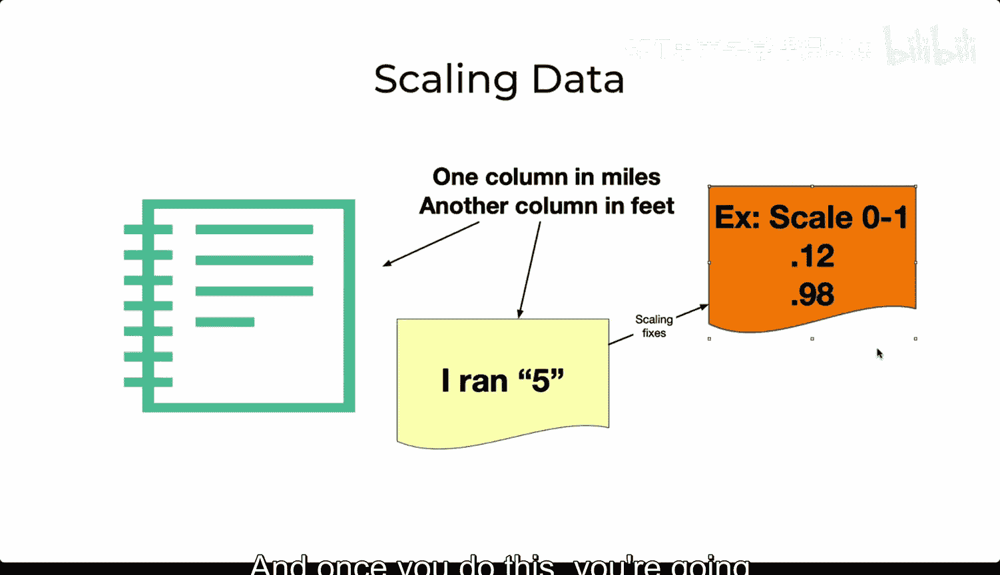

#  095：数据扩展

## 概述
在本节课中，我们将要学习机器学习中一个关键的数据预处理步骤：数据扩展。我们将了解为什么需要对数据进行扩展，以及如何通过简单的缩放技术使不同量纲的数据具有可比性，从而提升机器学习模型的性能。

---

## 为什么需要数据扩展？
上一节我们介绍了数据预处理的重要性，本节中我们来看看数据扩展的具体原因。

机器学习数据通常需要进行扩展，并非所有情况都需要，但大多数机器学习问题都要求你对数据进行扩展。这背后有一个非常简单的直觉。

这里有一个很好的例子。假设你有一个数据集，里面包含许多不同的列。有些列在比较数值。比如，有人说“我跑了5”。这到底是什么意思？是指跑了5英里、5公里还是5英尺？根据所使用的度量单位，差异是巨大的。

这就是数据扩展的一般直觉：一列数据可能以英里为单位，另一列可能以英尺为单位。直接进行比较并不是处理机器学习问题的好方法。例如，如果你在进行聚类分析，聚类结果将不会正确。

---

## 如何解决？通过数据扩展
那么，如何解决这个问题呢？答案是通过数据扩展。你可以做的事情之一是将数值缩放到0到1之间。这样，你就是在进行相对比较，而不是使用错误度量单位进行绝对比较。

因此，大多数机器学习算法确实要求你扩展数据，其原理相当直接。一旦你这样做了，你就能够将数据输入到，比如说，一个K均值聚类解决方案中。

以下是数据扩展的核心概念：
*   **目的**：消除不同特征因量纲（单位）不同带来的影响，使模型能够公平地学习所有特征。
*   **常用方法**：最小-最大缩放，将数据线性变换到[0, 1]区间。
*   **公式**：`X_scaled = (X - X_min) / (X_max - X_min)`

---

## 总结
本节课中我们一起学习了数据扩展。我们了解到，由于原始数据中不同特征可能具有不同的单位和尺度，直接用于机器学习算法（如聚类）会导致结果偏差。通过将数据缩放到一个统一的区间（如0到1），我们可以进行有效的相对比较，从而为大多数机器学习算法准备好数据。这是数据预处理中至关重要且常见的一步。