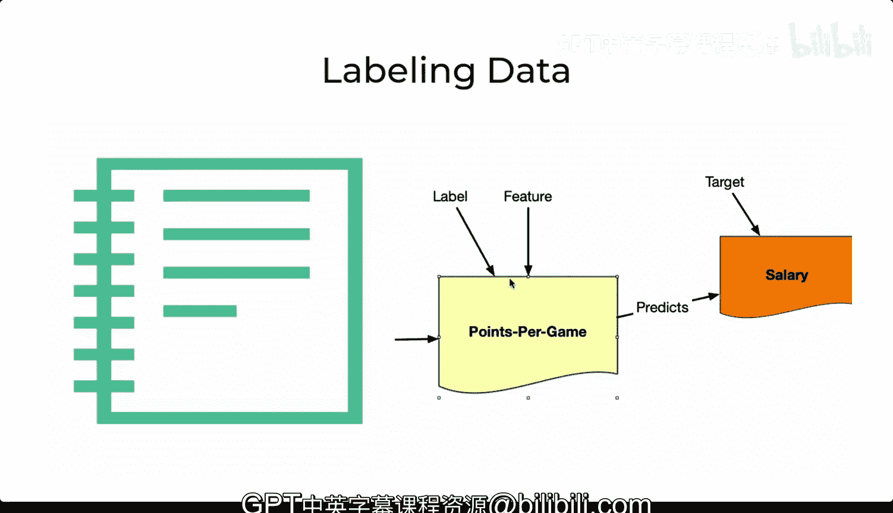

#  096：数据标注

在本节课中，我们将要学习机器学习中的一个核心概念：数据标注。我们将通过一个具体的例子来理解什么是标签、什么是特征，以及它们在监督式机器学习中的作用。

## 标签数据示例

上图展示了一个处理标签数据的例子。如果我们从一个笔记本中提取一些数据，例如一个包含NBA球员信息的数据集，其中“场均得分”这一列就可以作为标签。

## 特征与标签的关系

这个标签同时也是一个特征。对于同一列数据，我们可以使用两个不同的术语来描述它。我们可以使用这个特征来预测一个目标变量。例如，目标变量可以是该NBA球员的薪水。

因此，我们可能想要确定的是：基于球员的场均得分，我可以为该球员安排多少薪水。假设我是一支NBA球队的老板，这里的逻辑相当直接：你用来预测目标变量的任何东西都是一个特征，而这个特征需要有一个特定的标签。

## 获取标签的方法

如果你没有标签，可能需要通过其他方法来获取。你可以使用人工标注，例如通过亚马逊的Mechanical Turk等众包平台。或者，你也可以使用无监督机器学习来创建自然分组，然后利用这些分组来为数据打上标签。

## 监督式学习的要求

总的来说，所有监督式机器学习问题都需要一个带有标签的特征。这是构建预测模型的基础。

## 总结

本节课中，我们一起学习了数据标注的基本概念。我们明确了特征与标签的区别与联系，了解了标签在监督式学习中的必要性，并介绍了获取标签的两种主要方法：人工标注和无监督学习分组。理解这些概念是进行有效机器学习项目开发的第一步。