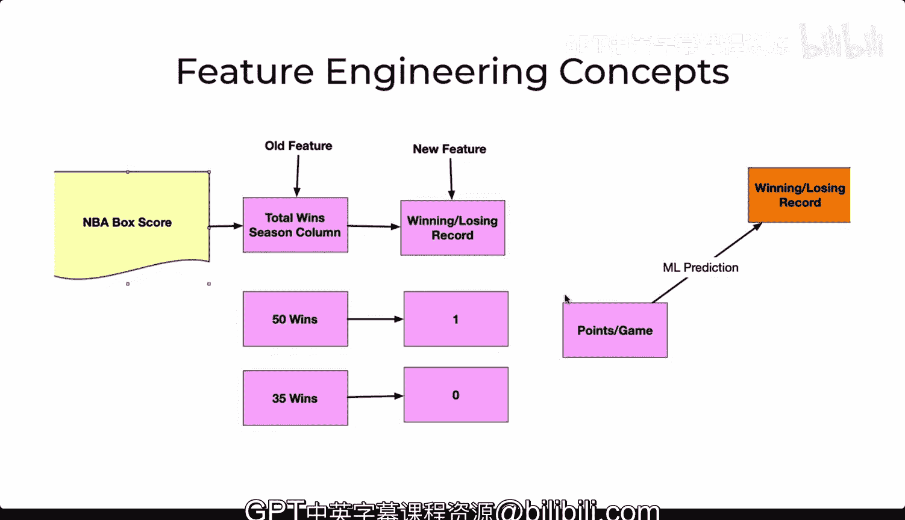

#  098：特征工程概念

## 概述
在本节课中，我们将学习特征工程的核心概念。我们将通过一个具体的例子——NBA赛季数据，来理解如何通过改造或组合现有特征来创建新的、更有用的特征，并用于机器学习预测系统。

## 特征工程：从旧特征到新特征

上一节我们介绍了特征工程的基本概念，本节中我们来看看一个具体的应用实例。

这里我们面临一个传统的特征工程问题。在这个案例中，我们拥有NBA比赛的统计数据表。表中包含一个记录球队赛季总胜场数的列。我们可以采取的做法是重新利用这个旧特征，并将其转换成一个新特征。

具体而言，我们可以观察总胜场数，并判断它是否超过某个阈值。例如，根据一个赛季的总比赛场数，你可以设定：如果一支球队赢得了50场比赛，那么它就拥有一个“胜利赛季”，这个新特征的值将被标记为1。反之，如果一支球队只赢了35场比赛（再次强调，这取决于赛季总场数），那么这个新特征的值可能被标记为0。这个新列可以命名为“胜负记录”。

## 新特征的用途

一旦创建了这个新特征，你就可以用它来进行预测。我们可以将这个新特征作为我们试图预测的标签。例如，我们可以提出一个问题：能否利用一支球队的平均得分来预测他们在一个赛季中会拥有胜利记录还是失败记录？

假设你想要基于这个属性创建预测模型。上述方法就是一种可行的途径。你同样也可以创建其他新的特征。但这里的核心思想是：通过**重用旧特征**或将**旧特征组合**在一起，你可以创建出一个新特征，然后将其用于机器学习预测系统。

以下是创建新特征的关键步骤：
1.  **识别现有特征**：找到数据集中可用的原始特征，例如“赛季总胜场”。
2.  **定义转换规则**：根据业务知识或分析目标设定规则，例如“胜场 >= 50 则为胜利赛季”。
3.  **应用转换**：根据规则为每条数据生成新特征的值，例如生成一个名为 `winning_season` 的新列，其值为 1 或 0。
4.  **用于模型**：将这个新特征作为模型的输入（特征）或输出（标签/目标变量）进行使用。

## 总结
本节课中我们一起学习了特征工程的一个核心实践：如何通过转换或组合现有数据来构建新的特征。我们以NBA数据为例，演示了如何将“赛季总胜场”转换为二进制的“胜负记录”特征，并探讨了如何将此新特征用于预测模型。理解并掌握这种创造性地生成特征的能力，是构建有效机器学习模型的关键步骤。