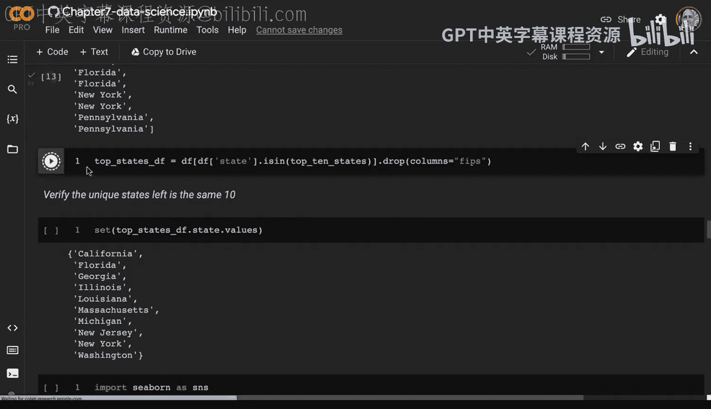
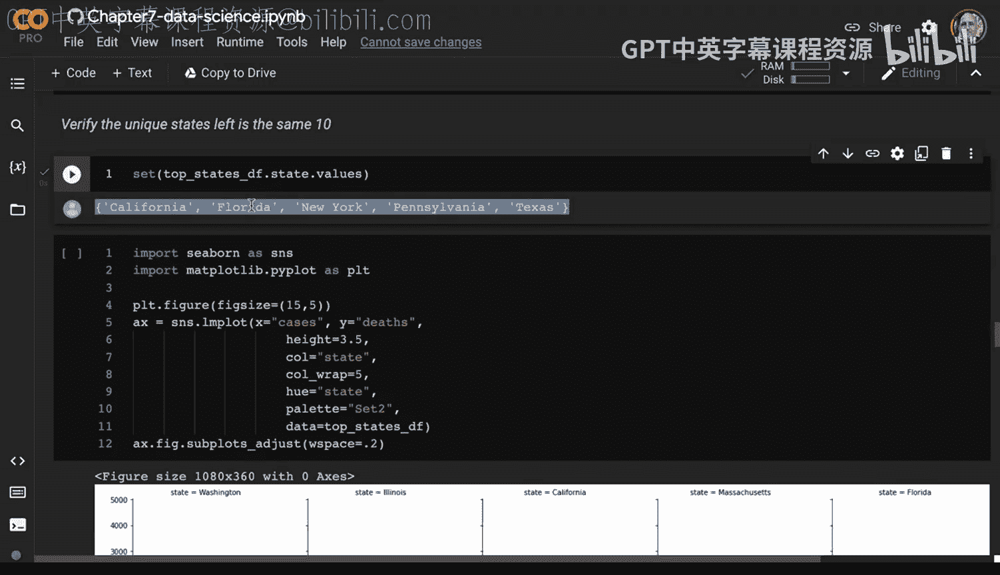
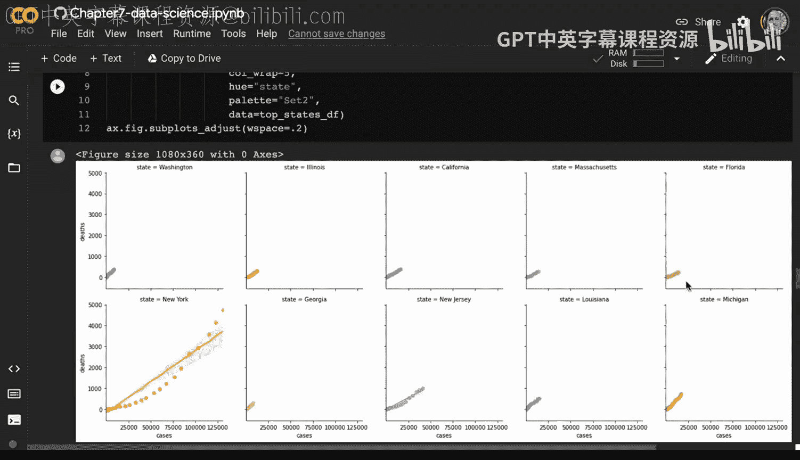
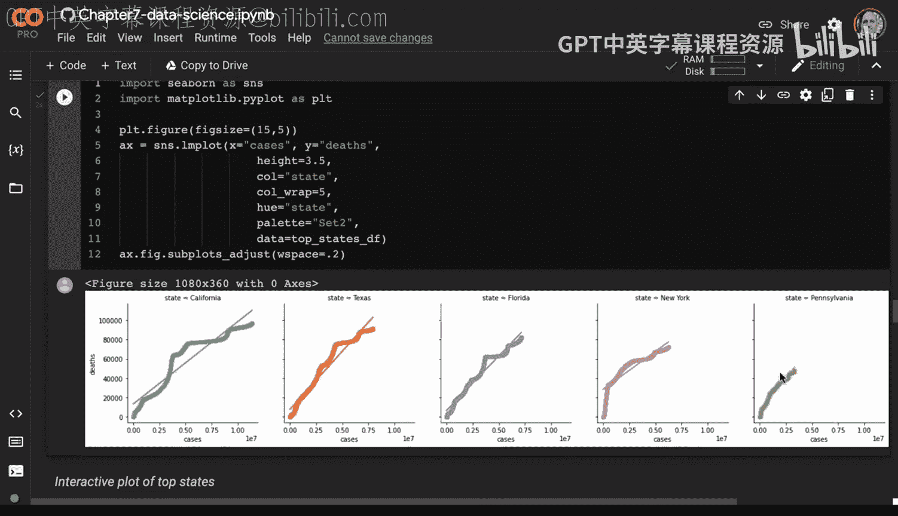

#  099：数据可视化 📊


在本节课中，我们将学习一个传统数据科学项目的工作流程，重点关注数据获取、探索性数据分析以及如何通过可视化和统计方法发现数据中的模式。我们将以纽约时报的州级新冠疫情数据为例，演示从数据加载到生成见解的完整过程。

## 项目结构与工作流程 🔄

上一节我们介绍了课程背景，本节中我们来看看一个典型数据科学项目的结构。我建议在处理数据科学项目时，创建一个遵循以下四个阶段的结构：**数据获取**、**探索性数据分析**、**建模**和**结论**。这四个阶段各自包含所需的关键组件，并且你可以在它们之间来回切换。

## 数据获取与初步探索 📥

首先，让我们看看探索性数据分析和数据获取阶段。这里，我可以直接从纽约时报获取数据，这是按州划分的新冠疫情数据。我通常会做的一件事是查看最后几条记录，以了解数据的当前状态。你可以看到这是非常新的数据。然后，如果我查看列，我们也可以看到列名以及数据的形状。这实际上是对数据的初步检查。

## 探索性数据分析：数值统计 🔢

现在，当你进入探索性数据分析时，其真正含义是，你希望以数值形式查看描述性统计信息。例如，如果我在这里使用 `describe()` 方法，我们可以查看病例数和死亡数等。例如，50%分位数（中位数）显示，各州的死亡人数中位数为 4,345 例，但最大值是 96,960 例。

以下是查看数据描述的代码示例：
```python
data.describe()
```

## 探索性数据分析：数据可视化 📈

如果我们查看美国的新冠病例和死亡数据，这正是我们可以直接进行绘图分析的地方。我会绘制一个列与另一个列的关系图，比如病例数与死亡数。我甚至可以添加一个色调参数，为我们提供更多关于正在发生的情况的信息。

以下是绘制病例与死亡关系图的代码示例：
```python
import seaborn as sns
sns.scatterplot(data=data, x='cases', y='deaths', hue='state')
```

你可以看到，这里报告的新冠病例数量与发生的死亡数量之间存在直接的线性相关性。这是一个经典问题。我注意到我在这里将数据框传递给了绘图函数。

## 数据操作与过滤 ⚙️

如果我想进一步操作数据，我可以做的一件事可能是按日期进行调整，然后按日期范围过滤结果。这样，我就获取了仅仅几天的数据。如果我查看最近的数据，你可以看到这里存在我可以发现的模式。

以下是按日期过滤数据的代码示例：
```python
filtered_data = data[(data['date'] >= start_date) & (data['date'] <= end_date)]
```

## 排序与州级分析 🗺️

我们能做的另一件事是，通过排序来查找数值。我也可以进行州级分析，查看在病例数方面具有最高数值的独特州。你可以看到加利福尼亚、佛罗里达、纽约、宾夕法尼亚、德克萨斯，显然这些也是非常大的州。

以下是查找病例数最多州的代码示例：
```python
top_states = data.groupby('state')['cases'].sum().sort_values(ascending=False).head()
```

然后，如果我想将其绘制出来，我们可以在这里进行并绘制出来。

## 核心概念与模式发现 💡

进行数据科学的核心思想是，你有一个数据获取阶段，一个探索性分析阶段，你需要同时查看数值数据和数据的图形化表示，以便发现模式。我们在这里可以看到的一点是，对于加利福尼亚州，似乎存在潜在的对数结果。在这里面也可以看到，开始出现对数结果。而纽约可能是这种情况最显著的版本。

以下是可能观察到的增长模式公式：
**指数增长最终会开始趋于平缓**。







因此，这可能意味着在已发生的死亡人数方面将会出现一个平台期。

## 总结 📝



本节课中，我们一起学习了一个结构化的数据科学工作流程。我们从数据获取开始，通过`describe()`方法进行数值统计探索，然后利用散点图等工具进行可视化分析以发现线性关系。我们还演示了如何通过日期过滤和排序来深入挖掘数据，并进行州级分析。最后，我们通过观察增长曲线，讨论了数据中可能存在的指数增长与平台期模式。整个过程强调了结合数值分析与可视化来理解和解释数据的重要性。