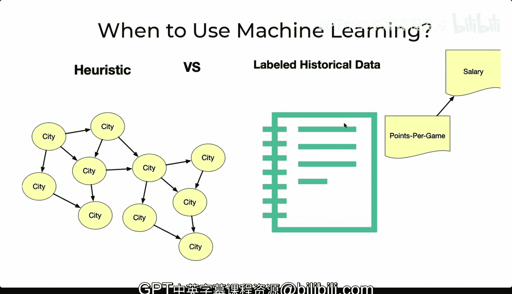

#  101：何时使用机器学习 🤔


在本节课中，我们将探讨一个关键问题：何时应该选择使用机器学习，而不是其他技术方法。理解这一点对于高效、合理地应用机器学习至关重要。

## 概述

选择正确的技术方案是项目成功的第一步。本节将提供一个清晰的决策框架，帮助你判断在何种场景下，机器学习是合适的工具，而在何种情况下，传统的启发式方法或其他技术可能更优。

## 启发式方法优先原则

一个简单的判断方法是：如果问题可以通过启发式方法解决，那么你应该首先尝试使用启发式方法。

以下是判断何时使用启发式方法的一个好例子。

### 案例：旅行商问题

假设我们遇到一个基于地理位置的问题：一家航运公司需要规划一条访问一系列城市的最短路径。这就是经典的**旅行商问题**。

**公式**：`最小化总旅行距离 = Σ 城市i到城市j的距离`

在这种情况下，使用启发式方法是更好的选择。原因如下：
*   该问题在计算机科学领域已有许多成熟的解决方案。
*   使用启发式方法更容易调试和理解算法的运行过程。

例如，你可以采用一种“随机贪婪起点”算法，运行多次模拟，然后从中选择总旅行距离最短的路线。

## 机器学习的适用场景

上一节我们介绍了优先使用启发式方法的场景，本节中我们来看看机器学习在什么情况下能大显身手。

### 核心条件：拥有带标签的历史数据

当你的问题满足以下条件时，机器学习通常是一个绝佳的选择：
*   你拥有**带标签的历史数据**。
*   你的目标是基于某些已知数据（特征）来预测另一个相关的未知值（标签）。

### 案例：NBA球员薪资预测

假设你收集了一份数据集，其中包含：
*   **特征**：每位球员每场比赛的平均得分。
*   **标签**：球员对应的薪资。

你的目标是建立一个模型，根据球员未来的场均得分来预测其应得的薪资。

**代码**（伪代码表示数据关系）：
```python
# 特征 (X) 与 标签 (y) 的关系
X = df['points_per_game']  # 场均得分
y = df['salary']           # 薪资
# 目标：训练模型 f，使得 salary ≈ f(points_per_game)
```

这正是一个典型的机器学习用例。你利用历史数据中的模式（得分与薪资的关系），来对未来进行预测。

## 决策总结

总而言之，在面对一个问题时，你可以遵循以下决策流程：

以下是选择技术方案的基本指导原则：

1.  **首先评估启发式方法**：如果问题可以通过清晰、确定的规则或优化算法（如旅行商问题）有效解决，应优先使用启发式方法。它通常更简单、高效且易于调试。
2.  **考虑机器学习**：如果你拥有**表格形式的、带标签的历史数据**，并且目标是根据一些列（特征）的值来预测另一列（标签）的值，那么机器学习非常适合。这在商业预测场景中非常常见。

## 课程总结



本节课中我们一起学习了如何决定何时使用机器学习。关键在于审视问题的本质和可用数据的类型：对于规则明确的问题，启发式方法是简洁高效的利器；而对于拥有丰富标签数据、需要从历史模式中学习并进行预测的任务，机器学习则是强大的工具。做出明智的选择，能让你的项目事半功倍。