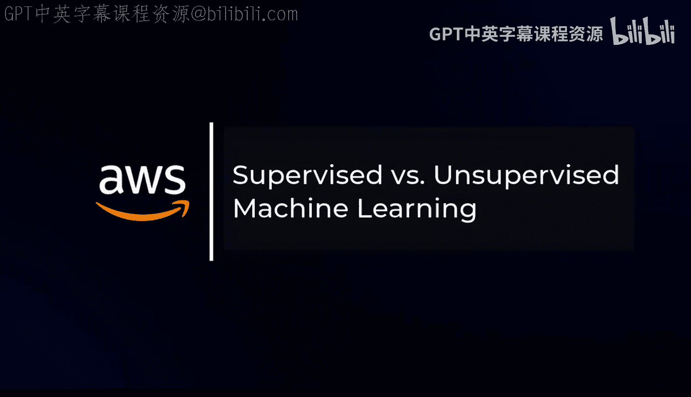
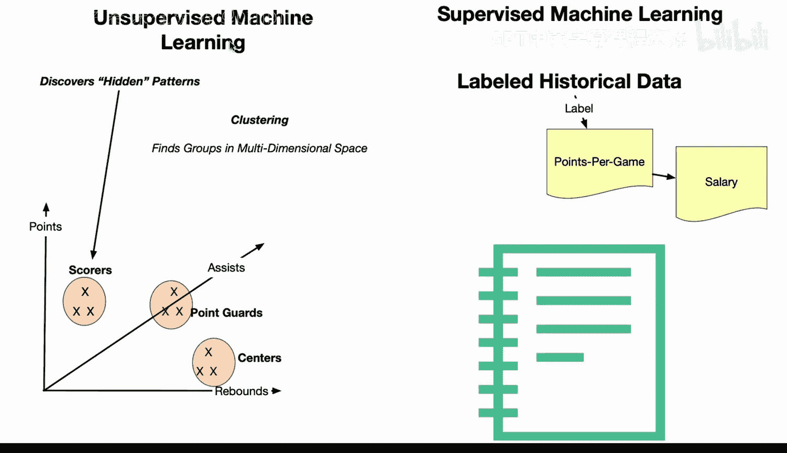
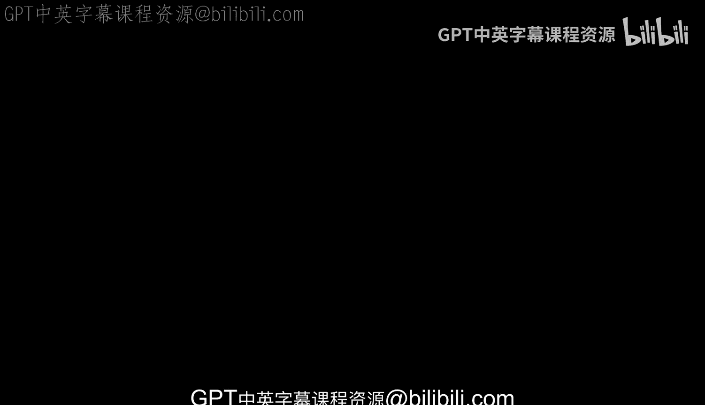

#  102：监督式与非监督式机器学习

在本节课中，我们将要学习监督式机器学习与非监督式机器学习之间的核心区别。我们将通过具体的例子来理解它们各自的工作原理、适用场景以及它们如何协同工作。

## 概述

机器学习主要分为两大范式：监督式学习和非监督式学习。理解它们的区别是构建有效机器学习解决方案的基础。本节将清晰地阐述这两种方法，并说明它们在实际项目中的应用。

## 监督式机器学习

上一节我们介绍了机器学习的两种主要类型，本节中我们首先来看看监督式机器学习。

监督式机器学习的工作原理是使用带有标签的历史数据，并基于这些数据来做出预测。在回归问题中，我们拥有自变量（特征）和因变量（目标标签）。例如，我们可能有球员的“场均得分”数据，如果我们想用这个数据来预测“薪资”，那么“薪资”就是我们的目标标签。

我们可以基于“场均得分”这个特征，创建一个监督式机器学习模型来预测“薪资”这个目标。因此，在任何你拥有**标签数据**的场景下，尤其是像这样以数值形式存在的表格数据，都可以通过监督式机器学习来解决。

其核心过程可以概括为：
**模型 = 训练(特征数据, 标签数据)**
然后使用训练好的模型进行预测：
**预测结果 = 模型(新特征数据)**

## 非监督式机器学习

了解了需要明确标签的监督式学习后，我们来看看非监督式机器学习。它的核心思想是**发现数据中隐藏的模式**，而这些被发现的模式随后可以成为数据的标签。

以下是一个很好的例子：使用聚类算法。假设我们拥有篮球运动员的“得分”、“助攻”和“篮板”数据，但没有给他们打上“位置”标签（如控卫、中锋）。

通过在这些特征上进行聚类分析，你能够发现隐藏的模式。例如：
*   谁是NBA中的高得分手？
*   谁是控球后卫？
*   谁是中锋？

你可以通过聚类发现这些，因为当你在多维空间中进行聚类时，具有相似特征的球员会自然地聚集在一起。在这三个轴（得分、助攻、篮板）构成的空间里，同一类球员的数据点彼此距离最近。然后，领域专家（如篮球分析师）就能够识别这些隐藏的模式，并为每个簇赋予一个有意义的标签（如“控卫”、“得分手”、“中锋”）。

通常，在非监督式机器学习中，最好有领域专家参与，以便为发现的隐藏模式进行标注，从而可以将这些标签应用到数据上。这正是非监督式学习的核心：**探索与发现**，而不是基于已有标签进行预测。

## 核心区别与协同工作

现在，让我们总结一下两者的关键区别。监督式学习是在你**已经拥有标签数据**的情况下，针对一个具体问题（如预测）进行工作。而非监督式学习则侧重于**发现**数据中未知的结构或模式。

这两者并非互斥，它们可以协同工作。在许多实际项目中，非监督式机器学习可以作为第一步，用于**发现数据中的标签或细分群体**。然后，第二步可以将这些新生成的标签数据用于监督式学习，**构建预测模型**。

例如：
1.  **非监督式步骤**：对客户数据进行聚类，发现不同的客户群体（如“高价值客户”、“价格敏感型客户”）。
2.  **监督式步骤**：使用这些新定义的客户群体作为标签，训练一个模型，用于预测新客户属于哪个群体。

## 总结

本节课中我们一起学习了监督式与非监督式机器学习。监督式学习利用已知的输入和输出（标签）关系来训练模型，用于预测新数据的输出。而非监督式学习则是在没有预定义标签的情况下，分析数据的内在结构和模式。理解这一根本区别，能帮助你在实际工作中根据数据情况和业务目标，选择合适的学习方法，甚至将两者结合，构建更强大的机器学习流水线。