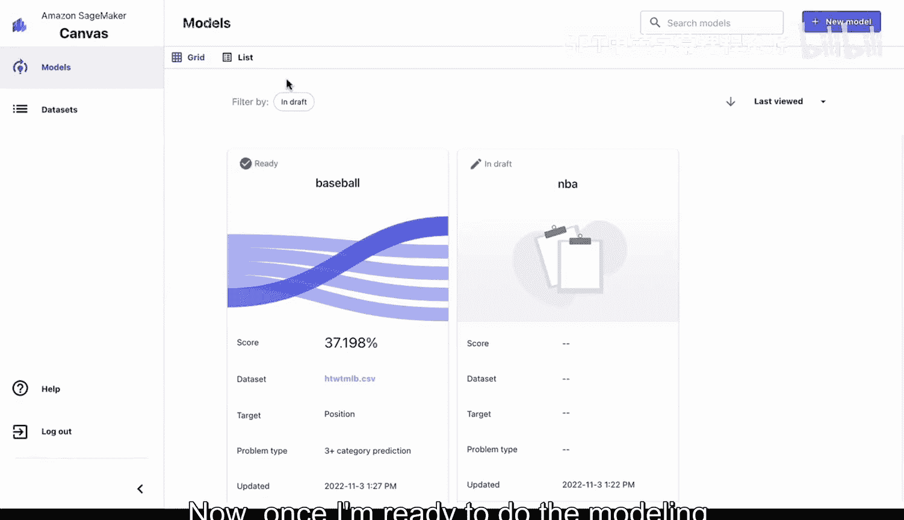
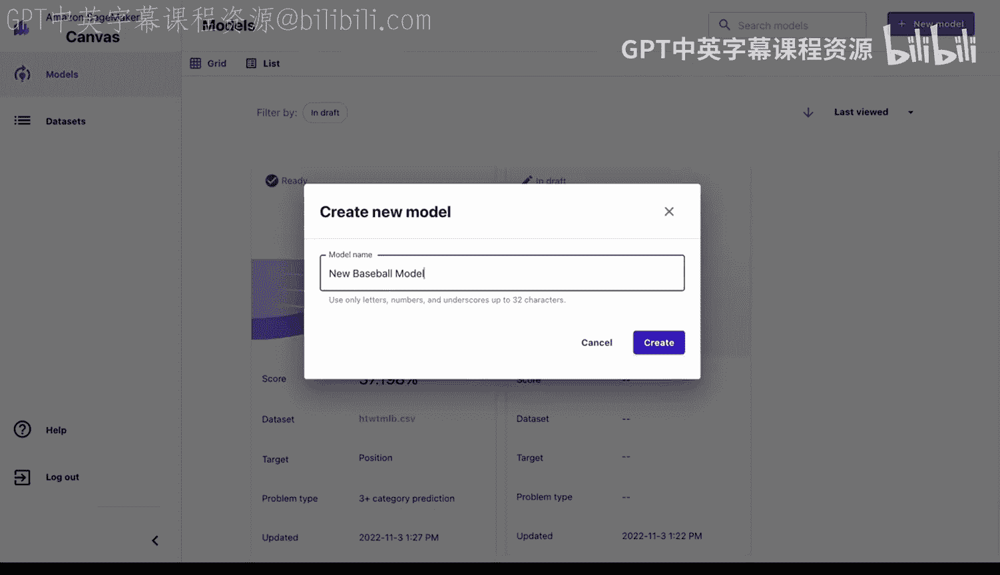
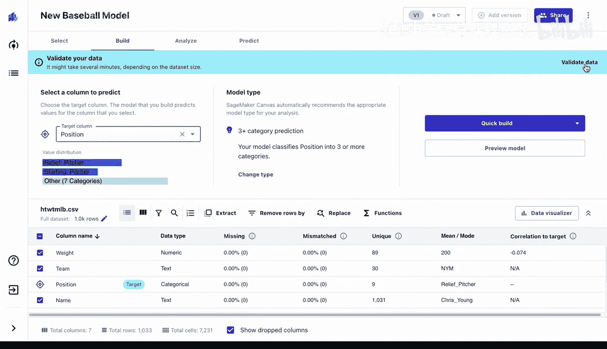
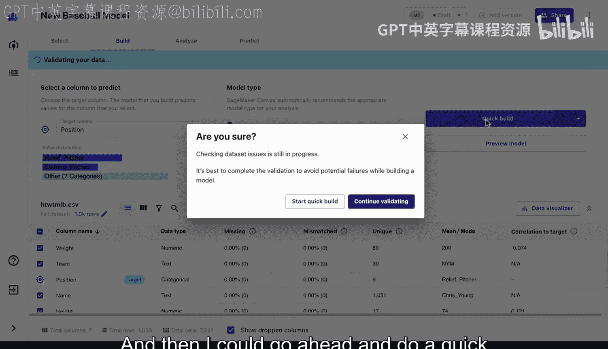
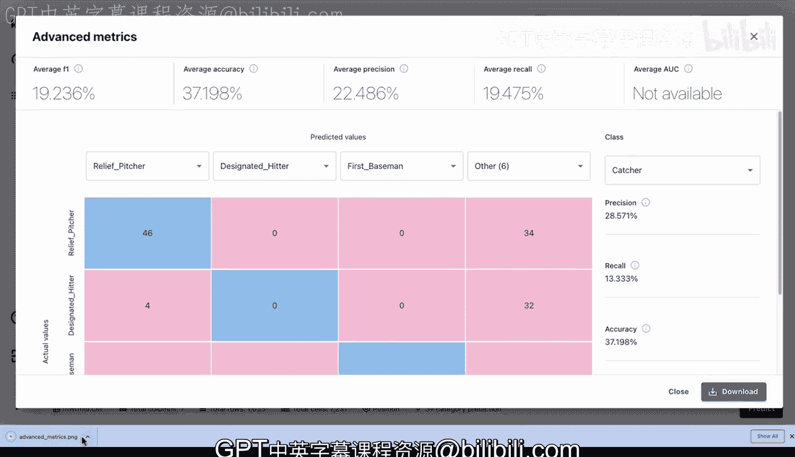

#  105：使用SageMaker Canvas进行建模演示 🧑‍💻

在本节课中，我们将学习如何使用亚马逊SageMaker Canvas这一低代码或无代码机器学习工具，来了解建模的基础组成部分。我们将从数据导入开始，逐步完成模型创建、数据探索、模型训练与评估的完整流程。

---

## 数据导入 📤

建模的第一个阶段是数据摄取。在SageMaker Canvas中，我们可以通过“导入”功能来加载数据。

以下是导入数据的两种主要方式：
*   从本地计算机拖拽文件。
*   从亚马逊S3存储桶中拉取数据。

例如，这里有一个关于美国职业棒球大联盟的数据集。要导入它，只需选中文件并点击“导入”按钮，系统便会开始导入数据。

---

## 数据探索与模型创建 🔍

数据导入完成后，我们就可以开始建模了。

首先，需要创建一个新模型，例如命名为“new baseball model”。接着，选择要使用的数据集，这里我们选择刚才导入的棒球数据。

这个工具的一个优点是，它能直观地展示数据的初步信息：
*   数据类型
*   是否存在缺失值
*   是否存在不匹配的值
*   唯一值的数量
*   平均值和众数

如果想进一步可视化数据，可以点击“可视化”。例如，我们知道身高和体重可能存在关联，数据可视化图表可以清晰地展示这一点。

此外，工具还支持类似Excel的函数功能，允许我们应用一些公式对数据进行处理。这是一个为机器学习构建的、具备强大数据可视化能力的好工具。

---

## 模型训练与初步构建 ⚙️

回到模型创建界面，我们需要选择要预测的目标列。例如，我们可以选择预测球员的“位置”。

系统显示“位置”包含多个类别，如救援投手、先发投手等。在开始训练前，可以先验证数据是否正确。

确认无误后，可以启动“快速构建”。该功能会尝试创建一个模型来预测所选的目标变量。由于我们已经预先运行过，现在可以查看一个已创建好的模型。

该模型显示，其正确预测位置的准确率为37%。

---

## 模型评估与指标解读 📊

我们可以深入查看模型对每个具体位置的预测效果。例如，查看“救援投手”的预测情况，发现这是模型预测效果较好的类别之一。

系统提供的“模型准确率洞察”功能，能以图表形式展示预测值与实际值的对比。对于“救援投手”，模型仅根据身高和体重就能在41%的情况下正确预测；而对于数据中实际是“救援投手”的样本，模型能正确识别出其中的73%。

我们还可以查看高级评估指标：
*   **F1分数**：兼顾精确率和召回率的平衡性指标。
*   **平均准确率**：所有预测中正确的百分比。
*   **平均精确率**
*   **平均召回率**
*   **平均AUC（曲线下面积）**

这些是不同的模型性能评估指标。工具甚至提供了每个指标的解释。例如：
*   点击“精确率”，它会说明：在所有被预测为“接球手”的情况下，预测正确的比例为28%。
*   点击“召回率”，它会说明：当实际位置是“接球手”时，模型能正确预测出其中的13%。

这是一个学习数据科学和机器学习概念的绝佳方式。通过这个工具，我们可以逐一探究每个指标的含义。界面中还展示了混淆矩阵，让我们能清楚地看到真阳性、假阳性等预测结果。

---

## 结果导出与应用 📥

最后，如果需要对结果进行进一步分析或展示，我们可以：
*   下载训练好的模型。
*   下载可视化图表，并将其集成到仪表板中。

---

本节课中，我们一起学习了如何使用SageMaker Canvas完成从数据导入、探索、模型训练到评估的完整机器学习建模流程。通过这个低代码工具，我们直观地理解了数据准备、模型选择及性能评估等核心概念，为深入学习机器学习运维打下了基础。