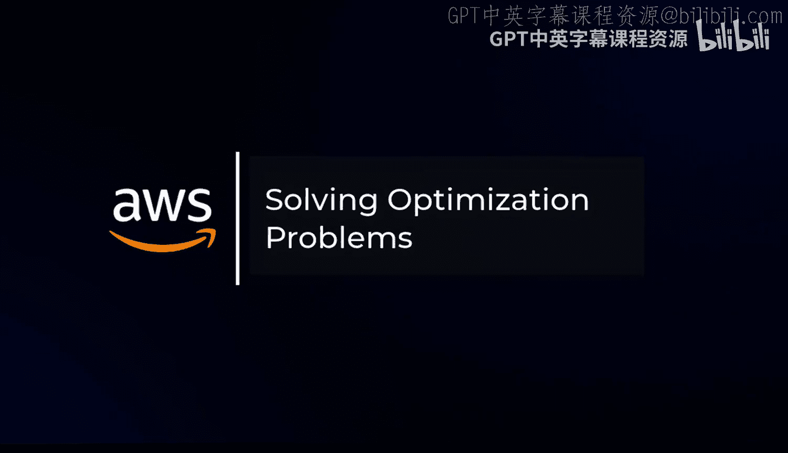
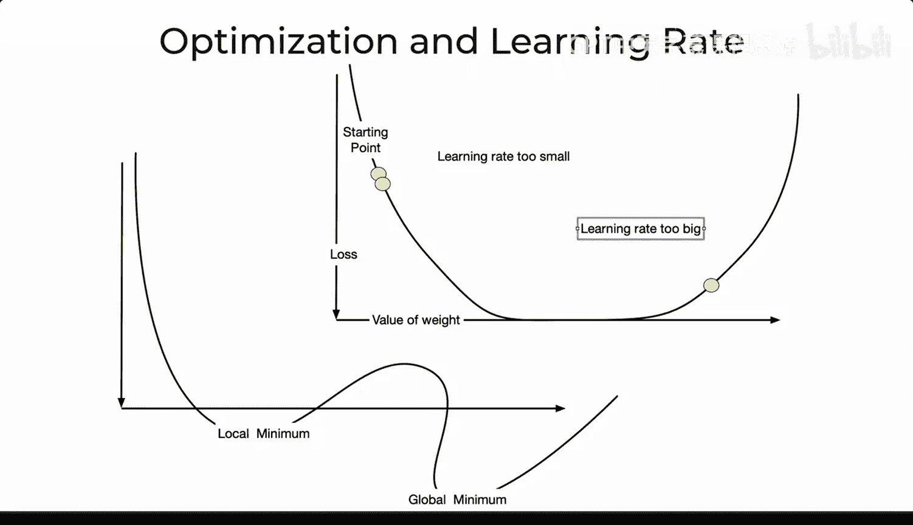

#  107：解决优化问题

在本节课中，我们将要学习深度学习中的一个核心概念：优化。我们将探讨在寻找问题最优解时可能遇到的挑战，例如局部最小值和全局最小值，并理解学习率在梯度下降过程中的关键作用。

## 理解局部最小值与全局最小值 🏔️

深度学习的一个基础问题是**优化**。让我们通过几个不同的场景来解释这个原理。

当你试图解决一个问题时，可能会遇到**局部最小值**和**全局最小值**。如果你被困在一个局部最小值中，你将无法获得最终的最佳解决方案。

在这个场景中，如果你缓慢下降并被困在这个局部最小值里，那么你最终将无法到达下方的这个全局最小值，也就无法获得可能的最佳解决方案。例如，这会影响你试图解决的分类问题的错误率。

理解这个问题的一个直观方法是想象在黑暗中走下山。你可能会被困在半山腰的某个湖泊里，那就是局部最小值。但如果你能到达最底部，那就是全局最小值。

## 梯度下降与学习率 📉

思考这个问题的另一种方式是考虑**梯度下降**问题。其核心是构建一个损失函数，你希望获得越来越高的准确率，即减少损失。最终，你需要确定**学习率**，也就是每次迭代中参数更新的步长。

以下是梯度下降的核心公式：
`新参数 = 旧参数 - 学习率 * 梯度`

在向下移动以寻找全局最小值的过程中，如果你设置的学习率太小，那么将需要很长时间才能到达解决方案，即找到全局最小值。反之，如果你采用的学习率太大，你可能会越过并跳过全局最小值。

因此，在解决深度学习问题时，需要考虑学习率的设定。你可以通过试错法来找到合适的学习率。一个非常好的工具是使用 **TensorFlow Playground**。它为你提供了一个绝佳的起点，让你可以尝试不同的学习率，并实验各种损失函数。

## 总结

本节课中我们一起学习了深度学习的优化基础。我们了解了在优化过程中，模型可能会陷入局部最小值而非找到全局最优解。同时，我们探讨了梯度下降法中**学习率**的关键作用：过小的学习率会导致收敛缓慢，而过大的学习率则可能使算法无法收敛。最后，我们提到了使用像TensorFlow Playground这样的工具进行实验是理解和调整这些超参数的有效方法。