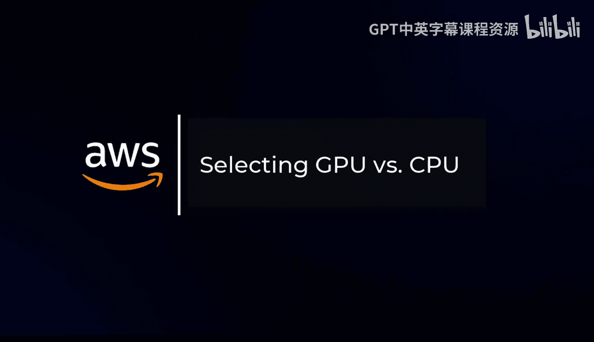
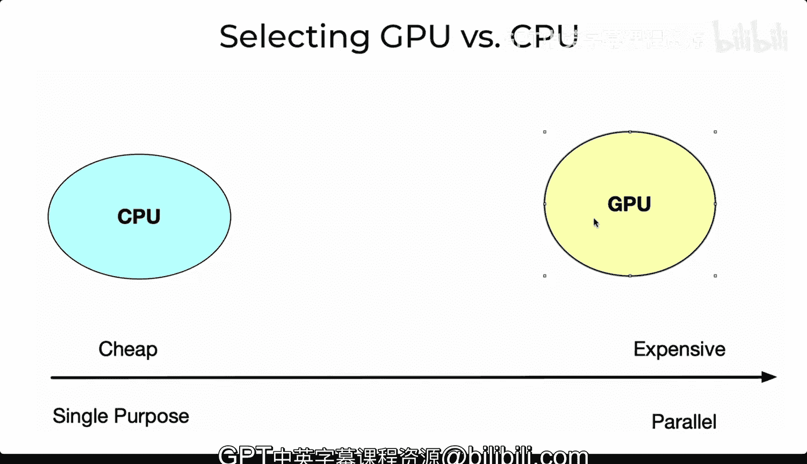

#  108：选择GPU与CPU 🚀

在本节课中，我们将探讨如何为你的训练任务或推理任务选择合适的处理器：是使用GPU还是CPU。理解两者的核心差异和适用场景，对于优化机器学习项目的成本与效率至关重要。

---

## CPU与GPU的核心差异 💡

上一节我们介绍了选择处理器的重要性，本节中我们来看看CPU和GPU各自的特点。CPU（中央处理器）是一种通用、成本较低的芯片。它擅长处理顺序任务和通用计算。

**CPU的特点可以概括为：**
`CPU = 低成本 + 通用计算 + 顺序处理`

相比之下，GPU（图形处理器）则专为并行处理设计。它拥有大量核心，能够同时执行大量相同的计算任务，但成本通常更高。

**GPU的特点可以概括为：**
`GPU = 高成本 + 专用计算 + 并行处理`

---

## 如何做出选择：权衡与考量 ⚖️

了解了基本概念后，我们来看看在实际项目中如何做出选择。这主要取决于你所要解决的问题类型、对速度的要求以及预算限制。

以下是做出选择时需要考虑的关键因素：

*   **任务性质**：如果你的任务涉及大量独立的、可并行化的计算（例如矩阵运算，这在深度学习训练中非常常见），GPU是更优的选择。如果任务更偏向逻辑控制、串行处理或通用计算，CPU可能就足够了。
*   **时间要求**：如果任务对完成时间不敏感，可以接受较长的处理时间（例如一些可批量处理的后台任务），那么使用成本更低的CPU是合理的。
*   **性能需求**：如果任务要求极高的处理速度，尤其是进行大规模并行操作时，GPU能显著加速训练或推理过程，其带来的时间节省可能远超其额外的成本。

---

## 总结 📝

本节课中我们一起学习了如何为机器学习任务选择GPU或CPU。核心在于理解**CPU适用于成本敏感、顺序处理的通用任务**，而**GPU则专为需要大规模并行计算的高性能场景设计**。在实际决策时，请综合考虑你的任务性质、时间限制和性能需求，在成本与效率之间找到最佳平衡点。