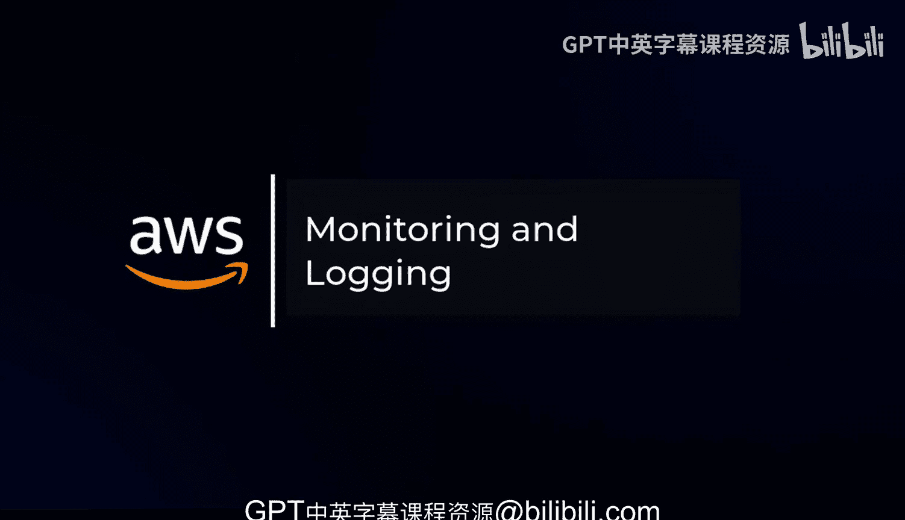
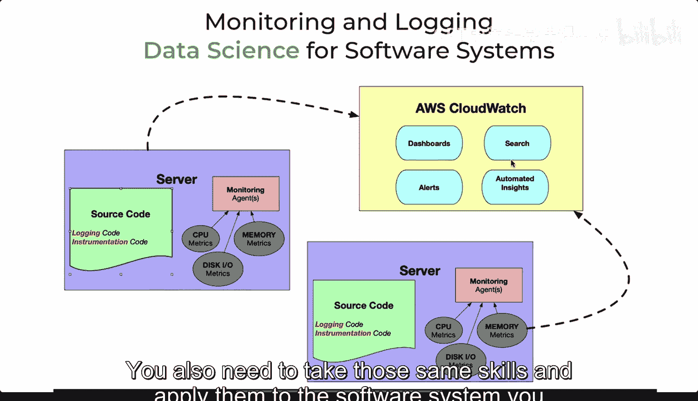
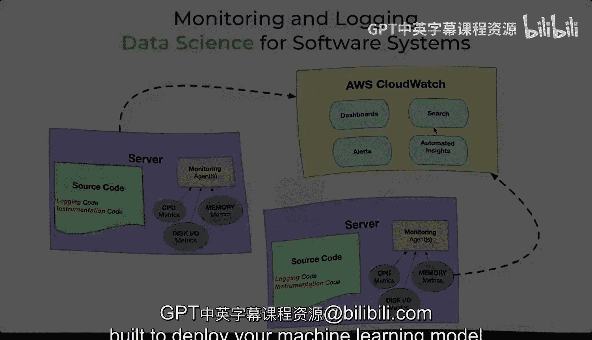

#  113：监控与日志记录 📊

在本节课中，我们将要学习机器学习运维中一个至关重要的环节：监控与日志记录。我们将探讨如何将其视为“软件系统的数据科学”，并了解实施监控的关键组成部分。

## 概述：监控与日志记录

监控与日志记录是确保生产环境中机器学习系统稳定、可靠运行的基础。我们可以将其理解为**软件系统的数据科学**。

这意味着，尽管你正在进行机器学习运维并将模型部署到生产环境，你同样需要关注你所使用基础设施的“数据科学”。对于一个服务器系统，其源代码、添加的日志记录以及代码中的性能埋点（例如，执行一次预测所需的时间）都是重要的信息来源。

## 监控的核心要素

上一节我们介绍了监控的基本概念，本节中我们来看看构成有效监控的几个核心部分。

以下是监控代理通常需要收集的关键指标：

*   **CPU使用率**：监控服务器的计算资源消耗。
*   **内存使用量**：跟踪系统的内存占用情况，防止内存泄漏。
*   **自定义性能指标**：例如，通过代码埋点记录的模型预测延迟，公式可表示为 `预测延迟 = 请求结束时间 - 请求开始时间`。

## 可视化与管理工具

了解了需要监控什么之后，我们来看看如何查看和管理这些数据。

你可以使用如 **AWS CloudWatch** 这类工具来实现监控。通过它，你可以：

*   拉起一个仪表盘，直观地查看各项指标。
*   设置并查看警报，及时响应异常。
*   在特定系统中搜索日志，进行问题排查。
*   获取来自 CloudWatch 系统的自动化洞察报告。

因此，将监控与日志记录视为软件系统的数据科学，是理解其价值的最佳方式。你必须建立监控与日志记录机制，才能了解系统中正在发生什么，并获得系统的可观测性。

## 总结

本节课中我们一起学习了机器学习运维中的监控与日志记录。我们认识到，拥有数据科学这样的严谨学科思维是很好的，作为一名数据科学家，你需要将同样的技能应用到你构建的软件系统上，通过监控和日志来确保其健康运行。

