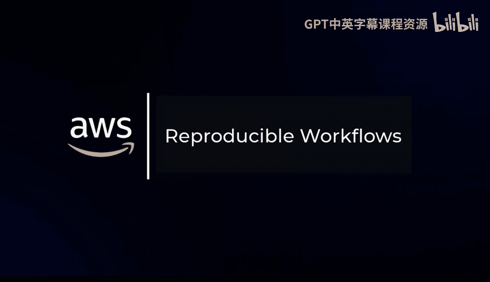
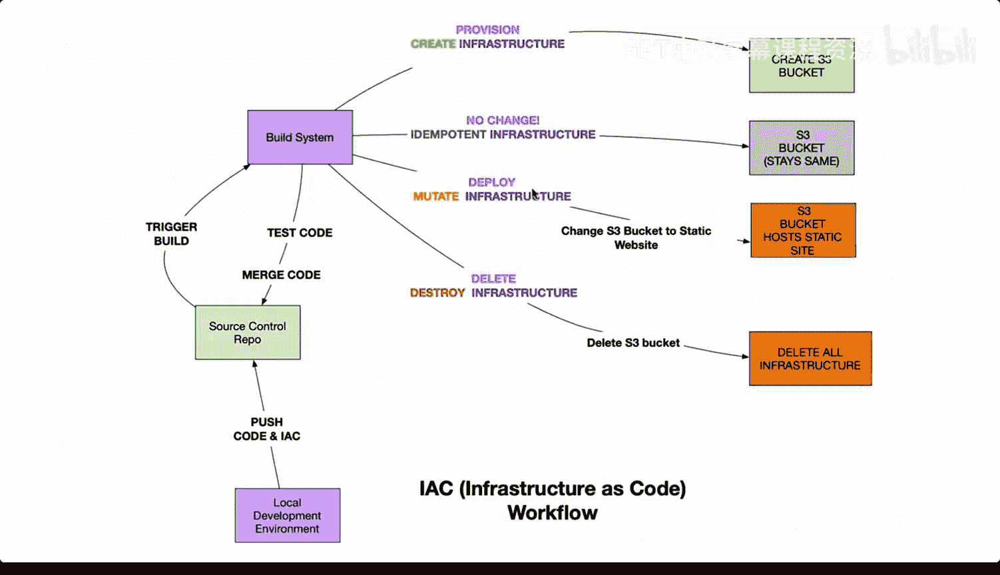
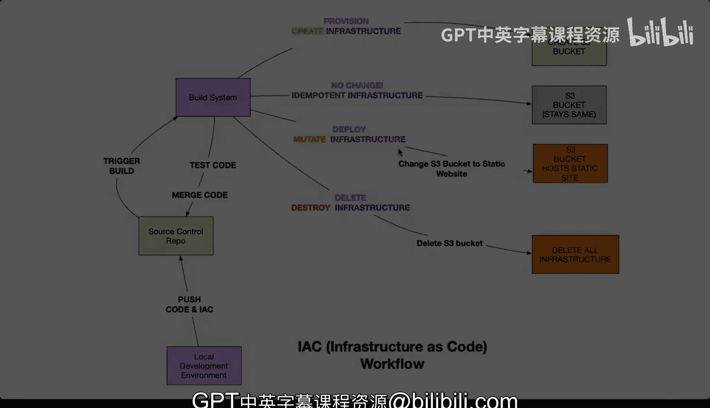

#  115：可复现工作流

在本节课中，我们将要学习可复现工作流的概念，特别是“基础设施即代码”的核心思想。我们将了解如何通过代码来定义和管理基础设施，从而实现自动化、一致且可追踪的部署流程。

## 什么是可复现工作流？ 🧱

一个可复现的工作流包含了“基础设施即代码”的理念。

除了构建系统和源代码仓库等组件外，可复现工作流的核心在于将基础设施的配置和管理也通过代码来实现。

## 基础设施即代码工作流 🔄

上一节我们介绍了可复现工作流的基本概念，本节中我们来看看一个具体的“基础设施即代码”工作流是如何运作的。

在这个工作流中，我们从基于云的开发环境（如 Cloud 9）或本地开发环境（如 GitHub Codespaces）开始，然后执行测试、合并、触发构建的流程。

这个流程会测试我们的代码，确保代码规范检查（Linting）正常工作，并确保部署系统能够运行。

## 基础设施即代码的运作原理 ⚙️

在后台，“基础设施即代码”工具负责实际创建和管理基础设施。

以下是其运作的几个关键点：

*   **创建基础设施**：例如，它可以创建一个亚马逊 S3 存储桶。
*   **维持状态**：如果在下一次部署时配置没有变化，它将保持 S3 存储桶的现有状态不变。
*   **变更基础设施**：如果你需要做出更改，例如将 S3 存储桶配置为静态网站，你可以部署一个变更配置的代码，工具会相应地修改基础设施。
*   **销毁基础设施**：如果你需要删除之前的变更，你可以通过代码指令来销毁基础设施，例如删除一个 S3 存储桶。

## 核心理念总结 🎯

“基础设施即代码”的根本理念在于，**不是由人工点击按钮来触发操作，而是由代码来驱动一切**。这确保了整个过程是可版本控制、可重复且不易出错的。

本节课中我们一起学习了可复现工作流及其核心实践“基础设施即代码”。我们了解了如何通过代码自动化地管理基础设施的创建、更新和销毁，从而构建出可靠、一致且高效的机器学习运维流程。