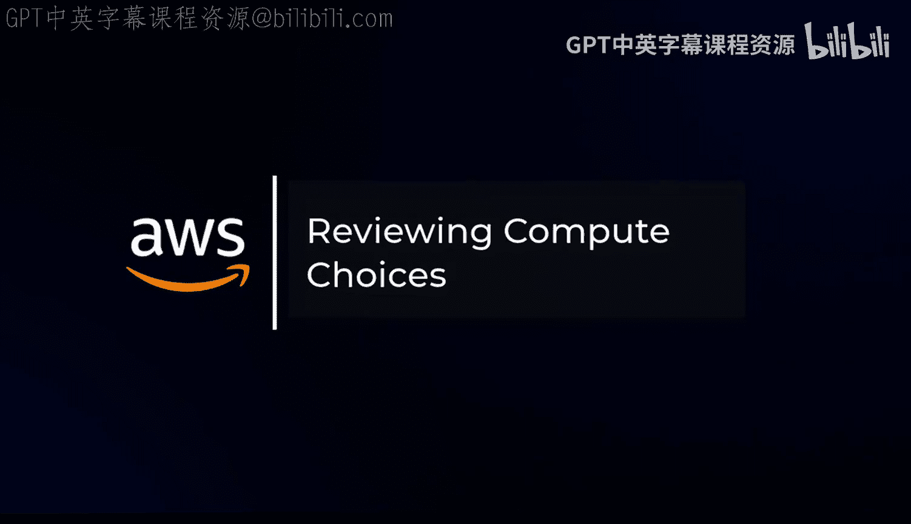
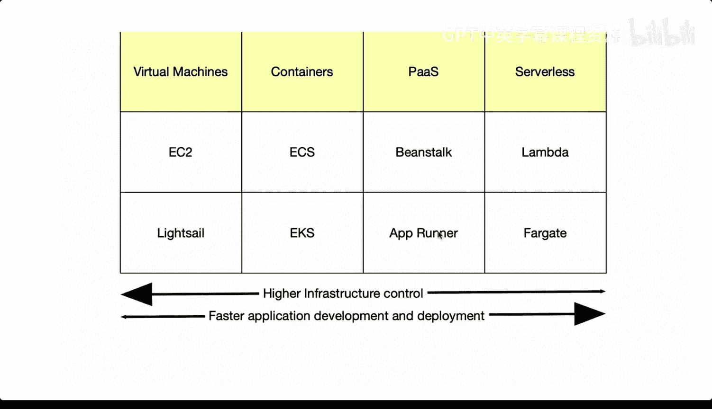

#  117：回顾计算选项

在本节课中，我们将回顾机器学习应用部署时可用的不同计算选项。我们将探讨从虚拟机到无服务器架构的演变，并分析每种方案在基础设施控制与开发部署速度之间的权衡。

## 基础设施控制与开发速度的权衡

上一节我们介绍了机器学习运维的基本概念，本节中我们来看看部署应用时可选择的不同计算环境。下图展示了从高基础设施控制到快速应用开发与部署的演变过程。

图中左侧代表**虚拟机**。这些可以是轻量级的销售型实例。随着我们向**无服务器**架构演进，会依次经过**容器**和**平台即服务**。最终，在像 **Lambda** 和 **Fargate** 这样的无服务器方案中，开发者无需管理太多基础设施，只需构建业务逻辑并将其投入生产。

## 不同计算选项的职责划分

以下是不同计算模式下开发者的职责对比：

*   **虚拟机与容器**：开发者需要管理操作系统、运行时环境、依赖项以及应用代码，拥有最高的控制权。
*   **平台即服务**：开发者仍需进行少量工作，例如在应用中放置配置文件，但平台会承担大部分基础设施管理工作。
*   **无服务器**：开发者几乎不管理基础设施，主要专注于编写和部署函数或应用逻辑。

## 如何为机器学习应用选择计算选项

因此，作为开发者，在构建机器学习应用时，选择取决于你的具体需求。如果你希望更专注于业务逻辑而非底层运维，可以倾向于使用无服务器选项。如果你需要执行底层定制或对运行环境有特殊要求，则可能更倾向于使用虚拟机和容器。

对于你正在构建的每一个具体方案，都需要选择能够解决你当前问题的最合适的配置。

---

本节课中我们一起学习了从虚拟机到无服务器等多种计算选项。关键在于理解在**基础设施控制权**和**应用开发部署速度**之间存在的权衡关系，并根据机器学习项目的具体需求，在**虚拟机**、**容器**、**平台即服务**和**无服务器**等方案中做出明智选择。