#  120：AWS AI与ML服务 🚀

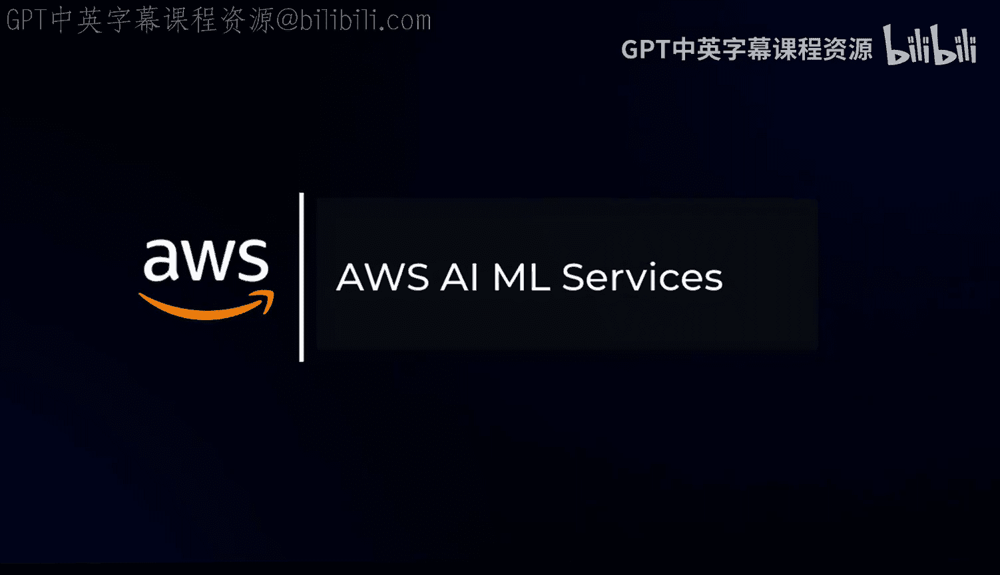

在本节课中，我们将学习AWS（亚马逊云科技）平台提供的一些核心机器学习服务。我们将通过控制台和代码两种方式，探索如何利用这些服务进行自然语言处理和图像分析等任务。

---

## 探索AWS机器学习服务

上一节我们介绍了机器学习运维的总体概念，本节中我们来看看AWS平台提供的具体服务。访问AWS控制台的“服务”菜单并找到“机器学习”部分，是了解平台能力的好方法。AWS提供了一些高级服务，值得首先了解。

## 使用AWS Comprehend进行自然语言处理 🌐

第一个值得关注的服务是AWS Comprehend。该服务可用于自然语言处理任务。一种使用方式是通过其内置的分析功能。

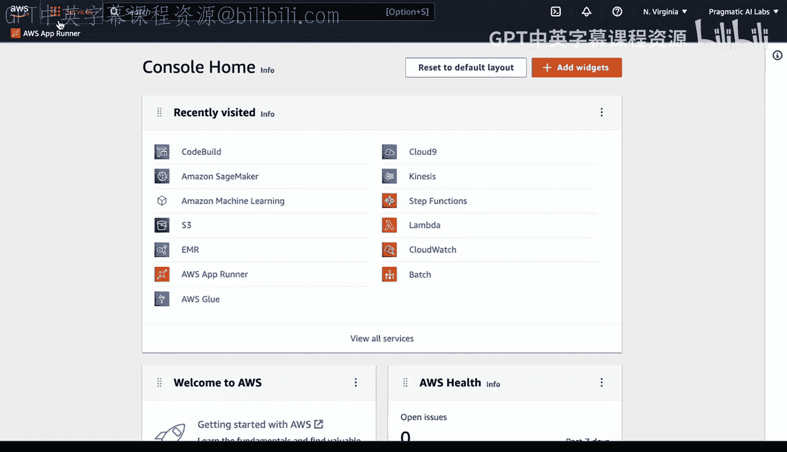

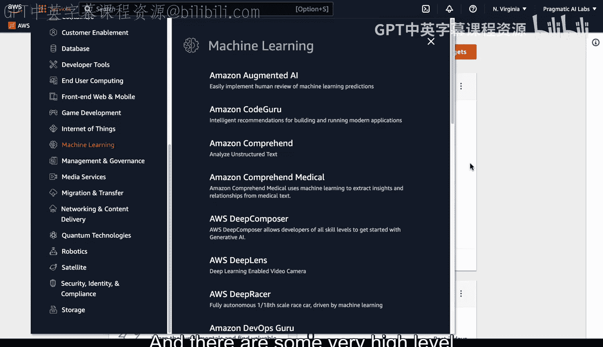

例如，输入文本“This is a great day.”并进行分析。


分析后，服务能够识别关键短语、检测语言、查找是否存在个人身份信息，并判断情感倾向的置信度。在本例中，这是一条非常积极的信息。


这是一个非常实用的服务，并且可以轻松地从控制台调用。此外，也可以通过Cloud Shell环境使用SDK进行调用。

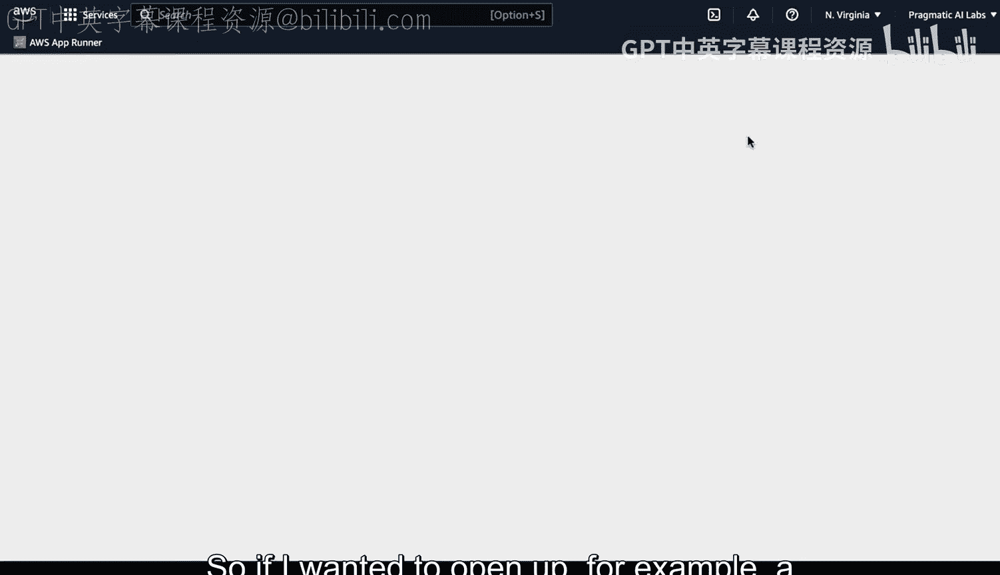


打开Shell并开始使用SDK也是一种很好的方式。我们可以让Shell保持运行，然后继续探索其他服务。

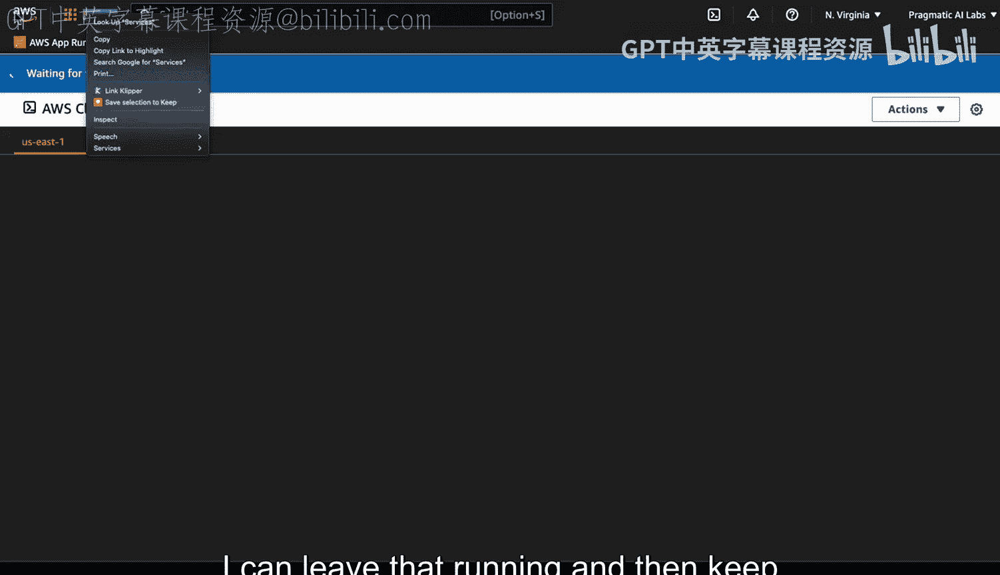


## 使用Amazon Rekognition进行图像分析 🖼️

回到机器学习服务列表，另一个可以体验的高级服务是Amazon Rekognition。该服务展示了AWS在图像分析方面的能力。

该服务可以用于检测标签、进行面部分析、识别图像中的文字等。所有这些功能都可以在控制台中通过上传文件直接体验。

例如，从桌面选择一张猫咪图片并上传到指定位置。

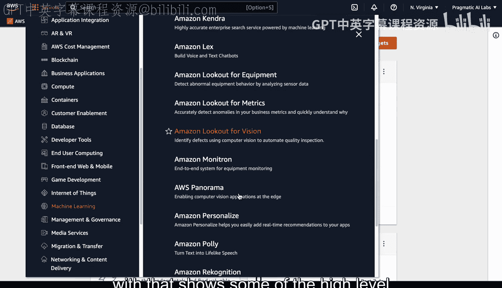


服务能够成功识别出这是一只猫，并提供其他相关标签。同样，我们也可以通过API调用来使用此服务。例如，使用Python解释器构建解决方案。

## 通过Boto3 SDK以编程方式调用服务 💻

那么，如何通过编程方式调用这些服务呢？一种方法是使用AWS的Python SDK——Boto3。

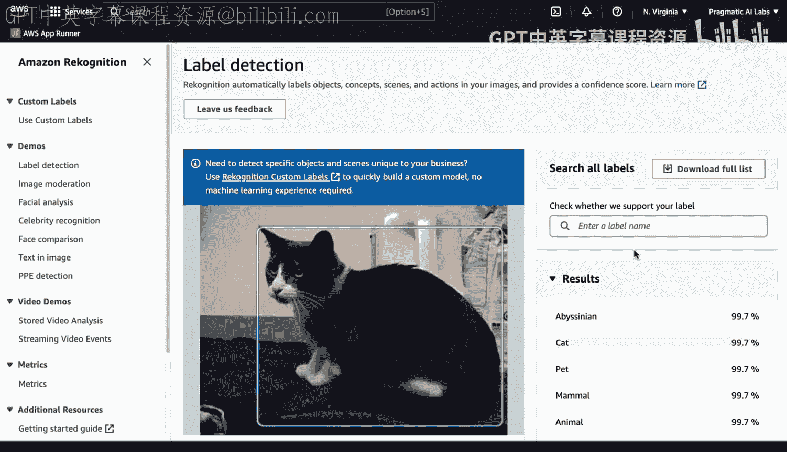
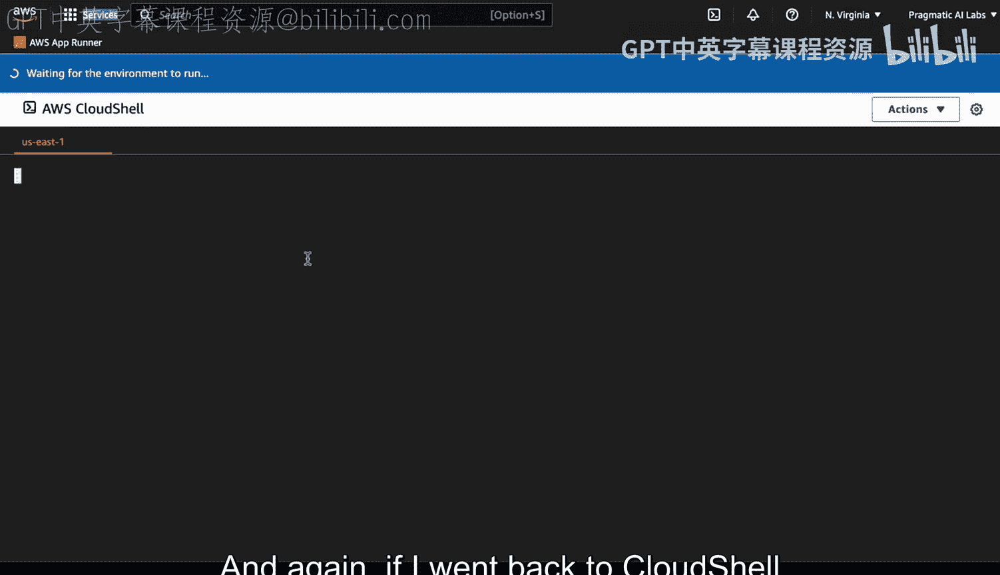

可以查找你试图使用的特定服务。以Comprehend为例，使用该服务的方式相当直接。创建客户端只需一行代码。


如果想进行情感分析，可以找到相应的方法。整个过程非常直观。


我们可以回到Cloud Shell，输入`ipython`进入交互式环境。

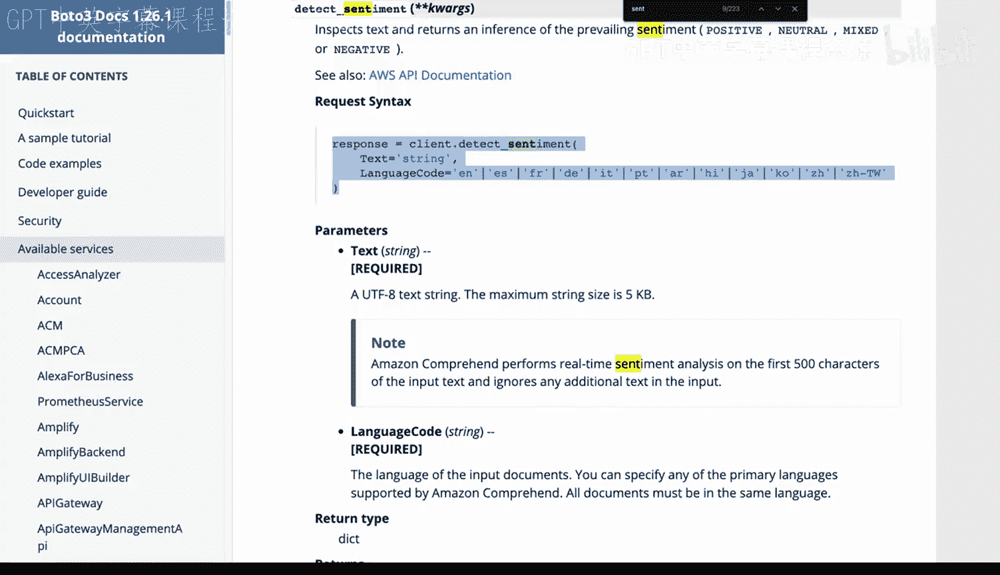

检查Boto3是否已加载，并导入它，然后创建Comprehend客户端。

以下是调用情感分析的核心代码示例：

```python
import boto3

# 创建Comprehend客户端
client = boto3.client('comprehend')


# 定义要分析的文本
text = "This is a great day."

# 调用情感分析API
response = client.detect_sentiment(
    Text=text,
    LanguageCode='en'
)

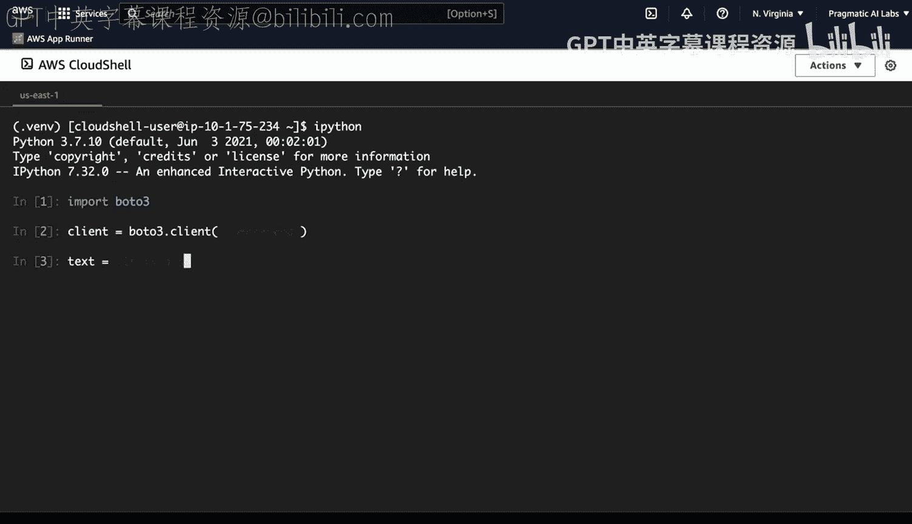

# 查看响应结果
print(response['Sentiment'])
```

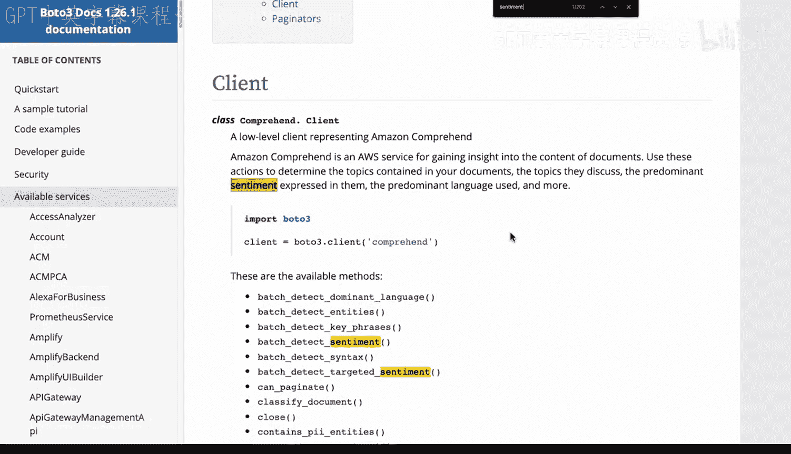

执行后，我们将得到一个积极的情感判断。


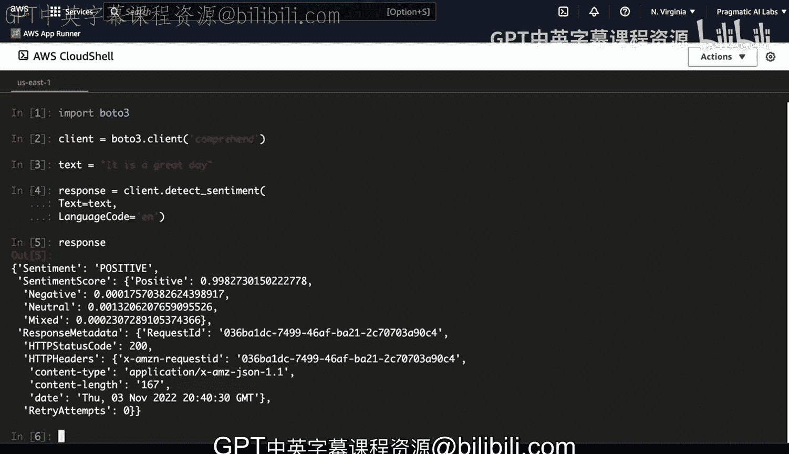

因此，无论是通过控制台界面，还是通过Cloud Shell环境使用SDK，都是使用AWS机器学习服务的有效方式。

---

## 总结


本节课中，我们一起学习了AWS平台上的两项核心机器学习服务：用于自然语言处理的**AWS Comprehend**和用于图像分析的**Amazon Rekognition**。我们通过控制台界面直观体验了它们的功能，并学习了如何使用**Boto3 SDK**以编程方式调用这些服务，特别是完成了情感分析的代码示例。这些高级服务让开发者能够快速集成强大的AI能力，而无需深入底层模型的细节。