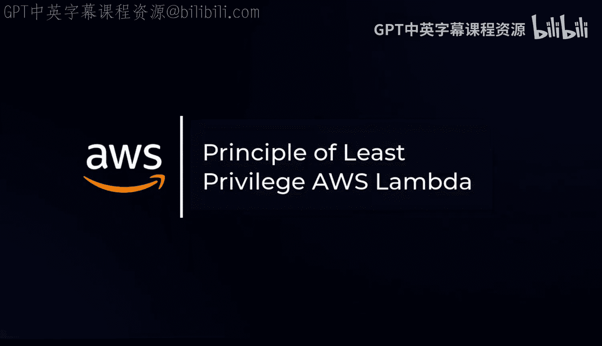
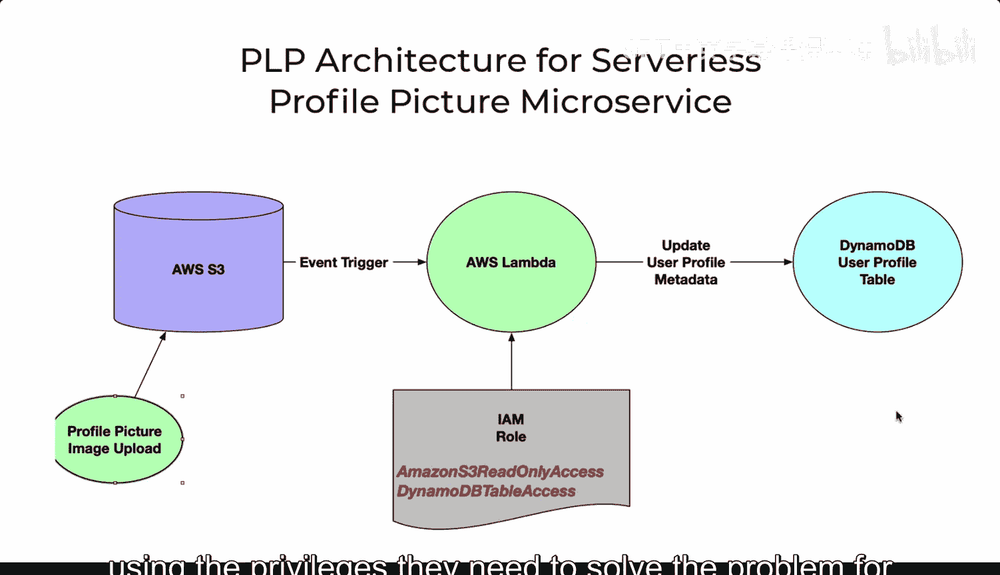

#  121：最小权限原则与AWS Lambda 🛡️

在本节课中，我们将要学习无服务器架构中的**最小权限原则**，并了解如何将其应用于AWS Lambda微服务，以构建更安全的机器学习系统。

---

上一节我们介绍了无服务器架构的基本概念，本节中我们来看看如何在这种架构中实施安全策略。

这里展示的是无服务器架构中的最小权限原则设计。

在这个特定的微服务中，你可以看到，Lambda微服务仅被授予从S3读取数据的权限，以及访问DynamoDB表的权限。

这样做的好处是，它允许我们精确地限制这个微服务的能力，使其只能执行其功能所必需的操作。

它没有被赋予额外的职责，这使其安全性大大提高。

以下是该微服务的工作流程：

1.  一张图片被上传并放入S3存储桶。
2.  这个操作会触发这个Lambda函数。
3.  随后，这个Lambda函数会执行并更新用户资料。

这可以是一个机器学习系统的一部分。系统后续可能会应用某种预训练模型来处理S3中加载的这些图像，然后进行某种图像处理或为图像识别标签。

核心思想是，在系统开发的所有部分中，每个组件都只使用解决其特定微服务问题所必需的权限。

---

本节课中我们一起学习了最小权限原则在AWS Lambda无服务器架构中的应用。通过为每个微服务精确配置仅需的权限（例如仅访问特定的S3和DynamoDB），我们可以有效限制其能力范围，减少潜在的安全风险，从而构建出更安全、职责更分明的机器学习系统。