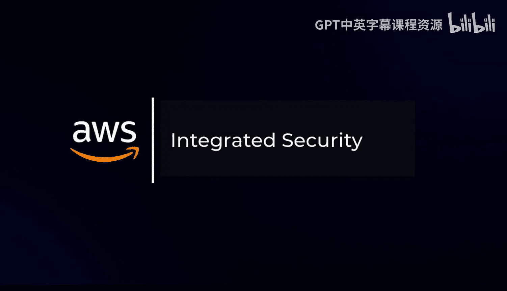
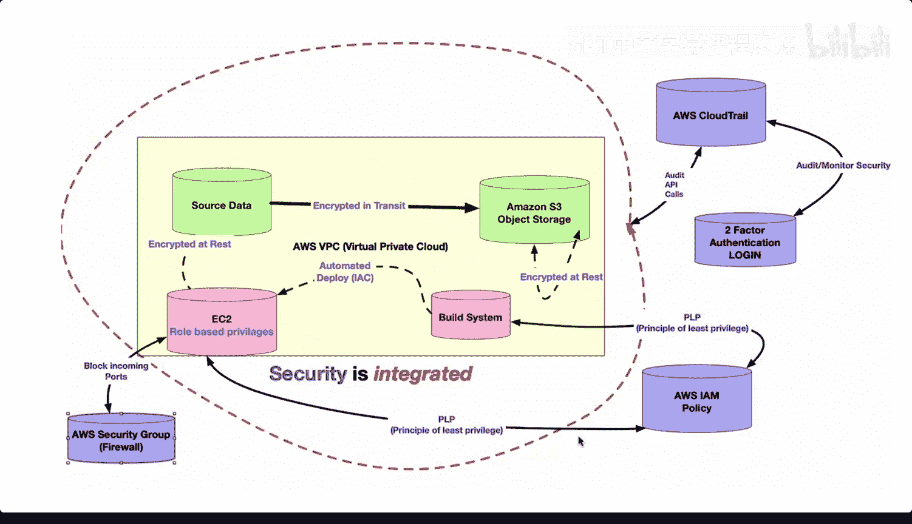

#  122：集成安全性 🔐

在本节课中，我们将学习如何为机器学习系统构建一个集成的安全体系。我们将以AWS云平台为例，剖析一个设计良好的网络如何通过多层次的安全措施来保护数据和资源。

---

上一节我们介绍了安全的重要性，本节中我们来看看一个具体的集成安全架构图。

上图展示了一个AWS的集成安全示意图，它揭示了一个正确构建的网络如何通过多种不同的安全层来发挥强大的防护能力。

以下是构成这个集成安全体系的核心组件：

*   **网络防火墙**：AWS安全防火墙能够阻止未经授权的入站端口访问，这是第一道防线。
*   **基于角色的权限控制**：从图中EC2实例部分可以看到，我们采用了基于角色的权限管理。这将有效限制攻击面。
*   **数据加密**：
    *   **静态数据加密**：数据在存储时（如EBS卷中）处于加密状态。
    *   **传输中数据加密**：数据在传输过程中（例如，从EBS存储传输到S3存储时）也进行端到端加密。
*   **虚拟私有云**：整个系统被部署在一个虚拟私有云内部，提供了逻辑上的网络隔离。
*   **基础设施即代码**：由于我们使用自动化部署或基础设施即代码，因此无需担心因手动操作而引入的错误。
*   **集成监控系统**：监控系统能够与此安全体系集成，实现全方位的可观测性。

---

了解了基础防护层后，我们进一步看看如何通过监控和策略来加强安全治理。

这个集成安全系统还包含以下高级监控与合规功能：

*   **API调用审计**：通过AWS CloudTrail，我们可以查看所有API调用记录，从而深入审视网络中发生的每一个操作。
*   **账户访问控制**：登录控制台账户时，可以启用双因素认证。我们还能审计和监控具体是谁登录了账户。
*   **最小权限原则**：借助AWS IAM策略，我们可以实施最小权限原则。这意味着：
    *   构建系统仅拥有执行部署所必需的确切权限。
    *   服务本身也仅拥有其运行所需的确切权限，因为它使用的是基于角色的权限。

---

本节课中我们一起学习了集成安全的概念。这种集成的安全理念，结合了网络防护、数据加密、权限管理和持续监控，是设计一个安全网络的关键基础。它确保了从基础设施到应用层的每一个环节都受到保护，是构建可靠机器学习运维体系不可或缺的一环。