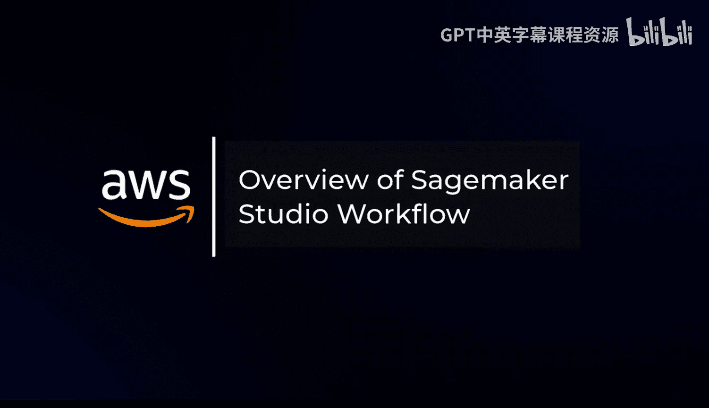
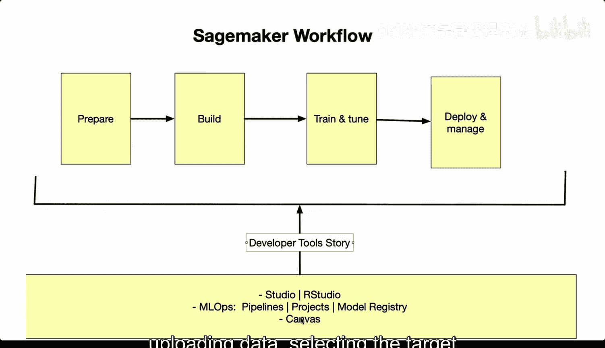
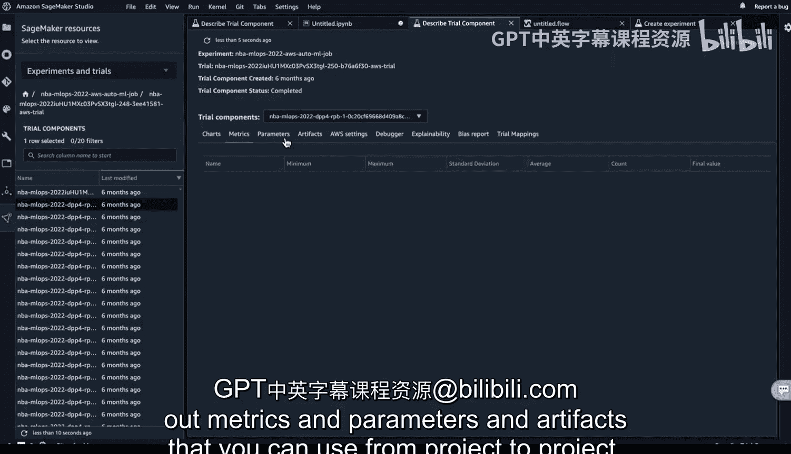

#  123：SageMaker Studio 工作流概述 🚀

在本节课中，我们将学习亚马逊 SageMaker Studio 的工作流概览。我们将了解从数据准备到模型部署与管理的完整流程，并探索 SageMaker Studio 提供的各种开发工具和环境。

---

## AWS 上的 SageMaker 工作流

下图展示了一个在 AWS 上的典型 SageMaker 工作流。

工作流始于数据准备，随后是数据构建。接着，通过训练和调优确保模型正确性。之后是模型部署，并在生产环境中管理该模型。管理内容包括处理模型的特定版本、进行 A/B 测试、针对该模型进行预测，以及判断何时应执行重新训练任务（例如，应对数据漂移问题）。

这构成了完整的开发者工具链故事。

---

## SageMaker 工具套件分类

除了核心工作流，还有一整套工具，可按机器学习应用的不同方面进行分类。

在 **Studio** 范畴内，不仅包含常规的 SageMaker Studio，还有其集成版本。工具主要分为三类：**管道（Pipelines）**、**项目（Projects）** 和 **模型注册表（Model Registry）**。

此外，还有 **Canvas**。这是一个高度商业智能化的无代码/低代码工具，允许您通过上传数据、选择目标列然后进行预测来构建机器学习解决方案。

---

## Amazon SageMaker Studio 开发环境

Amazon SageMaker Studio 是一个对开发者友好的环境，用于构建机器学习应用程序。

一个很好的起点是 **启动器（Launcher）**。您可以通过它快速启动模型算法解决方案。

您也可以通过创建 **AutoPilot 实验** 来自动构建模型。操作方式是输入实验名称和数据位置，然后开始执行。

---

## 数据导入、探索与可视化

您可以执行的另一项操作是导入和探索数据。如果选择此选项，其优势在于允许您从环境中已有的任何数据开始，通过点击操作构建解决方案，从而启动数据可视化流程。

---

## 启动菜单中的任务与组件

如果您查看此处的启动菜单，还可以浏览不同的任务和组件。

例如，构建数据流、新建编译任务或新建项目。所有这些选项都会显示出来。

您也可以更深入细节，或者直接启动一个笔记本，从头开始构建解决方案。这涵盖了项目开始时您可能需要做的任何事情。

---

## 实验跟踪与资源复用

总的来说，SageMaker Studio 提供了一整套工具。这些启动菜单是一个很好的起点，但它也允许您查看之前的实验和试验。

这种**实验跟踪**也是一个极好的资源，您可以利用它来构建指标、参数和工件，并在不同项目之间复用。

---

## 总结

本节课中，我们一起学习了 Amazon SageMaker Studio 的端到端工作流，涵盖了从数据准备到模型部署与监控的各个环节。我们还介绍了 SageMaker 提供的各类工具，特别是 Studio 环境中的启动器、数据探索、自动化建模以及实验跟踪功能，这些工具共同为高效构建和管理机器学习应用提供了支持。